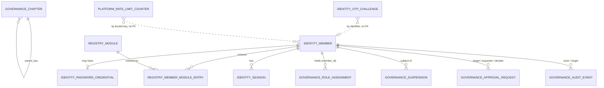

# Parent Application Data Model (Identity & Trust database)

**Document status 2026-11-22, as built.** Authoritative sources: migrations `platform/identity-service/db/migrations/001` to `007` and bootstrap `db/000-bootstrap.sql`, cross-checked read-only against the live development database `forkhatri_identity` (psql as `identity_app`: 12 tables listed, matching this document; 136 members, 4 audit events, 4 role assignments at inspection). The service has no `schema.sql`; migrations are the only schema source (see Known drift). API view: [API-REFERENCE.md](API-REFERENCE.md).

## Revision history

| Date | Change | Reason |
|---|---|---|
| 2026-09-13 | Static page introduced no database; future parent records listed. | First reviewable parent slice. |
| 2026-09-14 | Replaced with the actual Identity & Trust Service schema (migrations 001, 002). | Product-owner instruction, 2026-09-14; TR10-TR20. |
| 2026-09-14 | `home_locality` removed (003). | Owner rule: platform holds basic identity only. |
| 2026-11-22 | Rewritten as built: adds migrations 004-007 (governance schema, `dev` auth method, Mangalya name, Marathi and Kannada), all columns, ER diagram, functions, retention, drift. The 2026-09-14 text on the 7 original tables remains valid and is folded in below; its statement "preferred_language en/hi/te" and "three schemas" is **superseded** (now five languages and four schemas). | Owner request 2026-11-22: documentation must match the application as built. |

## 1. Database and roles

Postgres 18 on `localhost:5433`, database `forkhatri_identity` (isolated: only this service connects, ADR-002). Roles: `identity_owner` (owns objects, runs migrations), `identity_app` (runtime, non-owning, least privilege). Four schemas: `identity`, `registry`, `platform`, `governance`. Migrations are idempotent and applied in numeric order by hand or by `deploy/migrate`. At startup the service refuses to run if its role owns objects (`assert_non_owning_role`).

## 2. ER diagram

Soft links (no foreign key): `role_assignment.scope_key` points to a `registry.module.key` (module scope) or `governance.chapter.key` (chapter scope); `role_assignment.approval_id` and `suspension.approval_id` point to `approval_request.id`; `audit_event.module_key` is free text. `otp_challenge.identifier` equals `member.phone_e164` or `member.email`.

## 3. Tables

Types: `identity.member_status` enum (`active`, `suspended`, `deleted`); `identity.otp_channel` (`sms`, `email`); `identity.auth_method` (`otp`, `password`, `dev` added by 004).

### TBL-identity.member
Canonical member; PII: phone, email. Columns: `id` uuid PK default `gen_random_uuid()`; `display_name` text not null, 1-80 chars after trim; `phone_e164` text unique, check `^\+[1-9][0-9]{7,14}$`; `email` text unique, check lower-case and contains `@` after position 1; `preferred_language` text not null default `en`, check in (`en`,`hi`,`te`,`mr`,`kn`) (widened by 007); `identity_level` smallint not null default 1, check 0-2; `status` member_status default `active`; `created_at`, `updated_at` timestamptz default now(). Constraint `member_has_identifier`: phone or email present. (`home_locality` dropped by 003.) Notes: level 0 = provisioned, number unproven; level 1 = verified identifier; level 2 = reserved, no code path sets it. No code raises 0 to 1 after a first verified sign-in (CRITIQUE-platform C4). Live: 136 rows. Grants: SELECT, INSERT, UPDATE (no DELETE).

### TBL-identity.password_credential
`member_id` uuid PK, FK member ON DELETE CASCADE; `password_hash` text, check `LIKE '$argon2id$%'`; `created_at`, `updated_at`. Secondary credential; only import and seed scripts create rows (no API to set one). Grants SELECT, INSERT, UPDATE.

### TBL-identity.otp_challenge
`id` uuid PK; `identifier` text (normalised phone or email); `channel` otp_channel; `code_hmac` text (HMAC-SHA256 keyed by `OTP_PEPPER` over `challenge_id:code`); `attempt_count` int default 0; `max_attempts` int default 5; `expires_at` timestamptz; `verified_at`; `consumed_at`; `created_at`. Index `idx_otp_challenge_identifier (identifier, created_at DESC)`. No FK (member may not exist yet). Retention: no purge job exists, rows accumulate (gap, see section 7).

### TBL-identity.session
`id` uuid PK; `member_id` FK member ON DELETE CASCADE; `token_hash` bytea unique (SHA-256 of the 256-bit token); `auth_method` auth_method; `user_agent` text (truncated to 300 chars by the service); `created_at`; `last_seen_at` (refreshed at most every 5 minutes); `expires_at` (created + `SESSION_TTL_DAYS`); `revoked_at`. Index `idx_session_member (member_id)`. Live: 951 rows. Retention: expired and revoked rows are never deleted (gap).

### TBL-platform.rate_limit_counter
PK (`bucket_key` text, `window_start` timestamptz); `hit_count` int. Written by an upsert-increment per hit; one in 200 hits deletes rows older than one day. Grants include DELETE (the only table with DELETE for `identity_app`).

### TBL-registry.module
`key` text PK check `^[a-z][a-z0-9_]{1,30}$`; `name`; `tagline_en`, `tagline_hi`, `tagline_te` not null; `tagline_mr`, `tagline_kn` nullable (007; reads use `COALESCE(tagline_<lang>, tagline_en)`); `availability` check in (`available`,`in_development`,`planned`); `accent` check `^#[0-9a-fA-F]{6}$`; `sort_order` smallint; `updated_at`. Grants: SELECT, plus column UPDATE (`availability`, `updated_at`) from 005. Reference rows (002, upserted): `mangaly` (display name Mangalya since 006) available/10, `milavn` available/20, `vyapar` in_development/30, `counsel` available/40 (002 seeds `available`; older doc said planned: the Counsel module is live), `payments` planned/50, `finance` planned/60. Note: the live availability values are set by admins through `PATCH /v1/admin/modules/{key}` and can differ from migration text; the live table is the truth (verify with `SELECT key, availability FROM registry.module`).

### TBL-registry.member_module_entry
PK (`member_id` FK member cascade, `module_key` FK module); `first_entered_at`, `last_entered_at`, `entry_count` int default 1. Hub ordering and "continue". Not an access list. Grants SELECT, INSERT, UPDATE.

### TBL-governance.chapter
`key` text PK check `^[a-z0-9][a-z0-9-]{1,60}$`; `name` 2-80; `kind` in (`state`,`city`); `parent_key` self-FK; `created_by` FK member; `created_at`; `archived_at`. Constraint `chapter_city_has_parent`: a city needs a parent. National level has no row (it is the platform).

### TBL-governance.role_assignment
`id` uuid PK; `member_id` FK member; `role` text check `^[a-z_]{2,40}$` (catalogue in code `roles.py`, not a table); `scope_kind` in (`platform`,`module`,`chapter`); `scope_key` text; `title` <=60; `starts_at`; `ends_at`; `granted_by`; `grant_note` 3-500 chars; `approval_id`; `revoked_at`, `revoked_by`, `revoke_note`; `created_at`. Constraints: `role_scope_shape` (platform scope iff scope_key is null); `role_term_order` (ends after starts). Indexes: unique partial `uq_role_assignment_live (member_id, role, scope_kind, coalesce(scope_key,''))` where not revoked; `idx_role_assignment_member` where not revoked. Terms matter: samaj office bearers change yearly.

### TBL-governance.suspension
`id`; `member_id` FK; `kind` in (`suspension`,`ban`); `reason_code` check `^[a-z_]{2,40}$`; `note` 3-1000; `starts_at`; `ends_at`; `created_by`; `approval_id`; `lifted_at`, `lifted_by`, `lift_note`. Constraint `suspension_ban_is_open_ended` (a ban has no end). Unique partial `uq_suspension_open (member_id)` where not lifted (one open record per member). Index `idx_suspension_due (ends_at)` where open and dated, used by the 60-second expiry sweep.

### TBL-governance.approval_request
Two-person rule. `id`; `kind` in (`ban`,`grant_role`); `target_member_id` FK; `payload` jsonb; `reason_code`; `note` 3-1000; `requested_by` FK; `requested_at`; `status` in (`pending`,`approved`,`declined`,`withdrawn`) default pending; `decided_by`, `decided_at`, `decision_note`. Constraint `approval_four_eyes`: decider differs from requester unless withdrawn. Index `idx_approval_pending (requested_at)` where pending.

### TBL-governance.audit_event
Append-only. `id` bigint identity PK; `at` timestamptz default now(); `actor_member_id`, `target_member_id` FK member; `action` check `^[a-z_.]{3,80}$`; `module_key`; `subject`; `reason_code`; `note`; `details` jsonb; `ip` text. Indexes: `idx_audit_at (at DESC)`, `idx_audit_target (target_member_id, at DESC)`, `idx_audit_actor (actor_member_id, at DESC)`. Grants SELECT, INSERT only. Actions written: `member.contact_viewed`, `member.suspended`, `member.suspension_lifted`, `member.suspension_ended`, `member.banned`, `member.ban_lifted`, `member.signed_out`, `role.granted`, `role.revoked`, `org.chapter_created`, `org.chapter_closed`, `module.availability_changed`, `queue.action`. IP is personal data (DPDP, see 08).

Table count: 12 (identity 4, platform 1, registry 2, governance 5). Enum types: 3.

## 4. Row-level security

None, by design (decision recorded in migration 001 and 08): lookups by identifier or token digest run before any member context exists, so RLS would need a `SECURITY DEFINER` bypass. Compensating controls: isolated database, non-owning role, no DELETE on `member`, digests not secrets. Module databases do use RLS (documented per module). Risk noted in CRITIQUE-lens-architecture H5/H6: the owner role can alter or drop the audit trigger.

## 5. Functions and triggers

| Object | Definition | Purpose |
|---|---|---|
| `governance.audit_is_append_only()` (function, plpgsql) | raises exception | Used by the trigger below |
| `audit_event_append_only` (trigger on `governance.audit_event`, BEFORE UPDATE OR DELETE, per row) | calls the function | Stops rewriting history even by the owner by accident |

No other functions, views, sequences (other than the identity column) or triggers exist. Database-side `updated_at` is set by the application, not a trigger.

## 6. Grants (runtime role `identity_app`)

SELECT, INSERT, UPDATE on member, password_credential, otp_challenge, session, member_module_entry, chapter, role_assignment, suspension, approval_request; SELECT, INSERT on audit_event; SELECT, INSERT, UPDATE, DELETE on rate_limit_counter; SELECT on registry.module plus UPDATE (`availability`, `updated_at`). USAGE on the four schemas. Verified live: the only DELETE privilege is on `platform.rate_limit_counter`.

## 7. Data lifecycle and retention (as built)

| Data | Created | Changed | Removed |
|---|---|---|---|
| member | first verified sign-up, or module provisioning (level 0) | name and language via `PATCH /v1/me`; status by governance | Never deleted by any working path. `retire-provisioned` issues a DELETE but the role lacks the privilege (see finding in API-REFERENCE). Account deletion and export are not built (DPDP gap). |
| otp_challenge | each code request | attempts, verified, consumed | no purge job (gap) |
| session | each sign-in | `last_seen_at`; revoked on sign-out or suspension | rows stay after expiry (gap) |
| rate_limit_counter | each limited call | increment | opportunistic purge after one day |
| role, suspension, approval, chapter | console actions | lifted, revoked, archived (never deleted) | kept |
| audit_event | every admin action | never | never (no retention period decided; owner must set one) |

## 8. Migration history

| No. | File | Purpose |
|---|---|---|
| 000 | `db/000-bootstrap.sql` | Superuser step: roles `identity_owner` and `identity_app`, database, connect grants |
| 001 | `001-initial.sql` | Schemas identity, registry, platform; member, password_credential, otp_challenge, session, rate_limit_counter, module, member_module_entry; enums; grants |
| 002 | `002-module-registry.sql` | Registry reference rows (6 modules) and en/hi/te taglines; idempotent upsert |
| 003 | `003-member-basic-identity-only.sql` | Drop `identity.member.home_locality` (owner rule 2026-09-14) |
| 004 | `004-dev-auth-method.sql` | Add `dev` to `identity.auth_method` for the development switcher |
| 005 | `005-governance.sql` | Schema `governance`: chapter, role_assignment, suspension, approval_request, audit_event, append-only trigger, grants, UPDATE on module availability |
| 006 | `006-mangalya-display-name.sql` | Registry name Mangaly to Mangalya (key unchanged) |
| 007 | `007-marathi-kannada.sql` | Languages `mr`, `kn`: widen member language check, add `tagline_mr`, `tagline_kn`, fill all modules |

Count: 8 files (bootstrap plus 7 migrations). Applying: `psql -h localhost -p 5433 -U identity_owner -d forkhatri_identity -f db/migrations/<file>`; there is no migration-tracking table (applied state cannot be read from the database; verify by inspecting objects).

## 9. Known drift and gaps

1. **No `schema.sql` exists for this service.** The rule "schema.sql lags migrations" applies to module services; here migrations are the only definition. A fresh install must run 000 then 001-007 in order.
2. **No migration ledger** (no `schema_migrations` table): which migration ran is unknowable from the database; 004 (`ALTER TYPE ... ADD VALUE`) must not run inside a transaction block with later use.
3. **002 versus live registry data.** 002 re-run resets `availability`, overwriting admin changes (it upserts availability). Do not re-run 002 on a live database without checking.
4. **Counsel availability.** Doc of 2026-09-14 said planned; 002 file now seeds `available`.
5. **`retire_provisioned_member` needs DELETE on `identity.member`, not granted** (finding, unverified by execution).
6. **No retention jobs** for otp_challenge, session, audit_event.
7. **`identity_level` never rises from 0 to 1**; level 2 has no writer.
8. **`deleted` status** exists in the enum and is honoured by reads, but nothing writes it.
9. **Soft links** (`scope_key`, `approval_id`, `audit_event.module_key`) have no FK, so a typo is caught only by application code.

## 10. Module member-link tables (not in this database)

| Module | Member-link table | Keyed by |
|---|---|---|
| Mangalya | `mangaly_identity.account` (database `mangaly`) | canonical `member_id` |
| Milavn | `milavn_profile.member_profile` (`forkhatridb`) | canonical `member_id` |
| Vyapar | `vyapar.members` (`forkhatridb`) | canonical `member_id` |
| Counsel | own tables; verify the link table in `modules/MOD04-counsel` docs | `member_id` |

The platform never reads or writes these tables (TR11). Table names above are from the 2026-09-14 record; re-verify in each module's own `07a-er-model.md`.

## 11. Account deletion (added 2026-11-22)

Supersedes the "Never deleted by any working path" row in section 7 (member rows are now hard-deleted at the end of a deletion job).

New migration `db/migrations/008-account-deletion.sql` (applied as `identity_owner`): job tables, tombstone columns on the audit table, function `identity.finalize_member_deletion`. Migrations now 8 (001-008) plus bootstrap.

| Object | Purpose |
|---|---|
| `identity.deletion_job` | One row per deletion: status, tombstone, receipt; `member_id` nulled when finished |
| `identity.deletion_job_module` | One row per module: status (`pending`, `done`, `nothing_to_delete`, `partial`, `failed`), attempts, next retry, counts, retained list |
| `governance.audit_event.actor_tombstone`, `target_tombstone` | One-way HMAC-SHA256 of the member id; the original ids are cleared |
| `identity.finalize_member_deletion(member_id, job_id)` | SECURITY DEFINER: deletes member, sessions, password credential, entries, codes, roles, approvals, suspensions |

Tables: 14 (was 12). Per-table fate for identity is in the "As built" section of `ACCOUNT-DELETION.md`; per-module tables are in each module's `ACCOUNT-DELETION.md` (Vyapar 63 tables inspected, Milavn 70, Mangalya 26 store groups, Counsel 40 tables). Module migrations: Vyapar 033-erase-member.sql, Milavn 056-erase-member.sql, Mangalya 067-erase-member-data.sql; Counsel has none (service code). The live table list was not re-checked against the database in this pass (unverified).
