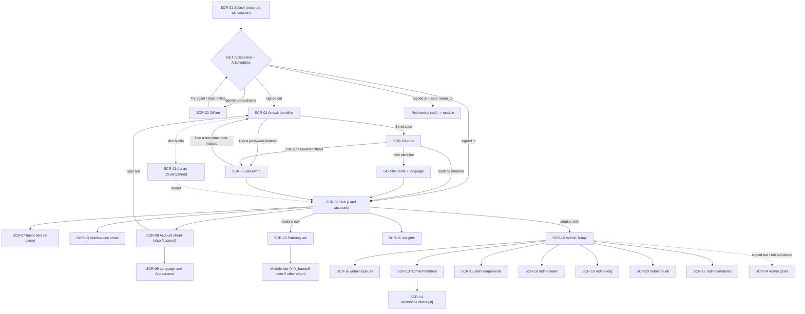

# ForKhatri platform hub: wireframes (as built, 2026-11-22)

Scope: the platform hub web app `platform/forkhatri-web` (Next.js app router). Source of truth is the code (`app/`, `components/`, `lib/i18n.ts`, `lib/admin-i18n.ts`, `lib/insights-i18n.ts`, the CSS files). English strings are copied from those locale files. Screen ids (SCR-nn) follow the as-built inventory in `docs/ParentApp/03-ux.md`. No browser run was used for this document: everything below is read from code; live data values are not verified (see section 6).

Design rules applied (from the memory index): mobile-first web app; one ForKhatri sign-in, no module builds its own login; five languages (English, Hindi, Telugu, Marathi, Kannada) with no hard-coded strings; no unnecessary intermediate screens; notifications bell sits left of the profile avatar; the hub shows the module and only that screen changes when asked; the admin console and the members dashboard are separate routes.

---

## 1. Map and screen index

### 1.1 Navigation map



### 1.2 Screen index

| SCR | Route | Purpose | Who sees it | Key API calls |
|---|---|---|---|---|
| 01 | `/` (first paint) | Devotional splash, once per tab session | Everyone | none (waits for boot) |
| 02-05 | `/` (phase signedOut) | One-question-at-a-time sign-in: identifier, code, name, password | Signed out | `POST /v1/auth/code`, `/v1/auth/code/verify`, `/v1/auth/welcome`, `/v1/auth/password` |
| 06 | `/` (phase signedIn) | Hub: greeting, intent field, modules | Signed in | `GET /v1/session`, `GET /v1/modules`, `GET /v1/admin/me` |
| 07 | in SCR-06 | Rule-based intent parser (client only) | Signed in | none |
| 08 | `/account` or avatar | Account sheet: name, masked contact, language, appearance, sign out | Signed in | `PATCH /v1/me`, `POST /v1/auth/sign-out` |
| 09 | arrival header, sheet | Language choice (5) | All | `PATCH /v1/me` (signed in), `GET /v1/modules` refetch |
| 10 | bell | Notifications sheet (honest empty state) | Signed in | none |
| 11 | `/insights` | Members dashboard | Every signed-in member | `GET /v1/insights` |
| 12 | `/admin` | Today: what needs me | Appointed admins | `/v1/admin/overview`, `/queues` |
| 13 | `/admin/members` | Find a person | `members.view` | `/members?q&status&offset` |
| 14 | `/admin/members/[id]` | One person across ForKhatri | `members.view` | `/members/{id}`, `/members/{id}/modules`, suspend, lift, sign-out, ban, contact |
| 15 | `/admin/approvals` | Two-person approvals | ban/approve/roles permissions | `/approvals`, `/approvals/{id}/decide` |
| 16 | `/admin/queues[?view=module/view]` | Federated module queues | Admins with module scopes | `/queues`, `/queues/{m}/{v}/{item}`, action POST |
| 17 | `/admin/modules` | Open, build or plan a module | All admins; owner changes | `/modules`, `PATCH /modules/{key}` |
| 18 | `/admin/team` | Roles and appointments | `roles.view` or managed chapters | `/roles`, `/roles/{id}/revoke` |
| 19 | `/admin/org` | National office, chapters, module teams | `org.view` | `/org`, `/org/chapters`, close |
| 20 | `/admin/audit` | Append-only audit log | `audit.view` | `/audit?action&before&target` |
| 21 | in SCR-02 and SCR-08 | Development "Act as" persona switcher | Dev builds only (`NEXT_PUBLIC_DEV_TOOLS=true`, never production) | `GET /dev/v1/personas`, `POST /dev/v1/sessions` |
| 22 | `/` (phase offline) | Identity service unreachable | Everyone | `GET /v1/session` retry |
| 23 | overlay on hub | "Entering {module}" veil | Signed in | `POST /v1/modules/{key}/enter`, `POST /v1/auth/handoff` |
| 24 | `/admin/*` gate | Signed out or not appointed | Non-admins | `identity.session`, `admin.me` |

Routes found in `app/`: 12 page routes (`/`, `/account`, `/insights`, `/admin`, `/admin/queues`, `/admin/members`, `/admin/members/[id]`, `/admin/approvals`, `/admin/team`, `/admin/org`, `/admin/audit`, `/admin/modules`). `/account` is the same Entrance with the account sheet pre-opened.

---

## 2. Screen wireframes (390px unless stated)

### SCR-01 Splash

```
+--------------------------------------+
|                                      |
|          (kumkum-maroon ground)      |
|        [turning chakra ring]         |
|        (1) deity image               |
|                                      |
|        (2) ForKhatri wordmark        |
|        (3) Jai Sahasrarjun           |
|                                      |
|        (4) Tap anywhere to continue  |
+--------------------------------------+
```

| # | Element | Does | Data | States | Next |
|---|---|---|---|---|---|
| 1 | Deity image + ring | Brand cover, CSS animated, painted from server HTML | `SPLASH_IMAGE` | reduced motion: no rotation, shorter stay (0.9 s vs 2 s min, 5 s cap) | none |
| 2 | Wordmark | Brand | - | - | - |
| 3 | Blessing | `splashBlessing` "Jai Sahasrarjun" in stored or browser language | `loadStoredLang` | - | - |
| 4 | Skip hint | Tap, click or any key dismisses (`splashSkip` "Tap anywhere to continue") | - | Hidden when `sessionStorage fk.splash.v1` already set | SCR-02 / 06 / 22 |

### SCR-02 Arrival: identifier step (signed out)

```
+--------------------------------------+
| ForKhatri              [EN][हि][తె][म][ಕ] (1)
+--------------------------------------+
|              (aurora glow)           |
|                 ( orb ) (2)          |
|        Welcome to ForKhatri (3)      |
|   [Sign in to continue to {module}]  |
|  (notice: "You've signed out...") (4)|
|                                      |
|  Let's begin. What's your mobile     |
|  number or email? (5)                |
|  +--------------------------------+  |
|  | Mobile number or email     [>] |  |
|  +--------------------------------+  |
|  (6) error line (role=alert)         |
|                                      |
|     Use a password instead (7)       |
|  [lock] Your number is never shown   |
|  to other members. (8)               |
|                                      |
| Your community. Your opportunities.  |
| Your support. Your growth. (9)       |
|                                      |
| Development: act as...  (10, dev)    |
+--------------------------------------+
```

| # | Element | Does | Data | States | Next |
|---|---|---|---|---|---|
| 1 | Language switch (group "Language") | Switches interface; pressed state shows current; short labels per language | `LANGUAGES` | stored in `localStorage` | stays |
| 2 | Orb | Decorative; pulses ("is-thinking") while busy | - | busy | - |
| 3 | Kicker | `arrivalKicker`; or `continueTo` "Sign in to continue to {module}" when a safe `return_to` resolves to a module | `return_to`, registry | - | - |
| 4 | Notice | After sign-out: `signedOut` "You've signed out. See you soon." | - | shown once | - |
| 5 | Question h1 + input | Accepts 10-digit Indian mobile, +E.164 or email; arrow button "Send code" disabled until valid | identifier (normalised) | invalid: "Enter a 10-digit Indian mobile number or an email address."; busy spinner | SCR-03 |
| 6 | Error line | Assertive live region; shake on failure | `err_*` by `detail.code` | rate limited, delivery unavailable ("We can't send a sign-in code there right now. Please use your password, or sign in with your email address."), network | - |
| 7 | "Use a password instead" | Switch path | - | - | SCR-05 |
| 8 | Privacy cue | Reassurance `privacyNumber` | - | - | - |
| 9 | Promise line | `arrivalPromise` | - | - | - |
| 10 | Act-as link | Opens SCR-21 panel | personas | Renders only if `/dev/v1/personas` answers | SCR-21 |

### SCR-03 Arrival: code step

```
+--------------------------------------+
| ForKhatri              [EN][हि][తె][म][ಕ]
+--------------------------------------+
|                 ( orb )              |
|        Welcome to ForKhatri          |
|  (lock) +91 98****0001  [Change] (1) |
|                                      |
|  Enter the 6-digit code sent to      |
|  {destination} (2)                   |
|     [ 4 ][ 2 ][ _ ][ _ ][ _ ][ _ ]   |
|  (3) cells; one hidden input         |
|  Development code 123456 [Fill] (4)  |
|  (O) New code in 24s  | Send a new   |
|  code (5)                            |
|     Use a password instead (6)       |
+--------------------------------------+
```

| # | Element | Does | Data | States | Next |
|---|---|---|---|---|---|
| 1 | Answered chip | Shows `destination_hint`; "Change" returns to step 1 | `CodeChallenge.destination_hint` | - | SCR-02 |
| 2 | Question | `askCode` | - | - | - |
| 3 | Code field | `inputmode=numeric`, `one-time-code`; auto-verifies on sixth digit | `challenge_id`, code | busy "Checking…"; wrong: "That code isn't right. Please check and try again." + shake; expired / attempts exhausted: back to step 1 with message | SCR-06 (signed_in) or SCR-04 (name_required) |
| 4 | Dev code | Shown only when service returns `dev_code`; "Fill" submits it | `dev_code` | dev only | verify |
| 5 | Resend | Ring countdown "New code in {seconds}s"; then "Send a new code"; info "A new code is on its way." | `resend_in` | - | stays |
| 6 | Use a password instead | - | - | - | SCR-05 |

### SCR-04 Arrival: welcome (new member)

```
+--------------------------------------+
|  (lock) +91 98****  [Change]         |
|  (check) ••••••                      |
|  Welcome to the community. What      |
|  should we call you? (1)             |
|  +--------------------------------+  |
|  | The name members will see      |  |
|  +--------------------------------+  |
|  Language (2)                        |
|  [English][हिन्दी][తెలుగు][मराठी][ಕನ್ನಡ]  |
|  [ Enter ForKhatri ] (3)             |
+--------------------------------------+
```

| # | Element | Does | Data | States | Next |
|---|---|---|---|---|---|
| 1 | Name field | Required, max 80, autocomplete name | `display_name` | empty: button disabled | - |
| 2 | Language radiogroup | Sets interface and `preferred_language` | `Lang` | one selected | - |
| 3 | "Enter ForKhatri" | `POST /v1/auth/welcome` | `challenge_id, code, display_name, preferred_language` | busy label "Checking…"; code-expired errors send back to step 1 | SCR-06 or return_to module |

### SCR-05 Arrival: password step

```
+--------------------------------------+
|  Enter your password (1)             |
|  +--------------------------------+  |
|  | Mobile number or email         |  |
|  +--------------------------------+  |
|  +--------------------------------+  |
|  | Password                  [eye]|  |
|  +--------------------------------+  |
|  [ Sign in ]  (2)                    |
|  Use a one-time code instead (3)     |
+--------------------------------------+
```

| # | Element | Does | Data | States | Next |
|---|---|---|---|---|---|
| 1 | Identifier + password fields; eye toggles "Show password"/"Hide password" | - | identifier, password | - | - |
| 2 | "Sign in" | `POST /v1/auth/password`; disabled until both valid | - | error: "That number, email or password doesn't match. Please try again." | SCR-06 / module |
| 3 | "Use a one-time code instead" | - | - | - | SCR-02 |

### SCR-06 Hub (signed in)

```
+--------------------------------------+
| ForKhatri                 [bell](1)[AV](2)
+--------------------------------------+
| [portrait] Bhagwan Kartavirya        |
|            Sahasrarjun (3)           |
| Good morning, Asha (4)               |
| One community, many ways to grow.    |
| Where to today? (5)                  |
| +----------------------------------+ |
| | (search) What would you like to  | |
| | do?                    [x] [mic] | |
| +----------------------------------+ |
| Try [Yoga this weekend near me]      |
|     [Family introduction for a       |
|      rishta] [Hire a trusted         |
|      electrician] (6)                |
|                                      |
| Showing modules from your last visit.|
| They'll open again once we           |
| reconnect. (7, only if stale)        |
| OPEN NOW                             |
| +----------------------------------+ |
| |(sigil) Mangalya                > | |
| |  o Visited 2 days ago (8)        | |
| |  tagline                         | |
| +----------------------------------+ |
| | Milavn / Vyapar / Counsel ...    | |
| COMING TO FORKHATRI                  |
| [Payment Services][Loans & Finance]  |
|  Being built / Planned (9)           |
| +----------------------------------+ |
| |(sigil) ForKhatri in numbers    > | |
| | How many we are, where we live,  | |
| | women and men, ages (10)         | |
| | (sigil) Admin console          > | |
| | Queues, members, roles and the   | |
| | samaj organisation (11, admins)  | |
| +----------------------------------+ |
| [lock] One ForKhatri account for     |
| every module. Private by default.(12)|
+--------------------------------------+
```

| # | Element | Does | Data | States | Next |
|---|---|---|---|---|---|
| 1 | Bell (aria "Notifications") | Opens sheet; always left of avatar | - | `aria-expanded` | SCR-10 |
| 2 | Avatar (aria "Account for {name}") | Opens sheet | `display_name` initial | - | SCR-08 |
| 3 | Deity line + devotional portrait | Non-interactive image (`deityName`) | - | - | - |
| 4 | Greeting h1 | `greetMorning` / `greetAfternoon` / `greetEvening` by hour opened (before 12, before 17, else) | first word of `display_name` | - | - |
| 5 | Subtitle `hubSubtitle` | Shown on phone and up (hidden on smallest per CSS `.hub-sub` display rule: block at 720px, unverified below) | - | - | - |
| 6 | Suggestion chips | Fill the input with the suggestion (`suggestActivity`, `suggestMatch`, `suggestService`) | - | - | SCR-07 |
| 7 | Stale notice | Cached registry in use; rows not enterable | `stale` | dimmed rows | - |
| 8 | Module rows ("Open now") | One button per `availability = available`, recent first (`last_entered_at`), then registry order; shows name, "Visited {when}", tagline, arrow | `ModuleEntry{key,name,tagline,availability,entry_url,accent,last_entered_at}` | no `entry_url` or stale: disabled div, no arrow | SCR-23 |
| 9 | "Coming to ForKhatri" tiles | Non-interactive list; status "Being built" (`in_development`) or "Planned" | `availability` | hidden if none | - |
| 10 | "ForKhatri in numbers" row | Link to `/insights` for every member | - | - | SCR-11 |
| 11 | "Admin console" row | Link to `/admin`; appears only if `GET /v1/admin/me` says `is_admin` | `is_admin` | silent on failure | SCR-12 |
| 12 | Trust line | `trustLine` | - | - | - |

States: loading shows `HubSkeleton` (aria-busy, label "Loading ForKhatri"); entering shows SCR-23; identity unreachable shows SCR-22.

#### SCR-06 at 1280px (differs materially)

```
+--------------------------------------------------------------------------------+
| ForKhatri                                                        [bell] [AV]   |
+--------------------------------------------------------------------------------+
|  LEFT (5fr, sticky)               |  RIGHT (7fr)                              |
|  [portrait] Bhagwan Kartavirya... |  OPEN NOW                                 |
|  Good morning, Asha (2.8rem)      |  +-------------------------------------+  |
|  One community, many ways to grow |  | Mangalya  tagline              >    |  |
|  [ What would you like to do? ]   |  | Milavn / Vyapar / Counsel           |  |
|  Try [chip] [chip] [chip]         |  +-------------------------------------+  |
|                                   |  COMING TO FORKHATRI (4-column tiles)    |
|                                   |  ForKhatri in numbers / Admin console    |
|                                   |  trust line                              |
+--------------------------------------------------------------------------------+
```

Two columns appear at 1100px; from 720px rows grow to 88px min height, coming tiles go 4 across, side padding 32px.

### SCR-07 Intent field (in place, no dialog)

```
+----------------------------------+
| (search) cricket this weekend [x]|
+----------------------------------+
 [Milavn] [activity] [this weekend] [near you]   (1 chips)
 {module} isn't open yet. It's being built. (2 note)
 -> matching rows highlighted and moved to top, others dimmed (3)
```

| # | Element | Does | Data | States | Next |
|---|---|---|---|---|---|
| 1 | Understanding chips | Module, kind (activity, matrimony, business, service, opportunity, advice, payment, loan), time (today, tonight, tomorrow, this weekend), place (near you / in {place}) | `parseIntent` result | none when empty | - |
| 2 | One quiet note | "{module} isn't open yet. It's being built." / "...planned for later." / "This could fit more than one place." / "Not sure yet. Try words like “yoga”, “plumber” or “rishta”." | - | one at most | - |
| 3 | Row reorder | `is-match` first, rest `is-dim`; Enter opens the top available match with an `entry_url` (not when stale); Escape or ✕ ("Clear") clears; `/` focuses the field | - | On phones the greeting collapses (`data-compact`) if the keyboard would cover the result | SCR-23 |

Mic button ("Speak instead" / "Stop listening", placeholder "Listening…", error "Voice input didn't work. You can type instead.") appears only where the Web Speech API exists; otherwise a `/` key hint shows. Matching is client-side, rule-based, no network.

### SCR-08 Account sheet (also route `/account`)

```
+--------------------------------------+
|  ====  (drag handle)                 |
|  Your account                    [x] |
|  (AV 64)  Asha Reddy                 |
|           +91 ****0001 · a***@...(1) |
|  Name                          Edit(2)|
|  Asha Reddy                          |
|  Mobile  +91 ****0001                |
|  Email   Not set (3)                 |
|  Saved (4)                           |
|  Language (5)                        |
|  [English][हिन्दी][తెలుగు][मराठी][ಕನ್ನಡ]|
|  Appearance (6)                      |
|  [System][Light][Dark]               |
|  [lock] Your number and email are    |
|  never shown to other members.       |
|  Your details in each module, like   |
|  your matrimonial profile or activity|
|  location, are managed inside that   |
|  module. (7)                         |
|  [ Sign out ] (8)                    |
|  Sign out on all devices (9)         |
|  -- Act as (development) panel (10)--|
+--------------------------------------+
```

| # | Element | Does | Data | States | Next |
|---|---|---|---|---|---|
| 1 | Identity header | Avatar, name, masked contact | `display_name, phone_hint, email_hint` | - | - |
| 2 | Name row / inline edit | "Edit" opens field "The name members will see" with Cancel / Save (max 80) | `PATCH /v1/me {display_name}` | Saving…, Saved (check), "Couldn't save. Please try again.", API errors; not signed in ends session | stays |
| 3 | Mobile / Email read-only | "Not set" when null | hints | - | - |
| 5 | Language radiogroup | Optimistic switch, `PATCH /v1/me {preferred_language}`, registry refetched; rolls back with an error toast on failure | `preferred_language` | - | SCR-09 |
| 6 | Appearance radiogroup | Device-only, `localStorage fk.theme`, never sent to server | - | System follows OS | - |
| 7 | Privacy and module notes | Explains module data lives in modules | - | - | - |
| 8 | Sign out | `POST /v1/auth/sign-out {everywhere:false}` | - | disabled while signing out; 401 treated as success | SCR-02 with notice |
| 9 | Sign out on all devices | Expands confirm box: "This signs you out on every phone and computer." [Cancel] [Sign out everywhere] | `everywhere:true` | - | SCR-02 |
| 10 | Act-as panel | See SCR-21 | personas | dev only | reload |

Desktop (>= 720px): the sheet is a floating panel under the header (fade/scale) instead of a bottom sheet; no drag. Escape and backdrop close; focus is trapped and returns to the opener. Closing at `/account` rewrites the URL to `/`.

### SCR-09 Language switcher

Two surfaces, same five options: header group on signed-out screens (short labels, `aria-label` = native name) and the radiogroup in SCR-08 / SCR-04 (native names English, हिन्दी, తెలుగు, मराठी, ಕನ್ನಡ). Changing language: updates `<html lang>`, stores in `localStorage`, switches fonts (Geist, Sora, Noto Devanagari/Telugu/Kannada). Admin and Insights read the stored language (`loadStoredLang`) or member preference; they have no picker of their own (see gaps).

### SCR-10 Notifications sheet

```
+--------------------------------------+
|  ====                                |
|  Notifications                   [x] |
|           (check orb)                |
|        You're all caught up (1)      |
|  Updates from your modules will      |
|  appear here. (2)                    |
+--------------------------------------+
```

| # | Element | Does | Data | States | Next |
|---|---|---|---|---|---|
| 1-2 | Empty state | Honest empty state; no notification service exists yet | none | only state | close |

### SCR-11 Insights: members dashboard (`/insights`)

```
+--------------------------------------+
| ForKhatri > Members   Updated 10:42 [refresh] (1)
+--------------------------------------+
| Members (h1)                         |
| Everyone with a ForKhatri account,   |
| across every module. (2)             |
| +---------+ +---------+              |
| |Members  | |New in 30|   (3 KPIs)   |
| |  412    | |days  +9 |              |
| +---------+ +---------+              |
| |Active in| |With a   |              |
| |30 days  | |known city|             |
| Growth  [30 days|90 days|All time](4)|
| ~~~~ line/area chart ~~~~            |
| Where members live [India|World] (5) |
| [ map shaded by state + city dots ]  |
| legend Fewer..More, City with members|
| Top cities [Cities|States] table (6) |
| Countries / Cities we could not place|
| Who they are (7)                     |
| Women and men split bar, Age bands,  |
| Median age, Looking for, Marital     |
| status, Mother tongue                |
| Accounts (8)                         |
| Modules used, Signs in with, App     |
| language meters                      |
| Sources: Mangalya: up to date (9)    |
+--------------------------------------+
```

| # | Element | Does | Data | States | Next |
|---|---|---|---|---|---|
| 1 | Breadcrumb + refresh | Back to hub (aria "Back to ForKhatri"); re-fetches ("Refreshing…") | `generated_at` | - | SCR-06 |
| 2 | Title and lede | `pageTitle` "Members", `pageSub` | - | - | - |
| 3 | KPI tiles | Members ("{joined} joined · {pending} waiting to sign in"), New in 30 days ("+{n} this week"), Active in 30 days ("{n} this week", suspended count), With a known city ("{pct} of members") | `totals.*`, `location.located` | - | - |
| 4 | Growth chart | Range tabs "30 days / 90 days / All time"; tooltip "{n} members", "{n} joined that day" | `growth[]` | - | - |
| 5 | Map | India / World tabs; hover tooltip "{n} members"; legend | `location.india_states, cities, countries`; `public/geo/*.topo.json` | no data: "No members" | - |
| 6 | Ranked lists | Cities, States tables; countries with "{city} from a city · {phone} from phone number"; unresolved cities list | `location.*` | empty: "No member has a city yet." | - |
| 7 | Who they are | Gender and age only from Mangalya candidate profiles ("Known for {known} of {total} members"); bands, medians, Looking for (A bride, A groom), Marital status, Mother tongue | `gender, age, candidates` | - | - |
| 8 | Accounts | Meters for modules used, sign-in method (Mobile number / Email / Mobile and email), app language | `modules, sign_in, languages` | - | - |
| 9 | Sources | `sourceOk` / `sourceDown` per source (ForKhatri accounts, Mangalya, Milavn) | `sources[]` | down: "not reachable, its numbers are missing" | - |

States: loading skeleton ("Counting members…"); signed out: "Sign in to see the members dashboard" + Sign in; error: "The dashboard could not be loaded. Check that the identity service is running, then try again." + Try again. Totals only, never a person. 1280px: KPIs in a row, the map and city list sit side by side (breakpoints 720/900/960 in `insights.css`; exact grid unverified).

### SCR-24 Admin gates (`/admin/*` before the console loads)

```
+--------------------------------------+
|  ForKhatri                           |
|  Opening the console…   (loading)    |
|  --- or ---                          |
|  Sign in to open the admin console   |
|  [ Sign in ]  -> /?return_to=/admin  |
|  --- or ---                          |
|  This console is for people the samaj|
|  has appointed                       |
|  Office bearers, moderators and      |
|  verifiers see their work here...    |
|  [ Back to ForKhatri ]               |
|  --- or ---                          |
|  The console could not be loaded...  |
|  [ Try again ]                       |
+--------------------------------------+
```

Four states: loading, signedOut, notAdmin, error. Console loads `identity.session` then `GET /v1/admin/me`.

### Admin shell (frame for SCR-12 to 20)

```
390px                                   1280px
+------------------------------+        +----------+---------------------------------+
| ForKhatri   Admin console    |        | ForKhatri| (page content, max-width)       |
+------------------------------+        | Admin    |                                 |
|  (page content)              |        | console  |                                 |
|                              |        | [Today]  |                                 |
+------------------------------+        | Queues   |                                 |
|[Today][Queues][Members][Appr]|        | Members  |                                 |
|                    [More ...]|        | Approvals|                                 |
+------------------------------+        | Team and |                                 |
 More dialog: Team and roles,           | roles    |                                 |
 Organisation, Audit log, Modules,      | Organisat|                                 |
 Back to ForKhatri                      | Audit log|                                 |
                                        | Modules  |                                 |
                                        | name,role|                                 |
                                        | Back to  |                                 |
                                        | ForKhatri|                                 |
                                        +----------+---------------------------------+
```

Items shown only if permitted: Today and Modules always; Queues if the person has module scopes; Members needs `members.view`; Approvals needs `approvals.decide` or `members.ban` or `roles.manage`; Team and roles needs `roles.view` or managed chapters; Organisation needs `org.view`; Audit log needs `audit.view`. Phone bar: four primary tabs (Today, Queues, Members, Approvals) plus "More" (opens a dialog) when other items exist. Side nav appears at 900px; its footer shows display name, "{role} · {scope}" and "Back to ForKhatri". Roles: Owner, President, Secretary, Treasurer, Grievance officer, Data protection officer, Auditor, Chapter head, Chapter secretary, Moderator, Verifier.

### SCR-12 Admin Today (`/admin`)

```
+--------------------------------------+
| Namaste, Ramesh (1)                  |
| What needs you today, across every   |
| module.                              |
| [President · National] (2 role badges)|
| NEEDS YOU (3)                        |
| (o) 5 open in Reports  [2 urgent] >  |
| (o) 1 waiting for a second person  > |
| ( ) {name}'s suspension ends in 2 d >|
| ( ) {name}'s term as {role} ends ... |
|  -- or -- Nothing needs you right now.|
| +--------+ +--------+ (4 KPIs)       |
| |Members | |Active  |                |
| |412     | |this wk | Joined this    |
| |n not   | |        | week/Suspended |
| |signed  |                           |
| Recent activity            See all(5)|
| timeline of audit lines              |
+--------------------------------------+
```

| # | Element | Does | Data | States | Next |
|---|---|---|---|---|---|
| 1 | Greeting | `greeting` "Namaste, {name}" | `me.member` | - | - |
| 2 | Role badges ("Your roles") | Role · scope · title | `me.roles` | - | - |
| 3 | Needs-you rows | Queues with open items ("{n} open in {queue}", badges "{n} urgent", "{n} overdue"; "{queue} could not be reached" on error), pending approvals the person can decide, suspensions and role terms ending | `admin.overview()`, `admin.queues()` | empty: "Nothing needs you right now."; red dot if urgent or overdue | `/admin/queues?view=`, `/admin/approvals`, `/admin/members/{id}`, `/admin/team` |
| 4 | KPIs | Members ("{n} not signed in yet"), Active this week, Joined this week, Suspended (link to `/admin/members?status=suspended` if `members.view`) | `overview.members` | - | SCR-13 |
| 5 | Recent activity | Only with `audit.view`; "See all" | `overview.recent` | "Nothing recorded yet." | SCR-20 |

States: loading ("Opening the console…" style `Loading`), error line. 1280px: content sits right of the side nav.

### SCR-13 Admin Members (`/admin/members`)

```
+--------------------------------------+
| Members                              |
| Everyone with a ForKhatri account.   |
| Contact details stay hidden unless   |
| your role allows them, and every look|
| is recorded.                         |
| (search) Name, mobile number or email (1)
| [Everyone][Active][Suspended][Not signed in yet] (2)   30 people (3)
| +----------------------------------+ |
| |(AV) Asha Reddy [Appointed]   [..]| |
| | +91 ****0001 · Joined 29 Sep 2026| |
| | · Last seen 2 hours ago        > | |
| +----------------------------------+ |
| [ Show more ] (4)                    |
+--------------------------------------+
```

| # | Element | Does | Data | States | Next |
|---|---|---|---|---|---|
| 1 | Search | Debounced 220 ms, writes `?q=&status=` to URL | `q` | - | - |
| 2 | Status chips | filter `""|active|suspended|not_joined` | `status` | - | - |
| 3 | Count "{n} people" | - | `total` | - | - |
| 4 | Rows | Avatar, name, "Appointed" badge for staff, masked contact, joined date, "Last seen {when}" or "Never signed in"; badge Suspended / Removed / Not signed in yet; page size 30, "Show more" | `MemberRow` | empty: "No one matches."; error line | SCR-14 |

### SCR-14 Admin Member detail (`/admin/members/[id]`)

```
+--------------------------------------+
| <- Members                           |
| (AV 64) Asha Reddy                   |
| [Active] [Moderator · Milavn]        |
| +91 ****0001 · a***@...              |
| (success notice)                     |
| [Show full contact][Suspend]         |
| [Sign out everywhere][Propose a ban] |
|  (own account: "This is your own     |
|   account.")                         |
| ACCOUNT                              |
| Member since / Last seen / Signed in |
| on {n} devices / Language /          |
| Verification Level {n}               |
| MODULES USED                         |
| Mangalya  {n} visits · last {when}   |
| IN EACH MODULE (note) card per module|
| Plan: No paid plan | facts | flags   |
| SUSPENSIONS AND BANS (history)       |
| HISTORY (audit timeline)             |
+--------------------------------------+
```

Action dialogs (full-screen on phone via `<dialog>`):

```
+--------------------------------------+
| Suspend {name}                   [x] |
| {name} is signed out everywhere and  |
| cannot use any module until the      |
| suspension ends.                     |
| Reason [ select v ]                  |
| How long [1 day][3 days][7 days]     |
|          [30 days][Until lifted]     |
| Note [ What happened, in a sentence  |
|        or two ]                      |
| [Cancel] [Suspend]                   |
+--------------------------------------+
```

| Action | Visible when | Dialog fields | Result |
|---|---|---|---|
| Show full contact | `members.contact`, not yet shown | reason note (min 3 chars); "Your look is recorded in the audit log." | Replaces masked contact in header; audited |
| Suspend | `members.suspend`, no open suspension, not removed | Reason (catalogue: Harassment or abuse, Fraud or asking for money, Fake profile, Pretending to be someone else, Inappropriate photos or content, Under the age allowed, Spam or advertising, Threat to someone's safety, Court or government order, The member asked for it, Other), length, note | Updated detail |
| Lift suspension / Lift ban | open item; ban lift needs `approvals.decide` | note | Updated detail |
| Sign out everywhere | `members.suspend` and active sessions > 0 | note | Updated detail |
| Propose a ban | `members.ban`, not already banned or pending | reason, note | "Sent. It takes effect when a second person approves." badge "Waiting for approval" |

Buttons stay disabled until note length is 3 or more (and reason chosen when needed). States: loading; error with no data; module cards with "Could not be reached" per module; "Not in this module" and "Has not opened a module yet." empties; "Never suspended or banned." and "No administrative action on this account yet." empties.

### SCR-15 Admin Approvals (`/admin/approvals`)

```
+--------------------------------------+
| Approvals                            |
| A ban, and appointing a senior office|
| bearer, always needs two people: one |
| asks, another decides.               |
| [Waiting] [Decided]                  |
| +----------------------------------+ |
| |(AV) Ban {name}            [Banned]| |
| | Asked by {name} · 2 hours ago    | |
| | Fraud or asking for money · note | |
| | [Decline]          [Approve]     | |
| +----------------------------------+ |
|  own request: "You asked. Another    |
|  office bearer decides." [Withdraw]  |
|  no right: "Your role cannot decide  |
|  this."                              |
+--------------------------------------+
 Decline dialog: "Why are you declining?" [Cancel] [Decline] (min 3 chars)
```

Kinds: `ban` ("Ban {name}") and `grant_role` ("Appoint {name} as {role}", with "until {date}"). Decided tab shows "Approved by {name}", "Declined by {name}", "Withdrawn" with date and note. Empty: "Nothing is waiting." / "Nothing decided yet." Title links to SCR-14.

### SCR-16 Admin Queues (`/admin/queues`)

```
390px                                  1280px (split from 900px)
+------------------------------+       +---------------------------+------------------------+
| Queues                       |       | list (min 320px)          | detail (sticky)        |
| Reports, cases and checks... |       | [Open|All]                | Item title        [x]  |
| [Mangalya Reports 3][Milavn !]|      | o Summary text  [Waiting] | Decide: [Acknowledge]  |
| Reports and safety [Open|All]|       |   Due in 2 d · Reported.. | [Resolve][Dismiss]...  |
| o Summary text    [In review]|       |                           | Outcome / Note         |
|   Urgent · Reported 1 h ago  |       |                           | Details / What has     |
| ...                          |       |                           | happened               |
+------------------------------+       +---------------------------+------------------------+
 Tap item -> full-screen dialog with detail
```

Tabs: one per module view (`module/view`), badge with open count or "!" on error; default selects the first view with open items; `?view=module/view` deep link from Today. Rows sorted: open first, priority (urgent, high, normal), due date, submitted. Row dot red = urgent, amber = high. Status labels: Open, In review, Acknowledged, Resolved, Dismissed, Action taken, Escalated, Waiting. Detail sections: "Decide" (module-provided actions, e.g. Acknowledge, Resolve, Reopen, Suspend in this module, Lift suspension, Dismiss, Warn, Escalate, Restrict, Verify, Reject, Approve, Remove, Ask for a clearer copy), optional "Outcome" select (No action needed, Warned, Content removed, Account suspended, Sent for investigation), "Note for the record" ("What you saw and why you decided this"), "Details", "What has happened". Success "Done: {action}". Errors: "This module has not given you access yet." / "The module is not answering right now." / "This module has not connected its queues to the console yet." / "The module sent an error." Empties: "You are not appointed to any module's queue.", "Nothing open here. Well done.", "Nothing here yet.", "Choose an item to see its details." (desktop). Each decision is enforced by the module and written to the platform audit log. Exact detail body layout is module-defined (unverified, see gaps).

### SCR-17 Admin Modules (`/admin/modules`)

```
+--------------------------------------+
| Modules                              |
| Open a module to every member, or    |
| keep it as being built or planned.   |
| Only an owner can change this.       |
| Mangalya       {n} members have opened it
| [Open][Being built][Planned]         |
| ...                                  |
+--------------------------------------+
 Confirm dialog "{module}: {state}": "Why are you changing this?" [Cancel][Confirm]
```

Availability values `available / in_development / planned`; only an owner changes them (others see it read-only, exact disabled treatment unverified); change is audited ("{actor} set {module} to “{availability}”") and flips the module on hub SCR-06.

### SCR-18 Admin Team and roles (`/admin/team`)

```
+--------------------------------------+
| Team and roles          [Appoint     |
| Who holds which role, where, and     |
| until when. ...          someone]    |
| PRESIDENT  (role help text)          |
| (AV) Name  [President · National]    |
|   until 12 Sep 2027 · Appointed by X |
|                       [End appointment]
| Nobody yet.                          |
+--------------------------------------+
 Appoint dialog: Person (search by name or mobile number) [Change];
 Role; Where (Module | Chapter); Title (optional, e.g. Joint Secretary);
 Term ends [In one year][No end date][On a date]; Why this person;
 badge "Needs a second person's approval."; [Cancel][Appoint]
 End dialog: "End {name}'s appointment as {role}" + note + [Cancel][End appointment]
```

Results: "Appointed." or "Sent. It takes effect when a second person approves." Errors include "This person already holds that role there.", "ForKhatri must always have at least one owner.", "Only an active member can be appointed."

### SCR-19 Admin Organisation (`/admin/org`)

```
+--------------------------------------+
| Organisation          [Add a state]  |
| National office bearers (rows / "Nobody yet.")
| Chapters                             |
|  Karnataka   {n} cities  [Appoint][Add a city]
|     Bengaluru  [Appoint]             |
|     "No office bearers yet." per chapter
|  "No chapters yet. Add the first state."
| Platform team (if any)               |
| Module teams (rows / "Nobody yet.")  |
+--------------------------------------+
 Dialog "Add a state" / "Add a city · {state}": Name (placeholders "For example, Karnataka" / "For example, Bengaluru") [Cancel][Add]
```

"Close chapter" ("Close the {name} chapter") exists in the strings and API; its trigger is not in the Organisation markup read (gap). Errors: "A chapter with this name already exists.", "Close the city chapters under it first.", "End the office bearers' terms in this chapter first."

### SCR-20 Admin Audit log (`/admin/audit`)

```
+--------------------------------------+
| Audit log                            |
| Every administrative action, who took|
| it and why. Nobody can edit or       |
| delete this record.                  |
| [Everything][Members][Roles][Approvals][Module queues][Organisation][Modules]
| 12 Nov, 4:10 pm  Ramesh suspended Asha  (timeline)
| ... [ Show older ]                   |
+--------------------------------------+
```

Sentences from keys such as "{actor} suspended {target}", "{actor} approved banning {target}", "{target} was appointed {role}", "{actor} decided “{action}” in {module}"; fallback "{actor}: {action}"; empty "Nothing recorded yet."; pagination by `before` cursor ("Show older"). Linked rows go to the member (SCR-14) except on SCR-14 itself (`linkTarget=false`).

### SCR-21 Development "Act as" (dev builds only)

```
signed out: dock at foot          signed in: section in SCR-08
 Development: act as...  [Hide]    Act as (development)
 +--------------------------+      [Krishna  Owner's account...]
 | Act as (development)     |      [Asha     Data in Mangalya and Milavn]
 | [Krishna][Asha][...]     |      [new-member Fresh, no module data]
 | Signs this browser in as |      [mangalya-family ...] [mangalya-parent ...]
 | a development member...  |      [milavn-moderator ...]  (Current marked)
```

One tap: `POST /dev/v1/sessions {persona}` then page reload. Text lives in `DevActAs.tsx` (own 5-language table), not in `i18n.ts`. Renders nothing if `/dev/v1/personas` is not mounted or in a production build. Failure text: "Couldn't switch. Check that the identity service runs with DEV_TOOLS_ENABLED=true." Persona list shown is whatever the service returns (the strings define Krishna, Asha, new-member, mangaly-family, mangaly-parent, milavn-moderator; the project notes use "mangalya-" spellings, so the exact keys returned are unverified).

### SCR-22 Offline

```
+--------------------------------------+
| ForKhatri                      [langs]|
|        (cloud-off orb)               |
| We can't reach ForKhatri right now   |
| Your account is safe. This is usually|
| a brief connection hiccup.           |
| [ Try again ]  / [spinner] Trying again…
| FROM YOUR LAST VISIT                 |
| (sigil) Mangalya  tagline (dimmed list)|
+--------------------------------------+
```

`role=alert` card; automatic retry on the browser `online` event; cached module list from `localStorage` shown non-interactive (tinted by module `accent`).

### SCR-23 Entering veil and module handoff

```
+--------------------------------------+
|                                      |
|          (module sigil 36)           |
|        Entering Milavn               |
|        ------ (progress line)        |
+--------------------------------------+
```

Flow: tap row -> `entering` set (veil, row ignored while busy) -> `POST /v1/modules/{key}/enter` returns `entry_url` -> `goSignedIn(entry_url)`: same origin goes direct; other origin first calls `POST /v1/auth/handoff` and appends single-use `fk_handoff` code; the module redeems it into its own session. Errors: veil closes and a toast shows "We couldn't open {module}. Please try again." (HTTP errors) or the mapped message; "Your session has ended. Please sign in again." returns to SCR-02. Back from a module (bfcache) clears the veil. Sign-in with `?return_to=` runs the same path with a loop guard (20 s `sessionStorage` bounce window) and only for origins in the registry or the hub itself.

Toast (all signed-in errors): top region, `role=alert` for errors, `status` for info, 5 s auto-dismiss.

---

## 3. Key flows (storyboards)

**F1 First run, new member**
1. SCR-01 Splash (about 2 s, tap skips).
2. SCR-02 type mobile or email. Decision: invalid input keeps the arrow disabled; delivery failure suggests the password path.
3. SCR-03 six digits (auto-submit). Decision: existing member goes to step 5; unknown identifier goes to step 4; expired or exhausted codes return to step 2.
4. SCR-04 name and language, "Enter ForKhatri".
5. SCR-06 Hub in the chosen language (`saveStoredLang`).

**F2 Returning member with password (QA)**
SCR-02 -> "Use a password instead" -> SCR-05 -> "Sign in" -> SCR-06.

**F3 Sign in to a module (return_to)**
1. Module redirects to hub `/?return_to=<module url>`.
2. SCR-02 shows "Sign in to continue to {module}".
3. After sign-in: safe target and not a bounce loop leads to the redirecting orb, then handoff, then the module (SCR-23 path). Unsafe or looped targets are cleared and SCR-06 shows.

**F4 Hub to module**
SCR-06 (optional: type in SCR-07, Enter opens top match) -> tap row -> SCR-23 -> module. Decision: stale registry or missing `entry_url` makes rows disabled.

**F5 Change language**
SCR-06 -> avatar -> SCR-08 -> language radio -> UI switches at once, PATCH follows, registry taglines refetch. Decision: failure rolls back with a toast.

**F6 Sign out**
SCR-08 -> "Sign out" -> SCR-02 with "You've signed out. See you soon." Variant: "Sign out on all devices" -> confirm -> "Sign out everywhere".

**F7 Admin: handle a report**
SCR-06 "Admin console" -> SCR-12 "Needs you" -> SCR-16 (`?view=`) -> pick item (dialog on phone) -> "Decide" action + outcome + note -> "Done: {action}".

**F8 Admin: ban with second person**
SCR-13 search -> SCR-14 "Propose a ban" (reason + note) -> "Sent. It takes effect when a second person approves." Second office bearer: SCR-12 shows "{n} waiting for a second person" -> SCR-15 Approve or Decline (with reason). The requester only sees "Withdraw".

**F9 Admin: appoint**
SCR-18 or SCR-19 "Appoint someone" -> search person, role, where, term, reason -> "Appointed." or sent for approval (senior roles) -> SCR-15.

**F10 Members dashboard**
SCR-06 "ForKhatri in numbers" -> SCR-11 -> growth range, map tabs -> back via breadcrumb.

**F11 Offline recovery**
Boot fails -> SCR-22 -> "Try again" (or network returns) -> boot again -> SCR-02 or SCR-06.

---

## 4. Components and design tokens

### 4.1 Component inventory

| Component | Where | Notes |
|---|---|---|
| Header (`topbar`) | Entrance | Wordmark link, bell + avatar (signed in), language group (signed out), skeleton while booting; hairline on scroll |
| Aurora, Orb (`OrbCore`) | Arrival, redirecting | Luminous signed-out look only |
| Thread chip + step question | Arrival | Answered steps collapse into chips with "Change" |
| Field / code cells / countdown ring | Arrival | 6 cells over one hidden input; ring in saffron |
| Primary / secondary / ghost / danger buttons | Arrival, account, sheets | `btn-primary`, `btn-secondary`, `btn-ghost`, `btn-danger`, `btn-small`, `btn-wide` |
| Segmented radiogroup | Account, welcome | Language and Appearance |
| Sheet | Account, notifications | Bottom sheet with drag handle under 720px; panel under header above; focus trap, Escape, backdrop |
| Module row | Hub, Offline | Sigil, name, "Visited", tagline, arrow; states match, dim, disabled |
| Coming tile | Hub | Non-interactive list items with status |
| Suggestion chip / understanding chip | Hub | |
| Sigil | Hub, Offline, veil | Per-module line glyph (mangaly, milavn, vyapar, counsel, payments, finance, numbers, admin) |
| Avatar | Header, sheet, admin | Initial based |
| Empty state | Notifications | Orb + title + body |
| Toast region | Entrance | Spring in; error vs info |
| Skeletons | Hub, Insights | `skeleton`, shimmer |
| Splash | Root | Once per tab session |
| Admin kit (`kit.tsx`) | Admin | `PageHead`, `Section`, `Badge` (tones ok, warn, danger, accent), `Chips`, `Dialog` (native `<dialog>`), `Field`, `Empty`, `Loading`, `ErrorLine`, `Avatar`, KPI tile, `adm-list` rows, timeline `AuditLine` |
| Admin bottom tab bar + side nav | Admin | Tab bar under 900px, side nav at 900px and above |
| Insights charts | Insights | `charts.tsx` growth chart, meters, age pyramid; `MemberMap.tsx` topojson map; segmented tabs |

### 4.2 Design tokens

Hub and shared base (`globals.css`, light / dark):
- Colour: `--bg #fafaf8 / #0c0c0d`, `--surface #fff / #141415`, `--surface-2 #f3f2ef / #1b1b1d`, `--line #e8e6e1 / #242426`, `--ink #18181a / #f1f1f0`, `--ink-2 #55555c / #a9a9ad`, `--ink-3 #6b6b72 / #85858b`, `--accent #d97706 / #f5a524`, `--accent-ink #a15800 / #f7b64c`, `--success #15803d / #45c98b`, `--danger #b42318 / #ff7b72`.
- Radius: `--radius 16px`, `--radius-sm 12px` (most used), 50% for avatars and orbs.
- Motion: `--ease cubic-bezier(0.2,0.8,0.2,1)`; springs in Motion (stiffness 380 to 520); view transitions 0.22 s; `prefers-reduced-motion` collapses all animation.
- Type: `--font-ui` Geist plus Noto Devanagari, Telugu, Kannada; `--font-display` Sora; base 16px / 1.5; greeting 2.2rem at 720px, 2.8rem at 1100px (Indic scripts slightly smaller).
- Layout: header 60px (68px at 720px); touch rows min 46 to 56px; breakpoints 720px (sheet becomes panel, hub padding) and 1100px (two-column hub).

Signed-out arrival look (`arrival.css`, scoped `data-look="arrival"`): paper `--bg #f5f1e8`, ink `#141833`, saffron `#e08600`, `--accent-fill` gradient `#ffd08a to #ff8f3f`, glass surfaces, trust green `#0d7d56`, radii 30px and 22px, header 72px, aurora blobs (amber, blue, pink), `--spring cubic-bezier(0.25,1.4,0.4,1)`; breakpoints 440px and 372px.

Admin (`admin.css`): reuses base tokens plus `--adm-side 248px`, `--adm-warn #b45309 / #f5a524`, soft tints for warn, danger, ok; breakpoints 720px and 900px.

Insights (`insights.css`): `ins-*` classes; breakpoints 479, 600, 720, 900, 960px; swatches for women, men and other series and quantile classes `ins-q0..` for map shading (exact colours not extracted, see gaps).

---

## 5. Cross-checks against the owner's design rules

- Bell left of avatar: matches (`topbar-actions` order).
- No extra intermediate screens: intent runs in place, no dialog; account is a sheet, not a page.
- Five languages with no hard-coded strings: hub, arrival, admin and insights use typed dictionaries. Exceptions: `DevActAs.tsx` (own table) and `LANG_NAMES` in `MemberDetail.tsx`.
- Admin and the members dashboard are open per role or to everyone as decided on 2026-09-27 (dashboard open to all signed-in members).

---

## 6. Wireframe gaps (unverified)

- No browser snapshot was taken; all labels are from code. Live module list, seeded values and the persona keys returned by `/dev/v1/personas` are unverified.
- SCR-06 `hubSubtitle` visibility on phone widths (CSS shows it from 720px; the ASCII shows it on phone as an assumption).
- SCR-11 exact desktop grid, map colours and tooltip layout; individual chart components in `charts.tsx` and `MemberMap.tsx` were not read line by line.
- SCR-16 queue item detail body (module-defined `fields` or raw `case_detail`, history list) and the phone dialog frame were read only in part.
- SCR-17 disabled treatment for non-owners; SCR-18 and SCR-19 exact row layouts read only from grep and partial code; "Close chapter" trigger on SCR-19 not located.
- The admin shell and Insights have no language picker; they follow stored language (admin: stored first, then member preference; Insights: member preference only), so an admin cannot switch language in place.
- `Admin console` and `Insights` pages set their own `<title>` ("Admin · ForKhatri", "Members · ForKhatri"); no `loading.tsx` or `not-found` routes exist, so unknown URLs fall to the Next.js default 404 (not wireframed).
- Splash image and devotional portrait art are described, not drawn.
- `docs/ParentApp/03-ux.md` says the trust line ends "Privacy first." and the coming-soon heading is "Coming soon"; the locale file says "Private by default." and "Coming to ForKhatri". This document follows the locale file.
