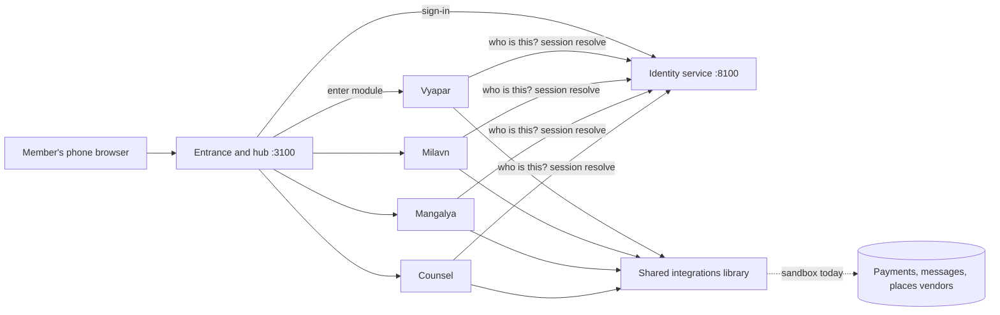

# ForKhatri: the whole picture in plain words

**Document status:** 2026-11-22, "as built" scope. Written for the product owner. Facts come from the repository, the October 2026 critique files, the owner decisions recorded in memory and the module backlogs. Anything not verified is marked **unverified**.
Companion documents: [docs/README.md](README.md) (index), [architecture.md](architecture.md) (technical map), [GLOSSARY.md](GLOSSARY.md), [RUNBOOK.md](RUNBOOK.md).

## Contents

1. What ForKhatri is
2. What is built today (status table)
3. The platform that holds it together
4. The four built modules, one by one
5. The three planned modules (MOD05, MOD06, MOD07)
6. How the pieces connect
7. Who the users are
8. Business model as designed
9. What is not built
10. Biggest risks and open decisions
11. Where to read more

---

## 1. What ForKhatri is

ForKhatri is one mobile-first web application for the Khatri community (the owner's notes name the Somavanshiya Sahasrarjun Kshatriya, Khatri and Pattegar community). A member signs in once, sees a home screen (the **hub**) and chooses what they need: business and jobs, community events, matrimony, or paid advice. Each of those is a **module**. The platform underneath gives every module the same sign-in, the same member identity, the same languages (English, Hindi, Telugu; Marathi and Kannada were added to the identity service in migration 007) and the same governance (who in the Samaj may approve what).

Owner direction (2026-10-02): the Samaj (community organisation) runs ForKhatri; the Samaj heads govern the app. A Welfare Trust, designed inside the Finance module (MOD07), is meant to receive a share of earnings for community welfare.

It is a web app, not a native app (owner rule). Every module must work for real, end to end, not as a dummy (owner rule 2026-09-30). Payments run on a **sandbox** (a pretend gateway that works only on the developer's own machine) until a real payment vendor exists.

## 2. What is built today

| Module | What it is | Status | Where |
|---|---|---|---|
| Platform: identity service | One sign-in, member identity, sessions, module registry, admin governance, insights numbers | **Built**, runs locally on port 8100 | `platform/identity-service` |
| Platform: web entrance | Splash, sign-in, hub, account sheet, admin console, insights page, "Development: act as" | **Built**, port 3100 | `platform/forkhatri-web` |
| Shared integrations library | One adapter layer for places search, payments, messaging and delivery | **Built** (sandbox and console adapters; no real vendor) | `shared/forkhatri-integrations` |
| MOD01 Vyapar | Business and jobs network (Upwork plus WorkIndia style) | **Built, partial**: real flows on rules, payments sandbox; hub lists it as "in development" | `modules/MOD01-vyapar` |
| MOD02 Milavn | Community events, circles, one-tap RSVP | **Built, partial**: core flows done; paid tickets sandbox only | `modules/MOD02-milavn` |
| MOD03 Mangalya | Matrimony for families, with Home Circle | **Built, partial**: profiles, discovery, requests, plans; horoscope calculation service present; some backlog items open | `modules/MOD03-mangalya` |
| MOD04 Counsel | Paid one-to-one advice from verified professionals | **Built, partial**: booking, video room, follow-ups, written questions; real payments and delivery blocked on vendors | `modules/MOD04-counsel` |
| MOD05 Dashboard | Personal dashboard, local information, fair exposure | **Planned**; folder is empty. The hub and the insights page cover a small part today | `modules/MOD05-dashboard` |
| MOD06 Payment Services | Bill payments, coupons and benefits | **Planned**; folder is empty; legal route undecided | `modules/MOD06-payment-services` |
| MOD07 Loans and Finance | Loan discovery and referral; Welfare Trust ledger | **Planned**; folder is empty; blocked on a regulatory decision (BLOCKER-002) | `modules/MOD07-loans-finance` |
| Deploy kit | Docker Compose, Caddy, backup, restore, rollback scripts, GitHub workflow | **Built but stale**: the October critique found it points to an old folder name and covers only 2 of the modules | `deploy/`, `.github/workflows/deploy.yml` |

The status words "built, partial" mean the screens and APIs exist and were checked on screen, while the module backlog lists items blocked on outside vendors or owner decisions.

## 3. The platform that holds it together

- **One sign-in.** The Identity and Trust Service stores only basic identity (name, phone or email, language, trust level 1 or 2). Modules never run their own login (owner rule). A member signs in with a code sent to phone or email, or with a password. Production SMS is off, so phone members cannot receive codes yet (critique finding).
- **Opaque session cookie.** The browser holds a cookie called `fk_session` it cannot read. Each module asks the identity service "who is this?" with a service key.
- **Hub.** Lists every module with its availability (available, in development, planned) and remembers where each member last went.
- **Module registry.** A table of modules plus environment settings for entry addresses. A new module is registered by a row and a setting, then it appears on the hub.
- **Admin console** (`/admin`): Today, Members, Member detail, Approvals (two-person approvals), Queues, Modules, Team, Organisation, Audit log. Roles are Samaj roles such as President and Secretary. The built-in demo personas Ramesh and Meena Khatri hold admin roles in the development data.
- **Insights page** ("ForKhatri in numbers"): open to every member by owner decision (2026-09-27). The critique warns small counts can identify people.
- **Notifications bell:** sits to the left of the profile avatar (owner rule). Today it always says "You're all caught up" at the hub level (critique finding); each module has its own in-app inbox.
- **Languages:** English, Hindi, Telugu in the web apps; no user-visible text may be hard-coded (owner rule). Hindi and Telugu quality is a known weak spot.
- **Development sign-in:** "Act as (development)" switches person with no password for people testing by hand; automated tests use a session script. The product owner's own account is never used by automation.

## 4. The four built modules

### MOD01 Vyapar: business and jobs
**Purpose:** a trusted place for businesses, professionals and freelancers to be found, hire and be hired, in the style of Upwork plus WorkIndia.
**Users:** business owners, freelancers, job seekers, employers, customers, service providers.
**Built:** one profile per member (owner rule), job and local-service posts, applications, contracts and milestones, a scam shield on every post text, "paid on time" counts confirmed by the person paid, a final status and polite closure for every applicant, appeals for every restriction, multilingual search, a notice that nobody may charge people who apply, and profession-aware rules (advocates and architects get no promotion or reviews). Per-post "let people call" settings (owner decision 2026-09-28).
**Blocked or open:** real payouts (Razorpay account), Claude AI features (key not set, runs on rules), better Hindi and Telugu voice (Bhashini key), masked phone numbers, push and SMS delivery, real credential register checks, legal review before any fee on workers (a worker fee might make Vyapar an "aggregator" under gig-worker law; the fee setting stays at 0).
**Boundary:** paid advice belongs to Counsel, not Vyapar (owner rule).

### MOD02 Milavn: community events
**Purpose:** "what is happening around you": find a meetup, RSVP with one tap, join circles that form from people who keep showing up together.
**Users:** organisers, members attending, venue partners, a moderator role.
**Built:** events, one-tap RSVP, circles, places search (OpenStreetMap lookup), venue shown only after a confirmed spot, no paywall on messages, mutual "would meet again", no public ratings, trust-scoped messaging, women-only circles with a self-declared answer, groups, a moderator persona and QA test users.
**Blocked or open:** real ticket money (Milavn never holds money by design; sandbox only), the women-only rule is self-declared and unenforceable (critique), place search breaks the OpenStreetMap usage policy (critique), a security review step was skipped on money, uploads and chat (critique).

### MOD03 Mangalya: matrimony for families
**Purpose:** a calm, respectful matrimony space where the candidate decides and parents have a real role.
**Users:** candidates (brides and grooms), parents and guardians (Home Circle), siblings and relatives (can only suggest), agents (marriage brokers, with limits), moderators.
**Built:** profiles in two parts ("Details" and "In my words"), Home Circle, discovery with the candidate's "Looking for" always applied, mutual preferences as hard rules, waiting periods after a decline (90 days) or withdrawal (21 days), requests and connections, plans, closed-vocabulary AI matching, a horoscope calculation service, screenshot blocking (owner rule), kumkum and turmeric palette with red toned down (owner rules). Mangalya is the module's spelling; older files say "Mangaly".
**Blocked or open:** horoscope matching presentation design, a recommendation engine (backlog B2), photo verification badge is computed in the browser and forgeable (critique), "From Rs 590 a month" is really Rs 7,079 up front (critique), no real payment vendor, whole-account delete and export.

### MOD04 Counsel: paid one-to-one advice
**Purpose:** book a verified professional (lawyer, chartered accountant, doctor and similar) for a one-to-one consultation.
**Users:** members seeking advice, consultants, reviewers who verify credentials.
**Built:** consultant profiles and badges that say what was checked, booking, propose-a-time, instant "Available now" consults, a video or voice room (browser-to-browser, with pre-join check, screen share, consented recording), follow-ups, paid written questions with automatic refund if unanswered, recap after every call, calendar invites, a ledger with a 2 percent platform fee (a setting), real delete and export of personal data, encrypted files. One-to-one only; group sessions live in Milavn (owner rule).
**Blocked or open:** real payments and payouts, WhatsApp and SMS delivery, professional register checks, a relay server for strict networks, two-way calendar sync, transcripts. The critique flags lawyer star ratings and named reviews as likely unlawful under Bar Council rules.

## 5. The three planned modules

These exist only as scope text in `modules/modules.md` and the critique `CRITIQUE-planned-money-governance.md`. Their folders are empty. Nothing is built.

- **MOD05 Dashboard:** a personal front page that reads, never writes, each module's data; local information (government schemes, camps, scholarships) sourced from outside; a "fair exposure" rule so surfacing is not purely commercial. The critique says it duplicates the hub and should be paused.
- **MOD06 Payment Services:** bill payments, a coupons and benefits system driven by activity in other modules, partner commissions. The critique says it would itself need an RBI payment-aggregator licence and should not be member-visible until a licensed partner kit exists.
- **MOD07 Loans and Finance:** discovery and referral of loans to verified financial partners only. ForKhatri will not underwrite or lend (BLOCKER-002 keeps it from claiming to be a lender). The Welfare Trust ledger is designed here (owner direction 2026-10-02); the critique recommends the Trust be an outside registered body and the app only show its ledger.

## 6. How the pieces connect

Sign-in happens once on the entrance. A module sees the cookie, asks the identity service who the member is, and creates its own member record the first time (just in time). Each module has its own database and its own tiers and roles; the platform never reads module tables. Cross-module links today are the hub itself, the shared language choice and the shared integrations library. Cross-module features that would join modules (Dashboard, benefits) are planned only. Ports and the full diagrams are in [architecture.md](architecture.md).

## 7. Who the users are

| Person | Uses | Notes |
|---|---|---|
| Community member | hub, any module | one identity; trust level 1 or 2 from the platform |
| Candidate and family (Mangalya) | Mangalya | candidate decides; parents and guardians act for them in the Home Circle |
| Business owner, freelancer, job seeker | Vyapar | one profile per member |
| Event organiser and attendee | Milavn | circles; moderator role |
| Consultant (professional) | Counsel | credentials checked per dimension |
| Samaj office bearers (President, Secretary and others) | admin console | two-person approvals; audit log; contact reveal is audited |
| Technical owner | everything | holds all keys; a critique risk |
| Operators and moderators | module queues | volunteers today; paid operators recommended |

## 8. Business model as designed

None of this earns money yet, because no payment vendor is connected. What the design says:

- **Core is free** for members. No ads (critique records this as right).
- **Mangalya:** paid plans (Gold, Assisted). The critique found the displayed price misleading and the Assisted plan unclear. **Owner to confirm** final pricing and refund rules.
- **Counsel:** a platform fee of 2 percent per consultation, held as a setting. The critique notes this is below the gateway's own cost (about 2.36 percent), so it may lose money. Consultants are paid per completed session or answer.
- **Vyapar:** worker fee 0 (setting). Planned revenue: business membership, promoted listings (clearly marked), possibly lead fees. **Owner to confirm**.
- **Milavn:** planned event fees, sponsorship, premium networking. Milavn never holds money; a licensed route for ticket money is undecided.
- **MOD06:** commissions from partners and merchants (planned).
- **MOD07:** referral fees from regulated lenders, subject to the neutral-offer rules (planned). A share of net surplus to the Welfare Trust (owner direction); the critique recommends promising "a share of net surplus, published yearly", never a rupee figure.
- **AI** attaches to premium tiers, described in everyday words (owner direction 2026-10-02). The critique questions whether basic understanding should stay free.

No revenue figures exist; any figure is **unverified**. The money path needs a legal entity and a lawyer or chartered accountant first (see section 10).

## 9. What is not built

- Real payments, refunds and payouts (no vendor chosen).
- Real SMS, WhatsApp, email, push delivery; production phone sign-in; password set and reset.
- Consent notice, privacy and terms links, age gate, named data fiduciary, whole-account delete and export (DPDP duties begin about May 2027).
- Platform-wide notifications (the bell is a placeholder at hub level).
- MOD05, MOD06, MOD07 entirely.
- Native mobile app, Marathi and Kannada coverage across the modules (identity migration only), a WhatsApp bridge.
- A legal entity, paid operators, a grievance officer, a breach plan.
- A deploy kit that covers all four modules (stale today).
- Proof of demand: the member-validation phase of the roadmap is unticked.

## 10. Biggest risks and open decisions

From [docs/Critique/MASTER-CRITIQUE-2026-10.md](Critique/MASTER-CRITIQUE-2026-10.md): money has no legal route; DPDP duties start about May 2027; the community is small so modules start empty; "verified" promises more than the checks deliver; members cannot be reached in production; women's safety rests on self-declaration; regulated professions carry legal risk; the community and language set are not written down; "Samaj runs it" has no legal entity or paid operations; Hindi and Telugu are second-class. Fix-now items include dev back doors that default on, public tunnels that reach dev tools, crisis messages that get a shrug, misleading prices and a stale deploy kit. The master critique lists 13 strategic questions only the owner can answer; the master critique recommends validating demand before building MOD05 to MOD07.

> Drift note: `scripts/dev.mjs` and the deploy kit reference folder names that no longer match the repository (see RUNBOOK.md known issues).

## 11. Where to read more

Start at [docs/README.md](README.md). Platform requirements are in `docs/ParentApp/`; each module has its own numbered document set 01 to 09 in its folder.

## 12. Deleting your account (added 2026-11-22)

A member can now delete themselves, immediately. "Delete my ForKhatri account" (hub) removes the member everywhere; "Delete my data in <module>" removes only that module's data. The member confirms with their password or a fresh code and types DELETE. Only what law or safety requires stays, with no name or contact. What stays, for how long and what is still open is in plain words in [DATA-RIGHTS.md](DATA-RIGHTS.md). The screens have not yet been checked in a browser.
