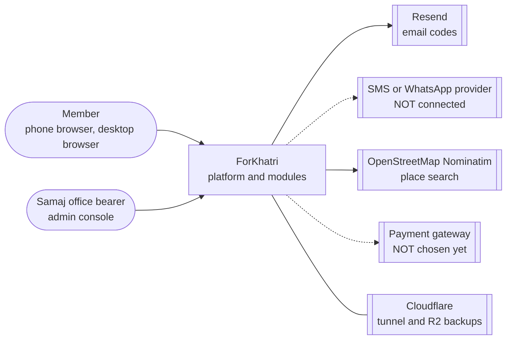
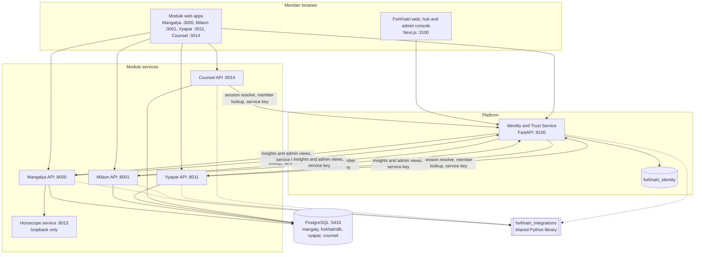
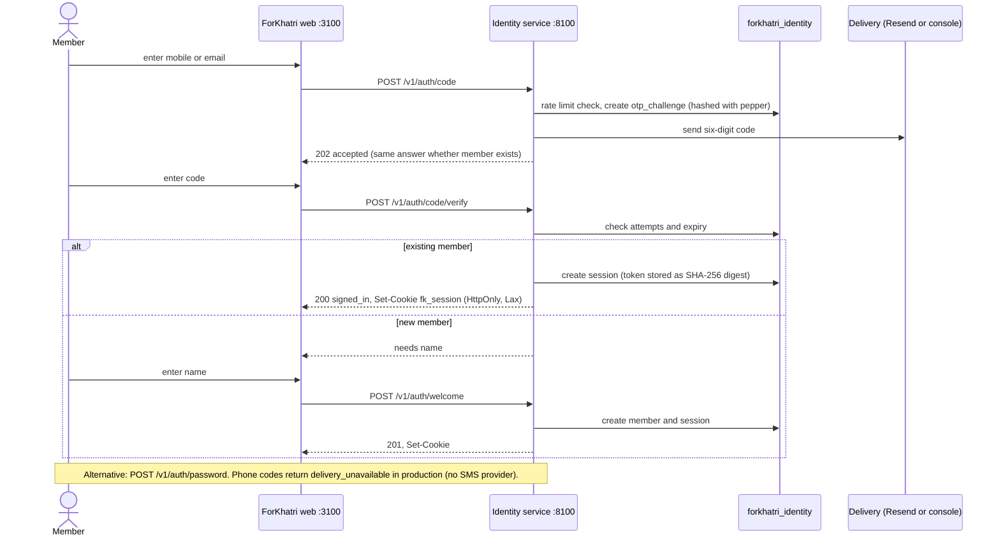
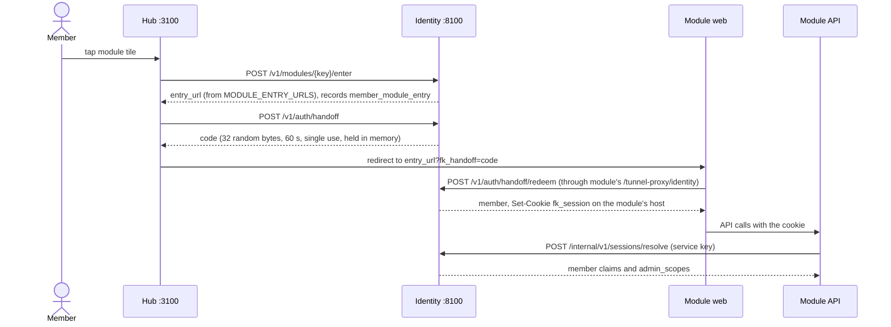

# ForKhatri system architecture (as built, 2026-11-22)

Document status: AS BUILT on 2026-11-22. Derived from `scripts/dev.mjs`, `scripts/tunnel.mjs`,
`scripts/start-tunnels.ps1`, each module's settings and `next.config` files, `platform/identity-service`,
`deploy/`, and `ARCHITECTURE.md` (the decision record with the ADRs, kept as history). Where code and
older documents disagree, this file says so under "Known drift".

Related: `ARCHITECTURE.md` (ADRs), `MODULE-ARCHITECTURE-STANDARD.md` (how every module is built),
`modules/modules.md` (module scope), `docs/RUNBOOK.md` (operate it), `docs/GLOSSARY.md` (terms),
`docs/ParentApp/07-tech-reqs.md` (platform contract), `docs/ParentApp/09-implementation.md` (what was built).

## Contents

1. [What ForKhatri is](#1-what-forkhatri-is)
2. [C4 level 1: system context](#2-c4-level-1-system-context)
3. [C4 level 2: containers](#3-c4-level-2-containers)
4. [Module status](#4-module-status)
5. [Port map](#5-port-map)
6. [Sign-in sequence](#6-sign-in-sequence)
7. [Entering a module and the handoff sequence](#7-entering-a-module-and-the-handoff-sequence)
8. [How a module resolves who the member is](#8-how-a-module-resolves-who-the-member-is)
9. [Data stores](#9-data-stores)
10. [Module registration contract](#10-module-registration-contract)
11. [Shared libraries](#11-shared-libraries)
12. [Tunnel mode (phones and public sharing)](#12-tunnel-mode)
13. [Production topology](#13-production-topology)
14. [Cross-cutting rules](#14-cross-cutting-rules)
15. [Known drift and gaps](#15-known-drift-and-gaps)

## 1. What ForKhatri is

One mobile-first web app for the Khatri community. A member signs in once at the entrance (the hub),
then enters modules: Vyapar (business and work), Milavn (real-world meetups), Mangalya (matrimony),
Counsel (paid guidance). Payment Services, Loans and Finance, and a stand-alone Dashboard are planned.
Identity holds basic facts only (name, verified phone or email, language, level); every module owns its
own profile, roles and data (owner rule 2026-09-14, migration 003).

Stack: Python 3.12 or 3.13 with FastAPI and uvicorn for every API; Next.js (App Router) with React and
TypeScript for every web app; PostgreSQL (port 5433 in development, version 18 in production); Node 20 or
newer for launchers and the horoscope service. Production proxy: Caddy 2.11; tunnel: Cloudflare.

## 2. C4 level 1: system context

Solid lines exist in code and are used when configured; dotted lines are seams only (adapter `none` or
`disabled`). See `shared/forkhatri-integrations/README.md`.

## 3. C4 level 2: containers

| Container | Path | Tech | Responsibility |
|---|---|---|---|
| ForKhatri web | `platform/forkhatri-web` | Next.js | Sign-in screens, hub, account sheet, intent bar, members dashboard, admin console, development "Act as" |
| Identity and Trust Service | `platform/identity-service` | FastAPI, asyncpg | Members, codes, passwords, sessions, rate limits, module registry, governance (roles, suspensions, approvals, audit), insights fan-out, internal API for modules |
| Mangalya web and API | `modules/MOD03-mangalya/mangaly-web`, `mangaly-service` | Next.js, FastAPI | Matrimony, Home Circle, discovery, trust |
| Horoscope service | `modules/MOD03-mangalya/horoscope-service` | Node | Guna Milan and Mangal Dosha, called only by the Mangalya API (shared token) |
| Milavn web and API | `modules/MOD02-milavn/milavn-web`, `milavn-service` | Next.js, FastAPI | Activities, circles, chat (WebSocket `/ws/chat`), reminders |
| Vyapar web and API | `modules/MOD01-vyapar/vyapar-web`, `vyapar-service` | Next.js, FastAPI | Posts, profiles, requests, reputation; also `vyapar-mcp` |
| Counsel web and API | `modules/MOD04-counsel/counsel-web`, `counsel-service` | Next.js, FastAPI | Paid one-to-one guidance, WebSocket |

## 4. Module status

| Key in registry | Module | Folder | Registry availability (migration 002) | Built in code |
|---|---|---|---|---|
| mangaly | MOD03 Mangalya | `modules/MOD03-mangalya` | available | yes (API, web, horoscope) |
| milavn | MOD02 Milavn | `modules/MOD02-milavn` | available | yes |
| vyapar | MOD01 Vyapar | `modules/MOD01-vyapar` | in_development | yes (open directly on 3011; hub lists it as in development) |
| counsel | MOD04 Counsel | `modules/MOD04-counsel` | available | yes |
| payments | MOD06 Payment Services | `modules/MOD06-payment-services` (empty) | planned | no |
| finance | MOD07 Loans and Finance | `modules/MOD07-loans-finance` (empty) | planned | no |
| (none) | MOD05 Dashboard | `modules/MOD05-dashboard` (empty) | no tile: the hub is the dashboard | partial: hub and "ForKhatri in numbers" |

Registry rows can be changed later through `PATCH /v1/admin/modules/{key}` (admin console).

## 5. Port map

Read from `scripts/dev.mjs` (launcher) and `scripts/tunnel.mjs`; module settings agree.

| Port | Process | Group (`--only=`) | Browser-facing | Database |
|---|---|---|---|---|
| 5433 | PostgreSQL (prerequisite; the launcher only checks it) | none | no | all |
| 8100 | identity (Identity and Trust Service) | platform | yes (API) | forkhatri_identity |
| 3100 | entrance (ForKhatri web) | platform | yes | none |
| 8000 | mangalya-api | mangalya | yes (API) | mangaly |
| 3000 | mangalya-web | mangalya | yes | none |
| 8013 | horoscope (internal) | mangalya | no (loopback) | none |
| 8001 | milavn-api | milavn | yes (API, WebSocket) | forkhatridb |
| 3001 | milavn-web | milavn | yes | none |
| 8011 | vyapar-api | vyapar | yes (API) | vyapar |
| 3011 | vyapar-web | vyapar | yes | none |
| 8014 | counsel-api | counsel | yes (API, WebSocket) | counsel |
| 3014 | counsel-web | counsel | yes | none |
| 80 (Docker network) | Caddy | production only | via Cloudflare | none |

Rules enforced by `scripts/dev.mjs`: a port already in use is left alone (reported "already running");
only children it started are stopped, by exact process id; Python APIs run without `--reload`;
a missing `.venv` or `node_modules` is reported, not fatal.

## 6. Sign-in sequence

Code sign-in with sign-up folded in, and a password alternative. Rate limits and anti-enumeration apply
(per identifier, per IP, per challenge; window 900 s; see `platform/identity-service/app/config/settings.py`).

Session: opaque token in an `HttpOnly` cookie (`fk_session` in development, `__Host-fk_session` with
`Secure` in production), 30 days (`SESSION_TTL_DAYS`). Sign-out: `POST /v1/auth/sign-out`, optionally everywhere.

## 7. Entering a module and the handoff sequence

On one origin (production, or localhost where the cookie is sent to each port because cookies do not
separate by port) the module simply reads `fk_session`. On separate hostnames (Cloudflare quick tunnels:
every service gets its own random `*.trycloudflare.com` name) the hub's cookie does not reach the module,
so a single-use handoff code carries the session across.

The session token never appears in a URL. `return_to` (allow-listed in `platform/forkhatri-web/lib/return-to.ts`)
brings a signed-out member back to the module page they wanted.

## 8. How a module resolves who the member is

1. Browser calls the module API with the session cookie (name from `PLATFORM_SESSION_COOKIE` or
   `PLATFORM_SESSION_COOKIE_NAME`).
2. The module API calls `POST {PLATFORM_IDENTITY_URL}/internal/v1/sessions/resolve` with headers
   `X-ForKhatri-Service` (its name) and `X-ForKhatri-Service-Key` (its key from `SERVICE_KEYS`).
3. Identity answers claims: member id, display name, language, level, `admin_scopes` (module permissions such
   as `milavn.moderate` granted in the admin console); phone and email only for services listed in
   `SERVICES_RECEIVING_IDENTIFIERS`.
4. Modules cache the answer for 30 seconds and fail closed with 503 when identity is unreachable (Milavn).
5. `/internal/v1/*` answers 404 to any request carrying `X-Forwarded-For`, and Caddy blocks it at the edge.

Other internal calls: `members/lookup` (up to 200 ids to names), `members/provision` and
`members/{id}/retire-provisioned` (a parent creates a profile for a child's number; six-month removal rule;
Mangalya only today).

## 9. Data stores

One PostgreSQL server, one database per module (isolation ADR-002), a non-owning application role per
service so row level security applies (`MODULE-ARCHITECTURE-STANDARD.md` section 4).

| Database | Owner role / app role | Used by | Schemas and notes |
|---|---|---|---|
| forkhatri_identity | identity_owner / identity_app | Identity service | `identity`, `platform`, `registry`, `governance` (migrations 001 to 007) |
| mangaly | mangaly_owner / mangaly_app | Mangalya API | module data, member link table `mangaly_identity.account`; seeds in `07a-db-implementation` |
| forkhatridb | milavn_owner / milavn_app | Milavn API | shared Core Platform database holding Milavn's own schemas (migrations 001 to 015 as of README) |
| vyapar | vyapar_app | Vyapar API | `modules/MOD01-vyapar/07a-db-implementation`; DB URL in its `.env` |
| counsel | per `counsel-service/.env.example` | Counsel API | `counsel-service/db/migrations` |

Files: uploaded media sit on local disk (`.local-media` per API; Docker volumes `mangaly-media`, `milavn-media`
in production; `vyapar-service/uploads`). No object storage yet. In memory: Milavn chat hub and reminder jobs
(single process only), identity handoff codes, module session caches.

## 10. Module registration contract

To add a module (planned MOD05 to MOD07, or any new one) the platform needs these things; nothing in the
hub is hard-coded per module beyond what is below.

| Step | Where | What |
|---|---|---|
| 1. Registry row | new migration like `platform/identity-service/db/migrations/002-module-registry.sql` | `registry.module(key, name, tagline_en/hi/te, availability, accent, sort_order)`; key matches `^[a-z][a-z0-9_]{1,30}$`; availability is available, in_development or planned |
| 2. Entry URL | identity `.env` `MODULE_ENTRY_URLS` (JSON map key to URL) | where `POST /v1/modules/{key}/enter` sends the member |
| 3. Service key | identity `SERVICE_KEYS` and the module's `PLATFORM_SERVICE_KEY` | at least 32 characters in production; one key per module |
| 4. Session resolve | module API calls `/internal/v1/sessions/resolve` | see section 8 |
| 5. Insights (optional) | identity `MODULE_API_URLS` and a module endpoint answering the insights facts | else the dashboard shows the module as not reachable |
| 6. Admin views (optional) | identity `ADMIN_MODULE_API_URLS` or `MODULE_API_URLS`; module serves `queues` views | the admin console federates queues and actions through `/v1/admin/queues/...` |
| 7. Own database and migrations | module `07a-db-implementation` | non-owning app role, RLS, no cross-module foreign keys |
| 8. Locales | en, hi, te, mr, kn files and `GLOSSARY.md` | one term per concept (owner rule 2026-09-29) |
| 9. Production | `deploy/docker-compose.yml`, `Caddyfile`, `migrate.py` | zone path, API prefix, database; not done for Vyapar and Counsel (section 15) |

Environment values are never hard-coded in code (owner rule 2026-09-27): names go in `.env.example`.

## 11. Shared libraries

`shared/forkhatri-integrations` (Python standard library only, installed with `pip install -e` into each
service's virtualenv; `deploy` Dockerfiles do not install it yet, unverified): `payments` (adapters `none`,
`sandbox`, `payment_services`), `messaging` (`console`, `disabled`; SMS, WhatsApp, email, push), `delivery`
(outbox sender with retries), `places` (Nominatim, or `none`). All adoption is opt-in by configuration so each
module's earlier behaviour is unchanged (owner direction 2026-10-01). No real vendor is connected; candidates
are listed in `shared/forkhatri-integrations/BACKLOG.md`.

## 12. Tunnel mode

Purpose: show the whole app on phones through the public internet without a domain.

- `npm run dev:tunnel` (`scripts/tunnel.mjs`): starts a `cloudflared` quick tunnel for every browser-facing
  port (8100, 3100, 8000, 3000, 8001, 3001, 8011, 3011, 8014, 3014; horoscope 8013 is never tunnelled),
  waits for each `https://*.trycloudflare.com` URL, rewrites a marked auto-managed block in each affected
  `.env` and `.env.local`, then starts every dev server fresh so each reads the new URLs on first boot.
  Ctrl+C reverts the blocks to localhost. Do not run it together with `npm run dev`.
- `scripts/start-tunnels.ps1` (Windows): frees the ports, deletes each web app's `.next` cache (cures the
  `next/font/google` build error), starts `tunnel.mjs` hidden, prints the links. Options `-Stop`, `-Status`,
  `-Foreground`. Links are in `scripts/.tunnel.log`. It needs `cloudflared` installed.
- Managed values: identity `CORS_ALLOWED_ORIGINS`, `MODULE_ENTRY_URLS`, `MODULE_API_URLS`,
  `ADMIN_MODULE_API_URLS`; each web app's `NEXT_PUBLIC_API_BASE` (or `NEXT_PUBLIC_API_URL` for Vyapar),
  `NEXT_PUBLIC_IDENTITY_API` (or `NEXT_PUBLIC_HOST_IDENTITY_API`), `NEXT_PUBLIC_FORKHATRI_ENTRANCE_URL`;
  Mangalya API `FORKHATRI_ENTRANCE_URL` and CORS.
- Proxy rewrites (set only when `TUNNEL_DEV_ORIGIN` is present, i.e. while tunnelling): while tunnelled the
  browser must call identity and the module API through the web app's own origin, because two tunnel hostnames
  are two different sites and a cross-site call would never send the cookie back.

| Web app | Rewrite source | Destination (always localhost, server to server) |
|---|---|---|
| ForKhatri web | `/tunnel-proxy/identity/:path*` | `http://localhost:8100/:path*` |
| Mangalya web | `/tunnel-proxy/identity/:path*`, `/tunnel-proxy/api/:path*` | `:8100`, `:8000` |
| Milavn web | same two; plus always `/media/:path*` to the API | `:8100`, `:8001` |
| Vyapar web | same two | `:8100`, `:8011` |
| Counsel web | same two (API base from `API_SERVER_BASE`); WebSocket cannot be rewritten so it connects straight to the Counsel tunnel | `:8100`, API |

Mode flag: `NEXT_PUBLIC_API_BASE` equals `/tunnel-proxy/api` and `NEXT_PUBLIC_IDENTITY_API` equals
`/tunnel-proxy/identity` while tunnelling; otherwise the plain localhost URLs. The sign-in handoff
(section 7) is what moves a session from the hub's hostname to a module's hostname.

Known limit: quick tunnel hostnames change every run, so `fk_session` set on one hostname never reaches another;
a named tunnel on a real domain would let services share a parent domain and `SESSION_COOKIE_DOMAIN`.

## 13. Production topology

One Oracle Cloud Always Free Ampere VM (2 OCPU, 12 GB), Docker Compose, outbound-only Cloudflare Tunnel, Caddy as
the only HTTP entry. Browser to Cloudflare to `cloudflared` to `caddy:80`.

| Path | Goes to | Notes |
|---|---|---|
| `/edge-health` | Caddy answers `ok` | heartbeat and deploy checks |
| `/api/identity/*` | identity-service :8100 | prefix stripped, service runs with `ROOT_PATH` |
| `/api/mangaly/*` | mangaly-service :8000 | prefix stripped |
| `/api/milavn/*` | milavn-service :8001 | prefix stripped, WebSocket kept open |
| `/mangaly`, `/mangaly/*` | mangaly-web :3000 | Next `basePath` `/mangaly` |
| `/milavn`, `/milavn/*` | milavn-web :3001 | Next `basePath` `/milavn` |
| everything else | forkhatri-web :3100 | default zone |
| `/internal/*`, `/api/identity/internal*`, `/api/*/docs`, `/api/*/redoc`, `/api/*/openapi.json` | 404 | never public |

Edge headers: HSTS, nosniff, referrer policy, permissions policy; client IP only from `CF-Connecting-IP`;
request body capped at 25 MB. Containers are read-only, run with all capabilities dropped and memory limits (about 5.3 GB
total). Operations: `docs/RUNBOOK.md`.

## 14. Cross-cutting rules

- Authentication is owned only by the platform (no module login). Development sign-in uses the `/dev/v1` switcher
  (compiled out of production; the production guard refuses to start with dev tools on).
- Error model: JSON `{code, message}` domain errors (for example `session_invalid`, `service_unauthorized`,
  `delivery_unavailable`, `handoff_invalid`, `member_exists`).
- Origin allow-list guards every browser write on the identity service (CORS list `CORS_ALLOWED_ORIGINS`).
- Languages: en, hi, te, mr, kn; parity checked by `scripts/check_locale_parity.py`.
- Mobile first (owner rule); desktop works too.

## 15. Known drift and gaps

1. `scripts/dev.mjs` uses `mangalya-service` and `mangalya-web` folder names that do not exist (real: `mangaly-service`, `mangaly-web`), so `npm run dev` skips Mangalya's API and web; `tunnel.mjs` is correct.
2. `deploy/` and `.github/workflows/deploy.yml` use `modules/MOD03-mangaly` (does not exist; real `MOD03-mangalya`).
3. Vyapar and Counsel are absent from the production compose, Caddyfile and migrate job.
4. Handoff codes are in process memory; one identity process only.
5. Registry key `mangaly` keeps the old spelling by design (migration 006); only the display name is Mangalya.
6. Vyapar and Counsel are in the identity `SERVICE_KEYS` development defaults but `SERVICES_RECEIVING_IDENTIFIERS` has only `mangaly`.
7. MOD05, MOD06, MOD07 do not exist yet; Payment Services is the planned target of the `payment_services` adapter (contract at the top of `shared/forkhatri-integrations/forkhatri_integrations/payments/adapters.py`).
8. Counsel's and Vyapar's database ownership roles were not verified from running databases in this pass (unverified: check each `07a-db-implementation/.env.example`).
