# Vyapar data model as built — table-by-table appendix (2026-11-22)

**Document status:** as built, 2026-11-22. Generated read-only from the live development database (`vyapar` on localhost:5433, schemas `vyapar_*`), migrations 001–032 being authoritative. Companion to [07a-er-model.md](07a-er-model.md) (design history and rationale, still valid where not marked superseded). Counts: **63 tables in 13 schemas, 811 columns, 139 indexes, 69 RLS policies, 84 functions, 18 triggers, 28 foreign keys.**

Table IDs are TBL-001.. in the order below. "RLS" = row-level security enabled / forced on the table.

## Contents

- [vyapar_analytics](#vyapar_analytics) (1 tables)
- [vyapar_commercial](#vyapar_commercial) (8 tables)
- [vyapar_contracts](#vyapar_contracts) (6 tables)
- [vyapar_enquiries](#vyapar_enquiries) (6 tables)
- [vyapar_identity](#vyapar_identity) (1 tables)
- [vyapar_integration](#vyapar_integration) (10 tables)
- [vyapar_listings](#vyapar_listings) (10 tables)
- [vyapar_opportunities](#vyapar_opportunities) (4 tables)
- [vyapar_payments](#vyapar_payments) (1 tables)
- [vyapar_platform](#vyapar_platform) (2 tables)
- [vyapar_privacy](#vyapar_privacy) (6 tables)
- [vyapar_reviews](#vyapar_reviews) (5 tables)
- [vyapar_trust_safety](#vyapar_trust_safety) (3 tables)
- [Functions](#functions)
- [Triggers](#triggers)
- [Entity relationship diagram](#entity-relationship-diagram)
- [Migration history](#migration-history)
- [Known drift](#known-drift)

## vyapar_analytics

### TBL-001 vyapar_analytics.analytics_events

RLS: enabled=yes, forced=no.

| Column | Type | Null | Default |
|---|---|---|---|
| id | bigint | NO | nextval('vyapar_analytics.analytics_events_id_seq'::regclass) |
| member_pseudo | text | YES |  |
| object_id | text | YES |  |
| surface | text | YES |  |
| event | text | NO |  |
| level | text | NO |  |
| props | jsonb | NO | '{}'::jsonb |
| at | timestamp | with | time zone NO now() |

Constraints (FK/CHECK/UNIQUE):

- `analytics_events_level_check` (c): `CHECK ((level = ANY (ARRAY['impression'::text, 'view'::text, 'action'::text, 'attributed_outcome'::text, 'confirmed_outcome'::text, 'operational'::text])))`

Indexes: `analytics_events_pkey`, `analytics_events_at_idx`

RLS policies: `analytics_insert_any (INSERT)`, `analytics_select_operator_only (SELECT)`

## vyapar_commercial

### TBL-002 vyapar_commercial.campaigns

RLS: enabled=yes, forced=no.

| Column | Type | Null | Default |
|---|---|---|---|
| id | uuid | NO | gen_random_uuid() |
| listing_id | text | NO |  |
| owner_id | text | NO |  |
| name | text | NO |  |
| product_id | text | NO |  |
| product_version | integer | NO |  |
| budget_paise | bigint | NO |  |
| tax_paise | bigint | NO |  |
| starts_at | timestamp | with | time zone NO  |
| ends_at | timestamp | with | time zone NO  |
| audience | jsonb | NO | '{}'::jsonb |
| item_refs | jsonb | NO | '[]'::jsonb |
| state | text | NO | 'draft'::text |
| payment_order_id | uuid | YES |  |
| created_at | timestamp | with | time zone NO now() |
| updated_at | timestamp | with | time zone NO now() |

Constraints (FK/CHECK/UNIQUE):

- `campaigns_product_id_product_version_fkey` (f): `FOREIGN KEY (product_id, product_version) REFERENCES vyapar_commercial.products(id, version)`
- `campaigns_state_check` (c): `CHECK ((state = ANY (ARRAY['draft'::text, 'awaiting_payment'::text, 'active'::text, 'completed'::text, 'cancelled'::text, 'refunded'::text])))`

Indexes: `campaigns_pkey`

RLS policies: `campaigns_owner_or_workspace (ALL)`

### TBL-003 vyapar_commercial.commercial_order_history

RLS: enabled=yes, forced=no.

| Column | Type | Null | Default |
|---|---|---|---|
| id | bigint | NO | nextval('vyapar_commercial.commercial_order_history_id_seq'::regclass) |
| order_kind | text | NO |  |
| order_id | uuid | NO |  |
| from_state | text | YES |  |
| to_state | text | NO |  |
| reason | text | YES |  |
| at | timestamp | with | time zone NO now() |

Constraints (FK/CHECK/UNIQUE):

- `commercial_order_history_order_kind_check` (c): `CHECK ((order_kind = ANY (ARRAY['promotion'::text, 'entitlement'::text])))`

Indexes: `commercial_order_history_pkey`, `commercial_order_history_order_idx`

RLS policies: `order_history_visible_to_owner (ALL)`

### TBL-004 vyapar_commercial.entitlements

RLS: enabled=yes, forced=no.

| Column | Type | Null | Default |
|---|---|---|---|
| id | uuid | NO | gen_random_uuid() |
| listing_id | text | NO |  |
| owner_id | text | NO |  |
| product_id | text | NO |  |
| product_version | integer | NO |  |
| price_paise | bigint | NO |  |
| tax_paise | bigint | NO |  |
| state | text | NO | 'awaiting_payment'::text |
| starts_at | timestamp | with | time zone YES  |
| renews_at | timestamp | with | time zone YES  |
| grace_until | timestamp | with | time zone YES  |
| cancel_at_period_end | boolean | NO | false |
| renewal_reminder_at | timestamp | with | time zone YES  |
| renewal_reminder_acked_at | timestamp | with | time zone YES  |
| payment_order_id | uuid | YES |  |
| created_at | timestamp | with | time zone NO now() |
| updated_at | timestamp | with | time zone NO now() |

Constraints (FK/CHECK/UNIQUE):

- `entitlements_state_check` (c): `CHECK ((state = ANY (ARRAY['awaiting_payment'::text, 'active'::text, 'paused'::text, 'cancelled'::text, 'completed'::text, 'refunded'::text])))`
- `entitlements_product_id_product_version_fkey` (f): `FOREIGN KEY (product_id, product_version) REFERENCES vyapar_commercial.products(id, version)`

Indexes: `entitlements_pkey`, `entitlements_owner_idx`

RLS policies: `entitlements_owner_or_workspace (ALL)`

### TBL-005 vyapar_commercial.impressions

RLS: enabled=yes, forced=no.

| Column | Type | Null | Default |
|---|---|---|---|
| id | bigint | NO | nextval('vyapar_commercial.impressions_id_seq'::regclass) |
| target_kind | text | NO |  |
| target_id | uuid | NO |  |
| member_id | text | YES |  |
| surface | text | NO |  |
| sponsored | boolean | NO | false |
| kind | text | NO |  |
| at | timestamp | with | time zone NO now() |

Constraints (FK/CHECK/UNIQUE):

- `impressions_kind_check` (c): `CHECK ((kind = ANY (ARRAY['impression'::text, 'view'::text, 'save'::text, 'enquiry'::text, 'outcome'::text])))`

Indexes: `impressions_pkey`, `impressions_target_idx`

RLS policies: `impressions_insert_any (INSERT)`, `impressions_select_operator_only (SELECT)`

### TBL-006 vyapar_commercial.outbox_event

RLS: enabled=yes, forced=no.

| Column | Type | Null | Default |
|---|---|---|---|
| id | bigint | NO | nextval('vyapar_commercial.outbox_event_id_seq'::regclass) |
| event_type | text | NO |  |
| payload | jsonb | NO |  |
| published_at | timestamp | with | time zone YES  |
| created_at | timestamp | with | time zone NO now() |

Indexes: `outbox_event_pkey`

RLS policies: `outbox_insert_any (INSERT)`, `outbox_select_dispatcher (SELECT)`

### TBL-007 vyapar_commercial.products

RLS: enabled=no, forced=no.

| Column | Type | Null | Default |
|---|---|---|---|
| id | text | NO |  |
| version | integer | NO | 1 |
| kind | text | NO |  |
| name | text | NO |  |
| description | text | YES |  |
| duration_days | integer | YES |  |
| billing | text | NO |  |
| price_paise | bigint | NO |  |
| tax_rate_bp | integer | NO | 1800 |
| capabilities | ARRAY | NO | '{}'::text[] |
| active | boolean | NO | true |
| created_at | timestamp | with | time zone NO now() |

Constraints (FK/CHECK/UNIQUE):

- `products_kind_check` (c): `CHECK ((kind = ANY (ARRAY['boost'::text, 'workspace'::text, 'campaign'::text])))`
- `products_billing_check` (c): `CHECK ((billing = ANY (ARRAY['one_time'::text, 'monthly'::text, 'annual'::text])))`

Indexes: `products_pkey`

### TBL-008 vyapar_commercial.promotions

RLS: enabled=yes, forced=no.

| Column | Type | Null | Default |
|---|---|---|---|
| id | uuid | NO | gen_random_uuid() |
| owner_id | text | NO |  |
| target_kind | text | NO |  |
| target_id | uuid | NO |  |
| product_id | text | NO |  |
| product_version | integer | NO |  |
| price_paise | bigint | NO |  |
| tax_paise | bigint | NO |  |
| audience | jsonb | NO | '{}'::jsonb |
| state | text | NO | 'draft'::text |
| starts_at | timestamp | with | time zone YES  |
| ends_at | timestamp | with | time zone YES  |
| paused_at | timestamp | with | time zone YES  |
| credit_paise | bigint | NO | 0 |
| campaign_id | uuid | YES |  |
| payment_order_id | uuid | YES |  |
| reject_reason | text | YES |  |
| created_at | timestamp | with | time zone NO now() |
| updated_at | timestamp | with | time zone NO now() |
| duration_days | integer | YES |  |

Constraints (FK/CHECK/UNIQUE):

- `promotions_target_kind_check` (c): `CHECK ((target_kind = ANY (ARRAY['listing'::text, 'opportunity'::text])))`
- `promotions_state_check` (c): `CHECK ((state = ANY (ARRAY['draft'::text, 'awaiting_payment'::text, 'scheduled'::text, 'active'::text, 'paused'::text, 'completed'::text, 'cancelled'::text, 'rejected'::text, 'refunded'::text])))`
- `promotions_campaign_id_fkey` (f): `FOREIGN KEY (campaign_id) REFERENCES vyapar_commercial.campaigns(id)`
- `promotions_product_id_product_version_fkey` (f): `FOREIGN KEY (product_id, product_version) REFERENCES vyapar_commercial.products(id, version)`
- `promotions_duration_days_check` (c): `CHECK (((duration_days >= 1) AND (duration_days <= 30)))`

Indexes: `promotions_pkey`, `promotions_target_idx`, `promotions_owner_idx`

RLS policies: `promotions_owner_or_workspace (ALL)`

### TBL-009 vyapar_commercial.workspace_members

RLS: enabled=yes, forced=no.

| Column | Type | Null | Default |
|---|---|---|---|
| id | uuid | NO | gen_random_uuid() |
| listing_id | text | NO |  |
| member_id | text | YES |  |
| phone | text | NO |  |
| role | text | NO |  |
| state | text | NO | 'pending'::text |
| invited_by | text | NO |  |
| invited_at | timestamp | with | time zone NO now() |
| accepted_at | timestamp | with | time zone YES  |
| revoked_at | timestamp | with | time zone YES  |
| expires_at | timestamp | with | time zone NO (now() + '30 days'::interval) |

Constraints (FK/CHECK/UNIQUE):

- `workspace_members_role_check` (c): `CHECK ((role = ANY (ARRAY['admin'::text, 'operator'::text])))`
- `workspace_members_state_check` (c): `CHECK ((state = ANY (ARRAY['pending'::text, 'active'::text, 'revoked'::text, 'expired'::text])))`

Indexes: `workspace_members_pkey`, `workspace_members_listing_idx`

RLS policies: `workspace_members_visible (ALL)`

## vyapar_contracts

### TBL-010 vyapar_contracts.contract_disputes

RLS: enabled=yes, forced=no.

| Column | Type | Null | Default |
|---|---|---|---|
| id | uuid | NO | gen_random_uuid() |
| contract_id | uuid | NO |  |
| milestone_id | uuid | YES |  |
| opened_by | text | NO |  |
| reason | text | NO |  |
| state | text | NO | 'open'::text |
| notes | text | YES |  |
| resolved_by | text | YES |  |
| resolved_at | timestamp | with | time zone YES  |
| created_at | timestamp | with | time zone NO now() |
| updated_at | timestamp | with | time zone NO now() |

Constraints (FK/CHECK/UNIQUE):

- `contract_disputes_reason_check` (c): `CHECK (((char_length(reason) >= 10) AND (char_length(reason) <= 2000)))`
- `contract_disputes_state_check` (c): `CHECK ((state = ANY (ARRAY['open'::text, 'resolved_client'::text, 'resolved_provider'::text, 'closed'::text])))`
- `contract_disputes_notes_check` (c): `CHECK (((notes IS NULL) OR (char_length(notes) <= 2000)))`
- `contract_disputes_contract_id_fkey` (f): `FOREIGN KEY (contract_id) REFERENCES vyapar_contracts.contracts(id) ON DELETE CASCADE`
- `contract_disputes_milestone_id_fkey` (f): `FOREIGN KEY (milestone_id) REFERENCES vyapar_contracts.contract_milestones(id) ON DELETE SET NULL`

Indexes: `contract_disputes_pkey`, `contract_disputes_contract_idx`, `contract_disputes_open_idx`

RLS policies: `contract_disputes_parties (ALL)`

### TBL-011 vyapar_contracts.contract_events

RLS: enabled=yes, forced=no.

| Column | Type | Null | Default |
|---|---|---|---|
| id | bigint | NO | nextval('vyapar_contracts.contract_events_id_seq'::regclass) |
| contract_id | uuid | NO |  |
| milestone_id | uuid | YES |  |
| actor_member_id | text | YES |  |
| type | text | NO |  |
| data | jsonb | NO | '{}'::jsonb |
| created_at | timestamp | with | time zone NO now() |

Constraints (FK/CHECK/UNIQUE):

- `contract_events_contract_id_fkey` (f): `FOREIGN KEY (contract_id) REFERENCES vyapar_contracts.contracts(id) ON DELETE CASCADE`

Indexes: `contract_events_pkey`, `contract_events_contract_idx`

RLS policies: `contract_events_parties (ALL)`

### TBL-012 vyapar_contracts.contract_ledger

RLS: enabled=yes, forced=no.

| Column | Type | Null | Default |
|---|---|---|---|
| id | bigint | NO | nextval('vyapar_contracts.contract_ledger_id_seq'::regclass) |
| contract_id | uuid | NO |  |
| milestone_id | uuid | YES |  |
| entry | text | NO |  |
| amount_paise | bigint | NO |  |
| payment_order_id | uuid | YES |  |
| note | text | YES |  |
| created_at | timestamp | with | time zone NO now() |

Constraints (FK/CHECK/UNIQUE):

- `contract_ledger_contract_id_fkey` (f): `FOREIGN KEY (contract_id) REFERENCES vyapar_contracts.contracts(id) ON DELETE CASCADE`
- `contract_ledger_milestone_id_fkey` (f): `FOREIGN KEY (milestone_id) REFERENCES vyapar_contracts.contract_milestones(id) ON DELETE SET NULL`
- `contract_ledger_entry_check` (c): `CHECK ((entry = ANY (ARRAY['held'::text, 'released'::text, 'refunded'::text, 'fee'::text])))`
- `contract_ledger_amount_paise_check` (c): `CHECK ((amount_paise >= 0))`

Indexes: `contract_ledger_pkey`, `contract_ledger_contract_idx`

RLS policies: `contract_ledger_parties (ALL)`

### TBL-013 vyapar_contracts.contract_milestones

RLS: enabled=yes, forced=no.

| Column | Type | Null | Default |
|---|---|---|---|
| id | uuid | NO | gen_random_uuid() |
| contract_id | uuid | NO |  |
| title | text | NO |  |
| description | text | YES |  |
| amount_paise | bigint | NO |  |
| due_date | date | YES |  |
| sort | integer | NO | 0 |
| state | text | NO | 'pending'::text |
| funded_order_id | uuid | YES |  |
| checkout_url | text | YES |  |
| funded_at | timestamp | with | time zone YES  |
| submitted_at | timestamp | with | time zone YES  |
| submission_note | text | YES |  |
| approved_at | timestamp | with | time zone YES  |
| released_at | timestamp | with | time zone YES  |
| rejected_at | timestamp | with | time zone YES  |
| reject_note | text | YES |  |
| auto_release_at | timestamp | with | time zone YES  |
| auto_approve | boolean | NO | false |
| pending_notice | jsonb | YES |  |
| created_at | timestamp | with | time zone NO now() |
| updated_at | timestamp | with | time zone NO now() |

Constraints (FK/CHECK/UNIQUE):

- `contract_milestones_title_check` (c): `CHECK (((char_length(title) >= 2) AND (char_length(title) <= 140)))`
- `contract_milestones_description_check` (c): `CHECK (((description IS NULL) OR (char_length(description) <= 2000)))`
- `contract_milestones_amount_paise_check` (c): `CHECK ((amount_paise > 0))`
- `contract_milestones_state_check` (c): `CHECK ((state = ANY (ARRAY['pending'::text, 'funded'::text, 'submitted'::text, 'approved'::text, 'released'::text, 'rejected'::text, 'refunded'::text])))`
- `contract_milestones_submission_note_check` (c): `CHECK (((submission_note IS NULL) OR (char_length(submission_note) <= 1000)))`
- `contract_milestones_reject_note_check` (c): `CHECK (((reject_note IS NULL) OR (char_length(reject_note) <= 1000)))`
- `contract_milestones_contract_id_fkey` (f): `FOREIGN KEY (contract_id) REFERENCES vyapar_contracts.contracts(id) ON DELETE CASCADE`

Indexes: `contract_milestones_pkey`, `contract_milestones_contract_idx`, `contract_milestones_auto_release_idx`

RLS policies: `contract_milestones_parties (ALL)`

### TBL-014 vyapar_contracts.contracts

RLS: enabled=yes, forced=no.

| Column | Type | Null | Default |
|---|---|---|---|
| id | uuid | NO | gen_random_uuid() |
| opportunity_id | uuid | YES |  |
| enquiry_id | uuid | NO |  |
| client_member_id | text | NO |  |
| provider_member_id | text | NO |  |
| provider_listing_id | uuid | YES |  |
| title | text | NO |  |
| description | text | YES |  |
| kind | text | NO |  |
| currency | text | NO | 'INR'::text |
| total_paise | bigint | NO |  |
| hourly_rate_paise | bigint | YES |  |
| weekly_hours_cap | numeric | YES |  |
| platform_fee_bps | integer | NO | 0 |
| state | text | NO | 'draft'::text |
| proposed_at | timestamp | with | time zone YES  |
| accepted_at | timestamp | with | time zone YES  |
| completed_at | timestamp | with | time zone YES  |
| cancelled_at | timestamp | with | time zone YES  |
| cancelled_by | text | YES |  |
| cancel_reason | text | YES |  |
| created_at | timestamp | with | time zone NO now() |
| updated_at | timestamp | with | time zone NO now() |

Constraints (FK/CHECK/UNIQUE):

- `contracts_title_check` (c): `CHECK (((char_length(title) >= 3) AND (char_length(title) <= 140)))`
- `contracts_description_check` (c): `CHECK (((description IS NULL) OR (char_length(description) <= 2000)))`
- `contracts_kind_check` (c): `CHECK ((kind = ANY (ARRAY['fixed'::text, 'hourly'::text])))`
- `contracts_currency_check` (c): `CHECK ((currency = 'INR'::text))`
- `contracts_total_paise_check` (c): `CHECK ((total_paise > 0))`
- `contracts_hourly_rate_paise_check` (c): `CHECK (((hourly_rate_paise IS NULL) OR (hourly_rate_paise > 0)))`
- `contracts_weekly_hours_cap_check` (c): `CHECK (((weekly_hours_cap IS NULL) OR ((weekly_hours_cap > (0)::numeric) AND (weekly_hours_cap <= (168)::numeric))))`
- `contracts_platform_fee_bps_check` (c): `CHECK (((platform_fee_bps >= 0) AND (platform_fee_bps <= 10000)))`
- `contracts_state_check` (c): `CHECK ((state = ANY (ARRAY['draft'::text, 'proposed'::text, 'active'::text, 'completed'::text, 'cancelled'::text, 'disputed'::text])))`
- `contracts_cancel_reason_check` (c): `CHECK (((cancel_reason IS NULL) OR (char_length(cancel_reason) <= 500)))`
- `contracts_check` (c): `CHECK ((client_member_id <> provider_member_id))`
- `contracts_check1` (c): `CHECK (((kind = 'fixed'::text) OR ((hourly_rate_paise IS NOT NULL) AND (weekly_hours_cap IS NOT NULL))))`

Indexes: `contracts_pkey`, `contracts_client_idx`, `contracts_provider_idx`, `contracts_one_live_per_enquiry`

RLS policies: `contracts_parties (ALL)`

### TBL-015 vyapar_contracts.timesheets

RLS: enabled=yes, forced=no.

| Column | Type | Null | Default |
|---|---|---|---|
| id | uuid | NO | gen_random_uuid() |
| contract_id | uuid | NO |  |
| week_start | date | NO |  |
| hours | numeric | NO |  |
| note | text | YES |  |
| state | text | NO | 'submitted'::text |
| reject_note | text | YES |  |
| milestone_id | uuid | YES |  |
| submitted_at | timestamp | with | time zone NO now() |
| approved_at | timestamp | with | time zone YES  |
| paid_at | timestamp | with | time zone YES  |
| created_at | timestamp | with | time zone NO now() |
| updated_at | timestamp | with | time zone NO now() |

Constraints (FK/CHECK/UNIQUE):

- `timesheets_week_start_check` (c): `CHECK ((EXTRACT(isodow FROM week_start) = (1)::numeric))`
- `timesheets_hours_check` (c): `CHECK (((hours > (0)::numeric) AND (hours <= (168)::numeric)))`
- `timesheets_note_check` (c): `CHECK (((note IS NULL) OR (char_length(note) <= 1000)))`
- `timesheets_state_check` (c): `CHECK ((state = ANY (ARRAY['submitted'::text, 'approved'::text, 'paid'::text, 'rejected'::text])))`
- `timesheets_reject_note_check` (c): `CHECK (((reject_note IS NULL) OR (char_length(reject_note) <= 1000)))`
- `timesheets_contract_id_week_start_key` (u): `UNIQUE (contract_id, week_start)`
- `timesheets_contract_id_fkey` (f): `FOREIGN KEY (contract_id) REFERENCES vyapar_contracts.contracts(id) ON DELETE CASCADE`
- `timesheets_milestone_id_fkey` (f): `FOREIGN KEY (milestone_id) REFERENCES vyapar_contracts.contract_milestones(id) ON DELETE SET NULL`

Indexes: `timesheets_pkey`, `timesheets_contract_id_week_start_key`

RLS policies: `timesheets_parties (ALL)`

## vyapar_enquiries

### TBL-016 vyapar_enquiries.blocks

RLS: enabled=yes, forced=no.

| Column | Type | Null | Default |
|---|---|---|---|
| blocker_id | text | NO |  |
| blocked_id | text | NO |  |
| created_at | timestamp | with | time zone NO now() |

Indexes: `blocks_pkey`

RLS policies: `blocks_blocker_only (ALL)`

### TBL-017 vyapar_enquiries.contact_attempts

RLS: enabled=yes, forced=no.

| Column | Type | Null | Default |
|---|---|---|---|
| id | uuid | NO | gen_random_uuid() |
| enquiry_id | uuid | YES |  |
| caller_id | text | NO |  |
| callee_id | text | NO |  |
| channel | text | NO |  |
| at | timestamp | with | time zone NO now() |
| opportunity_id | uuid | YES |  |

Constraints (FK/CHECK/UNIQUE):

- `contact_attempts_check` (c): `CHECK ((caller_id <> callee_id))`
- `contact_attempts_channel_check` (c): `CHECK ((channel = ANY (ARRAY['call'::text, 'whatsapp'::text])))`
- `contact_attempts_enquiry_id_fkey` (f): `FOREIGN KEY (enquiry_id) REFERENCES vyapar_enquiries.enquiries(id) ON DELETE CASCADE`
- `contact_attempts_target_check` (c): `CHECK (((enquiry_id IS NOT NULL) OR (opportunity_id IS NOT NULL)))`

Indexes: `contact_attempts_pkey`, `contact_attempts_callee_idx`, `contact_attempts_enquiry_idx`, `contact_attempts_opportunity_idx`

RLS policies: `contact_attempts_parties (ALL)`

### TBL-018 vyapar_enquiries.enquiries

RLS: enabled=yes, forced=no.

| Column | Type | Null | Default |
|---|---|---|---|
| id | uuid | NO | gen_random_uuid() |
| sender_id | text | NO |  |
| provider_id | text | NO |  |
| listing_id | uuid | YES |  |
| opportunity_id | uuid | YES |  |
| action_type | text | NO |  |
| sub_choice | text | YES |  |
| state | text | NO | 'open'::text |
| delivered | boolean | NO | true |
| safety_notice_seen | boolean | NO | false |
| first_reply_at | timestamp | with | time zone YES  |
| state_reason | text | YES |  |
| last_activity_at | timestamp | with | time zone NO now() |
| created_at | timestamp | with | time zone NO now() |
| updated_at | timestamp | with | time zone NO now() |
| package_id | uuid | YES |  |
| bid_amount_paise | bigint | YES |  |
| bid_type | text | YES |  |
| timeline_days | smallint | YES |  |
| milestones | jsonb | NO | '[]'::jsonb |
| screening_answers | jsonb | NO | '[]'::jsonb |
| applied_via | text | NO | 'form'::text |
| profile_snapshot | jsonb | YES |  |
| stage | text | NO | 'new'::text |
| stage_changed_at | timestamp | with | time zone YES  |

Constraints (FK/CHECK/UNIQUE):

- `enquiries_action_type_check` (c): `CHECK ((action_type = ANY (ARRAY['enquire'::text, 'apply'::text, 'propose'::text, 'contact'::text, 'register'::text])))`
- `enquiries_state_check` (c): `CHECK ((state = ANY (ARRAY['open'::text, 'awaiting_response'::text, 'in_progress'::text, 'resolved'::text, 'closed'::text, 'withdrawn'::text, 'restricted'::text])))`
- `enquiries_check` (c): `CHECK (((listing_id IS NOT NULL) OR (opportunity_id IS NOT NULL)))`
- `enquiries_bid_amount_paise_check` (c): `CHECK (((bid_amount_paise IS NULL) OR (bid_amount_paise > 0)))`
- `enquiries_bid_type_check` (c): `CHECK (((bid_type IS NULL) OR (bid_type = ANY (ARRAY['fixed'::text, 'hourly'::text]))))`
- `enquiries_timeline_days_check` (c): `CHECK (((timeline_days IS NULL) OR (timeline_days > 0)))`
- `enquiries_stage_check` (c): `CHECK ((stage = ANY (ARRAY['new'::text, 'shortlisted'::text, 'hired'::text, 'declined'::text])))`
- `enquiries_applied_via_check` (c): `CHECK ((applied_via = ANY (ARRAY['form'::text, 'one_tap'::text, 'voice'::text, 'agent'::text, 'call'::text])))`

Indexes: `enquiries_pkey`, `enquiries_sender_idx`, `enquiries_provider_idx`, `enquiries_one_open_per_target`, `enquiries_opportunity_stage_idx`

RLS policies: `enquiries_participants (ALL)`

Triggers: enquiries_emit_event AFTER INSERT, enquiries_emit_event AFTER UPDATE, enquiries_emit_stage_event AFTER UPDATE

### TBL-019 vyapar_enquiries.enquiry_messages

RLS: enabled=yes, forced=no.

| Column | Type | Null | Default |
|---|---|---|---|
| id | uuid | NO | gen_random_uuid() |
| enquiry_id | uuid | NO |  |
| sender_id | text | NO |  |
| body | text | NO |  |
| content_language | text | YES |  |
| attachment_url | text | YES |  |
| system_note | boolean | NO | false |
| created_at | timestamp | with | time zone NO now() |
| template_key | text | YES |  |
| template_params | jsonb | YES |  |

Constraints (FK/CHECK/UNIQUE):

- `enquiry_messages_body_check` (c): `CHECK (((char_length(body) >= 1) AND (char_length(body) <= 1000)))`
- `enquiry_messages_enquiry_id_fkey` (f): `FOREIGN KEY (enquiry_id) REFERENCES vyapar_enquiries.enquiries(id) ON DELETE CASCADE`
- `enquiry_messages_content_language_check` (c): `CHECK ((content_language = ANY (ARRAY['en'::text, 'hi'::text, 'te'::text, 'mr'::text, 'kn'::text])))`

Indexes: `enquiry_messages_pkey`, `enquiry_messages_enquiry_idx`

RLS policies: `enquiry_messages_participants (ALL)`

Triggers: enquiry_messages_emit_event AFTER INSERT

### TBL-020 vyapar_enquiries.outbox_event

RLS: enabled=yes, forced=no.

| Column | Type | Null | Default |
|---|---|---|---|
| id | bigint | NO | nextval('vyapar_enquiries.outbox_event_id_seq'::regclass) |
| event_type | text | NO |  |
| payload | jsonb | NO |  |
| published_at | timestamp | with | time zone YES  |
| created_at | timestamp | with | time zone NO now() |

Indexes: `outbox_event_pkey`

RLS policies: `outbox_insert_any (INSERT)`, `outbox_select_dispatcher (SELECT)`, `outbox_update_dispatcher (UPDATE)`

### TBL-021 vyapar_enquiries.partnership_requests

RLS: enabled=yes, forced=no.

| Column | Type | Null | Default |
|---|---|---|---|
| id | uuid | NO | gen_random_uuid() |
| sender_id | text | NO |  |
| recipient_id | text | NO |  |
| sender_listing_id | uuid | NO |  |
| recipient_listing_id | uuid | NO |  |
| need | text | NO |  |
| offer | text | NO |  |
| expectations | text | NO |  |
| content_language | text | YES |  |
| category | text | NO |  |
| locality | text | NO |  |
| timing | text | NO |  |
| next_step | text | NO |  |
| state | text | NO | 'pending'::text |
| decided_at | timestamp | with | time zone YES  |
| created_at | timestamp | with | time zone NO now() |
| updated_at | timestamp | with | time zone NO now() |

Constraints (FK/CHECK/UNIQUE):

- `partnership_requests_state_check` (c): `CHECK ((state = ANY (ARRAY['draft'::text, 'pending'::text, 'accepted'::text, 'declined'::text, 'withdrawn'::text, 'restricted'::text, 'closed'::text])))`
- `partnership_requests_content_language_check` (c): `CHECK ((content_language = ANY (ARRAY['en'::text, 'hi'::text, 'te'::text, 'mr'::text, 'kn'::text])))`

Indexes: `partnership_requests_pkey`, `partnership_requests_sender_idx`

RLS policies: `partnership_participants (ALL)`

Triggers: partnership_requests_emit_event AFTER INSERT, partnership_requests_emit_event AFTER UPDATE

## vyapar_identity

### TBL-022 vyapar_identity.members

RLS: enabled=yes, forced=no.

| Column | Type | Null | Default |
|---|---|---|---|
| id | text | NO |  |
| display_name | text | NO |  |
| phone | text | YES |  |
| trust_level | smallint | NO | 1 |
| language | text | NO | 'en'::text |
| locality | text | YES |  |
| lat | double | precision | YES  |
| lng | double | precision | YES  |
| radius_km | smallint | NO | 10 |
| work_mode | text | YES |  |
| help_with | ARRAY | NO | '{}'::text[] |
| capabilities | ARRAY | NO | '{}'::text[] |
| is_operator | boolean | NO | false |
| operator_permissions | ARRAY | NO | '{}'::text[] |
| first_run_done | boolean | NO | false |
| first_run_step | smallint | NO | 0 |
| avatar_url | text | YES |  |
| anonymized | boolean | NO | false |
| deleted_at | timestamp | with | time zone YES  |
| synced_at | timestamp | with | time zone NO now() |
| created_at | timestamp | with | time zone NO now() |
| updated_at | timestamp | with | time zone NO now() |
| capabilities_other | text | YES |  |
| call_hours_start | time | without | time zone YES  |
| call_hours_end | time | without | time zone YES  |
| call_days | ARRAY | NO | '{}'::text[] |
| max_calls_per_day | integer | YES |  |
| calls_from | text | NO | 'anyone'::text |
| whatsapp_ok | boolean | NO | true |
| call_ok | boolean | NO | true |
| badges | jsonb | NO | '[]'::jsonb |
| badges_computed_at | timestamp | with | time zone YES  |
| seed_batch | text | YES |  |

Constraints (FK/CHECK/UNIQUE):

- `members_work_mode_check` (c): `CHECK ((work_mode = ANY (ARRAY['on_site'::text, 'remote'::text, 'both'::text])))`
- `members_operator_permissions_check` (c): `CHECK ((operator_permissions <@ ARRAY['verification'::text, 'content'::text, 'commercial'::text, 'analytics'::text, 'moderation'::text]))`
- `members_call_days_check` (c): `CHECK ((call_days <@ ARRAY['mon'::text, 'tue'::text, 'wed'::text, 'thu'::text, 'fri'::text, 'sat'::text, 'sun'::text]))`
- `members_max_calls_per_day_check` (c): `CHECK (((max_calls_per_day IS NULL) OR ((max_calls_per_day >= 1) AND (max_calls_per_day <= 500))))`
- `members_calls_from_check` (c): `CHECK ((calls_from = ANY (ARRAY['anyone'::text, 'matching_only'::text])))`
- `members_language_check` (c): `CHECK ((language = ANY (ARRAY['en'::text, 'hi'::text, 'te'::text, 'mr'::text, 'kn'::text])))`

Indexes: `members_pkey`

RLS policies: `members_self_or_operator (ALL)`

## vyapar_integration

### TBL-023 vyapar_integration.access_tokens

RLS: enabled=yes, forced=no.

| Column | Type | Null | Default |
|---|---|---|---|
| id | uuid | NO | gen_random_uuid() |
| member_id | text | NO |  |
| name | text | NO |  |
| token_hash | text | NO |  |
| token_prefix | text | NO |  |
| scopes | ARRAY | NO |  |
| created_at | timestamp | with | time zone NO now() |
| expires_at | timestamp | with | time zone NO  |
| last_used_at | timestamp | with | time zone YES  |
| revoked_at | timestamp | with | time zone YES  |

Constraints (FK/CHECK/UNIQUE):

- `access_tokens_name_check` (c): `CHECK (((char_length(name) >= 1) AND (char_length(name) <= 80)))`
- `access_tokens_token_hash_check` (c): `CHECK ((token_hash ~ '^[0-9a-f]{64}$'::text))`
- `access_tokens_check` (c): `CHECK ((expires_at > created_at))`
- `access_tokens_token_hash_key` (u): `UNIQUE (token_hash)`
- `access_tokens_scopes_check` (c): `CHECK (((cardinality(scopes) > 0) AND (scopes <@ ARRAY['read'::text, 'opportunities:write'::text, 'listings:write'::text, 'enquiries:write'::text, 'reviews:write'::text, 'partnerships:write'::text, 'notifications:write'::text, 'contracts:write'::text])))`

Indexes: `access_tokens_pkey`, `access_tokens_token_hash_key`, `access_tokens_member_idx`

RLS policies: `access_tokens_self_only (ALL)`

### TBL-024 vyapar_integration.ai_events

RLS: enabled=yes, forced=no.

| Column | Type | Null | Default |
|---|---|---|---|
| id | uuid | NO | gen_random_uuid() |
| member_id | text | NO |  |
| kind | text | NO |  |
| provider | text | NO |  |
| model | text | YES |  |
| input_hash | text | NO |  |
| latency_ms | integer | NO | 0 |
| tokens_in | integer | NO | 0 |
| tokens_out | integer | NO | 0 |
| outcome | text | NO |  |
| credential_id | uuid | YES |  |
| created_at | timestamp | with | time zone NO now() |

Constraints (FK/CHECK/UNIQUE):

- `ai_events_latency_ms_check` (c): `CHECK ((latency_ms >= 0))`
- `ai_events_provider_check` (c): `CHECK ((provider = ANY (ARRAY['anthropic'::text, 'rules'::text])))`
- `ai_events_input_hash_check` (c): `CHECK ((input_hash ~ '^[0-9a-f]{64}$'::text))`
- `ai_events_tokens_in_check` (c): `CHECK ((tokens_in >= 0))`
- `ai_events_tokens_out_check` (c): `CHECK ((tokens_out >= 0))`
- `ai_events_outcome_check` (c): `CHECK ((outcome = ANY (ARRAY['ok'::text, 'fallback'::text, 'unsupported_without_ai'::text, 'refused'::text, 'unreachable'::text, 'rate_limited'::text, 'api_error'::text, 'bad_json'::text, 'error'::text])))`
- `ai_events_kind_check` (c): `CHECK ((kind = ANY (ARRAY['draft'::text, 'read_image'::text, 'shortlist'::text, 'tips'::text, 'proposal'::text, 'interview'::text])))`

Indexes: `ai_events_pkey`, `ai_events_member_day_idx`, `ai_events_created_idx`

RLS policies: `ai_events_self_or_analytics (ALL)`

### TBL-025 vyapar_integration.audit_events

RLS: enabled=yes, forced=no.

| Column | Type | Null | Default |
|---|---|---|---|
| id | bigint | NO | nextval('vyapar_integration.audit_events_id_seq'::regclass) |
| actor_id | text | YES |  |
| object_kind | text | NO |  |
| object_id | text | NO |  |
| action | text | NO |  |
| reason_code | text | YES |  |
| outcome | text | NO | 'ok'::text |
| details | jsonb | NO | '{}'::jsonb |
| at | timestamp | with | time zone NO now() |

Indexes: `audit_events_pkey`, `audit_events_idx`

RLS policies: `audit_insert_any (INSERT)`, `audit_select_operator_only (SELECT)`

### TBL-026 vyapar_integration.config

RLS: enabled=no, forced=no.

| Column | Type | Null | Default |
|---|---|---|---|
| key | text | NO |  |
| value | jsonb | NO |  |
| updated_at | timestamp | with | time zone NO now() |

Indexes: `config_pkey`

### TBL-027 vyapar_integration.counsel_referrals

RLS: enabled=yes, forced=no.

| Column | Type | Null | Default |
|---|---|---|---|
| id | uuid | NO | gen_random_uuid() |
| member_id | text | NO |  |
| enquiry_id | uuid | YES |  |
| problem_summary | text | NO |  |
| consent | boolean | NO |  |
| created_at | timestamp | with | time zone NO now() |

Indexes: `counsel_referrals_pkey`

RLS policies: `counsel_referrals_self_only (ALL)`

### TBL-028 vyapar_integration.dead_letters

RLS: enabled=yes, forced=no.

| Column | Type | Null | Default |
|---|---|---|---|
| id | bigint | NO | nextval('vyapar_integration.dead_letters_id_seq'::regclass) |
| target | text | NO |  |
| payload | jsonb | NO |  |
| error | text | YES |  |
| attempts | integer | NO | 0 |
| created_at | timestamp | with | time zone NO now() |

Indexes: `dead_letters_pkey`

RLS policies: `dead_letters_operator_only (ALL)`

### TBL-029 vyapar_integration.notifications

RLS: enabled=yes, forced=no.

| Column | Type | Null | Default |
|---|---|---|---|
| id | uuid | NO | gen_random_uuid() |
| member_id | text | NO |  |
| kind | text | NO |  |
| template_id | text | NO |  |
| title | text | NO |  |
| body | text | YES |  |
| link | text | YES |  |
| params | jsonb | NO | '{}'::jsonb |
| idempotency_key | text | YES |  |
| read_at | timestamp | with | time zone YES  |
| created_at | timestamp | with | time zone NO now() |

Constraints (FK/CHECK/UNIQUE):

- `notifications_idempotency_key_key` (u): `UNIQUE (idempotency_key)`

Indexes: `notifications_pkey`, `notifications_idempotency_key_key`, `notifications_member_idx`

RLS policies: `notifications_self_or_operator (ALL)`

### TBL-030 vyapar_integration.webhook_cursors

RLS: enabled=yes, forced=no.

| Column | Type | Null | Default |
|---|---|---|---|
| source | text | NO |  |
| last_id | bigint | NO | 0 |
| updated_at | timestamp | with | time zone NO now() |

Indexes: `webhook_cursors_pkey`

RLS policies: `webhook_cursors_dispatcher_only (ALL)`

### TBL-031 vyapar_integration.webhook_deliveries

RLS: enabled=yes, forced=no.

| Column | Type | Null | Default |
|---|---|---|---|
| id | bigint | NO | nextval('vyapar_integration.webhook_deliveries_id_seq'::regclass) |
| subscription_id | uuid | NO |  |
| member_id | text | NO |  |
| event_id | text | NO |  |
| event_type | text | NO |  |
| payload | jsonb | NO |  |
| status | text | NO | 'pending'::text |
| attempts | integer | NO | 0 |
| next_attempt_at | timestamp | with | time zone NO now() |
| last_status_code | integer | YES |  |
| last_error | text | YES |  |
| created_at | timestamp | with | time zone NO now() |
| delivered_at | timestamp | with | time zone YES  |

Constraints (FK/CHECK/UNIQUE):

- `webhook_deliveries_status_check` (c): `CHECK ((status = ANY (ARRAY['pending'::text, 'delivered'::text, 'failed'::text])))`
- `webhook_deliveries_subscription_id_event_id_key` (u): `UNIQUE (subscription_id, event_id)`
- `webhook_deliveries_subscription_id_fkey` (f): `FOREIGN KEY (subscription_id) REFERENCES vyapar_integration.webhook_subscriptions(id) ON DELETE CASCADE`

Indexes: `webhook_deliveries_pkey`, `webhook_deliveries_subscription_id_event_id_key`, `webhook_deliveries_due_idx`, `webhook_deliveries_sub_idx`

RLS policies: `webhook_deliveries_owner_or_dispatcher (ALL)`

### TBL-032 vyapar_integration.webhook_subscriptions

RLS: enabled=yes, forced=no.

| Column | Type | Null | Default |
|---|---|---|---|
| id | uuid | NO | gen_random_uuid() |
| member_id | text | NO |  |
| url | text | NO |  |
| description | text | YES |  |
| event_types | ARRAY | NO |  |
| all_events | boolean | NO | false |
| secret_enc | text | NO |  |
| secret_prefix | text | NO |  |
| active | boolean | NO | true |
| failure_streak | integer | NO | 0 |
| created_at | timestamp | with | time zone NO now() |
| updated_at | timestamp | with | time zone NO now() |
| deleted_at | timestamp | with | time zone YES  |

Constraints (FK/CHECK/UNIQUE):

- `webhook_subscriptions_url_check` (c): `CHECK (((url ~ '^https?://'::text) AND (char_length(url) <= 2000)))`
- `webhook_subscriptions_description_check` (c): `CHECK (((description IS NULL) OR (char_length(description) <= 200)))`
- `webhook_subscriptions_event_types_check` (c): `CHECK ((cardinality(event_types) > 0))`

Indexes: `webhook_subscriptions_pkey`, `webhook_subscriptions_member_idx`

RLS policies: `webhook_subscriptions_owner_or_dispatcher (ALL)`

## vyapar_listings

### TBL-033 vyapar_listings.council_credentials

RLS: enabled=yes, forced=no.

| Column | Type | Null | Default |
|---|---|---|---|
| id | uuid | NO | gen_random_uuid() |
| listing_id | uuid | NO |  |
| member_id | text | NO |  |
| credential_type | text | NO |  |
| council | text | NO |  |
| registration_number | text | NO |  |
| registered_on | date | YES |  |
| document_uri | text | YES |  |
| status | text | NO | 'claimed'::text |
| check_source | text | YES |  |
| last_attempt_at | timestamp | with | time zone YES  |
| last_checked_at | timestamp | with | time zone YES  |
| verified_at | timestamp | with | time zone YES  |
| expires_at | timestamp | with | time zone YES  |
| checked_by | text | YES |  |
| check_note | text | YES |  |
| verification_record_id | uuid | YES |  |
| created_at | timestamp | with | time zone NO now() |
| updated_at | timestamp | with | time zone NO now() |

Constraints (FK/CHECK/UNIQUE):

- `council_credentials_credential_type_check` (c): `CHECK ((credential_type = ANY (ARRAY['icai_membership'::text, 'medical_council_registration'::text, 'allied_health_registration'::text, 'bar_council_enrolment'::text, 'coa_registration'::text, 'digilocker_document'::text])))`
- `council_credentials_status_check` (c): `CHECK ((status = ANY (ARRAY['claimed'::text, 'verified'::text, 'expired'::text, 'failed'::text])))`
- `council_credentials_check_source_check` (c): `CHECK ((check_source = ANY (ARRAY['dev_stub'::text, 'registry'::text, 'operator'::text])))`
- `council_credentials_check_note_check` (c): `CHECK (((check_note IS NULL) OR (char_length(check_note) <= 300)))`
- `council_credentials_registration_number_check` (c): `CHECK (((char_length(registration_number) >= 3) AND (char_length(registration_number) <= 60)))`
- `council_credentials_listing_id_credential_type_key` (u): `UNIQUE (listing_id, credential_type)`
- `council_credentials_listing_id_fkey` (f): `FOREIGN KEY (listing_id) REFERENCES vyapar_listings.listings(id) ON DELETE CASCADE`
- `council_credentials_verification_record_id_fkey` (f): `FOREIGN KEY (verification_record_id) REFERENCES vyapar_listings.verification_records(id) ON DELETE SET NULL`

Indexes: `council_credentials_pkey`, `council_credentials_listing_id_credential_type_key`, `council_credentials_member_idx`, `council_credentials_record_idx`

RLS policies: `council_credentials_owner (ALL)`, `council_credentials_public_read (SELECT)`

### TBL-034 vyapar_listings.listing_contacts

RLS: enabled=yes, forced=no.

| Column | Type | Null | Default |
|---|---|---|---|
| id | uuid | NO | gen_random_uuid() |
| listing_id | uuid | NO |  |
| channel | text | NO |  |
| value | text | NO |  |
| disclosure | text | NO | 'after_accept'::text |

Constraints (FK/CHECK/UNIQUE):

- `listing_contacts_channel_check` (c): `CHECK ((channel = ANY (ARRAY['phone'::text, 'whatsapp'::text, 'email'::text, 'website'::text, 'address'::text])))`
- `listing_contacts_listing_id_fkey` (f): `FOREIGN KEY (listing_id) REFERENCES vyapar_listings.listings(id) ON DELETE CASCADE`
- `listing_contacts_disclosure_check` (c): `CHECK ((disclosure = ANY (ARRAY['public'::text, 'after_accept'::text, 'hidden'::text])))`

Indexes: `listing_contacts_pkey`, `listing_contacts_listing_idx`

RLS policies: `listing_contacts_owner_or_public (ALL)`

### TBL-035 vyapar_listings.listing_packages

RLS: enabled=yes, forced=no.

| Column | Type | Null | Default |
|---|---|---|---|
| id | uuid | NO | gen_random_uuid() |
| listing_id | uuid | NO |  |
| tier | text | NO |  |
| name | text | NO |  |
| name_hi | text | YES |  |
| name_te | text | YES |  |
| description | text | YES |  |
| description_hi | text | YES |  |
| description_te | text | YES |  |
| price_paise | bigint | NO |  |
| delivery_days | integer | YES |  |
| revisions | integer | YES |  |
| includes | ARRAY | NO | '{}'::text[] |
| sort | smallint | NO | 0 |
| created_at | timestamp | with | time zone NO now() |
| updated_at | timestamp | with | time zone NO now() |
| name_mr | text | YES |  |
| name_kn | text | YES |  |
| description_mr | text | YES |  |
| description_kn | text | YES |  |

Constraints (FK/CHECK/UNIQUE):

- `listing_packages_tier_check` (c): `CHECK ((tier = ANY (ARRAY['basic'::text, 'standard'::text, 'premium'::text])))`
- `listing_packages_name_check` (c): `CHECK (((char_length(name) >= 1) AND (char_length(name) <= 80)))`
- `listing_packages_description_check` (c): `CHECK (((description IS NULL) OR (char_length(description) <= 600)))`
- `listing_packages_price_paise_check` (c): `CHECK ((price_paise >= 0))`
- `listing_packages_delivery_days_check` (c): `CHECK (((delivery_days IS NULL) OR ((delivery_days >= 0) AND (delivery_days <= 365))))`
- `listing_packages_revisions_check` (c): `CHECK (((revisions IS NULL) OR ((revisions >= 0) AND (revisions <= 99))))`
- `listing_packages_includes_check` (c): `CHECK ((cardinality(includes) <= 12))`
- `listing_packages_listing_id_tier_key` (u): `UNIQUE (listing_id, tier)`
- `listing_packages_listing_id_fkey` (f): `FOREIGN KEY (listing_id) REFERENCES vyapar_listings.listings(id) ON DELETE CASCADE`

Indexes: `listing_packages_pkey`, `listing_packages_listing_id_tier_key`, `listing_packages_listing_idx`

RLS policies: `listing_packages_visibility (ALL)`

### TBL-036 vyapar_listings.listings

RLS: enabled=yes, forced=no.

| Column | Type | Null | Default |
|---|---|---|---|
| id | uuid | NO | gen_random_uuid() |
| owner_id | text | NO |  |
| kind | text | NO |  |
| name | text | NO |  |
| headline | text | YES |  |
| description | text | YES |  |
| content_language | text | YES |  |
| categories | ARRAY | NO | '{}'::text[] |
| capabilities | ARRAY | NO | '{}'::text[] |
| unmapped_labels | ARRAY | NO | '{}'::text[] |
| services | jsonb | NO | '[]'::jsonb |
| locality | text | NO |  |
| lat | double | precision | YES  |
| lng | double | precision | YES  |
| service_radius_km | smallint | NO | 10 |
| service_mode | text | NO | 'both'::text |
| enquiry_pref | text | NO | 'enabled'::text |
| enquiry_disabled_reason | text | YES |  |
| opportunity_participation | boolean | NO | true |
| discoverable | boolean | NO | true |
| partnership_open | boolean | NO | true |
| primary_phone | text | YES |  |
| contact_verified | boolean | NO | false |
| setup_step | smallint | NO | 0 |
| experience_years | smallint | YES |  |
| languages | ARRAY | NO | '{}'::text[] |
| availability | text | YES |  |
| evidence_links | ARRAY | NO | '{}'::text[] |
| rates | text | YES |  |
| intent_state | text | YES |  |
| intent_visible | boolean | NO | false |
| capability_visible | boolean | NO | true |
| state | text | NO | 'draft'::text |
| state_reason | text | YES |  |
| verification_state | text | NO | 'not_started'::text |
| verification_document | text | YES |  |
| verification_claim | text | YES |  |
| verified_at | timestamp | with | time zone YES  |
| verification_expires_at | timestamp | with | time zone YES  |
| credential_ref | jsonb | YES |  |
| image_url | text | YES |  |
| cover_url | text | YES |  |
| response_minutes | integer | YES |  |
| distribution_limited | boolean | NO | false |
| last_confirmed_at | timestamp | with | time zone NO now() |
| published_at | timestamp | with | time zone YES  |
| search_tsv | tsvector | YES |  |
| created_at | timestamp | with | time zone NO now() |
| updated_at | timestamp | with | time zone NO now() |
| call_hours_start | time | without | time zone YES  |
| call_hours_end | time | without | time zone YES  |
| call_days | ARRAY | YES |  |
| max_calls_per_day | integer | YES |  |
| calls_from | text | YES |  |
| whatsapp_ok | boolean | YES |  |
| call_ok | boolean | YES |  |
| seed_batch | text | YES |  |
| business_name | text | YES |  |
| business_headline | text | YES |  |
| business_description | text | YES |  |
| merged_from | jsonb | NO | '[]'::jsonb |
| own_assets | ARRAY | NO | '{}'::text[] |

Constraints (FK/CHECK/UNIQUE):

- `listings_kind_check` (c): `CHECK ((kind = ANY (ARRAY['business'::text, 'professional'::text])))`
- `listings_service_mode_check` (c): `CHECK ((service_mode = ANY (ARRAY['on_site'::text, 'remote'::text, 'both'::text])))`
- `listings_enquiry_pref_check` (c): `CHECK ((enquiry_pref = ANY (ARRAY['enabled'::text, 'disabled'::text])))`
- `listings_availability_check` (c): `CHECK ((availability = ANY (ARRAY['now'::text, 'this_week'::text, 'later'::text])))`
- `listings_intent_state_check` (c): `CHECK ((intent_state = ANY (ARRAY['looking'::text, 'open'::text, 'curious'::text, 'not_interested'::text])))`
- `listings_state_check` (c): `CHECK ((state = ANY (ARRAY['draft'::text, 'submitted'::text, 'active_unverified'::text, 'active_verified'::text, 'suspended'::text, 'archived'::text])))`
- `listings_verification_state_check` (c): `CHECK ((verification_state = ANY (ARRAY['not_started'::text, 'pending'::text, 'verified'::text, 'expiring'::text, 'expired'::text, 'rejected'::text, 'revoked'::text, 'disputed'::text])))`
- `listings_owner_id_name_locality_key` (u): `UNIQUE (owner_id, name, locality)`
- `listings_call_days_check` (c): `CHECK (((call_days IS NULL) OR (call_days <@ ARRAY['mon'::text, 'tue'::text, 'wed'::text, 'thu'::text, 'fri'::text, 'sat'::text, 'sun'::text])))`
- `listings_max_calls_per_day_check` (c): `CHECK (((max_calls_per_day IS NULL) OR ((max_calls_per_day >= 1) AND (max_calls_per_day <= 500))))`
- `listings_calls_from_check` (c): `CHECK (((calls_from IS NULL) OR (calls_from = ANY (ARRAY['anyone'::text, 'matching_only'::text]))))`
- `listings_own_assets_check` (c): `CHECK ((own_assets <@ ARRAY['two_wheeler'::text, 'four_wheeler'::text, 'driving_licence'::text, 'smartphone'::text, 'laptop'::text, 'own_tools'::text]))`
- `listings_content_language_check` (c): `CHECK ((content_language = ANY (ARRAY['en'::text, 'hi'::text, 'te'::text, 'mr'::text, 'kn'::text])))`

Indexes: `listings_pkey`, `listings_owner_id_name_locality_key`, `listings_search_idx`, `listings_state_idx`, `listings_owner_idx`, `listings_seed_batch_idx`, `listings_one_profile_per_owner`

RLS policies: `listings_verification_operator_update (UPDATE)`, `listings_visibility (ALL)`

Triggers: listings_phone_change_resets_verified BEFORE UPDATE, listings_tsv BEFORE INSERT, listings_tsv BEFORE UPDATE, listings_emit_event AFTER INSERT, listings_emit_event AFTER UPDATE

### TBL-037 vyapar_listings.member_listing

RLS: enabled=yes, forced=no.

| Column | Type | Null | Default |
|---|---|---|---|
| member_id | text | NO |  |
| listing_id | uuid | NO |  |
| saved_at | timestamp | with | time zone YES  |
| viewed_at | timestamp | with | time zone YES  |

Constraints (FK/CHECK/UNIQUE):

- `member_listing_listing_id_fkey` (f): `FOREIGN KEY (listing_id) REFERENCES vyapar_listings.listings(id) ON DELETE CASCADE`

Indexes: `member_listing_pkey`

RLS policies: `member_listing_self (ALL)`

### TBL-038 vyapar_listings.otp_challenges

RLS: enabled=yes, forced=no.

| Column | Type | Null | Default |
|---|---|---|---|
| id | uuid | NO | gen_random_uuid() |
| member_id | text | NO |  |
| listing_id | uuid | YES |  |
| phone | text | NO |  |
| code | text | NO |  |
| attempts | smallint | NO | 0 |
| expires_at | timestamp | with | time zone NO  |
| resend_after | timestamp | with | time zone NO  |
| locked_until | timestamp | with | time zone YES  |
| verified_at | timestamp | with | time zone YES  |
| created_at | timestamp | with | time zone NO now() |

Constraints (FK/CHECK/UNIQUE):

- `otp_challenges_listing_id_fkey` (f): `FOREIGN KEY (listing_id) REFERENCES vyapar_listings.listings(id) ON DELETE CASCADE`

Indexes: `otp_challenges_pkey`, `otp_challenges_listing_idx`

RLS policies: `otp_self_only (ALL)`

### TBL-039 vyapar_listings.outbox_event

RLS: enabled=yes, forced=no.

| Column | Type | Null | Default |
|---|---|---|---|
| id | bigint | NO | nextval('vyapar_listings.outbox_event_id_seq'::regclass) |
| event_type | text | NO |  |
| payload | jsonb | NO |  |
| published_at | timestamp | with | time zone YES  |
| created_at | timestamp | with | time zone NO now() |

Indexes: `outbox_event_pkey`

RLS policies: `outbox_insert_any (INSERT)`, `outbox_select_dispatcher (SELECT)`

### TBL-040 vyapar_listings.profession_rules

RLS: enabled=no, forced=no.

| Column | Type | Null | Default |
|---|---|---|---|
| id | integer | NO | nextval('vyapar_listings.profession_rules_id_seq'::regclass) |
| term_kind | text | NO |  |
| term_slug | text | NO |  |
| profession | text | NO |  |
| regulator | text | NO |  |
| rule_reference | text | NO |  |
| allow_promotion | boolean | NO | true |
| allow_public_reviews | boolean | NO | true |
| allow_ranking_boost | boolean | NO | true |
| allow_public_prices | boolean | NO | true |
| permitted_profile_fields | ARRAY | YES |  |
| note_key | text | YES |  |
| rules_checked_on | date | NO |  |
| source_url | text | YES |  |
| active | boolean | NO | true |
| created_at | timestamp | with | time zone NO now() |
| updated_at | timestamp | with | time zone NO now() |

Constraints (FK/CHECK/UNIQUE):

- `profession_rules_term_kind_check` (c): `CHECK ((term_kind = ANY (ARRAY['category'::text, 'capability'::text])))`
- `profession_rules_term_kind_term_slug_key` (u): `UNIQUE (term_kind, term_slug)`

Indexes: `profession_rules_pkey`, `profession_rules_term_kind_term_slug_key`

### TBL-041 vyapar_listings.taxonomy_terms

RLS: enabled=no, forced=no.

| Column | Type | Null | Default |
|---|---|---|---|
| id | integer | NO | nextval('vyapar_listings.taxonomy_terms_id_seq'::regclass) |
| kind | text | NO |  |
| slug | text | NO |  |
| name_en | text | NO |  |
| name_hi | text | YES |  |
| name_te | text | YES |  |
| icon | text | YES |  |
| parent_id | integer | YES |  |
| aliases | ARRAY | NO | '{}'::text[] |
| status | text | NO | 'active'::text |
| merged_into | integer | YES |  |
| version | integer | NO | 1 |
| created_at | timestamp | with | time zone NO now() |
| updated_at | timestamp | with | time zone NO now() |
| description_en | text | YES |  |
| description_hi | text | YES |  |
| description_te | text | YES |  |
| name_mr | text | YES |  |
| name_kn | text | YES |  |
| description_mr | text | YES |  |
| description_kn | text | YES |  |

Constraints (FK/CHECK/UNIQUE):

- `taxonomy_terms_kind_check` (c): `CHECK ((kind = ANY (ARRAY['category'::text, 'capability'::text])))`
- `taxonomy_terms_status_check` (c): `CHECK ((status = ANY (ARRAY['active'::text, 'unmapped'::text, 'merged'::text])))`
- `taxonomy_terms_kind_slug_key` (u): `UNIQUE (kind, slug)`
- `taxonomy_terms_parent_id_fkey` (f): `FOREIGN KEY (parent_id) REFERENCES vyapar_listings.taxonomy_terms(id)`
- `taxonomy_terms_merged_into_fkey` (f): `FOREIGN KEY (merged_into) REFERENCES vyapar_listings.taxonomy_terms(id)`

Indexes: `taxonomy_terms_pkey`, `taxonomy_terms_kind_slug_key`, `taxonomy_terms_parent_idx`

### TBL-042 vyapar_listings.verification_records

RLS: enabled=yes, forced=no.

| Column | Type | Null | Default |
|---|---|---|---|
| id | uuid | NO | gen_random_uuid() |
| listing_id | uuid | NO |  |
| member_id | text | NO |  |
| kind | text | NO |  |
| document_type | text | NO |  |
| identifier_masked | text | YES |  |
| identifier_enc | text | YES |  |
| image_url | text | YES |  |
| credential_name | text | YES |  |
| issuer | text | YES |  |
| state | text | NO | 'pending'::text |
| reason_code | text | YES |  |
| verifier_id | text | YES |  |
| decided_at | timestamp | with | time zone YES  |
| expires_at | timestamp | with | time zone YES  |
| image_delete_after | timestamp | with | time zone YES  |
| created_at | timestamp | with | time zone NO now() |
| updated_at | timestamp | with | time zone NO now() |

Constraints (FK/CHECK/UNIQUE):

- `verification_records_kind_check` (c): `CHECK ((kind = ANY (ARRAY['business'::text, 'credential'::text])))`
- `verification_records_document_type_check` (c): `CHECK ((document_type = ANY (ARRAY['gst'::text, 'udyam'::text, 'pan'::text, 'shops_est'::text, 'credential'::text])))`
- `verification_records_state_check` (c): `CHECK ((state = ANY (ARRAY['pending'::text, 'verified'::text, 'rejected'::text, 'needs_clearer_copy'::text, 'revoked'::text, 'expired'::text])))`
- `verification_records_listing_id_fkey` (f): `FOREIGN KEY (listing_id) REFERENCES vyapar_listings.listings(id) ON DELETE CASCADE`

Indexes: `verification_records_pkey`, `verification_records_listing_idx`

RLS policies: `verification_owner_or_verifier (ALL)`

## vyapar_opportunities

### TBL-043 vyapar_opportunities.member_opportunity

RLS: enabled=yes, forced=no.

| Column | Type | Null | Default |
|---|---|---|---|
| member_id | text | NO |  |
| opportunity_id | uuid | NO |  |
| saved_at | timestamp | with | time zone YES  |
| viewed_at | timestamp | with | time zone YES  |
| hidden_at | timestamp | with | time zone YES  |
| hidden_reason | text | YES |  |
| shared_at | timestamp | with | time zone YES  |
| external_opened_at | timestamp | with | time zone YES  |
| completed_at | timestamp | with | time zone YES  |
| more_like_this_at | timestamp | with | time zone YES  |

Constraints (FK/CHECK/UNIQUE):

- `member_opportunity_hidden_reason_check` (c): `CHECK ((hidden_reason = ANY (ARRAY['too_far'::text, 'wrong_type'::text, 'not_my_capability'::text, 'value_too_low'::text, 'wrong_timing'::text, 'already_found'::text, 'not_interested'::text])))`
- `member_opportunity_opportunity_id_fkey` (f): `FOREIGN KEY (opportunity_id) REFERENCES vyapar_opportunities.opportunities(id) ON DELETE CASCADE`

Indexes: `member_opportunity_pkey`

RLS policies: `member_opportunity_self (ALL)`

### TBL-044 vyapar_opportunities.opportunities

RLS: enabled=yes, forced=no.

| Column | Type | Null | Default |
|---|---|---|---|
| id | uuid | NO | gen_random_uuid() |
| poster_id | text | NO |  |
| listing_id | uuid | YES |  |
| title | text | NO |  |
| type | text | NO |  |
| description | text | YES |  |
| content_language | text | YES |  |
| requirements | text | YES |  |
| compensation | text | YES |  |
| value_amount | numeric | YES |  |
| location | text | YES |  |
| lat | double | precision | YES  |
| lng | double | precision | YES  |
| work_mode | text | YES |  |
| timing | text | YES |  |
| eligibility | jsonb | NO | '{}'::jsonb |
| required_capabilities | ARRAY | NO | '{}'::text[] |
| response_method | text | YES |  |
| deadline | timestamp | with | time zone YES  |
| source_segment | text | NO |  |
| source_name | text | YES |  |
| source_url | text | YES |  |
| source_unreachable | boolean | NO | false |
| entry_mode | text | NO | 'create'::text |
| raw_input | text | YES |  |
| raw_image_url | text | YES |  |
| unconfirmed_fields | ARRAY | NO | '{}'::text[] |
| confirmed_fields | ARRAY | NO | '{}'::text[] |
| state | text | NO | 'draft'::text |
| state_reason | text | YES |  |
| distribution_limited | boolean | NO | false |
| image_url | text | YES |  |
| last_confirmed_at | timestamp | with | time zone NO now() |
| reminder_sent_at | timestamp | with | time zone YES  |
| published_at | timestamp | with | time zone YES  |
| search_tsv | tsvector | YES |  |
| created_at | timestamp | with | time zone NO now() |
| updated_at | timestamp | with | time zone NO now() |
| salary_min_paise | bigint | YES |  |
| salary_max_paise | bigint | YES |  |
| incentive_type | text | YES |  |
| incentive_max_paise | bigint | YES |  |
| openings | smallint | YES |  |
| shift | text | YES |  |
| job_timings | text | YES |  |
| interview_details | text | YES |  |
| min_qualification | text | YES |  |
| english_level | text | YES |  |
| experience_min_months | smallint | YES |  |
| experience_max_months | smallint | YES |  |
| requires_assets | ARRAY | NO | '{}'::text[] |
| budget_type | text | YES |  |
| budget_min_paise | bigint | YES |  |
| budget_max_paise | bigint | YES |  |
| hourly_rate_min_paise | bigint | YES |  |
| hourly_rate_max_paise | bigint | YES |  |
| duration | text | YES |  |
| experience_level | text | YES |  |
| screening_questions | jsonb | NO | '[]'::jsonb |
| preferred_date | date | YES |  |
| budget_paise | bigint | YES |  |
| urgency | text | YES |  |
| allow_precall | boolean | NO | false |
| precall_channel | text | NO | 'whatsapp_only'::text |
| seed_batch | text | YES |  |

Constraints (FK/CHECK/UNIQUE):

- `opportunities_type_check` (c): `CHECK ((type = ANY (ARRAY['employment'::text, 'freelance'::text, 'local_service'::text, 'partnership'::text, 'training'::text, 'community'::text])))`
- `opportunities_work_mode_check` (c): `CHECK ((work_mode = ANY (ARRAY['on_site'::text, 'remote'::text, 'both'::text])))`
- `opportunities_response_method_check` (c): `CHECK ((response_method = ANY (ARRAY['in_app'::text, 'external'::text])))`
- `opportunities_source_segment_check` (c): `CHECK ((source_segment = ANY (ARRAY['community'::text, 'public'::text])))`
- `opportunities_entry_mode_check` (c): `CHECK ((entry_mode = ANY (ARRAY['create'::text, 'share'::text, 'upload'::text])))`
- `opportunities_state_check` (c): `CHECK ((state = ANY (ARRAY['draft'::text, 'pending_review'::text, 'active'::text, 'paused'::text, 'stale'::text, 'expired'::text, 'closed'::text, 'removed'::text])))`
- `opportunities_budget_max_paise_check` (c): `CHECK (((budget_max_paise IS NULL) OR (budget_max_paise >= 0)))`
- `opportunities_salary_min_paise_check` (c): `CHECK (((salary_min_paise IS NULL) OR (salary_min_paise >= 0)))`
- `opportunities_salary_max_paise_check` (c): `CHECK (((salary_max_paise IS NULL) OR (salary_max_paise >= 0)))`
- `opportunities_incentive_type_check` (c): `CHECK (((incentive_type IS NULL) OR (incentive_type = ANY (ARRAY['none'::text, 'fixed_plus_incentive'::text, 'incentive_only'::text]))))`
- `opportunities_incentive_max_paise_check` (c): `CHECK (((incentive_max_paise IS NULL) OR (incentive_max_paise >= 0)))`
- `opportunities_openings_check` (c): `CHECK (((openings IS NULL) OR (openings >= 1)))`
- `opportunities_hourly_rate_min_paise_check` (c): `CHECK (((hourly_rate_min_paise IS NULL) OR (hourly_rate_min_paise >= 0)))`
- `opportunities_shift_check` (c): `CHECK (((shift IS NULL) OR (shift = ANY (ARRAY['day'::text, 'night'::text, 'rotational'::text, 'flexible'::text]))))`
- `opportunities_min_qualification_check` (c): `CHECK (((min_qualification IS NULL) OR (min_qualification = ANY (ARRAY['below_10th'::text, '10th'::text, '12th'::text, 'diploma'::text, 'iti'::text, 'graduate'::text, 'postgraduate'::text, 'any'::text]))))`
- `opportunities_english_level_check` (c): `CHECK (((english_level IS NULL) OR (english_level = ANY (ARRAY['none'::text, 'basic'::text, 'good'::text, 'fluent'::text]))))`
- `opportunities_experience_min_months_check` (c): `CHECK (((experience_min_months IS NULL) OR (experience_min_months >= 0)))`
- `opportunities_experience_max_months_check` (c): `CHECK (((experience_max_months IS NULL) OR (experience_max_months >= 0)))`
- `opportunities_budget_type_check` (c): `CHECK (((budget_type IS NULL) OR (budget_type = ANY (ARRAY['fixed'::text, 'hourly'::text]))))`
- `opportunities_budget_min_paise_check` (c): `CHECK (((budget_min_paise IS NULL) OR (budget_min_paise >= 0)))`
- `opportunities_hourly_rate_max_paise_check` (c): `CHECK (((hourly_rate_max_paise IS NULL) OR (hourly_rate_max_paise >= 0)))`
- `opportunities_duration_check` (c): `CHECK (((duration IS NULL) OR (duration = ANY (ARRAY['under_1_week'::text, '1_4_weeks'::text, '1_3_months'::text, '3_6_months'::text, 'over_6_months'::text, 'ongoing'::text]))))`
- `opportunities_experience_level_check` (c): `CHECK (((experience_level IS NULL) OR (experience_level = ANY (ARRAY['entry'::text, 'intermediate'::text, 'expert'::text]))))`
- `opportunities_budget_paise_check` (c): `CHECK (((budget_paise IS NULL) OR (budget_paise >= 0)))`
- `opportunities_urgency_check` (c): `CHECK (((urgency IS NULL) OR (urgency = ANY (ARRAY['today'::text, 'this_week'::text, 'flexible'::text]))))`
- `opportunities_allow_precall_type_check` (c): `CHECK (((NOT allow_precall) OR (type = ANY (ARRAY['employment'::text, 'local_service'::text]))))`
- `opportunities_precall_channel_check` (c): `CHECK ((precall_channel = ANY (ARRAY['call_and_whatsapp'::text, 'whatsapp_only'::text])))`
- `opportunities_content_language_check` (c): `CHECK ((content_language = ANY (ARRAY['en'::text, 'hi'::text, 'te'::text, 'mr'::text, 'kn'::text])))`

Indexes: `opportunities_pkey`, `opportunities_search_idx`, `opportunities_state_idx`, `opportunities_poster_idx`, `opportunities_seed_batch_idx`

RLS policies: `opportunities_visibility (ALL)`

Triggers: opportunities_tsv BEFORE INSERT, opportunities_tsv BEFORE UPDATE, opportunities_emit_event AFTER INSERT, opportunities_emit_event AFTER UPDATE

### TBL-045 vyapar_opportunities.outbox_event

RLS: enabled=yes, forced=no.

| Column | Type | Null | Default |
|---|---|---|---|
| id | bigint | NO | nextval('vyapar_opportunities.outbox_event_id_seq'::regclass) |
| event_type | text | NO |  |
| payload | jsonb | NO |  |
| published_at | timestamp | with | time zone YES  |
| created_at | timestamp | with | time zone NO now() |

Indexes: `outbox_event_pkey`

RLS policies: `outbox_insert_any (INSERT)`, `outbox_select_dispatcher (SELECT)`

### TBL-046 vyapar_opportunities.saved_searches

RLS: enabled=yes, forced=no.

| Column | Type | Null | Default |
|---|---|---|---|
| id | uuid | NO | gen_random_uuid() |
| member_id | text | NO |  |
| query | text | NO | ''::text |
| filters | jsonb | NO | '{}'::jsonb |
| alert | boolean | NO | false |
| last_alerted_at | timestamp | with | time zone YES  |
| created_at | timestamp | with | time zone NO now() |
| updated_at | timestamp | with | time zone NO now() |

Constraints (FK/CHECK/UNIQUE):

- `saved_searches_query_check` (c): `CHECK ((char_length(query) <= 200))`

Indexes: `saved_searches_pkey`, `saved_searches_member_idx`, `saved_searches_alert_idx`

RLS policies: `saved_searches_self (ALL)`

## vyapar_payments

### TBL-047 vyapar_payments.payment_orders

RLS: enabled=yes, forced=no.

| Column | Type | Null | Default |
|---|---|---|---|
| id | uuid | NO | gen_random_uuid() |
| kind | text | NO |  |
| ref_id | uuid | NO |  |
| member_id | text | NO |  |
| amount_paise | bigint | NO |  |
| tax_paise | bigint | NO |  |
| currency | text | NO | 'INR'::text |
| gateway | text | NO |  |
| gateway_order_ref | text | YES |  |
| gateway_payment_ref | text | YES |  |
| idempotency_key | text | NO |  |
| state | text | NO | 'pending'::text |
| refund_paise | bigint | NO | 0 |
| refund_ref | text | YES |  |
| webhook_events | jsonb | NO | '[]'::jsonb |
| created_at | timestamp | with | time zone NO now() |
| updated_at | timestamp | with | time zone NO now() |

Constraints (FK/CHECK/UNIQUE):

- `payment_orders_state_check` (c): `CHECK ((state = ANY (ARRAY['pending'::text, 'succeeded'::text, 'failed'::text, 'refunded'::text])))`
- `payment_orders_idempotency_key_key` (u): `UNIQUE (idempotency_key)`
- `payment_orders_kind_check` (c): `CHECK ((kind = ANY (ARRAY['promotion'::text, 'entitlement'::text, 'campaign'::text, 'contract_milestone'::text])))`

Indexes: `payment_orders_pkey`, `payment_orders_idempotency_key_key`, `payment_orders_member_idx`

RLS policies: `payment_orders_owner_or_operator (ALL)`

Triggers: payment_orders_contract_milestone AFTER UPDATE

## vyapar_platform

### TBL-048 vyapar_platform.idempotency_key

RLS: enabled=yes, forced=no.

| Column | Type | Null | Default |
|---|---|---|---|
| id | uuid | NO | gen_random_uuid() |
| idempotency_key | text | NO |  |
| endpoint | text | NO |  |
| member_id | text | NO |  |
| request_hash | text | NO |  |
| status_code | integer | YES |  |
| response_snapshot | jsonb | YES |  |
| created_at | timestamp | with | time zone NO now() |
| expires_at | timestamp | with | time zone NO (now() + '7 days'::interval) |

Constraints (FK/CHECK/UNIQUE):

- `idempotency_key_member_scope` (u): `UNIQUE (member_id, idempotency_key, endpoint)`

Indexes: `idempotency_key_pkey`, `idempotency_key_member_scope`, `idx_idempotency_expiry`

RLS policies: `idempotency_key_self (ALL)`

### TBL-049 vyapar_platform.rate_limit_counter

RLS: enabled=no, forced=no.

| Column | Type | Null | Default |
|---|---|---|---|
| id | uuid | NO | gen_random_uuid() |
| rate_limit_key | text | NO |  |
| window_start | timestamp | with | time zone NO  |
| window_seconds | integer | NO |  |
| hit_count | integer | NO | 1 |
| limit_max | integer | NO |  |

Constraints (FK/CHECK/UNIQUE):

- `rate_limit_counter_rate_limit_key_window_start_key` (u): `UNIQUE (rate_limit_key, window_start)`

Indexes: `rate_limit_counter_pkey`, `rate_limit_counter_rate_limit_key_window_start_key`, `idx_rate_limit_key`

## vyapar_privacy

### TBL-050 vyapar_privacy.acceptances

RLS: enabled=yes, forced=no.

| Column | Type | Null | Default |
|---|---|---|---|
| member_id | text | NO |  |
| kind | text | NO |  |
| version | integer | NO |  |
| accepted_at | timestamp | with | time zone NO now() |

Indexes: `acceptances_pkey`

RLS policies: `acceptances_self_or_operator (ALL)`

### TBL-051 vyapar_privacy.data_requests

RLS: enabled=yes, forced=no.

| Column | Type | Null | Default |
|---|---|---|---|
| id | uuid | NO | gen_random_uuid() |
| member_id | text | NO |  |
| kind | text | NO |  |
| state | text | NO | 'received'::text |
| detail | text | YES |  |
| file_url | text | YES |  |
| retained_categories | ARRAY | NO | '{}'::text[] |
| due_at | timestamp | with | time zone YES  |
| completed_at | timestamp | with | time zone YES  |
| created_at | timestamp | with | time zone NO now() |

Constraints (FK/CHECK/UNIQUE):

- `data_requests_kind_check` (c): `CHECK ((kind = ANY (ARRAY['export'::text, 'delete'::text, 'withdraw'::text, 'correct'::text])))`
- `data_requests_state_check` (c): `CHECK ((state = ANY (ARRAY['received'::text, 'in_progress'::text, 'ready'::text, 'completed'::text, 'failed'::text, 'blocked'::text])))`

Indexes: `data_requests_pkey`

RLS policies: `data_requests_self_or_operator (ALL)`

### TBL-052 vyapar_privacy.derived_preferences

RLS: enabled=yes, forced=no.

| Column | Type | Null | Default |
|---|---|---|---|
| id | uuid | NO | gen_random_uuid() |
| member_id | text | NO |  |
| key | text | NO |  |
| value | jsonb | NO |  |
| evidence | text | NO |  |
| source | text | NO |  |
| state | text | NO | 'proposed'::text |
| proposed_at | timestamp | with | time zone NO now() |
| decided_at | timestamp | with | time zone YES  |

Constraints (FK/CHECK/UNIQUE):

- `derived_preferences_state_check` (c): `CHECK ((state = ANY (ARRAY['proposed'::text, 'active'::text, 'declined'::text, 'removed'::text])))`

Indexes: `derived_preferences_pkey`

RLS policies: `derived_preferences_self_only (ALL)`

### TBL-053 vyapar_privacy.legal_documents

RLS: enabled=no, forced=no.

| Column | Type | Null | Default |
|---|---|---|---|
| id | integer | NO | nextval('vyapar_privacy.legal_documents_id_seq'::regclass) |
| kind | text | NO |  |
| version | integer | NO |  |
| language | text | NO |  |
| title | text | NO |  |
| body | text | NO |  |
| published_at | timestamp | with | time zone NO now() |

Constraints (FK/CHECK/UNIQUE):

- `legal_documents_kind_check` (c): `CHECK ((kind = ANY (ARRAY['privacy'::text, 'terms'::text])))`
- `legal_documents_kind_version_language_key` (u): `UNIQUE (kind, version, language)`
- `legal_documents_language_check` (c): `CHECK ((language = ANY (ARRAY['en'::text, 'hi'::text, 'te'::text, 'mr'::text, 'kn'::text])))`

Indexes: `legal_documents_pkey`, `legal_documents_kind_version_language_key`

### TBL-054 vyapar_privacy.member_taste

RLS: enabled=yes, forced=no.

| Column | Type | Null | Default |
|---|---|---|---|
| member_id | text | NO |  |
| model | jsonb | NO | '{}'::jsonb |
| fingerprint | text | YES |  |
| reset_at | timestamp | with | time zone YES  |
| removed | jsonb | NO | '{}'::jsonb |
| updated_at | timestamp | with | time zone NO now() |

Indexes: `member_taste_pkey`

RLS policies: `member_taste_self_or_dispatcher (ALL)`

### TBL-055 vyapar_privacy.privacy_settings

RLS: enabled=yes, forced=no.

| Column | Type | Null | Default |
|---|---|---|---|
| member_id | text | NO |  |
| capability_visible | boolean | NO | true |
| seeking_visible | boolean | NO | false |
| contact_disclosure | text | NO | 'after_accept'::text |
| discoverable | boolean | NO | true |
| notifications_enabled | boolean | NO | true |
| commercial_comms | boolean | NO | false |
| behavioral_analytics | boolean | NO | true |
| digest_enabled | boolean | NO | true |
| digest_hour | smallint | NO | 19 |
| muted_types | ARRAY | NO | '{}'::text[] |
| prompted | ARRAY | NO | '{}'::text[] |
| updated_at | timestamp | with | time zone NO now() |
| personalised_recommendations | boolean | NO | true |

Constraints (FK/CHECK/UNIQUE):

- `privacy_settings_contact_disclosure_check` (c): `CHECK ((contact_disclosure = ANY (ARRAY['public'::text, 'after_accept'::text, 'hidden'::text])))`

Indexes: `privacy_settings_pkey`

RLS policies: `privacy_settings_self_only (ALL)`

## vyapar_reviews

### TBL-056 vyapar_reviews.outbox_event

RLS: enabled=yes, forced=no.

| Column | Type | Null | Default |
|---|---|---|---|
| id | bigint | NO | nextval('vyapar_reviews.outbox_event_id_seq'::regclass) |
| event_type | text | NO |  |
| payload | jsonb | NO |  |
| published_at | timestamp | with | time zone YES  |
| created_at | timestamp | with | time zone NO now() |

Indexes: `outbox_event_pkey`

RLS policies: `outbox_insert_any (INSERT)`, `outbox_select_dispatcher (SELECT)`, `outbox_update_dispatcher (UPDATE)`

### TBL-057 vyapar_reviews.paid_on_time_asks

RLS: enabled=yes, forced=no.

| Column | Type | Null | Default |
|---|---|---|---|
| id | uuid | NO | gen_random_uuid() |
| source_kind | text | NO |  |
| source_id | uuid | NO |  |
| payer_id | text | NO |  |
| payee_id | text | NO |  |
| title | text | YES |  |
| opportunity_id | uuid | YES |  |
| contract_id | uuid | YES |  |
| asked_at | timestamp | with | time zone NO now() |
| answer | boolean | YES |  |
| answered_at | timestamp | with | time zone YES  |

Constraints (FK/CHECK/UNIQUE):

- `paid_on_time_asks_source_kind_check` (c): `CHECK ((source_kind = ANY (ARRAY['milestone'::text, 'hire'::text])))`
- `paid_on_time_asks_check` (c): `CHECK ((payer_id <> payee_id))`
- `paid_on_time_asks_check1` (c): `CHECK (((answer IS NULL) = (answered_at IS NULL)))`
- `paid_on_time_asks_source_kind_source_id_key` (u): `UNIQUE (source_kind, source_id)`

Indexes: `paid_on_time_asks_pkey`, `paid_on_time_asks_source_kind_source_id_key`, `paid_on_time_asks_payer_idx`, `paid_on_time_asks_payee_idx`

RLS policies: `paid_on_time_payee (ALL)`

### TBL-058 vyapar_reviews.review_disputes

RLS: enabled=yes, forced=no.

| Column | Type | Null | Default |
|---|---|---|---|
| id | uuid | NO | gen_random_uuid() |
| review_id | uuid | NO |  |
| disputer_id | text | NO |  |
| reason | text | NO |  |
| outcome | text | YES |  |
| case_id | uuid | YES |  |
| decided_at | timestamp | with | time zone YES  |
| created_at | timestamp | with | time zone NO now() |

Constraints (FK/CHECK/UNIQUE):

- `review_disputes_reason_check` (c): `CHECK ((reason = ANY (ARRAY['retaliation'::text, 'manipulation'::text, 'not_the_interaction'::text, 'abusive'::text])))`
- `review_disputes_outcome_check` (c): `CHECK ((outcome = ANY (ARRAY['published'::text, 'hidden'::text, 'removed'::text])))`
- `review_disputes_review_id_key` (u): `UNIQUE (review_id)`
- `review_disputes_review_id_fkey` (f): `FOREIGN KEY (review_id) REFERENCES vyapar_reviews.reviews(id) ON DELETE CASCADE`

Indexes: `review_disputes_pkey`, `review_disputes_review_id_key`

RLS policies: `review_disputes_party (ALL)`

### TBL-059 vyapar_reviews.review_invites

RLS: enabled=yes, forced=no.

| Column | Type | Null | Default |
|---|---|---|---|
| id | uuid | NO | gen_random_uuid() |
| interaction_kind | text | NO |  |
| interaction_id | uuid | NO |  |
| member_id | text | NO |  |
| subject_listing_id | uuid | YES |  |
| subject_member_id | text | NO |  |
| expires_at | timestamp | with | time zone NO  |
| used_at | timestamp | with | time zone YES  |
| created_at | timestamp | with | time zone NO now() |

Constraints (FK/CHECK/UNIQUE):

- `review_invites_interaction_kind_check` (c): `CHECK ((interaction_kind = ANY (ARRAY['enquiry'::text, 'partnership'::text])))`
- `review_invites_interaction_kind_interaction_id_member_id_key` (u): `UNIQUE (interaction_kind, interaction_id, member_id)`

Indexes: `review_invites_pkey`, `review_invites_interaction_kind_interaction_id_member_id_key`

RLS policies: `review_invites_self (ALL)`

### TBL-060 vyapar_reviews.reviews

RLS: enabled=yes, forced=no.

| Column | Type | Null | Default |
|---|---|---|---|
| id | uuid | NO | gen_random_uuid() |
| interaction_kind | text | NO |  |
| interaction_id | uuid | NO |  |
| author_id | text | NO |  |
| subject_listing_id | uuid | YES |  |
| subject_member_id | text | NO |  |
| recommend | boolean | NO |  |
| tags | ARRAY | NO | '{}'::text[] |
| comment | text | YES |  |
| content_language | text | YES |  |
| state | text | NO | 'published'::text |
| created_at | timestamp | with | time zone NO now() |

Constraints (FK/CHECK/UNIQUE):

- `reviews_interaction_kind_check` (c): `CHECK ((interaction_kind = ANY (ARRAY['enquiry'::text, 'partnership'::text])))`
- `reviews_tags_check` (c): `CHECK ((cardinality(tags) <= 3))`
- `reviews_comment_check` (c): `CHECK (((comment IS NULL) OR ((char_length(comment) >= 20) AND (char_length(comment) <= 500))))`
- `reviews_state_check` (c): `CHECK ((state = ANY (ARRAY['published'::text, 'disputed'::text, 'hidden'::text, 'removed'::text])))`
- `reviews_interaction_kind_interaction_id_author_id_key` (u): `UNIQUE (interaction_kind, interaction_id, author_id)`
- `reviews_content_language_check` (c): `CHECK ((content_language = ANY (ARRAY['en'::text, 'hi'::text, 'te'::text, 'mr'::text, 'kn'::text])))`

Indexes: `reviews_pkey`, `reviews_interaction_kind_interaction_id_author_id_key`, `reviews_subject_idx`

RLS policies: `reviews_published_or_party (ALL)`

Triggers: reviews_emit_event AFTER INSERT, reviews_emit_event AFTER UPDATE

## vyapar_trust_safety

### TBL-061 vyapar_trust_safety.appeals

RLS: enabled=yes, forced=no.

| Column | Type | Null | Default |
|---|---|---|---|
| id | uuid | NO | gen_random_uuid() |
| case_id | uuid | NO |  |
| member_id | text | NO |  |
| text | text | NO |  |
| content_language | text | YES |  |
| evidence_urls | ARRAY | NO | '{}'::text[] |
| state | text | NO | 'open'::text |
| reviewer_id | text | YES |  |
| reason_code | text | YES |  |
| due_at | timestamp | with | time zone NO (now() + '7 days'::interval) |
| decided_at | timestamp | with | time zone YES  |
| created_at | timestamp | with | time zone NO now() |

Constraints (FK/CHECK/UNIQUE):

- `appeals_case_id_member_id_key` (u): `UNIQUE (case_id, member_id)`
- `appeals_text_check` (c): `CHECK ((char_length(text) <= 1000))`
- `appeals_state_check` (c): `CHECK ((state = ANY (ARRAY['open'::text, 'upheld'::text, 'overturned'::text, 'delayed'::text])))`
- `appeals_case_id_fkey` (f): `FOREIGN KEY (case_id) REFERENCES vyapar_trust_safety.moderation_cases(id) ON DELETE CASCADE`
- `appeals_content_language_check` (c): `CHECK ((content_language = ANY (ARRAY['en'::text, 'hi'::text, 'te'::text, 'mr'::text, 'kn'::text])))`

Indexes: `appeals_pkey`, `appeals_case_id_member_id_key`

RLS policies: `appeals_self_or_operator (ALL)`

### TBL-062 vyapar_trust_safety.moderation_cases

RLS: enabled=yes, forced=no.

| Column | Type | Null | Default |
|---|---|---|---|
| id | uuid | NO | gen_random_uuid() |
| object_kind | text | NO |  |
| object_id | uuid | NO |  |
| subject_member_id | text | YES |  |
| source | text | NO |  |
| severity | text | NO | 'medium'::text |
| state | text | NO | 'open'::text |
| reporter_count | integer | NO | 0 |
| primary_reason | text | YES |  |
| distribution_limited | boolean | NO | false |
| target_due_at | timestamp | with | time zone NO  |
| action | text | YES |  |
| action_duration_days | integer | YES |  |
| reason_code | text | YES |  |
| operator_id | text | YES |  |
| decided_at | timestamp | with | time zone YES  |
| created_at | timestamp | with | time zone NO now() |
| updated_at | timestamp | with | time zone NO now() |

Constraints (FK/CHECK/UNIQUE):

- `moderation_cases_object_kind_check` (c): `CHECK ((object_kind = ANY (ARRAY['listing'::text, 'opportunity'::text, 'enquiry'::text, 'partnership'::text, 'review'::text])))`
- `moderation_cases_severity_check` (c): `CHECK ((severity = ANY (ARRAY['low'::text, 'medium'::text, 'high'::text, 'critical'::text])))`
- `moderation_cases_state_check` (c): `CHECK ((state = ANY (ARRAY['open'::text, 'in_review'::text, 'actioned'::text, 'dismissed'::text, 'escalated'::text])))`
- `moderation_cases_action_check` (c): `CHECK ((action = ANY (ARRAY['limit'::text, 'remove'::text, 'restore'::text, 'request_verification'::text, 'suspend'::text, 'dismiss'::text])))`
- `moderation_cases_source_check` (c): `CHECK ((source = ANY (ARRAY['report'::text, 'auto_flag'::text, 'review_dispute'::text, 'operator'::text])))`

Indexes: `moderation_cases_pkey`, `moderation_cases_open_idx`

RLS policies: `moderation_cases_operator_only (ALL)`

### TBL-063 vyapar_trust_safety.reports

RLS: enabled=yes, forced=no.

| Column | Type | Null | Default |
|---|---|---|---|
| id | uuid | NO | gen_random_uuid() |
| reporter_id | text | NO |  |
| case_id | uuid | NO |  |
| object_kind | text | NO |  |
| object_id | uuid | NO |  |
| reason | text | NO |  |
| evidence_text | text | YES |  |
| content_language | text | YES |  |
| evidence_urls | ARRAY | NO | '{}'::text[] |
| created_at | timestamp | with | time zone NO now() |

Constraints (FK/CHECK/UNIQUE):

- `reports_evidence_text_check` (c): `CHECK (((evidence_text IS NULL) OR (char_length(evidence_text) <= 1000)))`
- `reports_evidence_urls_check` (c): `CHECK ((cardinality(evidence_urls) <= 3))`
- `reports_case_id_fkey` (f): `FOREIGN KEY (case_id) REFERENCES vyapar_trust_safety.moderation_cases(id) ON DELETE CASCADE`
- `reports_reason_check` (c): `CHECK ((reason = ANY (ARRAY['scam'::text, 'fake'::text, 'impersonation'::text, 'harassment'::text, 'discrimination'::text, 'spam'::text, 'stale'::text, 'privacy'::text, 'other'::text, 'asked_for_money'::text])))`
- `reports_content_language_check` (c): `CHECK ((content_language = ANY (ARRAY['en'::text, 'hi'::text, 'te'::text, 'mr'::text, 'kn'::text])))`

Indexes: `reports_pkey`

RLS policies: `reports_reporter_or_operator (ALL)`

## Functions

Schema-qualified functions found in vyapar_* schemas (SECURITY DEFINER member/operator/system paths and helpers; see migrations for bodies):

- `vyapar_commercial.active_boosts`
- `vyapar_commercial.answer_invite`
- `vyapar_commercial.apply_payment_result`
- `vyapar_commercial.campaign_impressions_report`
- `vyapar_commercial.cancel_profession_restricted_promotions`
- `vyapar_commercial.impressions_report`
- `vyapar_commercial.is_workspace_collaborator`
- `vyapar_commercial.mark_reminder_acked`
- `vyapar_commercial.notify_workspace_member`
- `vyapar_commercial.pending_invites_for_me`
- `vyapar_commercial.reject_promotion`
- `vyapar_commercial.run_campaign_lifecycle`
- `vyapar_commercial.run_entitlement_lifecycle`
- `vyapar_commercial.run_promotion_lifecycle`
- `vyapar_commercial.set_member_role_state`
- `vyapar_commercial.workspace_context`
- `vyapar_commercial.workspace_members_for`
- `vyapar_contracts.is_party`
- `vyapar_contracts.notify_party`
- `vyapar_contracts.on_milestone_payment`
- `vyapar_enquiries.contact_attempts_today`
- `vyapar_enquiries.emit_applicant_stage_event`
- `vyapar_enquiries.emit_enquiry_event`
- `vyapar_enquiries.emit_enquiry_message_event`
- `vyapar_enquiries.emit_partnership_event`
- `vyapar_enquiries.enquiry_targets`
- `vyapar_enquiries.is_blocked`
- `vyapar_enquiries.opportunity_response_bucket`
- `vyapar_enquiries.partnership_transition`
- `vyapar_enquiries.poster_reply_habit`
- `vyapar_enquiries.response_minutes`
- `vyapar_identity.badge_inputs`
- `vyapar_identity.contact_preferences_for`
- `vyapar_identity.ensure_member`
- `vyapar_identity.is_operator`
- `vyapar_identity.lookup_member_by_phone`
- `vyapar_identity.member_badges`
- `vyapar_identity.member_id_for_phone`
- `vyapar_identity.poster_summary`
- `vyapar_identity.public_names`
- `vyapar_identity.session_permissions`
- `vyapar_identity.store_badges`
- `vyapar_integration.notify_interaction_party`
- `vyapar_integration.notify_precall`
- `vyapar_integration.resolve_access_token`
- `vyapar_listings.contacts_for_viewer`
- `vyapar_listings.dashboard_summary`
- `vyapar_listings.emit_listing_event`
- `vyapar_listings.listing_promotion_forbidden`
- `vyapar_listings.listings_tsv_update`
- `vyapar_listings.member_taste_listing_events`
- `vyapar_listings.nearest_locality`
- `vyapar_listings.profile_consolidation_plan`
- `vyapar_listings.reset_contact_verified`
- `vyapar_opportunities.emit_opportunity_event`
- `vyapar_opportunities.member_taste_events`
- `vyapar_opportunities.opportunities_tsv_update`
- `vyapar_payments.record_gateway_event`
- `vyapar_platform.check_and_increment`
- `vyapar_platform.distance_km`
- `vyapar_platform.purge_expired_idempotency_keys`
- `vyapar_privacy.has_accepted`
- `vyapar_privacy.notification_targets`
- `vyapar_privacy.personalisation_allowed`
- `vyapar_privacy.propose_derived_preference`
- `vyapar_reviews.emit_review_event`
- `vyapar_reviews.is_revealed`
- `vyapar_reviews.issue_invites`
- `vyapar_reviews.open_dispute`
- `vyapar_reviews.paid_on_time_counts`
- `vyapar_reviews.paid_on_time_due`
- `vyapar_reviews.reputation_for_listings`
- `vyapar_reviews.reviews_for_listing`
- `vyapar_trust_safety.apply_seeker_charge_reports`
- `vyapar_trust_safety.file_appeal`
- `vyapar_trust_safety.file_report`
- `vyapar_trust_safety.my_outcomes`
- `vyapar_trust_safety.my_restriction_cases`
- `vyapar_trust_safety.object_is_held`
- `vyapar_trust_safety.raise_auto_flag`
- `vyapar_trust_safety.record_operator_action`
- `vyapar_trust_safety.set_object_state`
- `vyapar_trust_safety.severity_for_reason`
- `vyapar_trust_safety.target_interval`

## Triggers

See per-table lists above. Total trigger rows: 18 (BEFORE/AFTER x event).

## Entity relationship diagram

Foreign keys between tables (all 28). Grouped for readability; diagram shows relationships only, columns are in the tables above.

```mermaid
erDiagram
    listings ||--o{ listing_contacts : has
    listings ||--o{ otp_challenges : has
    listings ||--o{ verification_records : has
    listings ||--o{ member_listing : has
    opportunities ||--o{ member_opportunity : has
    enquiries ||--o{ enquiry_messages : has
    products ||--o{ campaigns : has
    reviews ||--o{ review_disputes : has
    campaigns ||--o{ promotions : has
    products ||--o{ promotions : has
    products ||--o{ entitlements : has
    moderation_cases ||--o{ reports : has
    moderation_cases ||--o{ appeals : has
    webhook_subscriptions ||--o{ webhook_deliveries : has
    enquiries ||--o{ contact_attempts : has
    listings ||--o{ listing_packages : has
    contracts ||--o{ contract_ledger : has
    contract_milestones ||--o{ contract_ledger : has
    contracts ||--o{ contract_milestones : has
    contracts ||--o{ contract_events : has
    contracts ||--o{ contract_disputes : has
    contract_milestones ||--o{ contract_disputes : has
    contracts ||--o{ timesheets : has
    contract_milestones ||--o{ timesheets : has
    listings ||--o{ council_credentials : has
    verification_records ||--o{ council_credentials : has
```

## Migration history

| # | File | Purpose (from file header) |
|---|---|---|
| 001 | `001-initial.sql` | Migration 001 — initial schema. No prior migration; this is the first. Vyapar (MOD01) — Postgres schema DDL. Idempotent (IF NOT EXISTS / DROP-then- CREATE POLICY throughout) — safe to re-run against an already-migrated database. T |
| 002 | `002-notification-dispatcher-reads.sql` | [TR021 gap, found during Step 9 implementation of FR21's notification matcher/digest job — fixed forward with a new migration, per this project's protected-path rule that 001-initial.sql (already applied) is immutable history, not |
| 003 | `003-enquiry-block-check.sql` | [TR022/TR024 gap, found during Step 9 curl testing of FR22's blocked- sender handling — fixed forward with a new migration, per the same "001-initial.sql is applied history, not edited in place" rule as migration 002.]  FR22's own |
| 004 | `004-trust-safety-member-paths.sql` | [TR039/TR040/TR041 gaps, found during Step 9 design of slice 6 by reading the live RLS policies before writing code — fixed forward with a new migration; 001-initial.sql is applied history and is not edited.]  Gap 1 (FR39): vyapar |
| 005 | `005-reviews-partnerships-member-paths.sql` | [TR024/TR025/TR026/TR027/TR028/TR029 gaps, found during Step 9 design of slice 7 by reading the live RLS policies before writing code — fixed forward; 001-initial.sql and 004 are applied history and are not edited.]  Gap 1 (FR26): |
| 006 | `006-commercial-payment-system-paths.sql` | [TR030/TR031/TR032/TR051 gaps, found during Step 9 design of slice 8 by reading the live RLS policies before writing code — fixed forward; 001-005 are applied history and are not edited.]  Gap 1 (FR51): a payment webhook arrives f |
| 007 | `007-workspace-entitlement-campaign-paths.sql` | [TR033/TR034/TR035/TR049 gaps, found during Step 9 design of slice 9 by reading the live RLS policies before writing code — fixed forward; 001-006 are applied history and are not edited.]  Gap 1 (FR33/TR033 "single chokepoint"): ` |
| 008 | `008-workspace-member-management.sql` | [TR034 gaps, found during Step 9 design of slice 9 — fixed forward.]  `workspace_members_visible` (001) admits a row to its inviter, its invitee, an active collaborator of that listing, or a commercial operator. Two real consequen |
| 009 | `009-workspace-role-variable-conflict.sql` | [TR034 bug fix, found by the live slice-9 test — fixed forward.] `set_member_role_state()` (migration 008) declares OUT parameters named `role` and `state` via RETURNS TABLE, so inside its UPDATE statement those names resolved to  |
| 010 | `010-privacy-analytics-integration-paths.sql` | [TR038/TR052 gaps, found during Step 9 design of slice 10 — fixed forward; 001-009 are applied history and are not edited.]  Gap 1 (FR38): derived_preferences RLS is self-only (member_id = caller). The DETECTION pass that proposes |
| 011 | `011-appeal-evidence.sql` | [Critique agent finding, fixed here] FR41 explicitly names optional evidence as part of an appeal. The `appeals` table already carries an `evidence_urls text[]` column (migration 001) but `file_appeal()` never accepted or stored a |
| 012 | `012-first-run-capabilities.sql` | [Original-Vyapar upgrade, queued 2026-09-17, approved by product owner as a pure UX upgrade within FR44's existing behavior contract] FR44's own acceptance criteria explicitly names "capture capabilities via structured choices plu |
| 013 | `013-opportunity-detail-context.sql` | [Opportunity detail rebuild — product owner review 2026-09-21: "is this screen and details correct and enough? I don't think any of Upwork or WorkIndia works like this"] Two narrow read paths the detail screen needs and that RLS c |
| 014 | `014-poster-reply-habit.sql` | [Opportunity detail, second pass — product owner pointed to the Upwork and WorkIndia reference screenshots: "we will be more and best over on that, not that we follow them."] Upwork's "About the client" shows hire rate and jobs po |
| 015 | `015-personal-access-tokens.sql` | [IMP37 — Refactor B: agent and API access] Personal access tokens.  Owner's direction (2026-09-21): "I need more API-like connections, as many as possible, so we can have agents working on top of Vyapar easily." An agent (the vyap |
| 016 | `016-webhooks-and-domain-events.sql` | [IMP37 — Refactor B: outbound webhooks] External systems subscribe to Vyapar's domain events and receive signed HTTP deliveries.  Event source is the EXISTING transactional outbox (MODULE-ARCHITECTURE- STANDARD §6, app/outbox.py). |
| 017 | `017-custom-boost-duration.sql` | [Custom boost duration — product owner, 2026-09-21, looking at the boost screen: "no custom duration?"] Boosts were sold only as 3, 7 or 14-day packs. A member can now pick any length from 1 to 30 days.  Pricing stays anchored to  |
| 018 | `018-structured-opportunities.sql` | [Backend workstream A, 2026-09-28] Structured opportunities, structured applications with a hiring pipeline, and a two-level taxonomy.  Why. Vyapar's Opportunity was one free-text form for every type. A person posting a job on Wor |
| 019 | `019-contact-trust-discovery.sql` | [IMP-B — contact actions, seeker protection, count badges, service packages, discovery filters and saved searches] Backend workstream B, 2026-09-28. Additive only: no existing column, constraint value or function signature is remo |
| 020 | `020-ai.sql` | [IMP42 — Refactor C (AI)] Audit and cost tracking for AI assistance.  Every call to an /v1/ai/* endpoint or getAiShortlist writes ONE row here, whether Claude answered, the rules engine answered, the call fell back, or it was refu |
| 021 | `021-contracts-milestones.sql` | [IMP — Backend workstream D, 2026-09-28] Contracts & milestone payments.  A client (the side that pays) and a provider (the side that does the work) turn an accepted enquiry — a listing enquiry the provider accepted, or a hired ap |
| 022 | `022-taxonomy-trade-roles.sql` | 022 — Taxonomy: the everyday trade roles migration 018 left out.  [FE1 — 2026-09-28, critique finding L3] Posting a job for a mason, a welder, a gardener (mali), a packer/loader or a tile fitter found nothing in the skill picker:  |
| 023 | `023-precall.sql` | [IMP-B — Pre-accept calling, critique L1, owner-approved 2026-09-28] "Let people call me before I accept": a per-post switch so a job seeker can tap Call / WhatsApp on the opportunity itself (Apna's "Call HR", WorkIndia's "Click t |
| 024 | `024-session-admin-permissions.sql` | [IMP-ADMIN — Admin & Governance Console, ADR-012 / TR-PLAT-01, 2026-09-29] Session-granted operator permissions.  The platform's identity service now answers a session resolve with `admin_scopes` (for example ["vyapar.moderate","v |
| 025 | `025-precall-channel.sql` | [IMP-B — critique W2 (women's safety), 2026-09-29] Pre-accept calling had one setting, and the copy on it promised "your number is never shown outside your hours". That was not true: a tel: link hands the number over for good, and |
| 026 | `026-one-profile-per-member.sql` | [Backend A, 2026-09-30 — owner decision] ONE Vyapar profile per member.  Owner, seeing Meena's hub say "3 Profiles": "how do a person have 3 profiles ... each user will get one profile." A member is one person on the ForKhatri ide |
| 026 | `026-trade-words-and-seed-marker.sql` | [IMP-B — owner, 2026-09-30: "all the real functionality is actually created as dummy"] Two data fixes behind "tap Plumbers, get 0 opportunities".  1. Trade words people actually type. Most skills had no aliases, so a post whose sk |
| 027 | `027-notification-texts.sql` | [IMP-B — owner, 2026-09-30: notifications "are rendered in English for everyone"] Notifications written by the SQL functions below received the title/body already rendered in en/hi/te (`p_texts`) but kept only the one language cho |
| 028 | `028-trust-pack.sql` | [Trust pack, 2026-09-30 — VISION-2040 items 1-5, "next 3 builds" #1] Additive and idempotent (safe to run twice). Five parts:  1. Profession rules (VISION item 5). A per-taxonomy-term config table, not per-member code: advocates ( |
| 029 | `029-voice-interview.sql` | [Voice interview, 2026-09-30 — owner: "Voice should like, we ask questions in their perspective and waits until we receive answer!"] Additive and idempotent (safe to run twice). The interview itself is stateless (the client sends  |
| 030 | `030-member-taste.sql` | [Recommendations that learn, 2026-09-30] A member's learned taste. Additive and idempotent (safe to run twice).  Vyapar's ranking learns from each member's OWN actions (applied, hired, saved, shared, opened, "More like this", "Not |
| 031 | `031-marathi-kannada.sql` | [Owner, 2026-10-06] Marathi (mr) and Kannada (kn) join English, Hindi and Telugu. Additive and idempotent (safe to run twice). Nothing existing is removed, renamed or rewritten:  1. Every language CHECK that allowed ('en','hi','te |
| 032 | `032-start-flow.sql` | 032 — The 3-question start (ONBOARDING-REDESIGN-2026-10.md, decisions 1–14, owner-accepted 2026-10-06). Additive and idempotent; nothing existing is dropped, renamed or rewritten, every existing row still passes.  1. members.date_ |

## Known drift

- Two files are numbered 026 (`026-one-profile-per-member.sql` and `026-trade-words-and-seed-marker.sql`); both are applied, order is alphabetical. Do not renumber (applied databases record file names).
- `07a-db-implementation/schema.sql` and `db/schema.sql` lag the migrations (they are the original design snapshot); migrations are authoritative. A fresh database is built by `init.sh` (schema, then migrations, then seeds).
- RLS is enabled on 57 of the 63 tables (exceptions: commercial.products, integration.config, listings.profession_rules, listings.taxonomy_terms, platform.rate_limit_counter, privacy.legal_documents, all reference or counter tables). Policies are written for role `vyapar_app`; write paths run through SECURITY DEFINER functions. Weak points are recorded in docs/Critique/CRITIQUE-mod01-vyapar.md.
- Migration 032 adds members.date_of_birth and members.phone_verified (start flow); migration 031 adds mr/kn columns and widens every language CHECK to en, hi, te, mr, kn.

