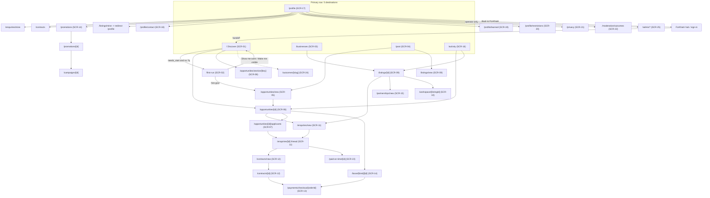

# MOD01 Vyapar: Wireframes (as built, 2026-11-22)

Source: `vyapar-web/app/**/page.tsx`, `app/components/**`, `locales/en/*.json`, `app/globals.css`, `app/styles/*.css`, `API-REFERENCE.md`, `03-ux.md` (SCR-01..25 addendum), `ONBOARDING-REDESIGN-2026-10.md`. Read statically; no live browser snapshots were taken (see Gaps). Labels are the English strings from `locales/en`. Wireframes are 390px phone width unless marked 1280px. "Hub" is the ForKhatri hub (http://localhost:3100) that hosts sign-in; Vyapar web runs in cookie auth mode behind it.

Words used on screen (GLOSSARY.md): "post" and "profile", never "listing" or "opportunity"; "request", never "enquiry".

---

## 1. Map

### 1.1 Navigation map



### 1.2 Role differences

| Role | Sees |
|---|---|
| Member (default) | All of SCR-01..24. Phone-first: a floating hub bar (5 destinations) at the bottom. |
| Poster | Applicants board (SCR-07), publish/pause/resume/renew/close buttons on SCR-06, Promote. |
| Worker or provider | Apply / Send a proposal / Send a quote on SCR-06; Paid-on-time question (SCR-23). |
| Business owner or admin | Business Workspace (SCR-10), team invitations on the Profile hub. |
| Operator | "Operator tools" group on Profile; /admin/verification, /admin/moderation, /admin/commercial, /admin/ops. Others see "This area is only for operators with the right permission." |
| Signed out | Hub sign-in first (cookie mode); Vyapar has no sign-in of its own. A dev-only member switcher exists ("Dev-only member switcher, not sign-in."). |

### 1.3 Shell (every screen)

Top bar: brand link ("Vyapar home"), host link ("{{name}} home" back to the platform), search box ("Search jobs, skills or businesses"), language switcher, notification bell, account menu. Desktop adds the Hire / Find work mega-menu and a left rail (Post button plus Discover, Businesses, Activity, Profile). Phone shows the floating hub at the bottom, with Post as the raised centre item. The hub condenses (labels stay) when scrolling down.

### 1.4 Screen index

| SCR | Route | Purpose | Who | Key API calls |
|---|---|---|---|---|
| SCR-01 | `/` | Discover feed, rows or ranked results | member | `GET /v1/opportunities/feed/rows`, `/feed/results`, `/v1/first-run/state`, saved searches |
| SCR-02 | `/first-run` | 3-question start | new member | `GET /v1/first-run/state`, `/trade-tiles`, `POST /v1/first-run/start`, `PATCH /v1/members/me` |
| SCR-03 | `/businesses` | Directory of businesses and professionals | member | `GET /v1/listings/search`, `/search-suggestions` |
| SCR-04 | `/post` | Chooser: a post, or your profile | member | none |
| SCR-05 | `/opportunities/new` | Post composer (AI draft, voice, photo, paste, form, review) | poster | `POST /v1/opportunities`, `PATCH`, `/confirm`, `/publish`, `/v1/uploads`, AI draft and read-image, `/v1/opportunities/seeker-charge-check` |
| SCR-06 | `/opportunities/[id]` | Post detail and action bar | member | `GET /v1/opportunities/{id}`, `/why`, `/similar`, `/matching-profiles`, save, not-interested, share, contact-actions |
| SCR-07 | `/opportunities/[id]/applicants` | Applicant board and compare | poster | `GET .../applicants`, `/compare`, `POST .../stage` |
| SCR-08 | `/opportunities/section/[key]` | Full list of one Discover row | member | `GET /v1/opportunities/feed/section/{key}/page` |
| SCR-09a | `/listings/new` | Create a profile (business or work) | member | `POST /v1/listings`, `/otp/request`, `/otp/verify`, `POST /v1/me/profile/locate` |
| SCR-09b | `/listings/[id]` | Profile detail | member | `GET /v1/listings/{id}`, `/similar`, `/reviews/page`, `/packages`, verification |
| SCR-09c | `/listings/mine` | Redirect to `/profile` | member | none |
| SCR-10 | `/workspace/[listingId]` | Business Workspace: plan, team, campaigns | owner/admin | workspace endpoints |
| SCR-11a | `/enquiries/new` | Send a request (question, price, apply, proposal, interested, contact) | member | `POST /v1/enquiries` |
| SCR-11b | `/enquiries/mine` | Requests inbox, Sent / Received | member | `GET /v1/enquiries/mine/page` |
| SCR-11c | `/enquiries/[id]` | Request conversation | parties | `GET /v1/enquiries/{id}`, `/messages`, `/accept`, `/resolve`, `/close`, `/withdraw`, `/restrict`, `/refer-to-counsel`, contact-actions |
| SCR-12a | `/contracts` | Contracts list | parties | contracts list |
| SCR-12b | `/contracts/new` | Start a contract | client | `POST contracts`, `GET /v1/enquiries/{id}` |
| SCR-12c | `/contracts/[id]` | Contract detail with stages and money | parties | contract get, milestone actions |
| SCR-13 | `/payments/checkout/[orderId]` | Sandbox checkout | buyer | order get / pay |
| SCR-14a | `/boost/[kind]/[id]` | Promote a post or profile | owner | `GET /v1/promotions/options`, `/quote`, `POST /v1/promotions`, `/confirm-purchase` |
| SCR-14b | `/promotions` | My promotions | owner | `GET /v1/promotions/mine/page` |
| SCR-14c | `/promotions/[id]` | Promotion detail, cancel, performance | owner | `GET /v1/promotions/{id}`, `/cancel`, `/v1/performance/{kind}/{id}` |
| SCR-14d | `/campaigns/[id]` | Campaign detail | owner/admin | campaigns endpoints |
| SCR-15a | `/partnerships/new` | Discuss a business partnership | member | `POST /v1/partnership-requests` |
| SCR-15b | `/partnerships/[id]` | Partnership request and response | parties | `GET /v1/partnership-requests/{id}`, `POST .../{action}` |
| SCR-16 | `/activity` | All / Posted / Recently viewed groups | member | `GET /v1/activity` |
| SCR-17 | `/profile` | Profile hub | member | `GET /v1/me/profile`, `/me/profile/completion`, `/v1/activity`, `/v1/enquiries/mine`, workspace mine and invites |
| SCR-18 | `/profile/contact` | Call and WhatsApp days, hours, who may call | member | `GET/PATCH /v1/listings/contact-preferences` |
| SCR-19 | `/profile/learned` | What Vyapar learned (removable) | member | taste remove / reset |
| SCR-20 | `/profile/restrictions` | Restrictions on your content | member | my restrictions |
| SCR-21 | `/privacy` | Who sees what, analytics, your data | member | privacy settings, export, delete |
| SCR-22 | `/moderation/outcomes` | Decisions and appeal | member | `GET /v1/moderation/outcomes`, `POST /v1/appeals` |
| SCR-23 | `/paid-on-time/[id]` | "Were you paid on time?" | worker | paid-on-time answer |
| SCR-24 | `/outcomes/[slug]` | Outcome landing pages (e.g. trade results) | member | `GET /v1/taxonomy/tree`, listings search / mine |
| SCR-25a | `/admin/verification` | Verification queue | operator | `GET /v1/admin/verification-queue`, verify, reject, needs-clearer-copy |
| SCR-25b | `/admin/moderation` | Moderation queue and appeals | operator | `GET /v1/admin/moderation-queue`, `/appeals`, decide |
| SCR-25c | `/admin/commercial` | Products, orders, refunds, ranking diagnostics | operator | `GET/POST /v1/admin/commercial/*` |
| SCR-25d | `/admin/ops` | Content operations, marketplace health | operator | ops and health endpoints |

Routes found: 38 `page.tsx` files; all 38 are wireframed below (SCR-09c and SCR-24 briefly).

---

## 2. Screens

### SCR-01 `/` Discover (home)

Phone, curated state (no filters):

```
+------------------------------------+
| [Vyapar] [Hindu Khatri home]  [bell]|  top bar (1)
| (Search jobs, skills or businesses)|  search (2)
+------------------------------------+
| Namaste, Asha                      |  hero (3)
| Work near Kukatpally, picked for you|
| [ Where: Kukatpally v ] [ Search ]  |
+------------------------------------+
| (card) You're on Vyapar. Hirers    |  outcome card (4, after start)
|  near Kukatpally can now find you  |
|  [Share on WhatsApp]               |
| (card) Your profile: 40% done      |  completion card (5)
|  Next: <question>  [____] [Save]   |
+------------------------------------+
| Trade rail: (Driver)(Cook)(Tally).. |  trade rail (6)
| [Trade v][Distance v][Pay v][Posted v][More v]  filter bar (7)
+------------------------------------+
| For you                  See all 12|  row header (8)
| +--------------------------------+ |
| | Delivery rider - KPHB          | |  card (9)
| | Rs 15,000 a month | 2 km       | |
| | From your community | Verified | |
| | posted today   [Save] [...]    | |
| +--------------------------------+ |
| Near you / From your community /   |
| More to explore / Shared from      |
| elsewhere (rows)                   |
| [ Save this search ]               |
+------------------------------------+
| (Discover)(Businesses)(+Post)(Activity)(Profile) | hub (10)
+------------------------------------+
```

| # | Element | Does | Data | States | Next |
|---|---|---|---|---|---|
| 1 | Top bar | brand, host link, bell | `unreadCount` | bell badge | `/`, hub, panel "Notifications" |
| 2 | Search | pushes `/?q=` | text | empty submit goes to `/` | filtered results |
| 3 | Hero | greeting, place, where chip | `display_name`, `near_label` | name missing: "Namaste," | location chip |
| 4 | Outcome card | after start: "You're on Vyapar. Hirers near {{place}} can now find you for {{trades}}." or "You're visible..." | `welcome=work|visible` | draft variants: "Your profile is saved. Confirm your phone number on your profile and it goes live." (also terms, review) | WhatsApp share |
| 5 | Completion card | one question at a time, "Your profile: {{percent}}% done" | `/me/profile/completion` | "Saved. Thanks!" | stays |
| 6 | Trade rail | filters by trade | trades | | `/?types=` |
| 7 | Filter bar | Trade, Distance, Pay, Posted, More (Shift, Experience, Where, Only verified, Kind of work) with Apply / Clear | filters in URL | active count "More . n" | sheet (below) |
| 8 | Row header | "See all {{count}}" | `rows[].see_all` | | SCR-08 |
| 9 | Card | opens post; Save; "More options": Not interested, Why this?, Report | `title`, `pay`, `distance`, `segment`, `sponsored` | Sponsored badge, Member-provided badge | SCR-06 |
| 10 | Hub | 5 destinations | | active item marked | each tab |

States: loading "Loading your feed..." (card skeleton); error "could not load posts" with "Retry"; empty rows "Nothing has been posted that matches you yet. Post what you need, and people in your community will see it." [Post something]; sparse profile "Add your skills to get better matches" [Add my skills]; empty results "No posts to show" with [Widen to {{km}} km], [Remove the last filter]. Results state replaces rows with "{{count}} posts near {{place}}" ranked list and facet counts.

Filter sheet (phone, `MobileFilterSheet`; desktop is a drawer; fetches its own preview counts):

```
+------------------------------------+
| Filters                       [x]  |
| Trade        [Find a trade or skill]|
| Distance     (Any)(5)(10)(25) km    |
| Pay          [Any pay v]            |
| Posted       [Any time v]           |
| Where        On-site / Remote       |
| Shift  Experience  [ ] Only verified|
| [ Clear ]            [ Apply (n) ]  |
+------------------------------------+
```

Desktop 1280px: no bottom hub; left rail (Post, Discover, Businesses, Activity, Profile) and top bar with Hire / Find work mega-menu ("By category", "Get it done", "For you": Post what you need, Work that matches you, Near you, Jobs starting now, Saved searches, Create your work profile). Content is a wide column with the aside (outcome card, completion card) beside the results.

### SCR-02 `/first-run` The 3-question start

```
Screen A (goal)                 Screen B (trades)              Screen C (where)
+--------------------------+    +--------------------------+   +--------------------------+
| Step 1 of 3  What you want|   | Step 2 of 3  <trade step>|   | Step 3 of 3  Where       |
| Namaste Asha, what do you |   | What work do you do? /   |   | Where do you live or     |
| want to do today?         |   | What do you sell or offer?|  | work from?               |
| (o) Find work             |   | Tap all that fit.        |   | Your area [Area or town] |
|     Jobs and local work.. |   | [tile][tile][tile][tile] |   | [Use where I am now]     |
| ( ) Hire someone          |   | [More trades]            |   | [Show me work] or        |
|     Post a job or task    |   | Your work, in your words |   | [Make me visible]        |
| ( ) Get customers         |   | (Business name, sell only)|  +--------------------------+
|     For my shop...        |   | [Continue]               |
| Your date of birth [__]   |   +--------------------------+
| By continuing you agree to|
| the Terms and Privacy     |
| [Agree and continue]      |
+--------------------------+
```

| Element | Does | Data | States | Next |
|---|---|---|---|---|
| Goal radios | choose find_work / hire / get_customers | `goal` | disabled reason "Pick what you want to do to continue"; "Add your date of birth to continue" | B (work or sell) or composer (hire: 1 step) |
| Date of birth | asked once | `dob` | "Vyapar is for members 18 and over." | under18 screen |
| Consent line | terms and privacy | | | on Agree |
| Trade tiles | multi-select, search or say | `trade-tiles` | "More trades / Fewer trades", "Leave it empty and we'll suggest one from your name and trade." | C |
| Area | typed or "Use where I am now" | `locality` | | `POST /first-run/start`, then `/?welcome=work|visible` (or `&draft=<reason>`) |
| Under 18 | "Thank you, {{name}}. Vyapar is for members who are 18 and over..." | | answer remembered | rest of ForKhatri |

Hire goal: one step (progress "Step 1 of 1"), then goes to the post composer. A member who has a trade or post (`needs_start` false) is never sent here. A `?q=` search skips the redirect.

### SCR-03 `/businesses` Directory

```
+------------------------------------+
| Businesses & Professionals         |
| (Try "plumber near Ameerpet") [Search]|
| (category: Plumbing x)(near: Ameerpet x) |
| [Filters (2)]  Sort: Relevance v   |
| 14 results                         |
| +--------------------------------+ |
| | Ravi Plumbing Works  [Verified]| |
| | Same-day repairs  * 4.6        | |
| | 3 km away   Responds in ~2 h   | |
| | [Ask for a price]              | |
| +--------------------------------+ |
| No exact match found.              |
| [Widen to 25 km][Include adjacent categories][Remove one filter][Include unverified profiles] |
| [Post what you need]               |
+------------------------------------+
```

Filters sheet: Distance (Any distance / Within {{km}} km), Service mode (Any, In person, Online, In person or online), Availability (Any, Available now, This week, Later), Verified only, Sort by (Relevance, Distance, Newest, Verified first), Skills search, [Clear filters] [Apply].

| Element | Data | States | Next |
|---|---|---|---|
| Search + suggestions | `q`, suggestions | "Too many searches, please slow down."; "Search is temporarily unavailable, showing recently added profiles instead." | results |
| Card | `name`, `headline`, `verified`, `distance_km`, review counts "{{n}} verified interactions . {{m}} of {{n}} recommend", "New on Vyapar" | | SCR-09b |
| Ask for a price | | | SCR-11a (`listing_id`) |

### SCR-04 `/post` Chooser

```
+------------------------------------+
| What do you want to post?          |
| A post reaches people now. Your    |
| profile lets people find you any time.|
| +--------------------------------+ |
| | (megaphone) A post             | |  -> /opportunities/new
| | A job, project, local service  | |
| | need, training or event.       | |
| +--------------------------------+ |
| | (store) Your profile           | |  -> /listings/new
| | Set up or update your work     | |
| | profile and your business...   | |
| +--------------------------------+ |
+------------------------------------+
```

### SCR-05 `/opportunities/new` Post composer

Step 0, start panel:

```
+------------------------------------+
| < What do you need?                |
| Describe it in your own words, type|
| or speak.                          |
| Describe what you need  [mic]      |
| [ e.g. Need 2 delivery riders ... ]|
| Hindi, Telugu, English or a mix.   |
| Or start from an example: (Job)(Project)(Local service) |
| [ Draft it ] [Read from a photo]   |
| [ Skip - fill in myself ]          |
| Other ways to post:                |
|  Paste a forwarded message or link |
|  Upload a screenshot               |
| How it works: 1 Say what you need  |
|  2 Check the form 3 Publish        |
| Posting on Vyapar is free...       |
+------------------------------------+
```

Step 1 of 2, details form (type tabs Job / Project / Local service / More types):

```
+------------------------------------+
| Step 1 of 2 . Details              |
| [Job][Project][Local service][More]|
| Job details                        |
| Drafted from what you wrote. 1 value is marked "Please check". |
| Job title        [______________]  |
| Role (picker: search a skill or role)|
| Where [Exact area] [Location]      |
| Monthly in-hand salary [Min][Max]  |
| Incentives up to  Openings  Shift  |
| Timings  Experience  Qualification |
| English  They need to have         |
| Interview  Description  [mic]      |
| Screening questions (Question 1..) |
| Calls before you accept: On/Off    |
| [Continue]                         |
+------------------------------------+
```

Step 2 of 2, check and publish:

```
+------------------------------------+
| Step 2 of 2 . Check & publish      |
| Live preview: "This is how your post|
| will look to other members."       |
| (card preview)                     |
| Confirm before publishing:         |
|  Pay  unconfirmed  [Confirm]       |
|  Everything looks confirmed.       |
| Tips: one-tap tips to get responses|
| [Publish]            [Back]        |
+------------------------------------+
```

| Element | Does | Data | States | Next |
|---|---|---|---|---|
| Describe | AI drafts the form | `text`, language | "Reading what you wrote..." ; photo not enabled: "Reading photos isn't switched on here yet, so we kept your photo." | form |
| Type tabs | choose Job / Project / Local service / Business partnership / Training / Community & government | `type` | | fields change |
| Fields | `title`, `skills`, `location`, pay (Fixed amount or Range), `openings`, `shift`, `experience`, `description`, screening `questions`, `apply_by` | | "Type one amount, like 15000, 15k or 1.5 lakh."; seeker-charge check blocks fee asks ("Never ask for a fee or deposit to apply. Such posts are removed.") | |
| Accept gate | "Please accept the updated terms of use" [Accept and continue] | | only when terms changed | |
| Publish | `POST /publish` | | disabled reasons from `common.disabled.*` | SCR-06 |

Legacy path (`LegacyComposer`): Share a post modes "Write it myself", "Paste a link or text", "Upload a screenshot"; segment "My own" / "Found elsewhere" with required source name. Reachable from "Other ways to post".

### SCR-06 `/opportunities/[id]` Post detail

```
+------------------------------------+
| < Delivery rider, KPHB     [share] |
| [Job] [From your community] [Open] |
| Posted by Ravi Mehra . verified    |
| Pay Rs 15,000-18,000 a month       |
| Location KPHB | Work mode On-site  |
| Duration & timing | Apply by 5 Dec |
| 3 days left | Fewer than 5 responded|
| What they're looking for / Skills  |
| About this post (description)      |
| Source (public posts): Found on X  |
| About the person who posted        |
|  On Vyapar since Mar 2026          |
|  2 open posts  [View profile]      |
| Why this?  Not interested v        |
| Similar posts                      |
+------------------------------------+
| [Save] [Call][WhatsApp] [ Apply ]  |  action bar (label varies)
+------------------------------------+
```

Action bar label by type: Apply (job), Send proposal (project), Send a quote (local service), Contact, I'm interested (training/community), Apply on the original website (public source; "You'll leave Vyapar. We can't verify this source, never pay to apply.").

Poster view of same screen: status chip (Draft, Under review, Open, Paused, No recent update, Expired, Closed, Removed), buttons Confirm / Publish / Pause / Resume / Renew / Close, [See applicants], [Promote], matching profiles, posting tips.

| Element | Data | States | Next |
|---|---|---|---|
| Action bar | `action_label`, `contact_actions` | "Replies open soon" disabled; call hours text "Takes calls {{days}}, {{hours}}" | SCR-11a, tel/WhatsApp |
| Not interested | reasons Too far / Wrong type / Not my kind of work / Value too low / Wrong timing / Already found something | "Hidden from your feed." | back to feed |
| Report | sheet below | | |
| Response count | bucket text (none, under 5, 5 to 10, 10 to 20, 20 plus) | | |

Report sheet (`ReportSheet`):

```
+------------------------------------+
| What's wrong?                 [x]  |
| (o) Asked me for money             |
| ( ) Scam or advance payment        |
| ( ) Fake or misleading ... Spam, Stale, Privacy, Something else |
| [Anything that helps us check]     |
| [ ] Also block this member         |
| [ Send report ]                    |
+------------------------------------+
```

After: "Thanks, our team will review this. The other person won't know who reported."

### SCR-07 `/opportunities/[id]/applicants` Applicant board

```
+------------------------------------+
| < Back to the post                 |
| Applicants (or Proposals / Responses)|
| Ranked by fit: skills, distance... |
| Sort: Newest | Best match          |
| Stages: [New 3][Shortlisted][Hired][Declined] |
| +--------------------------------+ |
| | [ ] Imran, Kukatpally  8.5/10  | |
| |  skills matched  5 yrs         | |
| |  [Shortlist][Decline][Open]    | |
| +--------------------------------+ |
| [Compare (2-4 selected)]           |
+------------------------------------+
```

States: "No applicants yet." with "These would help more people respond:" tips; empty stage lines ("Nothing new, you're up to date.", "No one shortlisted yet."). Next: SCR-11c per applicant; compare view lists 2 to 4 side by side.

### SCR-08 `/opportunities/section/[key]` Full row

Header with row title and total; list of the same cards as SCR-01; empty/error via States. Uses `feed.section` and capability options for the heading.

### SCR-09a `/listings/new` Create a profile

```
+------------------------------------+
| Add a profile                      |
| Choose what people should find:    |
| (o) Business profile  ( ) Work profile |
| Step 1 of 3  Who you are / About the business |
| Business name / Your name [______] |
| One line about your work [______]  |
| Step 2 of 3  What you do           |
| What kind of business  (chips)     |
| Services and skills (up to 15)     |
| Step 3 of 3  How to reach you      |
| Locality [__] [Use my current location] |
| How do you work? In person | Online | Both |
| Phone number [98765 43210] [Verify]|
| [Save profile]  [Save and finish later] |
+------------------------------------+
```

States: duplicate "You already have a profile with this name and locality." [Open the existing profile]; location "Which of these is your area?", "Location is off. Type your area below."; save disabled "Add your name to continue" / "Add your locality to continue". Draft badge "Not verified yet". Phone OTP "Enter the 6-digit code". Next: SCR-09b.

### SCR-09b `/listings/[id]` Profile detail

```
+------------------------------------+
| < Ravi Plumbing Works [Verified]   |
| Same-day plumbing repairs          |
| Ameerpet | In person | * recommend |
| Responds in ~2 h | Takes calls ... |
| Skills (chips)                     |
| Packages (Basic / Standard / Premium)|
| Reviews  "No reviews yet. Reviews come only from completed requests..." |
| Similar profiles                   |
+------------------------------------+
| [Save] [Call][WhatsApp] [Ask for a price] [Discuss partnership] |
+------------------------------------+
```

Owner view adds: Edit, Get verified (document type GST, Udyam, PAN, Shops & Establishment, Professional credential, identifier, [Submit for review]; "Submitted, under review (usually within 3 business days)."; states Verified, Not approved, "Needs a clearer copy"), visibility/intent, packages editor, Promote, Business Workspace link, Archive. Next: SCR-11a, SCR-15a, SCR-14a, SCR-10.

### SCR-09c `/listings/mine`

Redirects to `/profile`. No own layout.

### SCR-10 `/workspace/[listingId]` Business Workspace

```
+------------------------------------+
| Business Workspace                 |
| Plan, team and campaigns for <name>|
| Plan active - Renews 3 Jan         |
|  [Stop renewing]                   |
| (or) Choose a plan: (Monthly)(Annual, two months free) |
| Included: Team roles, campaigns... |
| Never included: verification, ranking... |
| Team: Owner / Admin / Operator rows|
|  [Invite] [Change role] [Remove]   |
| Campaigns: list -> /campaigns/[id] |
+------------------------------------+
```

States: "This workspace isn't available to you." (role "No access"); invitations appear on Profile ("Team invitations", Accept / Decline, "Role: {{role}}"). Roles Owner, Admin, Operator.

### SCR-11a `/enquiries/new` Send a request

Variants by `?opportunity_id=` or `?listing_id=`:

```
+------------------------------------+
| < Send a request   (Apply / Send a proposal / Reply to this request / I'm interested / Contact this business) |
| To Ravi Plumbing Works [Business verified]|
| You are writing to: <context>      |
| [Ask a question] [Ask for a price] |
| Your message (min 20)  [mic]       |
| 0 / 1000 . at least 20             |
| Apply: What the employer will see (your skills) + short note |
| Proposal: Your note, Your price, Timeline, Attach a work sample |
| Your phone number is not shared.   |
| [ Send ]                           |
+------------------------------------+
```

States: "You already have an open request with {{name}}." [Open it]; "This is no longer accepting requests."; "You have sent {{cap}} requests today. You can send more tomorrow."; disabled "Write at least 20 characters to send". Desktop shows a "What {{name}} will receive" preview and three guidelines. Next: SCR-11c.

### SCR-11b `/enquiries/mine` Requests

```
+------------------------------------+
| Requests                           |
| Questions, applications, proposals |
| [Sent] [Received]   All (4) v      |
| +--------------------------------+ |
| | Plumber needed - with Ravi     | |
| | Application | Waiting for reply| |
| | Needs your reply               | |
| +--------------------------------+ |
| Empty: "Nothing sent yet" / "Nothing received yet" |
+------------------------------------+
```

Desktop: two-pane, list left, "Choose a request to open it here" right. Status filter values: Open, Waiting for a reply, Accepted, Resolved, Closed, Withdrawn, Restricted.

### SCR-11c `/enquiries/[id]` Request conversation

```
+------------------------------------+
| < Requests   Ravi Plumbing  [Accepted]|
| Never pay in advance. Report anything suspicious. |
| (banner) Ravi is waiting for your answer. Accept to share contact... [Accept] |
| Contact details: Call | WhatsApp   |
| About this request: With / About / Started / Last activity |
| Messages                           |
|  Member: ...      You: ...         |
| [Write a message...]       [Send]  |
| [ More v ]: Mark resolved, Close request, Withdraw request, Restrict, Block, Refer to Counsel, Report |
| [Start a contract]                 |
+------------------------------------+
```

States: closed "This conversation has ended. No more messages can be sent."; restricted "Restricted: messages are off for this conversation."; post gone "This post has closed... See similar posts"; "Request not found". Review prompt after resolve ("Leave a review in the conversation"). Next: SCR-12b, SCR-23, review composer.

### SCR-12a `/contracts`

```
+------------------------------------+
| Contracts                          |
| Work you agreed on Vyapar, paid stage by stage. |
| [All][Paying][Doing the work]      |
| +--------------------------------+ |
| | Kitchen rewiring  Active       | |
| | You pay | Needs you | Updated..| |
| +--------------------------------+ |
| Empty: "No contracts yet" [Open my requests] |
+------------------------------------+
```

Test-payments notice: "Payments run in test mode today: no real money moves." Desktop two-pane ("Choose a contract to see its stages and payments").

### SCR-12b `/contracts/new`

Fields: "What is the work?", Details (optional), "How will you pay?" (Fixed price / Hourly), Total amount or Rate per hour and Most hours a week, Stages (Stage 1.. each title, amount, due), [Send to {{name}}]. Reached from a request thread (`?enquiry_id`).

### SCR-12c `/contracts/[id]`

```
+------------------------------------+
| < Contracts  Kitchen rewiring [Active]|
| with Ravi | Total Rs 40,000        |
| Stages  1 of 3 paid                |
|  1 Wiring  Paid                    |
|  2 Fittings  Paid in advance [Send work] / [Approve and pay][Request changes] |
|  3 Finish  Not paid in yet [Pay Rs 10,000 in advance] |
| Weekly hours (hourly): timesheets  |
| Money: Paid in advance / Paid / Refunded / Vyapar fee / Budget left |
| History                            |
| [Finish contract][End contract][Open conversation] |
+------------------------------------+
```

State banners: Draft ("This contract is a draft"), Contract sent, In dispute ("A Vyapar moderator is looking at this contract. Payments are paused"), Completed, Cancelled. Provider sees Accept contract / Decline; client sees Withdraw / Send. Stage states: Not paid in yet, Paid in advance, Work sent, Approved, Paid, Changes requested, Refunded.

### SCR-13 `/payments/checkout/[orderId]`

Sandbox hosted checkout: order summary, "Test payments" notice, [Pay] and [Cancel]. Layout: single card. Returns to the contract or promotion that created the order. Details beyond this unverified.

### SCR-14a `/boost/[kind]/[id]`

```
+------------------------------------+
| Promote <name>                     |
| Show this to more of the people it already fits. |
| How long: (7 days)(14 days)(30 days)(Custom) |
| Narrow the audience: [ ] Only in Ameerpet [ ] Only for Plumbing |
| Your order: Product / Price / GST / Credit applied / You pay |
| What you should know: What changes / What doesn't change / Renewal: None / Cancel and refund / Receipt |
| [ Continue to payment ]            |
+------------------------------------+
```

Disabled reason "Choose how long to see the full price." Next: SCR-13, then SCR-14c.

### SCR-14b `/promotions`, SCR-14c `/promotions/[id]`, SCR-14d `/campaigns/[id]`

List: cards with target, state, dates; empty "no promotions". Detail: state, dates, order disclosure, receipt, [Cancel promotion] (pro-rata credit), performance report (impressions, responses; small groups hidden: "Not enough data yet"). Campaign detail: campaign name, linked promotions, status (workspace plan required). Layouts for 14d unverified beyond headings.

### SCR-15a `/partnerships/new`

Sections: "Who you are writing to" (To {{name}}, "From your business profile"), "What each side brings" (What you need, What you offer, Expectations), "Where and when" (Category, Locality, Timing), "Intended next step", [Send].

### SCR-15b `/partnerships/[id]`

Request summary, sender and receiver, state; receiver buttons Accept / Decline; sender Withdraw; thread link after accept.

### SCR-16 `/activity`

```
+------------------------------------+
| Activity                           |
| [All][Posted][Recently viewed]     |
| Posted                             |
|  Delivery rider  Open  [See applicants] |
| Saved / Shared / Completed / Responded / To review / Business partnerships (groups) |
| Recently viewed                    |
| Empty: "Nothing here yet, saved and posted items will show up as you use Vyapar." |
+------------------------------------+
```

Status chips: listing (Draft, Submitted, Active, Active verified, Suspended, Archived), post (Draft, Under review, Open, Paused, No recent update, Expired, Closed, Removed).

### SCR-17 `/profile` Profile hub

```
+------------------------------------+
| Profile                            |
| Asha Rao  Using Vyapar in English  |
| Profiles 2 | Open requests 1 | Saved 4 | Recommendations |
| Team invitations: Role: Admin [Accept][Decline] |
| Your places on Vyapar              |
| Your work                          |
|  Your work profile (skills, area)  |
|  My business (optional)            |
|  My profiles / Requests / Contracts / Saved / Promotions / Business Workspace |
| Settings                           |
|  Calls and WhatsApp / Privacy / What Vyapar learned / Restrictions / Moderation outcomes |
|  Language and display: Language; Text size Normal, Large, Larger; High contrast |
| Support                            |
|  Help & grievance (grievance@forkhatri.example) |
|  Operator tools (operators only): Verification queue, Moderation queue |
|  [Back to ForKhatri]               |
+------------------------------------+
```

States: no profile "Set up your profile first" with [Add your business] / [Set up your work profile]; draft badge. Profile setup (`ProfileSetup`) edits skills, area, work mode inline.

### SCR-18 `/profile/contact`

Call and WhatsApp days, hours, daily limit, who may call; per-listing override. [Save]. Preview line "Takes calls {{days}}, {{hours}}."

### SCR-19 `/profile/learned`

List of learned preferences (categories, kinds) each with [Remove]; [Reset everything]; empty "nothing learned". Explains personalised feed ("Posts picked for you" setting lives on SCR-21).

### SCR-20 `/profile/restrictions`

Lists restrictions on your content with reason and [Appeal]; empty "nothing restricted".

### SCR-21 `/privacy`

Toggles: Show me in search, Show my skills, Show that I'm looking (off by default), Contact details (Always visible / After I accept a request / Never shown), Notifications, Promotional messages (off by default), Usage analytics, Daily digest, Posts picked for you. "Your data": [Download my data] ("Your data is ready, tap to view"), [Delete my account] then [Yes, delete my account] with anonymisation warning.

### SCR-22 `/moderation/outcomes`

Cards of decisions on your content (reason, date, outcome) with [Appeal] opening a text field and submit. Empty line when none.

### SCR-23 `/paid-on-time/[id]`

Single question card "were you paid on time" with Yes / No (and optional note), shown to the worker after a contract payment; thank-you state.

### SCR-24 `/outcomes/[slug]`

Explanatory landing page for an outcome (e.g. find a trade near you): heading, short explanation, trade tiles from the taxonomy, matching profiles or posts, CTA to Post or search. Reached from Discover/hub links. Exact slugs unverified.

### SCR-25 Operator consoles

```
/admin/verification              /admin/moderation               /admin/commercial        /admin/ops
+---------------------------+    +---------------------------+   +----------------------+ +------------------+
| Verification queue        |    | Moderation queue          |   | Products | Orders    | | Content operations|
| table: listing, document, |    | cases: reason, content,   |   | [Fixed|Hourly...] tabs| | Marketplace health|
| identifier, age           |    | [Decide] ; Appeals tab    |   | Refund form           | | metrics, hidden   |
| [Verify][Reject]          |    | [Decide appeal]           |   | Ranking diagnostics   | | groups under min  |
| [Needs clearer copy]      |    +---------------------------+   +----------------------+ +------------------+
+---------------------------+
```

Dense tables (`vy-dl-table`). Non-operators see "This area is only for operators with the right permission." Health metrics: Post coverage, Relevant discovery rate, Zero-result rate, Post action rate, Relevant connections, Successful connection rate, Discovery to request rate, Freshness, Reports per 1,000 interactions.

### Shared sheets

Notification bell panel: title "Notifications", "Mark all read", empty "No notifications yet." Review composer (after resolved request): recommend yes/no plus 20 to 500 character comment ("Say whether you recommend them; a comment needs 20-500 characters"). Voice input: mic button, "Listening in {{language}}...", "Check what we heard" with Keep / Try again / Discard; language switch EN, Hindi, Telugu, Marathi, Kannada.

---

## 3. Flows

**F1 First run to home.** 1 Hub sign-in. 2 `/` loads first-run state. 3 Decision: `needs_start`? yes and no `?q` goes to SCR-02 goal; no goes to Discover. 4 Goal (find work or get customers) then trades then area ("Show me work" or "Make me visible"). 4b Hire goal skips to composer. 4c Age under 18 shows the under18 notice. 5 Land on `/?welcome=work|visible` with the outcome card and completion card.

**F2 Create post to publish.** Post tab (SCR-04) then "A post" then SCR-05 start. Decision: draft with AI / read photo / skip / paste. Step 1 form, Continue, Step 2 check (confirm unconfirmed values, preview, tips). Decision: terms stale gives Accept gate. Publish then SCR-06 poster view (status "Open", or "Under review"). Later: SCR-07 for applicants.

**F3 Find work to application.** Discover (SCR-01), optional filters, card to SCR-06, Apply to SCR-11a (note), Send to SCR-11c waiting for reply. Poster: Activity/bell then SCR-07, Shortlist, open thread, Accept (contacts shared).

**F4 Hire a business.** Businesses (SCR-03), search or filters, card to SCR-09b, "Ask for a price" to SCR-11a, thread SCR-11c, Accept by business, "Start a contract" to SCR-12b, SCR-12c, client pays stage in advance (SCR-13), provider "Send work", client "Approve and pay", Finish contract, review, worker answers SCR-23.

**F5 Make profile to publish.** Post tab to "Your profile" to SCR-09a (3 steps), phone OTP, Save profile, status Draft or Active unverified, Get verified (document), operator approves in SCR-25a, Verified badge.

**F6 Promote.** Post detail or profile to Promote (SCR-14a), pick length and audience, review the order disclosure, SCR-13 checkout, SCR-14c shows live promotion; Cancel gives pro-rata credit.

**F7 Hub handoff.** Hub avatar to Vyapar module link; session cookie reused; Vyapar top bar host link and Profile "Back to ForKhatri" return to the hub.

**F8 Report and appeal.** Report sheet from any post or thread, operator decides in SCR-25b, member sees decision in SCR-22 and may Appeal.

---

## 4. Components and tokens

### 4.1 Component inventory

| Component | Where used |
|---|---|
| CommandHub (floating bottom nav, rail on desktop) | every screen |
| AppTopBar, HostTopBar, NotificationBell, LanguageSwitcher, HireMenu | every screen (menu desktop only) |
| Screen (width "wide" or default), PageHeader, Steps | all |
| DiscoverView, DiscoverHero, TradeRail, QuickChips, DiscoverFilterBar, FilterPanel, MobileFilterSheet, AppliedFilters, FeedRows, DiscoverCard, LivingCard | SCR-01, 08 |
| SaveSearch | SCR-01 |
| StartOutcomeCard, CompletionCard, TradeTiles | SCR-01, 02 |
| ComposerForm, StartPanel, ReviewStep, OpportunityPreview, VoiceInput, FileUpload | SCR-05 |
| ChoiceCard | SCR-04 |
| EnquiryThread, DisabledReason, ReviewComposer, Reputation, Verification | SCR-06, 09b, 11c |
| ReportSheet | SCR-06, 09b, 11c |
| SponsoredBadge | cards, SCR-06 |
| PerformanceReport | SCR-14c |
| ProfileSetup, ProfileRecommendations | SCR-17 |
| States (loading, empty, error with Retry) | all list screens |
| Tables (`vy-dl-table`), segmented tabs | SCR-12a, 25 |

### 4.2 Design tokens (`app/globals.css`)

| Group | Values |
|---|---|
| Surface | `--surface #f6f5f1`, raised `#ffffff`, nested `#f2f1ec`, sunken `#eeede7`; dark mode and a high-contrast mode redefine them |
| Ink and text | primary `#1a1c24`, secondary `#4b505c`, tertiary `#5f6472`, borders `#e3e1da`, `#cfccc3`, strong `#807c72` |
| Brand | `--brand #2b4acb` (hover `#233dae`, pressed `#1c3290`, soft `#ebeffd`); secondary teal `#0e7470`; focus ring `#2b4acb` |
| Status | success `#1d7a3e`, warning `#b86e00`, danger `#c4322a`, info `#1f63a8`, verified `#16753b` (each with soft and text variants) |
| Tile tints | amber, sky, green, indigo, plum pairs (bg and fg) |
| Type | Anek family (Latin, Devanagari, Telugu, Kannada) for display and body; text-size setting Normal / Large / Larger |
| Spacing | 4, 8, 12, 16, 24, 32, 48 px (`--space-1..7`) |
| Radii | xs 8, sm 12, md 16, tile 20, card 22, lg 28, pill 999 |
| Shadows | card, float, raise |
| Motion | exit 140ms, enter 210ms, move 380ms, sheet 240ms, hover 160ms, press 180ms; ease-out `cubic-bezier(.2,.8,.2,1)`, spring ease; hub uses spring (stiffness 420, damping 36); reduced-motion respected |
| Icons | lucide-react (Compass, Store, Plus, Activity, CircleUserRound, Megaphone, Search) |

Stylesheets: `account-2026`, `deals-2026`, `discover-2026`, `fe2`, `filters-2026`, `language-2026`, `reco-2026`, `start-2026`, `trust-2026`, `voice-2026`, `hiring.css`.

---

## 5. Wireframe gaps (unverified)

- No live browser snapshots taken; every wireframe is derived from code and locale strings, so spacing, ordering inside cards and live empty/error states are unverified. The Discover error state ("could not load posts" for one QA member) is cause-unverified (03-ux.md).
- SCR-13 checkout: only layout inferred; field details not read.
- SCR-14d campaigns, SCR-15b partnership response, SCR-20, SCR-22, SCR-23, SCR-24: described from headings and locale keys; button labels beyond those quoted are unverified. SCR-24 slug list not enumerated.
- SCR-10 Workspace team invite form fields and campaign creation not read in detail.
- SCR-25 consoles: column sets inferred; not every control listed.
- Desktop layouts: only Discover and the Requests/Contracts two-pane were described; other screens assumed to be a single wide column.
- Hindi, Telugu, Marathi, Kannada locales exist (`locales/hi|te|mr|kn`) and were not compared; layout impact of long labels unverified.
- Contact actions (Call / WhatsApp) availability depends on the poster's call hours; the exact disabled copy is unverified.
- Voice and AI draft behaviour depends on service flags; "Reading photos isn't switched on here yet" is a real fallback state.
