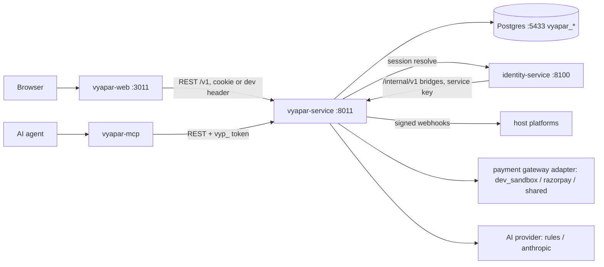

# MOD01 Vyapar — architecture (as built, 2026-11-22)

**Document status:** as built, 2026-11-22; derived from code (vyapar-service/app, vyapar-web, vyapar-mcp), the live OpenAPI (268 operations) and the live database (63 tables). Complements 07-tech-reqs.md (requirements and rationale). Complete endpoint list: [API-REFERENCE.md](API-REFERENCE.md). Complete data model: [07a-er-model-as-built.md](07a-er-model-as-built.md).

## Contents
1. Components and ports
2. Data flow and sequences
3. Stack and versions
4. Backend layering
5. Background jobs
6. Integrations and adapters
7. Configuration reference
8. Error model, versioning, caching, realtime
9. Files, media, i18n
10. Observability, performance budgets, deployment

## 1. Components and ports

| Component | Path | Port | Notes |
|---|---|---|---|
| vyapar-web (Next.js 16.3, React 19) | modules/MOD01-vyapar/vyapar-web | 3011 | mobile-first web app; also embeddable components (`embed/`) |
| vyapar-service (FastAPI) | modules/MOD01-vyapar/vyapar-service | 8011 | REST under /v1, platform bridges under /internal/v1 |
| vyapar-mcp | modules/MOD01-vyapar/vyapar-mcp | stdio | MCP server; talks only to the public REST API with a personal token |
| PostgreSQL | local dev | 5433 | database `vyapar`, 13 schemas `vyapar_*`; roles vyapar_owner (migrations) and vyapar_app (runtime) |
| Identity service (platform) | platform/identity-service | 8100 | session resolve; hub at 3100 |
| Shared integrations | shared/forkhatri-integrations | (library) | payments / messaging / places adapters, used when PAYMENT_GATEWAY=shared:<adapter> |

Started with `npm run dev:vyapar` (platform plus Vyapar) or `npm run dev` from the repo root (scripts/dev.mjs). `npm run dev:tunnel` exposes everything over Cloudflare Quick Tunnels.



## 2. Sequences

Sign-in resolve (every request):
```
Browser -> API: cookie fk_session (or Authorization: Bearer vyp_..., or X-Dev-Member-Id in dev)
API: identity chain (IDENTITY_PROVIDERS) -> bearer -> forkhatri -> dev
forkhatri: POST identity /internal/v1/sessions/resolve (2 s timeout, 30 s positive / 5 s negative cache, fail closed 503)
API: ensure_member() upserts the Vyapar member row (phone_verified from host) -> AuthzContext(member, roles, admin_scopes)
```
Start flow: `/first-run` -> GET trade-tiles -> POST /v1/first-run/start (profile, skills, area, consent, DOB if unknown, one transaction) -> redirect to results.
Post and match: composer -> AI draft (rules or Claude) -> scam shield + content flags -> opportunity active -> outbox_event -> webhook dispatcher and notification matcher (strong match >= 2.5, 3 per day cap).
Payment: order created -> gateway (sandbox or hosted Razorpay link) -> webhook /v1/payments webhook endpoint verified by PAYMENT_WEBHOOK_SECRET -> entitlement / promotion / contract funding.

## 3. Stack and versions
Backend: Python 3.13, fastapi >=0.141, uvicorn >=0.53, asyncpg >=0.31, pydantic-settings >=2.15, cryptography >=50, anthropic >=1.8. Web: next 16.3.5, react 19.2.8, i18next 26, react-i18next 17, motion 13, lucide-react, TypeScript 5. DB: PostgreSQL (psql 18 client present).

## 4. Backend layering
`routers/` (40 router files, one per tag, thin) -> `services/` (business rules, raise ApiError) -> `db.py` (asyncpg pool, per-request connection with the member context set for RLS) -> SECURITY DEFINER SQL functions (write paths). Cross-cutting: `authz.py`, `deps.py`, `errors.py`, `audit.py`, `notifications.py`, `outbox.py`, `ranking.py`, `trade_match.py`, `taste.py`, `geo.py`, `crypto.py`, `i18n/`, `integrations/{identity,payments,ai,credentials,notifications,webhooks,storage}`.

## 5. Background jobs (started in app lifespan, main.py)
| Job | Interval | Purpose |
|---|---|---|
| notification_loop | NOTIFY_MATCHER_INTERVAL_SECONDS (300) | strong-match, saved-search and digest notifications |
| credential_sync_loop | daily-equivalent | re-check council-verified badges (CREDENTIAL_RECHECK_DAYS) |
| verification_cleanup_loop | periodic | delete expired verification identifiers/documents |
| webhook_loop | WEBHOOK_DISPATCH_INTERVAL_SECONDS (10) | outbound webhook fan-out and retries |
Other time rules (read-time or on-demand): badge cache refresh (BADGES_CACHE_SECONDS 86400), 14-day contract auto-release, applicant-waiting nudge, paid-on-time ask.

## 6. Integrations and adapters
Identity (bearer token, ForKhatri session, dev header; admin scopes); Payments (dev_sandbox default, razorpay hosted link failing closed on placeholder keys, shared:<adapter> e.g. payment_services on MOD06 :8016); AI (rules or anthropic); Credentials (dev_stub); Places (none or nominatim, off by default); Notifications (in-app plus WebPush swap-seam with placeholder VAPID keys, never invoked); Webhooks (HMAC signed, AES-GCM stored secrets, private targets allowed only in dev); Storage (local `uploads/`, signed-URL TTL setting).

## 7. Configuration reference (names only; secrets marked S)
Service (`vyapar-service/.env`, loaded by app/config.py; keys are upper-case of these):
API_PORT, WEB_ORIGIN, DATABASE_URL (S), DEV_MODE, DEV_DEFAULT_MEMBER_ID, FORKHATRI_ENTRANCE_URL, IDENTITY_SERVICE_INTERNAL_URL, IDENTITY_SERVICE_KEY (S), IDENTITY_SERVICE_NAME, IDENTITY_RESOLVE_CACHE_SECONDS, IDENTITY_RESOLVE_NEGATIVE_CACHE_SECONDS, IDENTITY_PROVIDERS, PLACES_PROVIDER, PLACES_BASE_URL, PLACES_USER_AGENT, PLACES_CONTACT_EMAIL, VERIFICATION_IDENTIFIER_ENCRYPTION_KEY (S), OBJECT_STORAGE_SIGNED_URL_TTL_SECONDS, RATE_LIMIT_ENQUIRY_PER_DAY (20), RATE_LIMIT_REPORT_PER_DAY (10), RATE_LIMIT_NOTIFY_STRONG_MATCH_PER_DAY (3), PARTNERSHIP_REQUEST_PENDING_CAP (10), REVIEW_TAGS_POSITIVE, REVIEW_TAGS_NEGATIVE, LISTING_ACTIVE_CAP_PER_MEMBER (20), NOTIFY_STRONG_MATCH_THRESHOLD (2.5), NOTIFY_MATCHER_INTERVAL_SECONDS (300), VAPID_PUBLIC_KEY, VAPID_PRIVATE_KEY (S), PAYMENT_GATEWAY (dev_sandbox), RAZORPAY_KEY_ID, RAZORPAY_KEY_SECRET (S), PAYMENT_WEBHOOK_SECRET (S), PAYMENT_SERVICES_URL, PAYMENT_SERVICES_KEY (S), DISPATCHER_OPERATOR_MEMBER_ID, ANALYTICS_PSEUDONYM_SECRET (S), ACCESS_TOKEN_DEFAULT_DAYS (90), ACCESS_TOKEN_MAX_DAYS (365), ACCESS_TOKEN_MAX_ACTIVE_PER_MEMBER (20), INTEGRATION_SECRET_KEY (S), WEBHOOK_ALLOW_PRIVATE_TARGETS (true, dev only), WEBHOOK_DISPATCH_INTERVAL_SECONDS (10), WEBHOOK_TIMEOUT_SECONDS (5), WEBHOOK_MAX_ATTEMPTS (6), WEBHOOK_DISABLE_AFTER_FAILURES (25), WEBHOOK_MAX_PER_MEMBER (10), IDEMPOTENCY_TTL_HOURS (24), CONTACT_TIMEZONE_OFFSET_MINUTES (330), CONTACT_DEFAULT_COUNTRY_CODE (91), BADGES_CACHE_SECONDS (86400), SEEKER_CHARGE_REPORT_THRESHOLD (2), PRECALL_CALLER_TAPS_PER_DAY (3), CREDENTIAL_REGISTRY (dev_stub), CREDENTIAL_RECHECK_DAYS (365), PAID_ON_TIME_ASK_AFTER_HIRE_DAYS (30), PAID_ON_TIME_MIN_ANSWERS (3), APPLICANTS_WAITING_NUDGE_DAYS (7).
AI (app/integrations/ai/config.py): AI_PROVIDER, ANTHROPIC_API_KEY (S), VYAPAR_AI_MODEL, AI_DAILY_LIMIT, AI_TIMEOUT_SECONDS, AI_MAX_INPUT_CHARS.
Scripts only: VYAPAR_API_URL, VYAPAR_APP_DSN, VYAPAR_OWNER_DSN, VYAPAR_CHECK_AI_LIMIT, VYAPAR_CHECK_API, VYAPAR_CHECK_API_BASE.
Web: NEXT_PUBLIC_API_URL, NEXT_PUBLIC_PLATFORM_URL, NEXT_PUBLIC_VYAPAR_AUTH, NEXT_PUBLIC_VYAPAR_HOST, NEXT_PUBLIC_HOST_IDENTITY_API, NEXT_PUBLIC_REVERSE_GEOCODE_URL_TEMPLATE, NEXT_PUBLIC_TRANSLATE_URL_TEMPLATE, NEXT_PUBLIC_VYAPAR_VOICE_MOCK, FORKHATRI_IDENTITY_INTERNAL_URL (tunnel only), TUNNEL_DEV_ORIGIN (tunnel only), VYAPAR_WEB_DIST_DIR (second dev server).

## 8. Error model, versioning, caching, realtime
Error envelope: `{"detail": <translated string or object>, "error": {"code","message","details"}}`; `code` is derived from the translation key (for example opportunity_not_found; ambiguous segments are namespace-qualified, for example campaigns_not_found); HTTP status codes map to bad_request, unauthorized, payment_required, forbidden, not_found, method_not_allowed, conflict, gone, payload_too_large, unprocessable, rate_limited, internal_error, bad_gateway, service_unavailable. Versioning: path prefix /v1 (service version 0.1.0); additive changes only. Pagination: cursor helpers in services/pagination.py. Idempotency-Key middleware (24 h). Caching: in-process identity resolve cache, taxonomy cache, badge cache; no Redis. Realtime: none (polling; notification bell reads inbox).

## 9. Files, media, i18n
Uploads: POST /v1/uploads (image) stored under vyapar-service/uploads and served by public URL. i18n: backend catalogues `app/i18n/locales/{en,hi,te,mr,kn}/*.json` (23 namespaces), web `vyapar-web/locales/<lang>`; checks `vyapar-web/scripts/check-i18n-keys.py`, `scripts/check_locale_parity.py`. Fonts: Anek Latin/Devanagari/Telugu/Kannada via next/font.

## 10. Observability, budgets, deployment
Observability: request logs (api-out.log / api-err.log), audit table (vyapar_platform / audit via audit.py), analytics_events with pseudonymised member (ANALYTICS_PSEUDONYM_SECRET), admin ops console (/admin/ops). No external APM (unverified; none found in code). Performance budgets: see 08-security-performance.md. Deployment: none beyond local dev and tunnels; production deployment is not built (see RUNBOOK.md and the platform deployment docs).


## Account deletion (added 2026-11-22)
Design: one SECURITY DEFINER SQL function, vyapar_identity.erase_member(member, pseudonym) (migration 033), runs the whole erase in one transaction and returns the counts and the list of file urls; the Python layer (services/privacy.py) removes the files after commit, so a database failure never leaves missing files. Two entry points call it: the internal endpoint POST /internal/v1/members/{member_id}/erase (kind A, called by the identity service with X-ForKhatri-Service: identity and the service key; runs as the dispatcher service role) and the member endpoint POST /v1/privacy/delete-account-data (kind B, session only, typed DELETE, 3 per hour). Idempotent: a second call answers nothing_to_delete. Retry on failure is owned by the hub (identity retry loop, backoff, 7 days, admin stuck list). Other members' rows keep working through tombstone member del_<hash>. No new Vyapar setting was identified (unverified); the hub reads ERASE_MODULE_API_URLS. Inventory of every table: ACCOUNT-DELETION.md.
