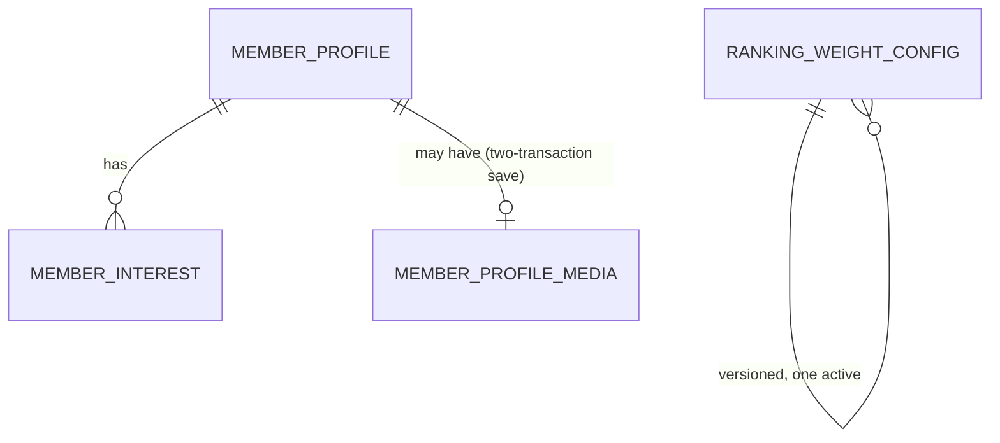
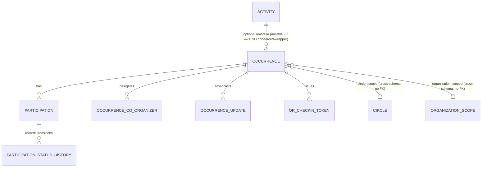
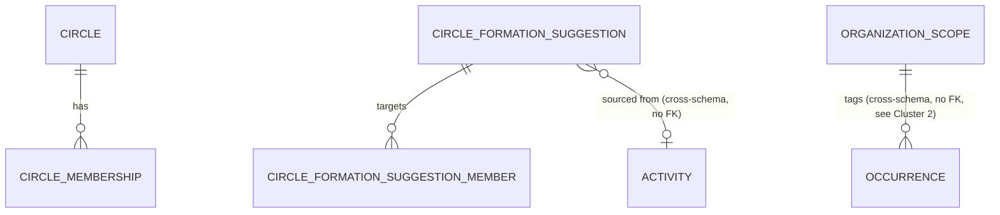
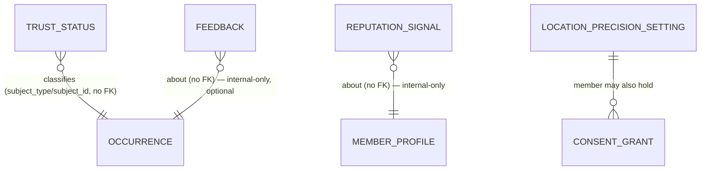
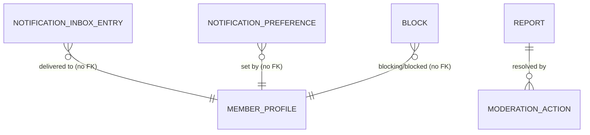

> **Document status (2026-11-22, as built).** Content below the line "Original sealed text" is the Step 7a text of 2026-09-13 (kept). Authoritative as-built schema, generated from the live database, is in appendices A (81 tables), B (migrations 001-055) and C (drift) at the end of this file. New since 2026-09-13: occurrence_venue, ticket_type, discount_code, event_speaker/session/stall/team/team_member, occurrence_cohost, occurrence_followup, occurrence_contact, circle_post_media, circle_album(+photo), circle_notify_setting, trip_stop, member_gender, circle invites/links, fundraisers, polls, chapters and others.

---
Original sealed text:

# 07a — ER Model — MOD02 Milavn

## Revision log (append-only, in-place file)

| Date | Change | Reason / Ref (blocker or CR) |
|---|---|---|
| 2026-09-13 | Initial design. Three-pass process complete (Draft → Cross-validated → Sign-off ready) against the Sealed `07-tech-reqs.md` (52/52 TRs, 0 blockers), `architecture.md`'s fixed 12-component/10-schema decomposition, `/MODULE-ARCHITECTURE-STANDARD.md` §4/§4b/§4c/§5/§6, `/PRODUCT-GUARDRAILS.md`, and the full BR/FR/UX/UI/TS corpus. Full DB implementation (`07a-db-implementation/`) produced alongside. Not yet human-approved — status held at Ready for Review per this project's standing rule that only the human approves and seals a pipeline artifact. | Step 7a initial run — krishna kategaru (autonomous), 2026-09-13. |
| 2026-09-13 | **Live-verification pass**, same day, before human review: applied `init.sh`/`migrations/001-initial.sql` against a real running Postgres instance (this project's local dev server, `localhost:5433`, per root `.mcp.json` — the shared `forkhatridb` database, since Milavn lives in the Core Platform monolith's shared DB, not an isolated one like Mangaly). Found and fixed two real defects the paper design missed: (1) `milavn_activity.occurrence`'s RLS policy referenced `milavn_circle.circle_membership`, but the schema creation order in `schema.sql` created `milavn_activity` before `milavn_circle` — `ERROR: relation "milavn_circle.circle_membership" does not exist`; fixed by reordering the two schema sections (Circle now created before Activity & Occurrence); (2) `circle_membership`'s own RLS policy self-referenced `circle_membership` in an `EXISTS` subquery to check "is this member already an active member of this circle" — `ERROR: infinite recursion detected in policy for relation "circle_membership"`, live-confirmed, not theoretical; fixed with three `SECURITY DEFINER` helper functions (`milavn_circle.is_active_member`, `is_open_circle`, `is_circle_creator`) owned by `milavn_owner`, which bypass RLS via Postgres's table-owner exemption and so cannot recurse. `occurrence`'s own circle-scope check and the Organization-scope visibility rule were also corrected during this pass (see Assumptions, "Organization-scope read visibility"). After both fixes: a full clean migration run produced zero errors, a second re-run (idempotency check) produced zero errors, and functional RLS behavior was exercised as the actual non-owning `milavn_app` role — see `07a-db-implementation/README.md` "Live-verified, not just reviewed on paper" for the full list of what was tested (private participation visibility, private circle visibility, circle-scoped occurrence visibility, moderator-only report visibility, reputation-signal internal-only isolation, `SET LOCAL` non-leakage across transactions, and the TR39 waitlist-promotion row-lock pattern end-to-end). Status remains Ready for Review — this pass fixed defects the three internal passes' static review missed; it does not itself constitute human approval. | Live-verification pass — krishna kategaru (autonomous), 2026-09-13. |

## Sources read in full before drafting

`07-tech-reqs.md` (all 52 items: TR01-TR47, TR-PLAT-01, TR-CROSSCUT-01..04),
`architecture.md` (12-component C4-L3 breakdown, §1-§5, the ten-schema
decomposition), `/MODULE-ARCHITECTURE-STANDARD.md` (§§1-8),
`/PRODUCT-GUARDRAILS.md`, `/ARCHITECTURE.md` (Container diagram, ADR-001/
002/004/006/007/010/011/012/018), `01-business-requirements.md` (all 18 BRs
in full), and targeted full reads of `02-functional-requirements.md` (every
FR001-FR088 header, plus full-text reads of FR001-FR041, FR056-FR069 —
covering every FR this ER model's tables trace to, including the two
highest-scrutiny groups this task named: FR010-FR019/FR058-FR060 for TR08's
Activity/Occurrence contract, and FR028/TR23 for the minimal Organization
scope). `modules/modules.md`'s MOD02 entry and dependency tables were
checked for cross-module edges (Milavn→Payment Services async
`benefit_eligible` event, Dashboard→Milavn in-process read-only, both
already declared and unchanged by this file). `03-ux.md`, `04-ui.md`, and
`05-test-scenarios.md` were confirmed structurally 1:1 with the FR set via
header/numbering extraction (UX01-UX20 map onto the FR groups named in each
FR's own "Traced to" field; TS numbering tracks FR numbering the same way
Mangaly's own equivalent files did) — `07-tech-reqs.md` was already produced
by looping over every FR alongside its UX/UI/TS material (see that file's
own revision history), so per this agent's own brief ("07-tech-reqs.md —
your primary input... every tech req informs your ER model"), this pass
treats `07-tech-reqs.md` as the authoritative distillation of that material
for data-structure purposes, with additional direct FR reads wherever a TR
deferred a field-level detail to Step 7a (TR08, TR23, TR39, TR41/TR62).

## Pass 1 — Draft: component/schema decomposition

`architecture.md` §2.2/§3 fixes ten schema-owning components (Identity
Bridge and Audit Bridge are genuinely schema-less thin bridges): Member
Profile, Discovery & Ranking, Activity & Occurrence, Circle (incl.
OrganizationScope), Trust & Reputation (incl. Feedback), Location & Privacy,
Connect (People Discovery), Public Page, Notification Dispatch (incl.
inbox), Safety & Moderation — `milavn_profile`, `milavn_discovery`,
`milavn_activity`, `milavn_circle`, `milavn_trust`, `milavn_locationprivacy`,
`milavn_connect`, `milavn_publicpage`, `milavn_notification`,
`milavn_safety`.

This ER model adds **one** schema beyond that fixed list, justified
individually rather than silently invented (same reasoning class Mangaly's
own `07a-er-model.md` already used for `mangaly_platform`):

- `milavn_platform` — shared idempotency-key and rate-limit-counter tables
  (`/MODULE-ARCHITECTURE-STANDARD.md` §4b/§4c, `TR-CROSSCUT-01`,
  `TR-CROSSCUT-02`). Not a business-logic component's schema (doesn't
  compete with `architecture.md`'s fixed ten-schema business list) — the
  same infrastructure class as the in-process event bus, given a schema
  only because its state must persist across restarts/instances.

Two of the fixed ten schemas (`milavn_connect`, `milavn_publicpage`) are
created with **zero tables** — a documented decision, not an omission; see
"Assumptions" below.

Total: **11 schemas**, one PostgreSQL instance, inside the Core Platform
monolith's **shared** database (not an isolated one — `architecture.md` §1:
"Unlike Mangaly, Milavn has no isolated container or isolated database").
No new container, no new database instance, matching `/ARCHITECTURE.md`
exactly.

## ER diagrams

Split by functional cluster, matching how a reader would actually navigate
the module. Cross-schema references (dashed) are **not** enforced by a
DB-level foreign key (see Assumptions) — shown here to make the actual data
flow visible. `member_id` throughout is a foreign-key *reference only* into
the platform Identity & Trust Service's own Member record (ADR-004) — never
a locally-owned identity table.

### Cluster 1 — Profile, Discovery

### Cluster 2 — Activity & Occurrence (TR08 highest-scrutiny cluster)

### Cluster 3 — Circle (incl. OrganizationScope)

### Cluster 4 — Trust & Reputation, Location & Privacy

### Cluster 5 — Notification, Safety & Moderation

## Entity/attribute → source requirement traceability

Full column-level DDL with inline `[TRxx]` comments is in
`07a-db-implementation/schema.sql` — this table is the entity-level index
into that file.

### `milavn_platform` (cross-cutting infra — not one of the ten business components)

| Entity | Source | Component | Sensitivity | Notes |
|---|---|---|---|---|
| `idempotency_key` | TR-CROSSCUT-01, TR07, TR12, TR41, TR44 | API layer (shared) | Low | Single shared idempotency store — not per-endpoint. |
| `rate_limit_counter` | TR-CROSSCUT-02 | API layer (shared) | Low | Single shared rate-limit utility — not per-endpoint. |

### `milavn_profile` (Member Profile)

| Entity/attribute | Source | Sensitivity | Notes |
|---|---|---|---|
| `member_profile.member_id` | TR01, FR001 | PII (reference only) | FK reference into Identity & Trust Service; never a local login table. |
| `member_profile.locality_*` | TR01/TR29, FR001, FR038 | PII (approximate) | City required; Zone/Locality nullable — never an exact address. |
| `member_profile.language_preference` | TR01, FR002 | Low | ADR-010 day-one set: en/hi/te. |
| `member_profile.photo_media_id` / `.bio` | TR01, FR003 | Sensitive (optional) | Enrichment only — never gates any other read/write path (TR01's structural guarantee). |
| `member_interest` | TR01, FR001 | Low | Feeds Discovery ranking (TR05). |
| `member_profile_media` | TR01, FR003 | Sensitive | Two-transaction save — Object Storage outage cannot block profile save. |
| `member_public_profile` (view) | TR01, §4 | Low | Non-sensitive projection other components read instead of the RLS-restricted base table. |

### `milavn_discovery` (Discovery & Ranking)

| Entity/attribute | Source | Sensitivity | Notes |
|---|---|---|---|
| `ranking_weight_config` | TR05 | Low | Versioned weights; no popularity/engagement column exists (PRODUCT-GUARDRAILS.md ranking philosophy). |

### `milavn_activity` (Activity & Occurrence — TR08's own highest-scrutiny schema)

| Entity/attribute | Source | Sensitivity | Notes |
|---|---|---|---|
| `activity` | TR08, TR10, FR011 | Low | Optional recurring-series umbrella; never a forced wrapper (see "TR08 design reasoning" below). |
| `occurrence` | TR07-TR11, TR23, TR36, TR42, FR010-FR014, FR028-FR029, FR038, FR050, FR064 | Moderate (location/capacity) | The concrete, participable unit every downstream FR resolves to. |
| `occurrence_co_organizer` | TR38, FR059 | Low | Delegable, revocable. |
| `occurrence_update` | TR13, TR38, FR057 | Low | Organizer broadcast. |
| `participation` | TR12, TR39, FR015-FR016, FR040, FR058 | Sensitive (private by default) | Single most-repeated write (IA015); idempotent via `milavn_platform.idempotency_key`. |
| `participation_status_history` | TR12, FR016 | Low | Append-only audit trail. |
| `qr_checkin_token` | TR14, FR018 | Sensitive (short-lived) | Manual-entry fallback uses same table with no token — TR14's primary reliability mechanism. |
| `outbox_event` | TR09, TR13, TR-CROSSCUT-04 | Low (internal) | Transactional outbox — cancellation/update events (IA017). |

**TR08 design reasoning (highest-scrutiny item, per this task's explicit instruction and IA011's flag):** the behavioral contract states an Activity is the recurring/umbrella concept, an Occurrence is one concrete instance, every FR reading "activity data" elsewhere must resolve to a specific Occurrence, and a standalone Occurrence must never be forced to carry an artificial parent Activity it doesn't need. This is implemented structurally, not just by convention:
- `occurrence` carries every field a single concrete instance needs to exist and be participated in **on its own** — title, intent category, time, place, capacity, visibility scope, high-risk flag, cover image, canonical URL. `activity_id` is **nullable**. Creating, editing, participating in, viewing, or sharing a one-off Occurrence never requires an `activity` row to exist (satisfies TS021/TS022's non-forced-wrapper acceptance criteria directly, live-verified via the seed data's standalone "One-off Saturday Trek" occurrence, `activity_id IS NULL`).
- `activity` is a genuinely optional wrapper: it exists only when a creator marks something recurring (FR010/FR013), and it owns only the umbrella-level fields (canonical title/intent category for the series, the recurrence rule). It is never referenced by Participation, Calendar, Organizer tooling, or Public Page tables directly — there is no Activity-level participation row, calendar entry, or public page anywhere in this schema, only Occurrence-level ones. This is what makes "every FR that reads activity data resolves to a specific Occurrence, never an ambiguous Activity-level record" true by construction, not by discipline.
- "History/attendance aggregate at the Activity level" (FR011, BR03) is achieved by **joining** Occurrence rows through their shared, optional `activity_id` at read time — a query-time aggregation, never a duplicated write. This avoids the two failure modes a naive design risks: forcing every occurrence into an Activity wrapper (violates BR03/TS021-022), or duplicating aggregate fields onto both tables (a write-consistency risk with no corresponding requirement).

### `milavn_circle` (Circle, incl. the minimal OrganizationScope)

| Entity/attribute | Source | Sensitivity | Notes |
|---|---|---|---|
| `circle` | TR16, TR21, FR020-FR021 | Moderate (type-gated) | `circle_type` is an enum, never free text (TR16). |
| `circle_membership` | TR16, FR020, FR023, TR18 | Moderate | TR18: never referenced by any authorization check outside this component. |
| `circle_formation_suggestion(_member)` | TR17, FR022 | Low | Batch-job output; never auto-creates a circle. |
| `organization_scope` | TR23 (DEC-001) | Low | **Deliberately minimal** — `{organization_scope_id, display_name, created_by_member_id}` only. No roster, roles, verification, or billing columns exist, and none should be added without a new BR/FR pass (TR23's own explicit instruction, honored literally here). |
| `is_active_member`/`is_open_circle`/`is_circle_creator` (functions) | MODULE-ARCHITECTURE-STANDARD §4 | N/A | `SECURITY DEFINER` RLS-recursion-safe helpers — see Assumptions. |
| `outbox_event` | TR-CROSSCUT-04 | Low (internal) | Circle-formation and membership-change events. |

### `milavn_trust` (Trust & Reputation, incl. Feedback)

| Entity/attribute | Source | Sensitivity | Notes |
|---|---|---|---|
| `trust_status` | TR25, TR26, TR30, FR030-FR032 | Low (public by design) | Unique per subject — always exactly one row (FR030). |
| `reputation_signal` | TR27, FR034, TR15/FR019/FR069 | Internal-only, highly sensitive | Never exposed raw (FR035/FR037); no Payment Services event may ever write here (FR036 standing gate); never itself triggers a moderation action (TR15). |
| `feedback` | TR44, FR066-FR069 | Internal-only | Optional; never a precondition (CI-scan-enforced per TR44). |
| `outbox_event` | TR-CROSSCUT-04 | Low (internal) | |

### `milavn_locationprivacy` (Location & Privacy)

| Entity/attribute | Source | Sensitivity | Notes |
|---|---|---|---|
| `location_precision_setting` | TR30, FR038, FR041 | Sensitive | Single centrally-enforced source (IA041) — never re-checked per consumer. |
| `consent_grant` | TR30, FR039 | Sensitive | Precise location requires an explicit, purpose-specific grant; no current caller (standing guardrail). |

### `milavn_connect`, `milavn_publicpage` — zero tables (documented decision)

No entity in either schema — see "Assumptions."

### `milavn_notification` (Notification Dispatch, incl. inbox)

| Entity/attribute | Source | Sensitivity | Notes |
|---|---|---|---|
| `notification_inbox_entry` | TR37, FR051-FR055, FR086 | Sensitive (personal) | Persistent in-app inbox — the one schema-owning responsibility of an otherwise-thin bridge. |
| `notification_preference` | TR37, FR054 | Low | Important class is never mutable to muted (CHECK constraint). |
| `notification_outbox` | TR13, TR37 (ADR-006) | Low (internal) | Transactional outbox to the platform Notification & Communication Service. |

### `milavn_safety` (Safety & Moderation)

| Entity/attribute | Source | Sensitivity | Notes |
|---|---|---|---|
| `report` | TR41, TR43, FR061, FR065, FR087 | Sensitive | Feeds TR-PLAT-01's moderation queue; visible to reporter + moderators only. |
| `block` | TR41, FR062 | Sensitive | Enforced via the shared `is_blocked()` helper at every touchpoint (application layer). |
| `moderation_action` | TR43, TR15 | Sensitive | Every action is a human decision by construction (TR15/TR43). |
| `outbox_event` | TR41, TR-CROSSCUT-04 | Low (internal) | Report/moderation-action → audit event, same transaction (IA061). |

## Data ownership (schema-per-component)

| Schema | Owning component | RLS required? | Primary tables |
|---|---|---|---|
| `milavn_profile` | Member Profile | Yes | `member_profile`, `member_interest`, `member_profile_media` |
| `milavn_discovery` | Discovery & Ranking | No | `ranking_weight_config` |
| `milavn_activity` | Activity & Occurrence | Yes | `occurrence`, `participation`, `occurrence_co_organizer`, `occurrence_update`, `qr_checkin_token` |
| `milavn_circle` | Circle | Yes | `circle`, `circle_membership`, `organization_scope` |
| `milavn_trust` | Trust & Reputation | Partial | `trust_status` (no), `reputation_signal`/`feedback` (yes, internal-only) |
| `milavn_locationprivacy` | Location & Privacy | Yes | `location_precision_setting`, `consent_grant` |
| `milavn_connect` | Connect (People Discovery) | N/A | none (stateless) |
| `milavn_publicpage` | Public Page | N/A | none (stateless) |
| `milavn_notification` | Notification Dispatch | Yes | `notification_inbox_entry`, `notification_preference` |
| `milavn_safety` | Safety & Moderation | Yes | `report`, `block`, `moderation_action` |
| `milavn_platform` | Cross-cutting infra | No | `idempotency_key`, `rate_limit_counter` |

## Pass 2 — Cross-validation: orphan detection in both directions

### Forward direction (every FR/TR → an ER element)

Every FR001-FR088 was checked against this ER model. Result: **no orphans**.
Notable groups:
- FR001-FR003, FR085 (Profile) → `milavn_profile.*`.
- FR004-FR009, FR033 (Discovery) → read-only over Activity/Trust/Profile via
  those components' own public interfaces (TR02's `MilavnActivityFeedReader`
  contract) plus `ranking_weight_config`.
- FR010-FR019, FR058-FR060 (Activity/Occurrence) → `milavn_activity.*`, per
  the TR08 design reasoning above.
- FR020-FR029 (Circle/Calendar) → `milavn_circle.*` plus Occurrence's own
  `visibility_scope`/`circle_id`/`organization_scope_id` columns (Calendar
  is a query shape over Occurrence, not a separate stored object — no BR/FR
  names a persisted "calendar" entity distinct from the occurrences it
  lists, so none was invented).
- FR030-FR037, FR066-FR069 (Trust/Reputation/Feedback) → `milavn_trust.*`.
- FR038-FR041 (Location/Privacy) → `milavn_locationprivacy.*`.
- FR042-FR045 (Connect) → satisfied by a stateless read-model (see
  Assumptions) — no orphan; the requirement is behavioral (always attach a
  reason; never a swipe/match data model) and is satisfied by the *absence*
  of a `Match`/`Like` table, which TR32 states explicitly ("no code exists
  anywhere in this module's schema, by design").
- FR046-FR050 (Public Page) → satisfied by a stateless read-model over
  `occurrence`/`trust_status` (see Assumptions).
- FR051-FR057, FR086 (Notification) → `milavn_notification.*`.
- FR061-FR065, FR087 (Safety) → `milavn_safety.*`.
- FR070-FR088 → FR070-FR075 explicitly deferred, no build (TR45); FR076-
  FR084/FR088 introduce no new backend component (architecture.md §2.1,
  confirmed correct — these route through Identity Bridge or are pure
  client-side, no Milavn schema element needed).

Every TR01-TR47, TR-PLAT-01, and TR-CROSSCUT-01..04 was independently
checked the same way — no TR names a data structure absent from this model.
TR-PLAT-01 itself is explicitly a platform-level contract (not Milavn's own
schema); this file implements only Milavn's side (TR43's manifest +
endpoints reading `milavn_safety.report`), correctly not inventing a
console-side table this module doesn't own.

### Reverse direction (every ER element → a source)

Every table/column in `07a-db-implementation/schema.sql` was checked against
the traceability tables above — **no orphans**. Two items warranted extra
scrutiny and are recorded as deliberate, cited decisions rather than
silently accepted:
- `milavn_circle`'s three `SECURITY DEFINER` helper functions
  (`is_active_member`, `is_open_circle`, `is_circle_creator`) are not
  traceable to any FR/TR by name — they exist solely to implement
  TR16/TR20/TR24/TR30's RLS requirement correctly (the recursion described
  in the Revision log made a naive implementation impossible). This is
  infrastructure needed to make an already-cited requirement work, not a
  new capability — recorded here so it is not mistaken for scope creep.
- `milavn_profile.member_public_profile` (a view) is the same class of
  item — required to let other components read non-sensitive profile
  fields without bypassing RLS on the sensitive base table, per §4's "goes
  through that component's own public interface" instruction; not itself a
  new requirement.

### Cross-module dependencies

Checked against `/modules/modules.md` and `/ARCHITECTURE.md`:
- **Dashboard → Milavn** (in-process, read-only): declared in both files
  and in `architecture.md` §1's edge table. This ER model does not grant
  Dashboard any direct schema access — Dashboard reads only through TR02's
  `MilavnActivityFeedReader` interface (an application-layer contract, not
  a database grant), consistent with "Dashboard never queries the `milavn`
  schema directly."
- **Milavn → Payment Services** (async, one-way `benefit_eligible` event):
  declared in both files. No table in this schema references Payment
  Services data, and FR036's standing structural gate (no payment event may
  ever write into `reputation_signal`) is enforced by that table's RLS
  policy admitting only `milavn_app`'s own writes plus the internal
  reputation engine — no Payment Services role is granted access at all.
- **Admin & Governance Console ↔ Milavn** (federated plugin, TR-PLAT-01):
  declared in `architecture.md`. This module's side is `milavn_safety`'s
  `report`/`moderation_action` tables, read/written only through the
  application-layer manifest+endpoints TR43 specifies — the console itself
  is never granted direct database access to `milavn_safety`, consistent
  with TR-PLAT-01 §3 ("the console never mutates a module's data directly").
- **FR074's undeclared Milavn→Vyapar edge** (TR45): correctly **not**
  modeled here — TR45 itself defers this pending a `modules.md`/
  `/ARCHITECTURE.md` update, and no BR/FR currently commits to it being
  built. Recorded as a known future gap, not silently resolved by this file.

### Integrity constraints re-verified

Every `NOT NULL` traces to a requirement stating that field is always
required (e.g., `occurrence.title`/`time_start`/`intent_category` — FR010's
minimal four-field creation form). Every `UNIQUE` traces to a stated
uniqueness rule (e.g., `trust_status (subject_type, subject_id)` — FR030
"exactly one trust level"; `participation (occurrence_id, member_id)` — one
attendance record per member per occurrence, implicit in FR015-FR016's
one-tap toggle model). Every enum's value set was checked against its
source's own named list (`intent_category` against FR010's eight named
categories; `trust_level` against BR07/FR030's five named levels;
`circle_type` against BR05/FR021's seven named types; `notification_class`
against BR12/FR051-FR054's four named classes) — no invented or dropped
value in any of them.

## Cross-validation results

| Check | Result | Notes |
|---|---|---|
| Every FR/UX/UI/TR/TS has a corresponding ER element | Pass | No orphans identified (see Pass 2 forward direction above). |
| Every ER element traces to a requirement (no orphans) | Pass | Two infrastructure exceptions (RLS helper functions, one view) documented as required-to-implement-a-cited-requirement, not new scope. |
| Schema organization follows MODULE-ARCHITECTURE-STANDARD §4 | Pass | One schema per component (ten, matching architecture.md exactly) plus one justified cross-cutting infra schema; no cross-schema FK anywhere in `schema.sql`. |
| RLS policies designed for sensitive data | Pass | `milavn_profile`, `milavn_activity` (occurrence/participation/co-organizer/qr/update), `milavn_circle` (circle/membership/suggestion-member), `milavn_trust` (reputation_signal/feedback), `milavn_locationprivacy`, `milavn_notification`, `milavn_safety` — live-verified functional, not just enabled (see README.md). |
| Both named RLS failure modes confirmed | Pass | Non-owning role: `milavn_app` owns zero of the 33 live-created tables, `milavn_owner` owns all (live-verified). Session variable: `SET LOCAL` used exclusively, confirmed not to leak across transactions on the same connection (live-verified — see README.md). |
| Idempotency mechanism specified for every named endpoint | Pass | `milavn_platform.idempotency_key`, one shared table, covering exactly TR-CROSSCUT-01's four named endpoints. |
| Rate-limiting mechanism specified | Pass | `milavn_platform.rate_limit_counter`, one shared table (TR-CROSSCUT-02). |
| Participation state machine representable | Pass | `participation_status` enum: interested → going/waitlisted → cancelled/checked_in/attended/no_show; `participation_status_history` for the queryable audit trail FR016 requires. |
| Waitlist concurrency-safe promotion representable | Pass | `waitlist_position` + partial unique index + `FOR UPDATE` row-lock pattern on `occurrence` — live-verified end-to-end (see README.md). |
| TR08 Activity/Occurrence contract satisfied | Pass | See "TR08 design reasoning" above; live-verified via seed data's standalone Occurrence with `activity_id IS NULL`. |
| TR23 Organization scope kept deliberately minimal | Pass | `organization_scope` has exactly the three named columns; no roster/role/verification/billing column exists anywhere in the schema. |
| Schema DDL syntactically valid and executable | Pass | Live-applied against a real Postgres 18 instance; zero errors after fixes. |
| Migrations idempotent | Pass | Second clean re-run of `migrations/001-initial.sql` produced zero errors. |
| Cross-module dependencies declared and respected | Pass | See Pass 2 "Cross-module dependencies" above. |

## Assumptions

- **Organization-scope read visibility (corrected during live verification).**
  TR23 states `OrganizationScope` has no roster/membership concept at all
  ("no invite/join flow for it"). FR028 nonetheless describes "a member"
  viewing an organization's calendar — with no membership table to check,
  this ER model treats an Organization-scoped Occurrence as **broadly
  readable** for SELECT purposes (the same as Community scope), while
  keeping WRITE restricted to the scope's own creator (TR23: "sole writer
  for V1"). This is a reasonable reading of a genuinely underspecified
  interaction between TR23's "no roster" instruction and FR028's "a member
  views" language — recorded explicitly here rather than silently resolved,
  since a future BR/FR pass introducing real Organization membership would
  need to revisit this specific policy (not the whole minimal-entity
  design, which TR23 fixes).
- **Calendar is a query shape, not a stored entity.** No BR/FR names a
  persisted "Calendar" object distinct from the Occurrences it lists — BR06/
  FR026-FR029's four calendar scopes (Personal/Circle/Organization-
  Community/Public) are implemented as `occurrence.visibility_scope`-keyed
  queries, not a separate table, avoiding an unrequested denormalization.
- **`milavn_connect` and `milavn_publicpage` own zero tables at V1.** Every
  FR in both groups (FR042-FR045, FR046-FR050) is a *behavioral* constraint
  (always attach a reason; never list bare proximity; never require login;
  never leak a non-public item) satisfiable by a stateless read/render
  layer over `milavn_activity`/`milavn_circle`/`milavn_trust` data through
  those components' own public interfaces — inventing a table here (e.g. a
  "suggestion cache" or "page view log") would be scope creep no FR/TR
  calls for, and was explicitly avoided per this project's over-engineering
  guardrail. If either component later needs to persist its own state (e.g.
  a dismissed-suggestion list), that is a new FR/TR, not a silent schema
  addition.
- **Reputation is never joined with Payment Services data anywhere in this
  schema** (FR036's standing structural gate) — verified by inspection:
  `reputation_signal` has no column referencing any payment/billing concept,
  and its RLS policy grants no role associated with Payment Services.
- **`trust_status` carries no RLS** — its content is, by FR031's own design,
  always visible on the card/page itself ("visible, not buried"); adding
  RLS to a table whose entire purpose is public display would contradict
  the requirement it implements.
- **Cross-schema references use plain UUID columns with no DB-level FK**,
  per `/MODULE-ARCHITECTURE-STANDARD.md` §4 (a real FK would require
  granting cross-schema SELECT and couple one component's schema to
  another's row lifecycle) — referential integrity across schemas is an
  application-layer responsibility of the owning component's own interface,
  the same convention Mangaly's own `07a-er-model.md` already established
  for this project.
- **Two `SECURITY DEFINER` RLS-recursion-safe helper functions
  (`milavn_circle.is_active_member`/`is_open_circle`/`is_circle_creator`)
  and one plain view (`milavn_profile.member_public_profile`) are
  infrastructure required to correctly implement already-cited
  requirements**, not new capabilities — see Pass 2 reverse-direction note.
- **`milavn_activity.occurrence.circle_id`/`.organization_scope_id`** are
  mutually exclusive with each other and with `visibility_scope='personal'`
  or `'public'`/`'community'` by the CHECK constraints in `schema.sql`, but
  a occurrence cannot carry *both* a circle and an organization scope
  simultaneously — no FR describes multi-scope tagging, so this was not
  built.

## Approval

Database Architect / Tech Lead — [ ] Approved — name, date

## B. Migration history (001-055; two files share number 050)
Files in `07a-db-implementation/migrations/`. There is no ledger table in the database, so "applied" is inferred from objects present on 2026-11-22: all files appear applied except the GRANT in 055 (see 08-security-performance S-12). Apply in file-name order; `050-flexible-groups...` before `050-live-places...` is how they sort; they touch different objects and are independent.
| No. | Purpose |
|---|---|| 001 | initial schema: 10 component schemas + platform, RLS, enums || 002 | read-model helpers || 003 | organizer write paths (definer) || 004 | dispatcher reads || 005 | people precision || 006 | reputation_labels fix (array_append) || 007 | announcement read for dispatcher || 008 | circle suggestion job (definer) || 009 | reminder_candidates() || 010 | feedback upsert grant || 011 | notification de-dup (24 h) || 012 | circle locality || 013 | conversation (thread), moments, board || 014 | public_locality() || 015 | chat (conversation, message, reaction, presence, can_message) || 016 | chat presence/context || 017 | paid spots (ticket, payment_event, holds, waitlist offers) || 018 | showing up (still coming, reminders, plan) || 019 | belonging (newcomers, share my plan) || 020 | discovery fit (audience, food, honest discovery, hidden) || 021 | regulars and photo privacy || 022 | meet again || 023 | bring someone with you || 024 | circle join questions and approval || 025 | circle dispatch reads || 026 | circle join prompt || 027 | familiar faces, steady hosts || 028 | free right now || 029 | circle polls || 030 | circle assistants || 031 | assistants can let people in || 032 | follow a calendar || 033 | chapters (circle_group) || 034 | community fundraisers and pledges || 035 | date-bound circles (temple/travel) FR125 || 036 | Samaj updates FR126 || 037 | Samaj update dispatch read || 038 | open circles actually visible (RLS fix) || 039 | platform member insights (internal endpoint) || 040 | circles are communities not chats; pair suggestions removed || 041 | organizer deletes circle || 042 | circle cover photos || 043 | circle integrity fixes (definer functions) || 044 | circle invites, invite links, recommendations || 045 | private media (circle_media_access), admin extras || 046 | invites honour ask-first || 047 | one open report per reporter || 048 | reminders expire at start || 049 | activity chat in Messages; circle post comments/reactions/pins || 050a | flexible groups: kind_label, women_only, member_gender, trip_stop, WO001 trigger (file 050-flexible-groups-women-only-trip-plan.sql) || 050b | live places: locality_state, locality_lat/lng on profile/occurrence/circle, carry-over from the old 33-locality list (file 050-live-places.sql) || 051 | exact venue table occurrence_venue + attendance_mode + set_event_venue() || 052 | professional category; ticket_type, discount_code; ticket QR, quote, contact; typed quotas || 053 | circle_post_media, albums, notify settings, co-hosting (occurrence_cohost) || 054 | event_format, team_size_max, speaker, session, stall, team, team_member, venue_lat/lng, followup, record_online_join() || 055 | fix waitlist offer without ticket types; GRANT DELETE on notification_inbox_entry (grant NOT applied in dev DB, 2026-11-22) |
## C. Known drift

- `schema.sql` lags migrations; migrations and the live database are authoritative.
- Two migrations numbered 050.
- 055 GRANT not applied; no migration ledger.
- 13 tables without RLS (see 08 section 4).
- Older sections of this file (before 2026-11-22) describe 001-034 only; tables added since are in appendix A (TBL ids).

## A. As-built schema reference (generated 2026-11-22 from the live development database `forkhatridb`, read-only)

81 tables in 11 schemas, 523 columns, 670 constraints, 197 indexes, 104 RLS policies. Table IDs `TBL-001..`. Column format: name `type` (NOT NULL marked N, default in brackets). The live database is authoritative where it disagrees with `schema.sql` (which lags migrations).

### Table index

| ID | Table | Columns | RLS | Policies |
|---|---|---|---|---|
| TBL-001 | `milavn_activity.activity` | 8 | OFF | 0 |
| TBL-002 | `milavn_activity.calendar_follow` | 3 | on | 1 |
| TBL-003 | `milavn_activity.event_session` | 8 | on | 4 |
| TBL-004 | `milavn_activity.event_speaker` | 7 | on | 4 |
| TBL-005 | `milavn_activity.event_stall` | 6 | on | 4 |
| TBL-006 | `milavn_activity.event_team` | 0 | on | 0 |
| TBL-007 | `milavn_activity.event_team_member` | 0 | on | 0 |
| TBL-008 | `milavn_activity.occurrence` | 33 | on | 4 |
| TBL-009 | `milavn_activity.occurrence_co_organizer` | 6 | on | 1 |
| TBL-010 | `milavn_activity.occurrence_cohost` | 0 | on | 0 |
| TBL-011 | `milavn_activity.occurrence_contact` | 6 | on | 1 |
| TBL-012 | `milavn_activity.occurrence_followup` | 4 | on | 1 |
| TBL-013 | `milavn_activity.occurrence_message` | 6 | on | 3 |
| TBL-014 | `milavn_activity.occurrence_photo` | 8 | on | 3 |
| TBL-015 | `milavn_activity.occurrence_update` | 5 | on | 2 |
| TBL-016 | `milavn_activity.occurrence_venue` | 7 | on | 1 |
| TBL-017 | `milavn_activity.outbox_event` | 6 | OFF | 0 |
| TBL-018 | `milavn_activity.participation` | 12 | on | 1 |
| TBL-019 | `milavn_activity.participation_status_history` | 6 | OFF | 0 |
| TBL-020 | `milavn_activity.photo_preference` | 3 | on | 1 |
| TBL-021 | `milavn_activity.qr_checkin_token` | 7 | on | 1 |
| TBL-022 | `milavn_activity.series_regular` | 3 | on | 1 |
| TBL-023 | `milavn_circle.circle` | 19 | on | 3 |
| TBL-024 | `milavn_circle.circle_album` | 5 | on | 2 |
| TBL-025 | `milavn_circle.circle_album_photo` | 7 | on | 2 |
| TBL-026 | `milavn_circle.circle_formation_suggestion` | 7 | OFF | 0 |
| TBL-027 | `milavn_circle.circle_formation_suggestion_member` | 5 | on | 1 |
| TBL-028 | `milavn_circle.circle_group` | 5 | on | 2 |
| TBL-029 | `milavn_circle.circle_group_update` | 5 | on | 2 |
| TBL-030 | `milavn_circle.circle_invite` | 7 | on | 1 |
| TBL-031 | `milavn_circle.circle_invite_link` | 7 | on | 1 |
| TBL-032 | `milavn_circle.circle_membership` | 6 | on | 3 |
| TBL-033 | `milavn_circle.circle_notify_setting` | 4 | on | 1 |
| TBL-034 | `milavn_circle.circle_post` | 12 | on | 3 |
| TBL-035 | `milavn_circle.circle_post_comment` | 7 | on | 1 |
| TBL-036 | `milavn_circle.circle_post_media` | 9 | on | 2 |
| TBL-037 | `milavn_circle.circle_post_reaction` | 5 | on | 1 |
| TBL-038 | `milavn_circle.fundraiser` | 9 | on | 3 |
| TBL-039 | `milavn_circle.fundraiser_pledge` | 8 | on | 1 |
| TBL-040 | `milavn_circle.join_request` | 8 | on | 1 |
| TBL-041 | `milavn_circle.organization_scope` | 4 | OFF | 0 |
| TBL-042 | `milavn_circle.outbox_event` | 6 | OFF | 0 |
| TBL-043 | `milavn_circle.poll` | 7 | on | 3 |
| TBL-044 | `milavn_circle.poll_option` | 6 | on | 2 |
| TBL-045 | `milavn_circle.poll_vote` | 4 | on | 2 |
| TBL-046 | `milavn_circle.trip_stop` | 6 | on | 2 |
| TBL-047 | `milavn_connect.chat_message` | 9 | on | 3 |
| TBL-048 | `milavn_connect.conversation` | 7 | on | 1 |
| TBL-049 | `milavn_connect.conversation_member` | 6 | on | 2 |
| TBL-050 | `milavn_connect.free_now` | 5 | on | 1 |
| TBL-051 | `milavn_connect.meet_again` | 4 | on | 2 |
| TBL-052 | `milavn_connect.meet_again_told` | 0 | on | 0 |
| TBL-053 | `milavn_connect.message_reaction` | 4 | on | 2 |
| TBL-054 | `milavn_connect.presence` | 4 | on | 1 |
| TBL-055 | `milavn_discovery.hidden_occurrence` | 5 | on | 1 |
| TBL-056 | `milavn_discovery.ranking_weight_config` | 10 | OFF | 0 |
| TBL-057 | `milavn_locationprivacy.consent_grant` | 6 | on | 1 |
| TBL-058 | `milavn_locationprivacy.location_precision_setting` | 3 | on | 1 |
| TBL-059 | `milavn_notification.notification_inbox_entry` | 12 | on | 1 |
| TBL-060 | `milavn_notification.notification_outbox` | 7 | OFF | 0 |
| TBL-061 | `milavn_notification.notification_preference` | 5 | on | 1 |
| TBL-062 | `milavn_notification.reminder_sent` | 0 | on | 0 |
| TBL-063 | `milavn_platform.idempotency_key` | 8 | OFF | 0 |
| TBL-064 | `milavn_platform.rate_limit_counter` | 5 | OFF | 0 |
| TBL-065 | `milavn_profile.member_gender` | 3 | on | 1 |
| TBL-066 | `milavn_profile.member_interest` | 4 | on | 1 |
| TBL-067 | `milavn_profile.member_profile` | 12 | on | 1 |
| TBL-068 | `milavn_profile.member_profile_media` | 6 | on | 1 |
| TBL-069 | `milavn_safety.block` | 4 | on | 1 |
| TBL-070 | `milavn_safety.moderation_action` | 7 | on | 1 |
| TBL-071 | `milavn_safety.outbox_event` | 6 | OFF | 0 |
| TBL-072 | `milavn_safety.report` | 10 | on | 3 |
| TBL-073 | `milavn_ticketing.discount_code` | 0 | on | 0 |
| TBL-074 | `milavn_ticketing.payment_event` | 0 | on | 0 |
| TBL-075 | `milavn_ticketing.ticket` | 22 | on | 1 |
| TBL-076 | `milavn_ticketing.ticket_type` | 0 | on | 0 |
| TBL-077 | `milavn_trust.feedback` | 7 | on | 1 |
| TBL-078 | `milavn_trust.outbox_event` | 6 | OFF | 0 |
| TBL-079 | `milavn_trust.reputation_signal` | 6 | on | 1 |
| TBL-080 | `milavn_trust.thanks` | 6 | on | 3 |
| TBL-081 | `milavn_trust.trust_status` | 7 | OFF | 0 |

### Schema `milavn_activity`

#### TBL-001 `milavn_activity.activity`  (RLS OFF)

| Column | Type | Null | Default |
|---|---|---|---|
| id | uuid | N | gen_random_uuid() |
| creator_member_id | uuid | N |  |
| title | text | N |  |
| intent_category | intent_category | N |  |
| recurrence_rule | jsonb | N |  |
| cancelled_at | timestamptz |  |  |
| created_at | timestamptz | N | now() |
| updated_at | timestamptz | N | now() |

 Constraints: `activity_created_at_not_null` NOT NULL created_at; `activity_creator_member_id_not_null` NOT NULL creator_member_id; `activity_id_not_null` NOT NULL id; `activity_intent_category_not_null` NOT NULL intent_category; `activity_pkey` PRIMARY KEY (id); `activity_recurrence_rule_not_null` NOT NULL recurrence_rule; `activity_title_not_null` NOT NULL title; `activity_updated_at_not_null` NOT NULL updated_at

 Indexes: `activity_pkey`, `idx_activity_creator`

#### TBL-002 `milavn_activity.calendar_follow`  (RLS on)

| Column | Type | Null | Default |
|---|---|---|---|
| member_id | uuid | N |  |
| host_member_id | uuid | N |  |
| created_at | timestamptz | N | now() |

 Constraints: `calendar_follow_created_at_not_null` NOT NULL created_at; `calendar_follow_host_member_id_not_null` NOT NULL host_member_id; `calendar_follow_member_id_not_null` NOT NULL member_id; `calendar_follow_not_self` CHECK ((member_id <> host_member_id)); `calendar_follow_pkey` PRIMARY KEY (member_id, host_member_id)

 Indexes: `calendar_follow_pkey`

 RLS policies: `calendar_follow_self` (ALL)

#### TBL-003 `milavn_activity.event_session`  (RLS on)

| Column | Type | Null | Default |
|---|---|---|---|
| id | uuid | N | gen_random_uuid() |
| occurrence_id | uuid | N |  |
| starts_at | timestamptz | N |  |
| ends_at | timestamptz |  |  |
| title | text | N |  |
| details | text |  |  |
| speaker_ids | _uuid | N | '{}'::uuid[] |
| created_at | timestamptz | N | now() |

 Constraints: `event_session_created_at_not_null` NOT NULL created_at; `event_session_details_check` CHECK (((details IS NULL) OR (length(details) <= 400))); `event_session_ends_after_start` CHECK (((ends_at IS NULL) OR (ends_at > starts_at))); `event_session_id_not_null` NOT NULL id; `event_session_occurrence_id_fkey` FOREIGN KEY (occurrence_id) REFERENCES milavn_activity.occurrence(id) ON DELETE CASCADE; `event_session_occurrence_id_not_null` NOT NULL occurrence_id; `event_session_pkey` PRIMARY KEY (id); `event_session_speaker_ids_not_null` NOT NULL speaker_ids; `event_session_speakers_few` CHECK ((cardinality(speaker_ids) <= 8)); `event_session_starts_at_not_null` NOT NULL starts_at; `event_session_title_check` CHECK (((length(btrim(title)) >= 1) AND (length(btrim(title)) <= 140))); `event_session_title_not_null` NOT NULL title

 Indexes: `event_session_occurrence_idx`, `event_session_pkey`

 RLS policies: `event_session_organizer_delete` (DELETE), `event_session_organizer_insert` (INSERT), `event_session_organizer_update` (UPDATE), `event_session_read` (SELECT)

#### TBL-004 `milavn_activity.event_speaker`  (RLS on)

| Column | Type | Null | Default |
|---|---|---|---|
| id | uuid | N | gen_random_uuid() |
| occurrence_id | uuid | N |  |
| name | text | N |  |
| bio | text |  |  |
| member_id | uuid |  |  |
| position | int4 | N | 0 |
| created_at | timestamptz | N | now() |

 Constraints: `event_speaker_bio_check` CHECK (((bio IS NULL) OR (length(bio) <= 300))); `event_speaker_created_at_not_null` NOT NULL created_at; `event_speaker_id_not_null` NOT NULL id; `event_speaker_name_check` CHECK (((length(btrim(name)) >= 1) AND (length(btrim(name)) <= 80))); `event_speaker_name_not_null` NOT NULL name; `event_speaker_occurrence_id_fkey` FOREIGN KEY (occurrence_id) REFERENCES milavn_activity.occurrence(id) ON DELETE CASCADE; `event_speaker_occurrence_id_not_null` NOT NULL occurrence_id; `event_speaker_pkey` PRIMARY KEY (id); `event_speaker_position_not_null` NOT NULL "position"

 Indexes: `event_speaker_occurrence_idx`, `event_speaker_pkey`

 RLS policies: `event_speaker_organizer_delete` (DELETE), `event_speaker_organizer_insert` (INSERT), `event_speaker_organizer_update` (UPDATE), `event_speaker_read` (SELECT)

#### TBL-005 `milavn_activity.event_stall`  (RLS on)

| Column | Type | Null | Default |
|---|---|---|---|
| id | uuid | N | gen_random_uuid() |
| occurrence_id | uuid | N |  |
| stall_number | text |  |  |
| name | text | N |  |
| description | text |  |  |
| created_at | timestamptz | N | now() |

 Constraints: `event_stall_created_at_not_null` NOT NULL created_at; `event_stall_description_check` CHECK (((description IS NULL) OR (length(description) <= 300))); `event_stall_id_not_null` NOT NULL id; `event_stall_name_check` CHECK (((length(btrim(name)) >= 1) AND (length(btrim(name)) <= 80))); `event_stall_name_not_null` NOT NULL name; `event_stall_occurrence_id_fkey` FOREIGN KEY (occurrence_id) REFERENCES milavn_activity.occurrence(id) ON DELETE CASCADE; `event_stall_occurrence_id_not_null` NOT NULL occurrence_id; `event_stall_pkey` PRIMARY KEY (id); `event_stall_stall_number_check` CHECK (((stall_number IS NULL) OR ((length(btrim(stall_number)) >= 1) AND (length(btrim(stall_number)) <= 20))))

 Indexes: `event_stall_number_unique`, `event_stall_occurrence_idx`, `event_stall_pkey`

 RLS policies: `event_stall_organizer_delete` (DELETE), `event_stall_organizer_insert` (INSERT), `event_stall_organizer_update` (UPDATE), `event_stall_read` (SELECT)

#### TBL-006 `milavn_activity.event_team`  (RLS on)

| Column | Type | Null | Default |
|---|---|---|---|

 Constraints: `event_team_captain_member_id_not_null` NOT NULL captain_member_id; `event_team_created_at_not_null` NOT NULL created_at; `event_team_id_not_null` NOT NULL id; `event_team_name_check` CHECK (((length(btrim(name)) >= 2) AND (length(btrim(name)) <= 60))); `event_team_name_not_null` NOT NULL name; `event_team_occurrence_id_fkey` FOREIGN KEY (occurrence_id) REFERENCES milavn_activity.occurrence(id) ON DELETE CASCADE; `event_team_occurrence_id_not_null` NOT NULL occurrence_id; `event_team_pkey` PRIMARY KEY (id)

 Indexes: `event_team_name_unique`, `event_team_pkey`

#### TBL-007 `milavn_activity.event_team_member`  (RLS on)

| Column | Type | Null | Default |
|---|---|---|---|

 Constraints: `event_team_member_joined_at_not_null` NOT NULL joined_at; `event_team_member_member_id_not_null` NOT NULL member_id; `event_team_member_occurrence_id_not_null` NOT NULL occurrence_id; `event_team_member_one_team` UNIQUE (occurrence_id, member_id); `event_team_member_pkey` PRIMARY KEY (team_id, member_id); `event_team_member_team_id_fkey` FOREIGN KEY (team_id) REFERENCES milavn_activity.event_team(id) ON DELETE CASCADE; `event_team_member_team_id_not_null` NOT NULL team_id

 Indexes: `event_team_member_one_team`, `event_team_member_pkey`

#### TBL-008 `milavn_activity.occurrence`  (RLS on)

| Column | Type | Null | Default |
|---|---|---|---|
| id | uuid | N | gen_random_uuid() |
| activity_id | uuid |  |  |
| creator_member_id | uuid | N |  |
| title | text | N |  |
| description | text |  |  |
| intent_category | intent_category | N |  |
| time_start | timestamptz | N |  |
| time_end | timestamptz |  |  |
| locality_city | text | N |  |
| locality_zone | text |  |  |
| locality_locality | text |  |  |
| capacity | int4 |  |  |
| cover_image_media_id | uuid |  |  |
| high_risk | bool | N | false |
| visibility_scope | visibility_scope | N | 'public'::milavn_activity.visibility_scope |
| circle_id | uuid |  |  |
| organization_scope_id | uuid |  |  |
| canonical_url_slug | text | N |  |
| status | occurrence_status | N | 'active'::milavn_activity.occurrence_status |
| cancelled_at | timestamptz |  |  |
| created_at | timestamptz | N | now() |
| updated_at | timestamptz | N | now() |
| price_paise | int4 |  |  |
| refund_cutoff_hours | int4 | N | 24 |
| audience_tags | _text | N | '{}'::text[] |
| food_tags | _text | N | '{}'::text[] |
| max_guests_per_member | int2 | N | 0 |
| locality_state | text |  |  |
| locality_lat | float8 |  |  |
| locality_lng | float8 |  |  |
| attendance_mode | text | N | 'in_person'::text |
| event_format | text |  |  |
| team_size_max | int2 |  |  |

 Constraints: `occurrence_activity_id_fkey` FOREIGN KEY (activity_id) REFERENCES milavn_activity.activity(id) ON DELETE RESTRICT; `occurrence_attendance_mode_not_null` NOT NULL attendance_mode; `occurrence_attendance_mode_values` CHECK ((attendance_mode = ANY (ARRAY['in_person'::text, 'online'::text, 'hybrid'::text]))); `occurrence_audience_tags_not_null` NOT NULL audience_tags; `occurrence_audience_tags_values` CHECK ((audience_tags <@ ARRAY['family_friendly'::text, 'elder_friendly'::text, 'beginner_friendly'::text])); `occurrence_canonical_url_slug_not_null` NOT NULL canonical_url_slug; `occurrence_canonical_url_slug_unique` UNIQUE (canonical_url_slug); `occurrence_circle_scope_requires_circle` CHECK (((visibility_scope <> 'circle'::milavn_activity.visibility_scope) OR (circle_id IS NOT NULL))); `occurrence_created_at_not_null` NOT NULL created_at; `occurrence_creator_member_id_not_null` NOT NULL creator_member_id; `occurrence_event_format_values` CHECK (((event_format IS NULL) OR (event_format = ANY (ARRAY['workshop'::text, 'webinar'::text, 'talk'::text, 'panel'::text, 'masterclass'::text, 'book_club'::text, 'skill_share'::text, 'office_hours'::text, 'bootcamp'::text, 'conference'::text, 'expo'::text, 'cultural_night'::text, 'tournament'::text, 'festival'::text, 'satsang'::text, 'darshan_stream'::text, 'town_hall'::text, 'volunteering'::text, 'trip'::text, 'meetup'::text])))); `occurrence_food_tags_not_null` NOT NULL food_tags; `occurrence_food_tags_values` CHECK (((food_tags <@ ARRAY['veg'::text, 'jain_options'::text, 'non_veg'::text, 'alcohol_free'::text]) AND (NOT (food_tags @> ARRAY['veg'::text, 'non_veg'::text])))); `occurrence_high_risk_not_null` NOT NULL high_risk; `occurrence_id_not_null` NOT NULL id; `occurrence_intent_category_not_null` NOT NULL intent_category; `occurrence_lat_lng_range` CHECK ((((locality_lat IS NULL) AND (locality_lng IS NULL)) OR (((locality_lat >= ('-90'::integer)::double precision) AND (locality_lat <= (90)::double precision)) AND ((locality_lng >= ('-180'::integer)::double precision) AND (locality_lng <= (180)::double precision))))); `occurrence_locality_city_not_null` NOT NULL locality_city; `occurrence_max_guests_per_member_not_null` NOT NULL max_guests_per_member; `occurrence_max_guests_sane` CHECK (((max_guests_per_member >= 0) AND (max_guests_per_member <= 4))); `occurrence_org_scope_requires_org` CHECK (((visibility_scope <> 'organization'::milavn_activity.visibility_scope) OR (organization_scope_id IS NOT NULL))); `occurrence_pkey` PRIMARY KEY (id); `occurrence_price_range` CHECK (((price_paise IS NULL) OR ((price_paise >= 100) AND (price_paise <= 10000000)))); `occurrence_refund_cutoff_hours_not_null` NOT NULL refund_cutoff_hours; `occurrence_refund_cutoff_range` CHECK (((refund_cutoff_hours >= 0) AND (refund_cutoff_hours <= 168))); `occurrence_scope_tags_mutually_exclusive` CHECK ((NOT ((circle_id IS NOT NULL) AND (organization_scope_id IS NOT NULL)))); `occurrence_status_not_null` NOT NULL status; `occurrence_team_size_tournament_only` CHECK (((team_size_max IS NULL) OR ((event_format = 'tournament'::text) AND ((team_size_max >= 2) AND (team_size_max <= 50))))); `occurrence_time_start_not_null` NOT NULL time_start; `occurrence_title_not_null` NOT NULL title; `occurrence_updated_at_not_null` NOT NULL updated_at; `occurrence_visibility_scope_not_null` NOT NULL visibility_scope

 Indexes: `idx_occurrence_activity_id`, `idx_occurrence_circle_id`, `idx_occurrence_creator`, `idx_occurrence_intent_category`, `idx_occurrence_locality`, `idx_occurrence_organization_scope_id`, `idx_occurrence_status`, `idx_occurrence_time_start`, `idx_occurrence_visibility_scope`, `occurrence_canonical_url_slug_unique`, `occurrence_event_format_idx`, `occurrence_pkey`

 RLS policies: `occurrence_delete` (DELETE), `occurrence_update` (UPDATE), `occurrence_visibility` (SELECT), `occurrence_write` (INSERT)

#### TBL-009 `milavn_activity.occurrence_co_organizer`  (RLS on)

| Column | Type | Null | Default |
|---|---|---|---|
| id | uuid | N | gen_random_uuid() |
| occurrence_id | uuid | N |  |
| member_id | uuid | N |  |
| granted_by_member_id | uuid | N |  |
| granted_at | timestamptz | N | now() |
| revoked_at | timestamptz |  |  |

 Constraints: `occurrence_co_organizer_granted_at_not_null` NOT NULL granted_at; `occurrence_co_organizer_granted_by_member_id_not_null` NOT NULL granted_by_member_id; `occurrence_co_organizer_id_not_null` NOT NULL id; `occurrence_co_organizer_member_id_not_null` NOT NULL member_id; `occurrence_co_organizer_occurrence_id_fkey` FOREIGN KEY (occurrence_id) REFERENCES milavn_activity.occurrence(id) ON DELETE CASCADE; `occurrence_co_organizer_occurrence_id_not_null` NOT NULL occurrence_id; `occurrence_co_organizer_pkey` PRIMARY KEY (id); `occurrence_co_organizer_unique` UNIQUE (occurrence_id, member_id)

 Indexes: `idx_occurrence_co_organizer_member`, `idx_occurrence_co_organizer_occurrence`, `occurrence_co_organizer_pkey`, `occurrence_co_organizer_unique`

 RLS policies: `occurrence_co_organizer_visibility` (ALL)

#### TBL-010 `milavn_activity.occurrence_cohost`  (RLS on)

| Column | Type | Null | Default |
|---|---|---|---|

 Constraints: `occurrence_cohost_circle_id_fkey` FOREIGN KEY (circle_id) REFERENCES milavn_circle.circle(id) ON DELETE CASCADE; `occurrence_cohost_circle_id_not_null` NOT NULL circle_id; `occurrence_cohost_created_at_not_null` NOT NULL created_at; `occurrence_cohost_invited_by_member_id_not_null` NOT NULL invited_by_member_id; `occurrence_cohost_occurrence_id_fkey` FOREIGN KEY (occurrence_id) REFERENCES milavn_activity.occurrence(id) ON DELETE CASCADE; `occurrence_cohost_occurrence_id_not_null` NOT NULL occurrence_id; `occurrence_cohost_pkey` PRIMARY KEY (occurrence_id, circle_id); `occurrence_cohost_status_check` CHECK ((status = ANY (ARRAY['pending'::text, 'accepted'::text, 'declined'::text]))); `occurrence_cohost_status_not_null` NOT NULL status

 Indexes: `occurrence_cohost_circle_idx`, `occurrence_cohost_pkey`

#### TBL-011 `milavn_activity.occurrence_contact`  (RLS on)

| Column | Type | Null | Default |
|---|---|---|---|
| occurrence_id | uuid | N |  |
| phone | text |  |  |
| email | text |  |  |
| visibility | text | N | 'confirmed'::text |
| offer_counsel | bool | N | false |
| updated_at | timestamptz | N | now() |

 Constraints: `occurrence_contact_email_check` CHECK (((email IS NULL) OR ((length(email) <= 120) AND (email ~ '^[^@\s]+@[^@\s]+\.[^@\s]+$'::text)))); `occurrence_contact_occurrence_id_fkey` FOREIGN KEY (occurrence_id) REFERENCES milavn_activity.occurrence(id) ON DELETE CASCADE; `occurrence_contact_occurrence_id_not_null` NOT NULL occurrence_id; `occurrence_contact_offer_counsel_not_null` NOT NULL offer_counsel; `occurrence_contact_phone_check` CHECK (((phone IS NULL) OR (phone ~ '^\+?[0-9 ()-]{7,20}$'::text))); `occurrence_contact_pkey` PRIMARY KEY (occurrence_id); `occurrence_contact_updated_at_not_null` NOT NULL updated_at; `occurrence_contact_visibility_check` CHECK ((visibility = ANY (ARRAY['confirmed'::text, 'public'::text]))); `occurrence_contact_visibility_not_null` NOT NULL visibility

 Indexes: `occurrence_contact_pkey`

 RLS policies: `occurrence_contact_by_choice` (SELECT)

#### TBL-012 `milavn_activity.occurrence_followup`  (RLS on)

| Column | Type | Null | Default |
|---|---|---|---|
| occurrence_id | uuid | N |  |
| recording_url | text |  |  |
| notes_url | text |  |  |
| updated_at | timestamptz | N | now() |

 Constraints: `occurrence_followup_notes_url_check` CHECK (((notes_url IS NULL) OR ((length(notes_url) <= 500) AND (notes_url ~* '^https://[^\s]+$'::text)))); `occurrence_followup_occurrence_id_fkey` FOREIGN KEY (occurrence_id) REFERENCES milavn_activity.occurrence(id) ON DELETE CASCADE; `occurrence_followup_occurrence_id_not_null` NOT NULL occurrence_id; `occurrence_followup_pkey` PRIMARY KEY (occurrence_id); `occurrence_followup_recording_url_check` CHECK (((recording_url IS NULL) OR ((length(recording_url) <= 500) AND (recording_url ~* '^https://[^\s]+$'::text)))); `occurrence_followup_updated_at_not_null` NOT NULL updated_at

 Indexes: `occurrence_followup_pkey`

 RLS policies: `occurrence_followup_confirmed_only` (SELECT)

#### TBL-013 `milavn_activity.occurrence_message`  (RLS on)

| Column | Type | Null | Default |
|---|---|---|---|
| id | uuid | N | gen_random_uuid() |
| occurrence_id | uuid | N |  |
| member_id | uuid | N |  |
| body | text | N |  |
| created_at | timestamptz | N | now() |
| deleted_at | timestamptz |  |  |

 Constraints: `occurrence_message_body_check` CHECK (((length(body) >= 1) AND (length(body) <= 1000))); `occurrence_message_body_not_null` NOT NULL body; `occurrence_message_created_at_not_null` NOT NULL created_at; `occurrence_message_id_not_null` NOT NULL id; `occurrence_message_member_id_not_null` NOT NULL member_id; `occurrence_message_occurrence_id_fkey` FOREIGN KEY (occurrence_id) REFERENCES milavn_activity.occurrence(id) ON DELETE CASCADE; `occurrence_message_occurrence_id_not_null` NOT NULL occurrence_id; `occurrence_message_pkey` PRIMARY KEY (id)

 Indexes: `occurrence_message_occ_idx`, `occurrence_message_pkey`

 RLS policies: `occurrence_message_own_delete` (UPDATE), `occurrence_message_thread` (SELECT), `occurrence_message_write` (INSERT)

#### TBL-014 `milavn_activity.occurrence_photo`  (RLS on)

| Column | Type | Null | Default |
|---|---|---|---|
| id | uuid | N | gen_random_uuid() |
| occurrence_id | uuid | N |  |
| member_id | uuid | N |  |
| storage_ref | text | N |  |
| caption | text |  |  |
| created_at | timestamptz | N | now() |
| removed_at | timestamptz |  |  |
| removal_requested_by | uuid |  |  |

 Constraints: `occurrence_photo_caption_check` CHECK (((caption IS NULL) OR (length(caption) <= 200))); `occurrence_photo_created_at_not_null` NOT NULL created_at; `occurrence_photo_id_not_null` NOT NULL id; `occurrence_photo_member_id_not_null` NOT NULL member_id; `occurrence_photo_occurrence_id_fkey` FOREIGN KEY (occurrence_id) REFERENCES milavn_activity.occurrence(id) ON DELETE CASCADE; `occurrence_photo_occurrence_id_not_null` NOT NULL occurrence_id; `occurrence_photo_pkey` PRIMARY KEY (id); `occurrence_photo_storage_ref_not_null` NOT NULL storage_ref

 Indexes: `occurrence_photo_occ_idx`, `occurrence_photo_pkey`, `occurrence_photo_storage_ref_idx`

 RLS policies: `occurrence_photo_own_delete` (DELETE), `occurrence_photo_thread` (SELECT), `occurrence_photo_write` (INSERT)

#### TBL-015 `milavn_activity.occurrence_update`  (RLS on)

| Column | Type | Null | Default |
|---|---|---|---|
| id | uuid | N | gen_random_uuid() |
| occurrence_id | uuid | N |  |
| organizer_member_id | uuid | N |  |
| message | text | N |  |
| created_at | timestamptz | N | now() |

 Constraints: `occurrence_update_created_at_not_null` NOT NULL created_at; `occurrence_update_id_not_null` NOT NULL id; `occurrence_update_message_not_null` NOT NULL message; `occurrence_update_occurrence_id_fkey` FOREIGN KEY (occurrence_id) REFERENCES milavn_activity.occurrence(id) ON DELETE CASCADE; `occurrence_update_occurrence_id_not_null` NOT NULL occurrence_id; `occurrence_update_organizer_member_id_not_null` NOT NULL organizer_member_id; `occurrence_update_pkey` PRIMARY KEY (id)

 Indexes: `idx_occurrence_update_occurrence`, `occurrence_update_pkey`

 RLS policies: `occurrence_update_organizer_write` (INSERT), `occurrence_update_participants_and_organizer` (SELECT)

#### TBL-016 `milavn_activity.occurrence_venue`  (RLS on)

| Column | Type | Null | Default |
|---|---|---|---|
| occurrence_id | uuid | N |  |
| venue_address | text |  |  |
| venue_notes | text |  |  |
| join_link | text |  |  |
| updated_at | timestamptz | N | now() |
| venue_lat | float8 |  |  |
| venue_lng | float8 |  |  |

 Constraints: `occurrence_venue_join_link_check` CHECK (((join_link IS NULL) OR ((length(join_link) <= 500) AND (join_link ~* '^https://'::text)))); `occurrence_venue_occurrence_id_fkey` FOREIGN KEY (occurrence_id) REFERENCES milavn_activity.occurrence(id) ON DELETE CASCADE; `occurrence_venue_occurrence_id_not_null` NOT NULL occurrence_id; `occurrence_venue_pkey` PRIMARY KEY (occurrence_id); `occurrence_venue_updated_at_not_null` NOT NULL updated_at; `occurrence_venue_venue_address_check` CHECK (((venue_address IS NULL) OR (length(venue_address) <= 400))); `occurrence_venue_venue_lat_check` CHECK (((venue_lat IS NULL) OR ((venue_lat >= (6)::double precision) AND (venue_lat <= (38)::double precision)))); `occurrence_venue_venue_lng_check` CHECK (((venue_lng IS NULL) OR ((venue_lng >= (67)::double precision) AND (venue_lng <= (98.5)::double precision)))); `occurrence_venue_venue_notes_check` CHECK (((venue_notes IS NULL) OR (length(venue_notes) <= 400)))

 Indexes: `occurrence_venue_pkey`

 RLS policies: `occurrence_venue_confirmed_only` (SELECT)

#### TBL-017 `milavn_activity.outbox_event`  (RLS OFF)

| Column | Type | Null | Default |
|---|---|---|---|
| id | uuid | N | gen_random_uuid() |
| event_type | text | N |  |
| aggregate_id | uuid | N |  |
| payload | jsonb | N |  |
| occurred_at | timestamptz | N | now() |
| dispatched_at | timestamptz |  |  |

 Constraints: `outbox_event_aggregate_id_not_null` NOT NULL aggregate_id; `outbox_event_event_type_not_null` NOT NULL event_type; `outbox_event_id_not_null` NOT NULL id; `outbox_event_occurred_at_not_null` NOT NULL occurred_at; `outbox_event_payload_not_null` NOT NULL payload; `outbox_event_pkey` PRIMARY KEY (id)

 Indexes: `idx_activity_outbox_event_undispatched`, `outbox_event_pkey`

#### TBL-018 `milavn_activity.participation`  (RLS on)

| Column | Type | Null | Default |
|---|---|---|---|
| id | uuid | N | gen_random_uuid() |
| occurrence_id | uuid | N |  |
| member_id | uuid | N |  |
| status | participation_status | N | 'interested'::milavn_activity.participation_status |
| waitlist_position | int4 |  |  |
| checked_in_at | timestamptz |  |  |
| created_at | timestamptz | N | now() |
| updated_at | timestamptz | N | now() |
| plan_travel | text |  |  |
| plan_with | text |  |  |
| confirmed_at | timestamptz |  |  |
| guest_count | int2 | N | 0 |

 Constraints: `participation_created_at_not_null` NOT NULL created_at; `participation_guest_count_not_null` NOT NULL guest_count; `participation_guest_count_sane` CHECK (((guest_count >= 0) AND (guest_count <= 4))); `participation_id_not_null` NOT NULL id; `participation_member_id_not_null` NOT NULL member_id; `participation_occurrence_id_fkey` FOREIGN KEY (occurrence_id) REFERENCES milavn_activity.occurrence(id) ON DELETE CASCADE; `participation_occurrence_id_not_null` NOT NULL occurrence_id; `participation_pkey` PRIMARY KEY (id); `participation_plan_travel_values` CHECK (((plan_travel IS NULL) OR (plan_travel = ANY (ARRAY['walk'::text, 'two_wheeler'::text, 'car'::text, 'cab_auto'::text, 'metro_bus'::text])))); `participation_plan_with_values` CHECK (((plan_with IS NULL) OR (plan_with = ANY (ARRAY['alone'::text, 'friend'::text, 'family'::text])))); `participation_status_not_null` NOT NULL status; `participation_unique` UNIQUE (occurrence_id, member_id); `participation_updated_at_not_null` NOT NULL updated_at; `participation_waitlist_position_requires_status` CHECK (((waitlist_position IS NULL) OR (status = 'waitlisted'::milavn_activity.participation_status)))

 Indexes: `idx_participation_member`, `idx_participation_occurrence`, `idx_participation_status`, `idx_participation_waitlist_position_unique`, `participation_pkey`, `participation_unique`

 RLS policies: `participation_self_or_organizer` (ALL)

#### TBL-019 `milavn_activity.participation_status_history`  (RLS OFF)

| Column | Type | Null | Default |
|---|---|---|---|
| id | uuid | N | gen_random_uuid() |
| participation_id | uuid | N |  |
| old_status | participation_status |  |  |
| new_status | participation_status | N |  |
| changed_by_member_id | uuid | N |  |
| changed_at | timestamptz | N | now() |

 Constraints: `participation_status_history_changed_at_not_null` NOT NULL changed_at; `participation_status_history_changed_by_member_id_not_null` NOT NULL changed_by_member_id; `participation_status_history_id_not_null` NOT NULL id; `participation_status_history_new_status_not_null` NOT NULL new_status; `participation_status_history_participation_id_fkey` FOREIGN KEY (participation_id) REFERENCES milavn_activity.participation(id) ON DELETE CASCADE; `participation_status_history_participation_id_not_null` NOT NULL participation_id; `participation_status_history_pkey` PRIMARY KEY (id)

 Indexes: `idx_participation_status_history_participation`, `participation_status_history_pkey`

#### TBL-020 `milavn_activity.photo_preference`  (RLS on)

| Column | Type | Null | Default |
|---|---|---|---|
| member_id | uuid | N |  |
| prefer_not_pictured | bool | N | false |
| updated_at | timestamptz | N | now() |

 Constraints: `photo_preference_member_id_not_null` NOT NULL member_id; `photo_preference_pkey` PRIMARY KEY (member_id); `photo_preference_prefer_not_pictured_not_null` NOT NULL prefer_not_pictured; `photo_preference_updated_at_not_null` NOT NULL updated_at

 Indexes: `photo_preference_pkey`

 RLS policies: `photo_preference_self` (ALL)

#### TBL-021 `milavn_activity.qr_checkin_token`  (RLS on)

| Column | Type | Null | Default |
|---|---|---|---|
| id | uuid | N | gen_random_uuid() |
| occurrence_id | uuid | N |  |
| token | text | N |  |
| expires_at | timestamptz | N |  |
| used_at | timestamptz |  |  |
| used_by_participation_id | uuid |  |  |
| created_at | timestamptz | N | now() |

 Constraints: `qr_checkin_token_created_at_not_null` NOT NULL created_at; `qr_checkin_token_expires_at_not_null` NOT NULL expires_at; `qr_checkin_token_id_not_null` NOT NULL id; `qr_checkin_token_occurrence_id_fkey` FOREIGN KEY (occurrence_id) REFERENCES milavn_activity.occurrence(id) ON DELETE CASCADE; `qr_checkin_token_occurrence_id_not_null` NOT NULL occurrence_id; `qr_checkin_token_pkey` PRIMARY KEY (id); `qr_checkin_token_token_not_null` NOT NULL token; `qr_checkin_token_unique` UNIQUE (token); `qr_checkin_token_used_by_participation_id_fkey` FOREIGN KEY (used_by_participation_id) REFERENCES milavn_activity.participation(id)

 Indexes: `idx_qr_checkin_token_occurrence`, `qr_checkin_token_pkey`, `qr_checkin_token_unique`

 RLS policies: `qr_checkin_token_organizer_only` (ALL)

#### TBL-022 `milavn_activity.series_regular`  (RLS on)

| Column | Type | Null | Default |
|---|---|---|---|
| member_id | uuid | N |  |
| activity_id | uuid | N |  |
| created_at | timestamptz | N | now() |

 Constraints: `series_regular_activity_id_fkey` FOREIGN KEY (activity_id) REFERENCES milavn_activity.activity(id) ON DELETE CASCADE; `series_regular_activity_id_not_null` NOT NULL activity_id; `series_regular_created_at_not_null` NOT NULL created_at; `series_regular_member_id_not_null` NOT NULL member_id; `series_regular_pkey` PRIMARY KEY (member_id, activity_id)

 Indexes: `series_regular_pkey`

 RLS policies: `series_regular_self` (ALL)

### Schema `milavn_circle`

#### TBL-023 `milavn_circle.circle`  (RLS on)

| Column | Type | Null | Default |
|---|---|---|---|
| id | uuid | N | gen_random_uuid() |
| name | text | N |  |
| circle_type | circle_type | N |  |
| description | text |  |  |
| created_by_member_id | uuid | N |  |
| created_at | timestamptz | N | now() |
| updated_at | timestamptz | N | now() |
| locality_city | text |  |  |
| locality_locality | text |  |  |
| join_policy | text | N | 'open'::text |
| join_questions | _text | N | '{}'::text[] |
| group_id | uuid |  |  |
| starts_on | date |  |  |
| ends_on | date |  |  |
| posting_policy | text | N | 'members'::text |
| cover_ref | text |  |  |
| locality_state | text |  |  |
| kind_label | text |  |  |
| women_only | bool | N | false |

 Constraints: `circle_circle_type_not_null` NOT NULL circle_type; `circle_created_at_not_null` NOT NULL created_at; `circle_created_by_member_id_not_null` NOT NULL created_by_member_id; `circle_dates_sane` CHECK (((ends_on IS NULL) OR (starts_on IS NULL) OR (ends_on >= starts_on))); `circle_group_id_fkey` FOREIGN KEY (group_id) REFERENCES milavn_circle.circle_group(id) ON DELETE SET NULL; `circle_id_not_null` NOT NULL id; `circle_join_policy_known` CHECK ((join_policy = ANY (ARRAY['open'::text, 'approval'::text]))); `circle_join_policy_not_null` NOT NULL join_policy; `circle_join_questions_few` CHECK ((cardinality(join_questions) <= 3)); `circle_join_questions_not_null` NOT NULL join_questions; `circle_kind_label_sane` CHECK (((kind_label IS NULL) OR ((length(kind_label) >= 1) AND (length(kind_label) <= 40)))); `circle_name_not_null` NOT NULL name; `circle_pkey` PRIMARY KEY (id); `circle_posting_policy_check` CHECK ((posting_policy = ANY (ARRAY['members'::text, 'organizers'::text]))); `circle_posting_policy_not_null` NOT NULL posting_policy; `circle_updated_at_not_null` NOT NULL updated_at; `circle_women_only_not_null` NOT NULL women_only

 Indexes: `circle_cover_ref_idx`, `circle_locality_idx`, `circle_pkey`, `idx_circle_created_by`, `idx_circle_group`, `idx_circle_type`

 RLS policies: `circle_modify` (UPDATE), `circle_visibility` (SELECT), `circle_write` (INSERT)

#### TBL-024 `milavn_circle.circle_album`  (RLS on)

| Column | Type | Null | Default |
|---|---|---|---|
| id | uuid | N | gen_random_uuid() |
| circle_id | uuid | N |  |
| name | text | N |  |
| created_by_member_id | uuid | N |  |
| created_at | timestamptz | N | now() |

 Constraints: `circle_album_circle_id_fkey` FOREIGN KEY (circle_id) REFERENCES milavn_circle.circle(id) ON DELETE CASCADE; `circle_album_circle_id_not_null` NOT NULL circle_id; `circle_album_created_at_not_null` NOT NULL created_at; `circle_album_created_by_member_id_not_null` NOT NULL created_by_member_id; `circle_album_id_not_null` NOT NULL id; `circle_album_name_check` CHECK (((length(btrim(name)) >= 1) AND (length(btrim(name)) <= 60))); `circle_album_name_not_null` NOT NULL name; `circle_album_pkey` PRIMARY KEY (id)

 Indexes: `circle_album_name_uidx`, `circle_album_pkey`

 RLS policies: `circle_album_member_creates` (INSERT), `circle_album_members` (SELECT)

#### TBL-025 `milavn_circle.circle_album_photo`  (RLS on)

| Column | Type | Null | Default |
|---|---|---|---|
| id | uuid | N | gen_random_uuid() |
| album_id | uuid | N |  |
| circle_id | uuid | N |  |
| member_id | uuid | N |  |
| storage_ref | text | N |  |
| caption | text |  |  |
| created_at | timestamptz | N | now() |

 Constraints: `circle_album_photo_album_id_fkey` FOREIGN KEY (album_id) REFERENCES milavn_circle.circle_album(id) ON DELETE CASCADE; `circle_album_photo_album_id_not_null` NOT NULL album_id; `circle_album_photo_caption_check` CHECK (((caption IS NULL) OR (length(caption) <= 200))); `circle_album_photo_circle_id_fkey` FOREIGN KEY (circle_id) REFERENCES milavn_circle.circle(id) ON DELETE CASCADE; `circle_album_photo_circle_id_not_null` NOT NULL circle_id; `circle_album_photo_created_at_not_null` NOT NULL created_at; `circle_album_photo_id_not_null` NOT NULL id; `circle_album_photo_member_id_not_null` NOT NULL member_id; `circle_album_photo_pkey` PRIMARY KEY (id); `circle_album_photo_storage_ref_key` UNIQUE (storage_ref); `circle_album_photo_storage_ref_not_null` NOT NULL storage_ref

 Indexes: `circle_album_photo_album_idx`, `circle_album_photo_pkey`, `circle_album_photo_storage_ref_key`

 RLS policies: `circle_album_photo_member_adds` (INSERT), `circle_album_photo_members` (SELECT)

#### TBL-026 `milavn_circle.circle_formation_suggestion`  (RLS OFF)

| Column | Type | Null | Default |
|---|---|---|---|
| id | uuid | N | gen_random_uuid() |
| source_activity_id | uuid |  |  |
| suggested_circle_name | text | N |  |
| status | suggestion_status | N | 'pending'::milavn_circle.suggestion_status |
| created_at | timestamptz | N | now() |
| responded_at | timestamptz |  |  |
| created_circle_id | uuid |  |  |

 Constraints: `circle_formation_suggestion_created_at_not_null` NOT NULL created_at; `circle_formation_suggestion_created_circle_id_fkey` FOREIGN KEY (created_circle_id) REFERENCES milavn_circle.circle(id); `circle_formation_suggestion_id_not_null` NOT NULL id; `circle_formation_suggestion_pkey` PRIMARY KEY (id); `circle_formation_suggestion_status_not_null` NOT NULL status; `circle_formation_suggestion_suggested_circle_name_not_null` NOT NULL suggested_circle_name

 Indexes: `circle_formation_suggestion_pkey`

#### TBL-027 `milavn_circle.circle_formation_suggestion_member`  (RLS on)

| Column | Type | Null | Default |
|---|---|---|---|
| id | uuid | N | gen_random_uuid() |
| suggestion_id | uuid | N |  |
| member_id | uuid | N |  |
| responded_at | timestamptz |  |  |
| accepted | bool |  |  |

 Constraints: `circle_formation_suggestion_member_id_not_null` NOT NULL id; `circle_formation_suggestion_member_member_id_not_null` NOT NULL member_id; `circle_formation_suggestion_member_pkey` PRIMARY KEY (id); `circle_formation_suggestion_member_suggestion_id_fkey` FOREIGN KEY (suggestion_id) REFERENCES milavn_circle.circle_formation_suggestion(id) ON DELETE CASCADE; `circle_formation_suggestion_member_suggestion_id_not_null` NOT NULL suggestion_id; `circle_formation_suggestion_member_unique` UNIQUE (suggestion_id, member_id)

 Indexes: `circle_formation_suggestion_member_pkey`, `circle_formation_suggestion_member_unique`, `idx_cfsm_member`

 RLS policies: `cfsm_self` (ALL)

#### TBL-028 `milavn_circle.circle_group`  (RLS on)

| Column | Type | Null | Default |
|---|---|---|---|
| id | uuid | N | gen_random_uuid() |
| name | text | N |  |
| description | text |  |  |
| created_by_member_id | uuid | N |  |
| created_at | timestamptz | N | now() |

 Constraints: `circle_group_created_at_not_null` NOT NULL created_at; `circle_group_created_by_member_id_not_null` NOT NULL created_by_member_id; `circle_group_id_not_null` NOT NULL id; `circle_group_name_not_null` NOT NULL name; `circle_group_name_sane` CHECK (((length(name) >= 1) AND (length(name) <= 80))); `circle_group_pkey` PRIMARY KEY (id)

 Indexes: `circle_group_pkey`

 RLS policies: `circle_group_author` (INSERT), `circle_group_readable` (SELECT)

#### TBL-029 `milavn_circle.circle_group_update`  (RLS on)

| Column | Type | Null | Default |
|---|---|---|---|
| id | uuid | N | gen_random_uuid() |
| group_id | uuid | N |  |
| created_by_member_id | uuid | N |  |
| message | text | N |  |
| created_at | timestamptz | N | now() |

 Constraints: `circle_group_update_created_at_not_null` NOT NULL created_at; `circle_group_update_created_by_member_id_not_null` NOT NULL created_by_member_id; `circle_group_update_group_id_fkey` FOREIGN KEY (group_id) REFERENCES milavn_circle.circle_group(id) ON DELETE CASCADE; `circle_group_update_group_id_not_null` NOT NULL group_id; `circle_group_update_id_not_null` NOT NULL id; `circle_group_update_message_not_null` NOT NULL message; `circle_group_update_pkey` PRIMARY KEY (id); `group_update_message_sane` CHECK (((length(message) >= 1) AND (length(message) <= 1000)))

 Indexes: `circle_group_update_pkey`, `idx_group_update_group`

 RLS policies: `group_update_admin_writes` (INSERT), `group_update_readable` (SELECT)

#### TBL-030 `milavn_circle.circle_invite`  (RLS on)

| Column | Type | Null | Default |
|---|---|---|---|
| id | uuid | N | gen_random_uuid() |
| circle_id | uuid | N |  |
| invited_member_id | uuid | N |  |
| invited_by_member_id | uuid | N |  |
| status | text | N | 'pending'::text |
| created_at | timestamptz | N | now() |
| responded_at | timestamptz |  |  |

 Constraints: `circle_invite_circle_id_fkey` FOREIGN KEY (circle_id) REFERENCES milavn_circle.circle(id) ON DELETE CASCADE; `circle_invite_circle_id_not_null` NOT NULL circle_id; `circle_invite_created_at_not_null` NOT NULL created_at; `circle_invite_id_not_null` NOT NULL id; `circle_invite_invited_by_member_id_not_null` NOT NULL invited_by_member_id; `circle_invite_invited_member_id_not_null` NOT NULL invited_member_id; `circle_invite_not_self` CHECK ((invited_member_id <> invited_by_member_id)); `circle_invite_pkey` PRIMARY KEY (id); `circle_invite_status_known` CHECK ((status = ANY (ARRAY['pending'::text, 'accepted'::text, 'declined'::text, 'cancelled'::text]))); `circle_invite_status_not_null` NOT NULL status

 Indexes: `circle_invite_circle`, `circle_invite_invitee`, `circle_invite_one_pending`, `circle_invite_pkey`

 RLS policies: `circle_invite_visible` (SELECT)

#### TBL-031 `milavn_circle.circle_invite_link`  (RLS on)

| Column | Type | Null | Default |
|---|---|---|---|
| id | uuid | N | gen_random_uuid() |
| circle_id | uuid | N |  |
| token_hash | text | N |  |
| created_by_member_id | uuid | N |  |
| created_at | timestamptz | N | now() |
| expires_at | timestamptz | N | (now() + '14 days'::interval) |
| revoked_at | timestamptz |  |  |

 Constraints: `circle_invite_link_circle_id_fkey` FOREIGN KEY (circle_id) REFERENCES milavn_circle.circle(id) ON DELETE CASCADE; `circle_invite_link_circle_id_not_null` NOT NULL circle_id; `circle_invite_link_created_at_not_null` NOT NULL created_at; `circle_invite_link_created_by_member_id_not_null` NOT NULL created_by_member_id; `circle_invite_link_expires_at_not_null` NOT NULL expires_at; `circle_invite_link_id_not_null` NOT NULL id; `circle_invite_link_pkey` PRIMARY KEY (id); `circle_invite_link_token_hash_key` UNIQUE (token_hash); `circle_invite_link_token_hash_not_null` NOT NULL token_hash

 Indexes: `circle_invite_link_circle`, `circle_invite_link_pkey`, `circle_invite_link_token_hash_key`

 RLS policies: `circle_invite_link_visible` (SELECT)

#### TBL-032 `milavn_circle.circle_membership`  (RLS on)

| Column | Type | Null | Default |
|---|---|---|---|
| id | uuid | N | gen_random_uuid() |
| circle_id | uuid | N |  |
| member_id | uuid | N |  |
| member_role | circle_member_role | N | 'member'::milavn_circle.circle_member_role |
| joined_at | timestamptz | N | now() |
| left_at | timestamptz |  |  |

 Constraints: `circle_membership_circle_id_fkey` FOREIGN KEY (circle_id) REFERENCES milavn_circle.circle(id) ON DELETE CASCADE; `circle_membership_circle_id_not_null` NOT NULL circle_id; `circle_membership_id_not_null` NOT NULL id; `circle_membership_joined_at_not_null` NOT NULL joined_at; `circle_membership_member_id_not_null` NOT NULL member_id; `circle_membership_member_role_not_null` NOT NULL member_role; `circle_membership_pkey` PRIMARY KEY (id)

 Indexes: `circle_membership_pkey`, `idx_circle_membership_active_unique`, `idx_circle_membership_circle`, `idx_circle_membership_member`

 RLS policies: `circle_membership_self_leave` (UPDATE), `circle_membership_self_write` (INSERT), `circle_membership_visibility` (SELECT)

#### TBL-033 `milavn_circle.circle_notify_setting`  (RLS on)

| Column | Type | Null | Default |
|---|---|---|---|
| circle_id | uuid | N |  |
| member_id | uuid | N |  |
| level | text | N |  |
| updated_at | timestamptz | N | now() |

 Constraints: `circle_notify_setting_circle_id_fkey` FOREIGN KEY (circle_id) REFERENCES milavn_circle.circle(id) ON DELETE CASCADE; `circle_notify_setting_circle_id_not_null` NOT NULL circle_id; `circle_notify_setting_level_check` CHECK ((level = ANY (ARRAY['all'::text, 'highlights'::text, 'off'::text]))); `circle_notify_setting_level_not_null` NOT NULL level; `circle_notify_setting_member_id_not_null` NOT NULL member_id; `circle_notify_setting_pkey` PRIMARY KEY (circle_id, member_id); `circle_notify_setting_updated_at_not_null` NOT NULL updated_at

 Indexes: `circle_notify_setting_pkey`

 RLS policies: `circle_notify_setting_self` (ALL)

#### TBL-034 `milavn_circle.circle_post`  (RLS on)

| Column | Type | Null | Default |
|---|---|---|---|
| id | uuid | N | gen_random_uuid() |
| circle_id | uuid | N |  |
| member_id | uuid | N |  |
| body | text | N |  |
| created_at | timestamptz | N | now() |
| deleted_at | timestamptz |  |  |
| photo_ref | text |  |  |
| doc_ref | text |  |  |
| doc_name | text |  |  |
| is_announcement | bool | N | false |
| pinned_at | timestamptz |  |  |
| attachment_count | int2 | N | 0 |

 Constraints: `circle_post_attachment_count_not_null` NOT NULL attachment_count; `circle_post_body_check` CHECK (((length(body) <= 1000) AND ((length(body) >= 1) OR (photo_ref IS NOT NULL) OR (doc_ref IS NOT NULL) OR (attachment_count > 0)))); `circle_post_body_not_null` NOT NULL body; `circle_post_circle_id_fkey` FOREIGN KEY (circle_id) REFERENCES milavn_circle.circle(id) ON DELETE CASCADE; `circle_post_circle_id_not_null` NOT NULL circle_id; `circle_post_created_at_not_null` NOT NULL created_at; `circle_post_id_not_null` NOT NULL id; `circle_post_is_announcement_not_null` NOT NULL is_announcement; `circle_post_member_id_not_null` NOT NULL member_id; `circle_post_pkey` PRIMARY KEY (id)

 Indexes: `circle_post_circle_idx`, `circle_post_doc_ref_idx`, `circle_post_photo_ref_idx`, `circle_post_pinned_idx`, `circle_post_pkey`

 RLS policies: `circle_post_members` (SELECT), `circle_post_own_delete` (UPDATE), `circle_post_write` (INSERT)

#### TBL-035 `milavn_circle.circle_post_comment`  (RLS on)

| Column | Type | Null | Default |
|---|---|---|---|
| id | uuid | N | gen_random_uuid() |
| post_id | uuid | N |  |
| circle_id | uuid | N |  |
| member_id | uuid | N |  |
| body | text | N |  |
| created_at | timestamptz | N | now() |
| deleted_at | timestamptz |  |  |

 Constraints: `circle_post_comment_body_check` CHECK (((length(body) >= 1) AND (length(body) <= 500))); `circle_post_comment_body_not_null` NOT NULL body; `circle_post_comment_circle_id_fkey` FOREIGN KEY (circle_id) REFERENCES milavn_circle.circle(id) ON DELETE CASCADE; `circle_post_comment_circle_id_not_null` NOT NULL circle_id; `circle_post_comment_created_at_not_null` NOT NULL created_at; `circle_post_comment_id_not_null` NOT NULL id; `circle_post_comment_member_id_not_null` NOT NULL member_id; `circle_post_comment_pkey` PRIMARY KEY (id); `circle_post_comment_post_id_fkey` FOREIGN KEY (post_id) REFERENCES milavn_circle.circle_post(id) ON DELETE CASCADE; `circle_post_comment_post_id_not_null` NOT NULL post_id

 Indexes: `circle_post_comment_pkey`, `circle_post_comment_post_idx`

 RLS policies: `circle_post_comment_members` (SELECT)

#### TBL-036 `milavn_circle.circle_post_media`  (RLS on)

| Column | Type | Null | Default |
|---|---|---|---|
| id | uuid | N | gen_random_uuid() |
| post_id | uuid | N |  |
| circle_id | uuid | N |  |
| kind | text | N |  |
| storage_ref | text | N |  |
| file_name | text |  |  |
| byte_size | int8 |  |  |
| position | int2 | N | 0 |
| created_at | timestamptz | N | now() |

 Constraints: `circle_post_media_circle_id_fkey` FOREIGN KEY (circle_id) REFERENCES milavn_circle.circle(id) ON DELETE CASCADE; `circle_post_media_circle_id_not_null` NOT NULL circle_id; `circle_post_media_created_at_not_null` NOT NULL created_at; `circle_post_media_file_name_check` CHECK (((file_name IS NULL) OR (length(file_name) <= 120))); `circle_post_media_id_not_null` NOT NULL id; `circle_post_media_kind_check` CHECK ((kind = ANY (ARRAY['photo'::text, 'doc'::text]))); `circle_post_media_kind_not_null` NOT NULL kind; `circle_post_media_pkey` PRIMARY KEY (id); `circle_post_media_position_not_null` NOT NULL "position"; `circle_post_media_post_id_fkey` FOREIGN KEY (post_id) REFERENCES milavn_circle.circle_post(id) ON DELETE CASCADE; `circle_post_media_post_id_not_null` NOT NULL post_id; `circle_post_media_storage_ref_key` UNIQUE (storage_ref); `circle_post_media_storage_ref_not_null` NOT NULL storage_ref

 Indexes: `circle_post_media_pkey`, `circle_post_media_post_idx`, `circle_post_media_storage_ref_key`

 RLS policies: `circle_post_media_author_adds` (INSERT), `circle_post_media_members` (SELECT)

#### TBL-037 `milavn_circle.circle_post_reaction`  (RLS on)

| Column | Type | Null | Default |
|---|---|---|---|
| post_id | uuid | N |  |
| circle_id | uuid | N |  |
| member_id | uuid | N |  |
| emoji | text | N |  |
| created_at | timestamptz | N | now() |

 Constraints: `circle_post_reaction_circle_id_fkey` FOREIGN KEY (circle_id) REFERENCES milavn_circle.circle(id) ON DELETE CASCADE; `circle_post_reaction_circle_id_not_null` NOT NULL circle_id; `circle_post_reaction_created_at_not_null` NOT NULL created_at; `circle_post_reaction_emoji_check` CHECK ((emoji = ANY (ARRAY['❤️'::text, '👏'::text, '😂'::text, '🙏'::text, '🎉'::text]))); `circle_post_reaction_emoji_not_null` NOT NULL emoji; `circle_post_reaction_member_id_not_null` NOT NULL member_id; `circle_post_reaction_pkey` PRIMARY KEY (post_id, member_id, emoji); `circle_post_reaction_post_id_fkey` FOREIGN KEY (post_id) REFERENCES milavn_circle.circle_post(id) ON DELETE CASCADE; `circle_post_reaction_post_id_not_null` NOT NULL post_id

 Indexes: `circle_post_reaction_pkey`

 RLS policies: `circle_post_reaction_members` (SELECT)

#### TBL-038 `milavn_circle.fundraiser`  (RLS on)

| Column | Type | Null | Default |
|---|---|---|---|
| id | uuid | N | gen_random_uuid() |
| circle_id | uuid | N |  |
| created_by_member_id | uuid | N |  |
| title | text | N |  |
| purpose | text |  |  |
| target_paise | int8 |  |  |
| closes_on | date |  |  |
| created_at | timestamptz | N | now() |
| closed_at | timestamptz |  |  |

 Constraints: `fundraiser_circle_id_fkey` FOREIGN KEY (circle_id) REFERENCES milavn_circle.circle(id) ON DELETE CASCADE; `fundraiser_circle_id_not_null` NOT NULL circle_id; `fundraiser_created_at_not_null` NOT NULL created_at; `fundraiser_created_by_member_id_not_null` NOT NULL created_by_member_id; `fundraiser_id_not_null` NOT NULL id; `fundraiser_pkey` PRIMARY KEY (id); `fundraiser_target_sane` CHECK (((target_paise IS NULL) OR ((target_paise >= 10000) AND (target_paise <= 1000000000)))); `fundraiser_title_not_null` NOT NULL title; `fundraiser_title_sane` CHECK (((length(title) >= 1) AND (length(title) <= 120)))

 Indexes: `fundraiser_pkey`, `idx_fundraiser_circle`

 RLS policies: `fundraiser_circle_members` (SELECT), `fundraiser_organizer_closes` (UPDATE), `fundraiser_organizer_writes` (INSERT)

#### TBL-039 `milavn_circle.fundraiser_pledge`  (RLS on)

| Column | Type | Null | Default |
|---|---|---|---|
| id | uuid | N | gen_random_uuid() |
| fundraiser_id | uuid | N |  |
| member_id | uuid | N |  |
| amount_paise | int8 | N |  |
| note | text |  |  |
| created_at | timestamptz | N | now() |
| paid_at | timestamptz |  |  |
| payment_reference | text |  |  |

 Constraints: `fundraiser_pledge_amount_paise_not_null` NOT NULL amount_paise; `fundraiser_pledge_created_at_not_null` NOT NULL created_at; `fundraiser_pledge_fundraiser_id_fkey` FOREIGN KEY (fundraiser_id) REFERENCES milavn_circle.fundraiser(id) ON DELETE CASCADE; `fundraiser_pledge_fundraiser_id_not_null` NOT NULL fundraiser_id; `fundraiser_pledge_id_not_null` NOT NULL id; `fundraiser_pledge_member_id_not_null` NOT NULL member_id; `fundraiser_pledge_pkey` PRIMARY KEY (id); `pledge_amount_sane` CHECK (((amount_paise >= 10000) AND (amount_paise <= 100000000))); `pledge_note_short` CHECK (((note IS NULL) OR (length(note) <= 140)))

 Indexes: `fundraiser_pledge_pkey`, `idx_pledge_one_per_member`

 RLS policies: `pledge_own` (ALL)

#### TBL-040 `milavn_circle.join_request`  (RLS on)

| Column | Type | Null | Default |
|---|---|---|---|
| id | uuid | N | gen_random_uuid() |
| circle_id | uuid | N |  |
| member_id | uuid | N |  |
| answers | _text | N | '{}'::text[] |
| status | text | N | 'pending'::text |
| created_at | timestamptz | N | now() |
| decided_at | timestamptz |  |  |
| decided_by_member_id | uuid |  |  |

 Constraints: `join_request_answers_not_null` NOT NULL answers; `join_request_circle_id_fkey` FOREIGN KEY (circle_id) REFERENCES milavn_circle.circle(id) ON DELETE CASCADE; `join_request_circle_id_not_null` NOT NULL circle_id; `join_request_created_at_not_null` NOT NULL created_at; `join_request_id_not_null` NOT NULL id; `join_request_member_id_not_null` NOT NULL member_id; `join_request_pkey` PRIMARY KEY (id); `join_request_status_known` CHECK ((status = ANY (ARRAY['pending'::text, 'approved'::text, 'declined'::text, 'withdrawn'::text]))); `join_request_status_not_null` NOT NULL status

 Indexes: `idx_join_request_circle`, `idx_join_request_one_pending`, `join_request_pkey`

 RLS policies: `join_request_own` (SELECT)

#### TBL-041 `milavn_circle.organization_scope`  (RLS OFF)

| Column | Type | Null | Default |
|---|---|---|---|
| organization_scope_id | uuid | N | gen_random_uuid() |
| display_name | text | N |  |
| created_by_member_id | uuid | N |  |
| created_at | timestamptz | N | now() |

 Constraints: `organization_scope_created_at_not_null` NOT NULL created_at; `organization_scope_created_by_member_id_not_null` NOT NULL created_by_member_id; `organization_scope_display_name_not_null` NOT NULL display_name; `organization_scope_organization_scope_id_not_null` NOT NULL organization_scope_id; `organization_scope_pkey` PRIMARY KEY (organization_scope_id)

 Indexes: `organization_scope_pkey`

#### TBL-042 `milavn_circle.outbox_event`  (RLS OFF)

| Column | Type | Null | Default |
|---|---|---|---|
| id | uuid | N | gen_random_uuid() |
| event_type | text | N |  |
| aggregate_id | uuid | N |  |
| payload | jsonb | N |  |
| occurred_at | timestamptz | N | now() |
| dispatched_at | timestamptz |  |  |

 Constraints: `outbox_event_aggregate_id_not_null` NOT NULL aggregate_id; `outbox_event_event_type_not_null` NOT NULL event_type; `outbox_event_id_not_null` NOT NULL id; `outbox_event_occurred_at_not_null` NOT NULL occurred_at; `outbox_event_payload_not_null` NOT NULL payload; `outbox_event_pkey` PRIMARY KEY (id)

 Indexes: `idx_circle_outbox_event_undispatched`, `outbox_event_pkey`

#### TBL-043 `milavn_circle.poll`  (RLS on)

| Column | Type | Null | Default |
|---|---|---|---|
| id | uuid | N | gen_random_uuid() |
| circle_id | uuid | N |  |
| created_by_member_id | uuid | N |  |
| question | text | N |  |
| kind | text | N | 'date'::text |
| created_at | timestamptz | N | now() |
| closed_at | timestamptz |  |  |

 Constraints: `poll_circle_id_fkey` FOREIGN KEY (circle_id) REFERENCES milavn_circle.circle(id) ON DELETE CASCADE; `poll_circle_id_not_null` NOT NULL circle_id; `poll_created_at_not_null` NOT NULL created_at; `poll_created_by_member_id_not_null` NOT NULL created_by_member_id; `poll_id_not_null` NOT NULL id; `poll_kind_known` CHECK ((kind = ANY (ARRAY['date'::text, 'activity'::text, 'question'::text]))); `poll_kind_not_null` NOT NULL kind; `poll_pkey` PRIMARY KEY (id); `poll_question_not_null` NOT NULL question; `poll_question_sane` CHECK (((length(question) >= 1) AND (length(question) <= 160)))

 Indexes: `idx_poll_circle`, `poll_pkey`

 RLS policies: `poll_author_closes` (UPDATE), `poll_author_writes` (INSERT), `poll_circle_members` (SELECT)

#### TBL-044 `milavn_circle.poll_option`  (RLS on)

| Column | Type | Null | Default |
|---|---|---|---|
| id | uuid | N | gen_random_uuid() |
| poll_id | uuid | N |  |
| label | text | N |  |
| option_time | timestamptz |  |  |
| occurrence_id | uuid |  |  |
| position | int4 | N | 0 |

 Constraints: `poll_option_id_not_null` NOT NULL id; `poll_option_id_poll_unique` UNIQUE (id, poll_id); `poll_option_label_not_null` NOT NULL label; `poll_option_label_sane` CHECK (((length(label) >= 1) AND (length(label) <= 120))); `poll_option_occurrence_id_fkey` FOREIGN KEY (occurrence_id) REFERENCES milavn_activity.occurrence(id) ON DELETE CASCADE; `poll_option_pkey` PRIMARY KEY (id); `poll_option_poll_id_fkey` FOREIGN KEY (poll_id) REFERENCES milavn_circle.poll(id) ON DELETE CASCADE; `poll_option_poll_id_not_null` NOT NULL poll_id; `poll_option_position_not_null` NOT NULL "position"

 Indexes: `idx_poll_option_poll`, `poll_option_id_poll_unique`, `poll_option_pkey`

 RLS policies: `poll_option_author_writes` (INSERT), `poll_option_circle_members` (SELECT)

#### TBL-045 `milavn_circle.poll_vote`  (RLS on)

| Column | Type | Null | Default |
|---|---|---|---|
| option_id | uuid | N |  |
| member_id | uuid | N |  |
| poll_id | uuid | N |  |
| created_at | timestamptz | N | now() |

 Constraints: `poll_vote_created_at_not_null` NOT NULL created_at; `poll_vote_member_id_not_null` NOT NULL member_id; `poll_vote_option_id_fkey` FOREIGN KEY (option_id) REFERENCES milavn_circle.poll_option(id) ON DELETE CASCADE; `poll_vote_option_id_not_null` NOT NULL option_id; `poll_vote_option_in_poll` FOREIGN KEY (option_id, poll_id) REFERENCES milavn_circle.poll_option(id, poll_id) ON DELETE CASCADE; `poll_vote_pkey` PRIMARY KEY (option_id, member_id); `poll_vote_poll_id_fkey` FOREIGN KEY (poll_id) REFERENCES milavn_circle.poll(id) ON DELETE CASCADE; `poll_vote_poll_id_not_null` NOT NULL poll_id

 Indexes: `idx_poll_vote_poll`, `poll_vote_pkey`

 RLS policies: `poll_vote_circle_members` (SELECT), `poll_vote_own` (ALL)

#### TBL-046 `milavn_circle.trip_stop`  (RLS on)

| Column | Type | Null | Default |
|---|---|---|---|
| id | uuid | N | gen_random_uuid() |
| circle_id | uuid | N |  |
| position | int4 | N |  |
| place | text | N |  |
| on_day | date |  |  |
| note | text |  |  |

 Constraints: `trip_stop_circle_id_fkey` FOREIGN KEY (circle_id) REFERENCES milavn_circle.circle(id) ON DELETE CASCADE; `trip_stop_circle_id_not_null` NOT NULL circle_id; `trip_stop_id_not_null` NOT NULL id; `trip_stop_note_sane` CHECK (((note IS NULL) OR (length(note) <= 200))); `trip_stop_pkey` PRIMARY KEY (id); `trip_stop_place_not_null` NOT NULL place; `trip_stop_place_sane` CHECK (((length(place) >= 1) AND (length(place) <= 80))); `trip_stop_position_not_null` NOT NULL "position"

 Indexes: `idx_trip_stop_circle`, `trip_stop_pkey`

 RLS policies: `trip_stop_managers_write` (ALL), `trip_stop_visible` (SELECT)

### Schema `milavn_connect`

#### TBL-047 `milavn_connect.chat_message`  (RLS on)

| Column | Type | Null | Default |
|---|---|---|---|
| id | uuid | N | gen_random_uuid() |
| conversation_id | uuid | N |  |
| member_id | uuid | N |  |
| kind | text | N | 'text'::text |
| body | text |  |  |
| media_ref | text |  |  |
| expression | text |  |  |
| created_at | timestamptz | N | now() |
| deleted_at | timestamptz |  |  |

 Constraints: `chat_message_body_check` CHECK (((body IS NULL) OR (length(body) <= 2000))); `chat_message_conversation_id_fkey` FOREIGN KEY (conversation_id) REFERENCES milavn_connect.conversation(id) ON DELETE CASCADE; `chat_message_conversation_id_not_null` NOT NULL conversation_id; `chat_message_created_at_not_null` NOT NULL created_at; `chat_message_id_not_null` NOT NULL id; `chat_message_kind_check` CHECK ((kind = ANY (ARRAY['text'::text, 'photo'::text, 'expression'::text]))); `chat_message_kind_not_null` NOT NULL kind; `chat_message_member_id_not_null` NOT NULL member_id; `chat_message_pkey` PRIMARY KEY (id)

 Indexes: `chat_message_conv_idx`, `chat_message_media_ref_idx`, `chat_message_pkey`

 RLS policies: `chat_message_members` (SELECT), `chat_message_own_delete` (UPDATE), `chat_message_write` (INSERT)

#### TBL-048 `milavn_connect.conversation`  (RLS on)

| Column | Type | Null | Default |
|---|---|---|---|
| id | uuid | N | gen_random_uuid() |
| kind | text | N |  |
| title | text |  |  |
| created_by | uuid | N |  |
| created_at | timestamptz | N | now() |
| last_message_at | timestamptz |  |  |
| occurrence_id | uuid |  |  |

 Constraints: `conversation_created_at_not_null` NOT NULL created_at; `conversation_created_by_not_null` NOT NULL created_by; `conversation_id_not_null` NOT NULL id; `conversation_kind_check` CHECK ((kind = ANY (ARRAY['direct'::text, 'group'::text, 'activity'::text]))); `conversation_kind_not_null` NOT NULL kind; `conversation_pkey` PRIMARY KEY (id); `conversation_title_check` CHECK (((title IS NULL) OR (length(title) <= 80)))

 Indexes: `conversation_occurrence_uidx`, `conversation_pkey`

 RLS policies: `conversation_members` (SELECT)

#### TBL-049 `milavn_connect.conversation_member`  (RLS on)

| Column | Type | Null | Default |
|---|---|---|---|
| conversation_id | uuid | N |  |
| member_id | uuid | N |  |
| joined_at | timestamptz | N | now() |
| left_at | timestamptz |  |  |
| last_read_at | timestamptz |  |  |
| muted | bool | N | false |

 Constraints: `conversation_member_conversation_id_fkey` FOREIGN KEY (conversation_id) REFERENCES milavn_connect.conversation(id) ON DELETE CASCADE; `conversation_member_conversation_id_not_null` NOT NULL conversation_id; `conversation_member_joined_at_not_null` NOT NULL joined_at; `conversation_member_member_id_not_null` NOT NULL member_id; `conversation_member_muted_not_null` NOT NULL muted; `conversation_member_pkey` PRIMARY KEY (conversation_id, member_id)

 Indexes: `conversation_member_member_idx`, `conversation_member_pkey`

 RLS policies: `conversation_member_self_update` (UPDATE), `conversation_member_visible` (SELECT)

#### TBL-050 `milavn_connect.free_now`  (RLS on)

| Column | Type | Null | Default |
|---|---|---|---|
| member_id | uuid | N |  |
| until | timestamptz | N |  |
| locality | text |  |  |
| note | text |  |  |
| created_at | timestamptz | N | now() |

 Constraints: `free_now_created_at_not_null` NOT NULL created_at; `free_now_member_id_not_null` NOT NULL member_id; `free_now_note_short` CHECK (((note IS NULL) OR (length(note) <= 80))); `free_now_pkey` PRIMARY KEY (member_id); `free_now_until_not_null` NOT NULL until; `free_now_window_sane` CHECK (((until > created_at) AND (until < (created_at + '12:00:00'::interval))))

 Indexes: `free_now_pkey`

 RLS policies: `free_now_self` (ALL)

#### TBL-051 `milavn_connect.meet_again`  (RLS on)

| Column | Type | Null | Default |
|---|---|---|---|
| chooser_member_id | uuid | N |  |
| chosen_member_id | uuid | N |  |
| occurrence_id | uuid | N |  |
| created_at | timestamptz | N | now() |

 Constraints: `meet_again_chooser_member_id_not_null` NOT NULL chooser_member_id; `meet_again_chosen_member_id_not_null` NOT NULL chosen_member_id; `meet_again_created_at_not_null` NOT NULL created_at; `meet_again_not_self` CHECK ((chooser_member_id <> chosen_member_id)); `meet_again_occurrence_id_fkey` FOREIGN KEY (occurrence_id) REFERENCES milavn_activity.occurrence(id) ON DELETE CASCADE; `meet_again_occurrence_id_not_null` NOT NULL occurrence_id; `meet_again_pkey` PRIMARY KEY (chooser_member_id, chosen_member_id)

 Indexes: `meet_again_pkey`

 RLS policies: `meet_again_chooser_delete` (DELETE), `meet_again_chooser_read` (SELECT)

#### TBL-052 `milavn_connect.meet_again_told`  (RLS on)

| Column | Type | Null | Default |
|---|---|---|---|

 Constraints: `meet_again_told_high_member_id_not_null` NOT NULL high_member_id; `meet_again_told_low_member_id_not_null` NOT NULL low_member_id; `meet_again_told_pkey` PRIMARY KEY (low_member_id, high_member_id); `meet_again_told_told_at_not_null` NOT NULL told_at

 Indexes: `meet_again_told_pkey`

#### TBL-053 `milavn_connect.message_reaction`  (RLS on)

| Column | Type | Null | Default |
|---|---|---|---|
| message_id | uuid | N |  |
| member_id | uuid | N |  |
| emoji | text | N |  |
| created_at | timestamptz | N | now() |

 Constraints: `message_reaction_created_at_not_null` NOT NULL created_at; `message_reaction_emoji_check` CHECK ((length(emoji) <= 8)); `message_reaction_emoji_not_null` NOT NULL emoji; `message_reaction_member_id_not_null` NOT NULL member_id; `message_reaction_message_id_fkey` FOREIGN KEY (message_id) REFERENCES milavn_connect.chat_message(id) ON DELETE CASCADE; `message_reaction_message_id_not_null` NOT NULL message_id; `message_reaction_pkey` PRIMARY KEY (message_id, member_id, emoji)

 Indexes: `message_reaction_pkey`

 RLS policies: `message_reaction_members` (SELECT), `message_reaction_own` (ALL)

#### TBL-054 `milavn_connect.presence`  (RLS on)

| Column | Type | Null | Default |
|---|---|---|---|
| member_id | uuid | N |  |
| last_seen_at | timestamptz | N | now() |
| expression | text |  |  |
| at_occurrence_id | uuid |  |  |

 Constraints: `presence_last_seen_at_not_null` NOT NULL last_seen_at; `presence_member_id_not_null` NOT NULL member_id; `presence_pkey` PRIMARY KEY (member_id)

 Indexes: `presence_pkey`

 RLS policies: `presence_self` (ALL)

### Schema `milavn_discovery`

#### TBL-055 `milavn_discovery.hidden_occurrence`  (RLS on)

| Column | Type | Null | Default |
|---|---|---|---|
| member_id | uuid | N |  |
| occurrence_id | uuid | N |  |
| reason | text | N |  |
| host_member_id | uuid |  |  |
| created_at | timestamptz | N | now() |

 Constraints: `hidden_occurrence_created_at_not_null` NOT NULL created_at; `hidden_occurrence_member_id_not_null` NOT NULL member_id; `hidden_occurrence_occurrence_id_not_null` NOT NULL occurrence_id; `hidden_occurrence_pkey` PRIMARY KEY (member_id, occurrence_id); `hidden_occurrence_reason_check` CHECK ((reason = ANY (ARRAY['not_my_thing'::text, 'too_far'::text, 'bad_time'::text, 'not_this_host'::text]))); `hidden_occurrence_reason_not_null` NOT NULL reason

 Indexes: `hidden_occurrence_pkey`

 RLS policies: `hidden_occurrence_self` (ALL)

#### TBL-056 `milavn_discovery.ranking_weight_config`  (RLS OFF)

| Column | Type | Null | Default |
|---|---|---|---|
| id | uuid | N | gen_random_uuid() |
| version | int4 | N |  |
| locality_weight | numeric | N |  |
| interest_weight | numeric | N |  |
| trust_weight | numeric | N |  |
| freshness_weight | numeric | N |  |
| effective_from | timestamptz | N | now() |
| effective_to | timestamptz |  |  |
| created_by_member_id | uuid |  |  |
| created_at | timestamptz | N | now() |

 Constraints: `ranking_weight_config_created_at_not_null` NOT NULL created_at; `ranking_weight_config_effective_from_not_null` NOT NULL effective_from; `ranking_weight_config_freshness_weight_not_null` NOT NULL freshness_weight; `ranking_weight_config_id_not_null` NOT NULL id; `ranking_weight_config_interest_weight_not_null` NOT NULL interest_weight; `ranking_weight_config_locality_weight_not_null` NOT NULL locality_weight; `ranking_weight_config_pkey` PRIMARY KEY (id); `ranking_weight_config_trust_weight_not_null` NOT NULL trust_weight; `ranking_weight_config_version_not_null` NOT NULL version; `ranking_weight_config_version_unique` UNIQUE (version)

 Indexes: `idx_ranking_weight_config_active`, `ranking_weight_config_pkey`, `ranking_weight_config_version_unique`

### Schema `milavn_locationprivacy`

#### TBL-057 `milavn_locationprivacy.consent_grant`  (RLS on)

| Column | Type | Null | Default |
|---|---|---|---|
| id | uuid | N | gen_random_uuid() |
| member_id | uuid | N |  |
| consent_type | consent_type | N |  |
| granted_to_context | text | N |  |
| granted_at | timestamptz | N | now() |
| revoked_at | timestamptz |  |  |

 Constraints: `consent_grant_consent_type_not_null` NOT NULL consent_type; `consent_grant_granted_at_not_null` NOT NULL granted_at; `consent_grant_granted_to_context_not_null` NOT NULL granted_to_context; `consent_grant_id_not_null` NOT NULL id; `consent_grant_member_id_not_null` NOT NULL member_id; `consent_grant_pkey` PRIMARY KEY (id)

 Indexes: `consent_grant_pkey`, `idx_consent_grant_member`

 RLS policies: `consent_grant_self` (ALL)

#### TBL-058 `milavn_locationprivacy.location_precision_setting`  (RLS on)

| Column | Type | Null | Default |
|---|---|---|---|
| member_id | uuid | N |  |
| precision_level | precision_level | N | 'locality'::milavn_locationprivacy.precision_level |
| updated_at | timestamptz | N | now() |

 Constraints: `location_precision_setting_member_id_not_null` NOT NULL member_id; `location_precision_setting_pkey` PRIMARY KEY (member_id); `location_precision_setting_precision_level_not_null` NOT NULL precision_level; `location_precision_setting_updated_at_not_null` NOT NULL updated_at

 Indexes: `location_precision_setting_pkey`

 RLS policies: `location_precision_setting_self` (ALL)

### Schema `milavn_notification`

#### TBL-059 `milavn_notification.notification_inbox_entry`  (RLS on)

| Column | Type | Null | Default |
|---|---|---|---|
| id | uuid | N | gen_random_uuid() |
| member_id | uuid | N |  |
| notification_class | notification_class | N |  |
| title | text | N |  |
| body | text | N |  |
| deep_link | text |  |  |
| source_occurrence_id | uuid |  |  |
| read_at | timestamptz |  |  |
| created_at | timestamptz | N | now() |
| expires_at | timestamptz |  |  |
| group_key | text |  |  |
| group_count | int4 | N | 1 |

 Constraints: `notification_inbox_entry_body_not_null` NOT NULL body; `notification_inbox_entry_created_at_not_null` NOT NULL created_at; `notification_inbox_entry_group_count_not_null` NOT NULL group_count; `notification_inbox_entry_id_not_null` NOT NULL id; `notification_inbox_entry_member_id_not_null` NOT NULL member_id; `notification_inbox_entry_notification_class_not_null` NOT NULL notification_class; `notification_inbox_entry_pkey` PRIMARY KEY (id); `notification_inbox_entry_title_not_null` NOT NULL title

 Indexes: `idx_notification_inbox_entry_member`, `notification_inbox_entry_expires_idx`, `notification_inbox_entry_pkey`, `notification_inbox_group_idx`

 RLS policies: `notification_inbox_entry_self` (ALL)

#### TBL-060 `milavn_notification.notification_outbox`  (RLS OFF)

| Column | Type | Null | Default |
|---|---|---|---|
| id | uuid | N | gen_random_uuid() |
| member_id | uuid | N |  |
| notification_class | notification_class | N |  |
| payload | jsonb | N |  |
| status | outbox_status | N | 'pending'::milavn_notification.outbox_status |
| created_at | timestamptz | N | now() |
| dispatched_at | timestamptz |  |  |

 Constraints: `notification_outbox_created_at_not_null` NOT NULL created_at; `notification_outbox_id_not_null` NOT NULL id; `notification_outbox_member_id_not_null` NOT NULL member_id; `notification_outbox_notification_class_not_null` NOT NULL notification_class; `notification_outbox_payload_not_null` NOT NULL payload; `notification_outbox_pkey` PRIMARY KEY (id); `notification_outbox_status_not_null` NOT NULL status

 Indexes: `idx_notification_outbox_undispatched`, `notification_outbox_pkey`

#### TBL-061 `milavn_notification.notification_preference`  (RLS on)

| Column | Type | Null | Default |
|---|---|---|---|
| member_id | uuid | N |  |
| notification_class | notification_class | N |  |
| muted | bool | N | false |
| frequency_setting | text |  |  |
| updated_at | timestamptz | N | now() |

 Constraints: `notification_preference_important_not_mutable` CHECK (((notification_class <> 'important'::milavn_notification.notification_class) OR (muted = false))); `notification_preference_member_id_not_null` NOT NULL member_id; `notification_preference_muted_not_null` NOT NULL muted; `notification_preference_notification_class_not_null` NOT NULL notification_class; `notification_preference_pkey` PRIMARY KEY (member_id, notification_class); `notification_preference_updated_at_not_null` NOT NULL updated_at

 Indexes: `notification_preference_pkey`

 RLS policies: `notification_preference_self` (ALL)

#### TBL-062 `milavn_notification.reminder_sent`  (RLS on)

| Column | Type | Null | Default |
|---|---|---|---|

 Constraints: `reminder_sent_kind_check` CHECK ((kind = ANY (ARRAY['three_days'::text, 'still_coming'::text, 'two_hours'::text]))); `reminder_sent_kind_not_null` NOT NULL kind; `reminder_sent_member_id_not_null` NOT NULL member_id; `reminder_sent_occurrence_id_not_null` NOT NULL occurrence_id; `reminder_sent_pkey` PRIMARY KEY (member_id, occurrence_id, kind); `reminder_sent_sent_at_not_null` NOT NULL sent_at

 Indexes: `reminder_sent_pkey`

### Schema `milavn_platform`

#### TBL-063 `milavn_platform.idempotency_key`  (RLS OFF)

| Column | Type | Null | Default |
|---|---|---|---|
| id | uuid | N | gen_random_uuid() |
| endpoint | text | N |  |
| actor_member_id | uuid | N |  |
| idempotency_key | text | N |  |
| request_hash | text | N |  |
| response_status | int4 | N |  |
| response_snapshot | jsonb | N |  |
| created_at | timestamptz | N | now() |

 Constraints: `idempotency_key_actor_member_id_not_null` NOT NULL actor_member_id; `idempotency_key_created_at_not_null` NOT NULL created_at; `idempotency_key_endpoint_not_null` NOT NULL endpoint; `idempotency_key_id_not_null` NOT NULL id; `idempotency_key_idempotency_key_not_null` NOT NULL idempotency_key; `idempotency_key_pkey` PRIMARY KEY (id); `idempotency_key_request_hash_not_null` NOT NULL request_hash; `idempotency_key_response_snapshot_not_null` NOT NULL response_snapshot; `idempotency_key_response_status_not_null` NOT NULL response_status; `idempotency_key_unique` UNIQUE (endpoint, actor_member_id, idempotency_key)

 Indexes: `idempotency_key_pkey`, `idempotency_key_unique`, `idx_idempotency_key_created_at`

#### TBL-064 `milavn_platform.rate_limit_counter`  (RLS OFF)

| Column | Type | Null | Default |
|---|---|---|---|
| rate_key | text | N |  |
| window_start | timestamptz | N |  |
| attempt_count | int4 | N | 1 |
| limit_max | int4 | N |  |
| updated_at | timestamptz | N | now() |

 Constraints: `rate_limit_counter_attempt_count_not_null` NOT NULL attempt_count; `rate_limit_counter_limit_max_not_null` NOT NULL limit_max; `rate_limit_counter_pkey` PRIMARY KEY (rate_key, window_start); `rate_limit_counter_rate_key_not_null` NOT NULL rate_key; `rate_limit_counter_updated_at_not_null` NOT NULL updated_at; `rate_limit_counter_window_start_not_null` NOT NULL window_start

 Indexes: `rate_limit_counter_pkey`

### Schema `milavn_profile`

#### TBL-065 `milavn_profile.member_gender`  (RLS on)

| Column | Type | Null | Default |
|---|---|---|---|
| member_id | uuid | N |  |
| gender | text | N |  |
| declared_at | timestamptz | N | now() |

 Constraints: `member_gender_declared_at_not_null` NOT NULL declared_at; `member_gender_gender_not_null` NOT NULL gender; `member_gender_known` CHECK ((gender = ANY (ARRAY['woman'::text, 'man'::text]))); `member_gender_member_id_not_null` NOT NULL member_id; `member_gender_pkey` PRIMARY KEY (member_id)

 Indexes: `member_gender_pkey`

 RLS policies: `member_gender_self` (ALL)

#### TBL-066 `milavn_profile.member_interest`  (RLS on)

| Column | Type | Null | Default |
|---|---|---|---|
| id | uuid | N | gen_random_uuid() |
| member_id | uuid | N |  |
| interest_tag | text | N |  |
| created_at | timestamptz | N | now() |

 Constraints: `member_interest_created_at_not_null` NOT NULL created_at; `member_interest_id_not_null` NOT NULL id; `member_interest_interest_tag_not_null` NOT NULL interest_tag; `member_interest_member_id_fkey` FOREIGN KEY (member_id) REFERENCES milavn_profile.member_profile(member_id) ON DELETE CASCADE; `member_interest_member_id_not_null` NOT NULL member_id; `member_interest_pkey` PRIMARY KEY (id); `member_interest_unique` UNIQUE (member_id, interest_tag)

 Indexes: `idx_member_interest_member_id`, `idx_member_interest_tag`, `member_interest_pkey`, `member_interest_unique`

 RLS policies: `member_interest_self` (ALL)

#### TBL-067 `milavn_profile.member_profile`  (RLS on)

| Column | Type | Null | Default |
|---|---|---|---|
| member_id | uuid | N |  |
| locality_city | text | N |  |
| locality_zone | text |  |  |
| locality_locality | text |  |  |
| language_preference | text | N | 'en'::text |
| photo_media_id | uuid |  |  |
| bio | text |  |  |
| created_at | timestamptz | N | now() |
| updated_at | timestamptz | N | now() |
| locality_state | text |  |  |
| locality_lat | float8 |  |  |
| locality_lng | float8 |  |  |

 Constraints: `member_profile_created_at_not_null` NOT NULL created_at; `member_profile_language_preference_not_null` NOT NULL language_preference; `member_profile_lat_lng_range` CHECK ((((locality_lat IS NULL) AND (locality_lng IS NULL)) OR (((locality_lat >= ('-90'::integer)::double precision) AND (locality_lat <= (90)::double precision)) AND ((locality_lng >= ('-180'::integer)::double precision) AND (locality_lng <= (180)::double precision))))); `member_profile_locality_city_not_null` NOT NULL locality_city; `member_profile_member_id_not_null` NOT NULL member_id; `member_profile_pkey` PRIMARY KEY (member_id); `member_profile_updated_at_not_null` NOT NULL updated_at

 Indexes: `member_profile_pkey`

 RLS policies: `member_profile_self_or_public_cols` (ALL)

#### TBL-068 `milavn_profile.member_profile_media`  (RLS on)

| Column | Type | Null | Default |
|---|---|---|---|
| id | uuid | N | gen_random_uuid() |
| member_id | uuid | N |  |
| storage_ref | text |  |  |
| upload_status | media_upload_status | N | 'pending'::milavn_profile.media_upload_status |
| created_at | timestamptz | N | now() |
| updated_at | timestamptz | N | now() |

 Constraints: `member_profile_media_created_at_not_null` NOT NULL created_at; `member_profile_media_id_not_null` NOT NULL id; `member_profile_media_member_id_fkey` FOREIGN KEY (member_id) REFERENCES milavn_profile.member_profile(member_id) ON DELETE CASCADE; `member_profile_media_member_id_not_null` NOT NULL member_id; `member_profile_media_pkey` PRIMARY KEY (id); `member_profile_media_updated_at_not_null` NOT NULL updated_at; `member_profile_media_upload_status_not_null` NOT NULL upload_status

 Indexes: `idx_member_profile_media_member_id`, `member_profile_media_pkey`

 RLS policies: `member_profile_media_self` (ALL)

### Schema `milavn_safety`

#### TBL-069 `milavn_safety.block`  (RLS on)

| Column | Type | Null | Default |
|---|---|---|---|
| id | uuid | N | gen_random_uuid() |
| blocking_member_id | uuid | N |  |
| blocked_member_id | uuid | N |  |
| created_at | timestamptz | N | now() |

 Constraints: `block_blocked_member_id_not_null` NOT NULL blocked_member_id; `block_blocking_member_id_not_null` NOT NULL blocking_member_id; `block_created_at_not_null` NOT NULL created_at; `block_id_not_null` NOT NULL id; `block_not_self` CHECK ((blocking_member_id <> blocked_member_id)); `block_pkey` PRIMARY KEY (id); `block_unique` UNIQUE (blocking_member_id, blocked_member_id)

 Indexes: `block_pkey`, `block_unique`, `idx_block_blocked_member`, `idx_block_blocking_member`

 RLS policies: `block_self` (ALL)

#### TBL-070 `milavn_safety.moderation_action`  (RLS on)

| Column | Type | Null | Default |
|---|---|---|---|
| id | uuid | N | gen_random_uuid() |
| report_id | uuid | N |  |
| moderator_member_id | uuid | N |  |
| action_type | moderation_action_type | N |  |
| notes | text |  |  |
| created_at | timestamptz | N | now() |
| reason_code | text |  |  |

 Constraints: `moderation_action_action_type_not_null` NOT NULL action_type; `moderation_action_created_at_not_null` NOT NULL created_at; `moderation_action_id_not_null` NOT NULL id; `moderation_action_moderator_member_id_not_null` NOT NULL moderator_member_id; `moderation_action_pkey` PRIMARY KEY (id); `moderation_action_reason_code_shape` CHECK (((reason_code IS NULL) OR (reason_code ~ '^[a-z0-9_.-]{1,64}$'::text))); `moderation_action_report_id_fkey` FOREIGN KEY (report_id) REFERENCES milavn_safety.report(id) ON DELETE CASCADE; `moderation_action_report_id_not_null` NOT NULL report_id

 Indexes: `idx_moderation_action_report`, `moderation_action_pkey`

 RLS policies: `moderation_action_moderator_only` (ALL)

#### TBL-071 `milavn_safety.outbox_event`  (RLS OFF)

| Column | Type | Null | Default |
|---|---|---|---|
| id | uuid | N | gen_random_uuid() |
| event_type | text | N |  |
| aggregate_id | uuid | N |  |
| payload | jsonb | N |  |
| occurred_at | timestamptz | N | now() |
| dispatched_at | timestamptz |  |  |

 Constraints: `outbox_event_aggregate_id_not_null` NOT NULL aggregate_id; `outbox_event_event_type_not_null` NOT NULL event_type; `outbox_event_id_not_null` NOT NULL id; `outbox_event_occurred_at_not_null` NOT NULL occurred_at; `outbox_event_payload_not_null` NOT NULL payload; `outbox_event_pkey` PRIMARY KEY (id)

 Indexes: `idx_safety_outbox_event_undispatched`, `outbox_event_pkey`

#### TBL-072 `milavn_safety.report`  (RLS on)

| Column | Type | Null | Default |
|---|---|---|---|
| id | uuid | N | gen_random_uuid() |
| reporter_member_id | uuid | N |  |
| subject_type | report_subject_type | N |  |
| subject_id | uuid | N |  |
| reason_category | text | N |  |
| description | text |  |  |
| status | report_status | N | 'open'::milavn_safety.report_status |
| created_at | timestamptz | N | now() |
| updated_at | timestamptz | N | now() |
| duplicate_of | uuid |  |  |

 Constraints: `report_created_at_not_null` NOT NULL created_at; `report_duplicate_of_fkey` FOREIGN KEY (duplicate_of) REFERENCES milavn_safety.report(id) ON DELETE SET NULL; `report_id_not_null` NOT NULL id; `report_pkey` PRIMARY KEY (id); `report_reason_category_not_null` NOT NULL reason_category; `report_reporter_member_id_not_null` NOT NULL reporter_member_id; `report_status_not_null` NOT NULL status; `report_subject_id_not_null` NOT NULL subject_id; `report_subject_type_not_null` NOT NULL subject_type; `report_updated_at_not_null` NOT NULL updated_at

 Indexes: `idx_report_reporter`, `idx_report_status`, `idx_report_subject`, `report_one_open_per_reporter_subject`, `report_pkey`

 RLS policies: `report_moderator_update` (UPDATE), `report_reporter_or_moderator` (SELECT), `report_self_write` (INSERT)

### Schema `milavn_ticketing`

#### TBL-073 `milavn_ticketing.discount_code`  (RLS on)

| Column | Type | Null | Default |
|---|---|---|---|

 Constraints: `discount_code_active_not_null` NOT NULL active; `discount_code_code_check` CHECK ((code ~ '^[A-Z0-9_-]{3,24}$'::text)); `discount_code_code_not_null` NOT NULL code; `discount_code_created_at_not_null` NOT NULL created_at; `discount_code_id_not_null` NOT NULL id; `discount_code_kind_check` CHECK ((kind = ANY (ARRAY['percent'::text, 'fixed'::text]))); `discount_code_kind_not_null` NOT NULL kind; `discount_code_max_uses_check` CHECK (((max_uses IS NULL) OR ((max_uses >= 1) AND (max_uses <= 100000)))); `discount_code_occurrence_id_not_null` NOT NULL occurrence_id; `discount_code_pkey` PRIMARY KEY (id); `discount_code_value_check` CHECK ((value > 0)); `discount_code_value_not_null` NOT NULL value; `discount_code_value_range` CHECK ((((kind = 'percent'::text) AND ((value >= 1) AND (value <= 90))) OR ((kind = 'fixed'::text) AND ((value >= 100) AND (value <= 10000000)))))

 Indexes: `discount_code_pkey`, `discount_code_unique`

#### TBL-074 `milavn_ticketing.payment_event`  (RLS on)

| Column | Type | Null | Default |
|---|---|---|---|

 Constraints: `payment_event_event_id_not_null` NOT NULL event_id; `payment_event_event_type_not_null` NOT NULL event_type; `payment_event_payment_reference_not_null` NOT NULL payment_reference; `payment_event_pkey` PRIMARY KEY (event_id); `payment_event_received_at_not_null` NOT NULL received_at

 Indexes: `payment_event_pkey`

#### TBL-075 `milavn_ticketing.ticket`  (RLS on)

| Column | Type | Null | Default |
|---|---|---|---|
| id | uuid | N | gen_random_uuid() |
| occurrence_id | uuid | N |  |
| member_id | uuid | N |  |
| kind | text | N | 'join'::text |
| amount_paise | int4 | N |  |
| currency | text | N | 'INR'::text |
| status | text | N |  |
| payment_reference | text |  |  |
| checkout_url | text |  |  |
| hold_expires_at | timestamptz |  |  |
| paid_at | timestamptz |  |  |
| refund_reference | text |  |  |
| refund_amount_paise | int4 |  |  |
| refund_reason | text |  |  |
| refunded_at | timestamptz |  |  |
| created_at | timestamptz | N | now() |
| updated_at | timestamptz | N | now() |
| ticket_type_id | uuid |  |  |
| discount_code_id | uuid |  |  |
| list_price_paise | int4 |  |  |
| discount_paise | int4 | N | 0 |
| qr_code | text | N | substr(replace((gen_random_uuid())::text, '-'::tex |

 Constraints: `ticket_amount_paise_check` CHECK ((amount_paise > 0)); `ticket_amount_paise_not_null` NOT NULL amount_paise; `ticket_created_at_not_null` NOT NULL created_at; `ticket_currency_check` CHECK ((currency = 'INR'::text)); `ticket_currency_not_null` NOT NULL currency; `ticket_discount_paise_not_null` NOT NULL discount_paise; `ticket_id_not_null` NOT NULL id; `ticket_kind_check` CHECK ((kind = ANY (ARRAY['join'::text, 'waitlist_offer'::text]))); `ticket_kind_not_null` NOT NULL kind; `ticket_member_id_not_null` NOT NULL member_id; `ticket_occurrence_id_not_null` NOT NULL occurrence_id; `ticket_pkey` PRIMARY KEY (id); `ticket_qr_code_not_null` NOT NULL qr_code; `ticket_refund_reason_check` CHECK (((refund_reason IS NULL) OR (refund_reason = ANY (ARRAY['member_withdrew'::text, 'organizer_cancelled'::text, 'no_spot'::text, 'duplicate'::text])))); `ticket_status_check` CHECK ((status = ANY (ARRAY['awaiting_payment'::text, 'paid'::text, 'expired'::text, 'failed'::text, 'void'::text, 'refund_pending'::text, 'refunded'::text]))); `ticket_status_not_null` NOT NULL status; `ticket_updated_at_not_null` NOT NULL updated_at

 Indexes: `ticket_discount_code_idx`, `ticket_holds_idx`, `ticket_member_idx`, `ticket_one_open_per_member`, `ticket_payment_reference_unique`, `ticket_pkey`, `ticket_qr_code_unique`, `ticket_type_tickets_idx`

 RLS policies: `ticket_self` (ALL)

#### TBL-076 `milavn_ticketing.ticket_type`  (RLS on)

| Column | Type | Null | Default |
|---|---|---|---|

 Constraints: `ticket_type_active_not_null` NOT NULL active; `ticket_type_created_at_not_null` NOT NULL created_at; `ticket_type_id_not_null` NOT NULL id; `ticket_type_name_check` CHECK (((length(btrim(name)) >= 1) AND (length(btrim(name)) <= 60))); `ticket_type_name_not_null` NOT NULL name; `ticket_type_occurrence_id_not_null` NOT NULL occurrence_id; `ticket_type_pkey` PRIMARY KEY (id); `ticket_type_position_not_null` NOT NULL "position"; `ticket_type_price_paise_check` CHECK (((price_paise >= 100) AND (price_paise <= 10000000))); `ticket_type_price_paise_not_null` NOT NULL price_paise; `ticket_type_quota_check` CHECK (((quota >= 1) AND (quota <= 100000))); `ticket_type_quota_not_null` NOT NULL quota

 Indexes: `ticket_type_name_unique`, `ticket_type_occurrence_idx`, `ticket_type_pkey`

### Schema `milavn_trust`

#### TBL-077 `milavn_trust.feedback`  (RLS on)

| Column | Type | Null | Default |
|---|---|---|---|
| id | uuid | N | gen_random_uuid() |
| occurrence_id | uuid | N |  |
| participant_member_id | uuid | N |  |
| rating_internal | int2 |  |  |
| comments_internal | text |  |  |
| submitted_at | timestamptz | N | now() |
| come_again | text |  |  |

 Constraints: `feedback_come_again_values` CHECK (((come_again IS NULL) OR (come_again = ANY (ARRAY['yes'::text, 'maybe'::text, 'no'::text])))); `feedback_id_not_null` NOT NULL id; `feedback_occurrence_id_not_null` NOT NULL occurrence_id; `feedback_participant_member_id_not_null` NOT NULL participant_member_id; `feedback_pkey` PRIMARY KEY (id); `feedback_rating_range` CHECK (((rating_internal IS NULL) OR ((rating_internal >= 1) AND (rating_internal <= 5)))); `feedback_submitted_at_not_null` NOT NULL submitted_at; `feedback_unique` UNIQUE (occurrence_id, participant_member_id)

 Indexes: `feedback_pkey`, `feedback_unique`, `idx_feedback_occurrence`

 RLS policies: `feedback_self_or_internal` (ALL)

#### TBL-078 `milavn_trust.outbox_event`  (RLS OFF)

| Column | Type | Null | Default |
|---|---|---|---|
| id | uuid | N | gen_random_uuid() |
| event_type | text | N |  |
| aggregate_id | uuid | N |  |
| payload | jsonb | N |  |
| occurred_at | timestamptz | N | now() |
| dispatched_at | timestamptz |  |  |

 Constraints: `outbox_event_aggregate_id_not_null` NOT NULL aggregate_id; `outbox_event_event_type_not_null` NOT NULL event_type; `outbox_event_id_not_null` NOT NULL id; `outbox_event_occurred_at_not_null` NOT NULL occurred_at; `outbox_event_payload_not_null` NOT NULL payload; `outbox_event_pkey` PRIMARY KEY (id)

 Indexes: `idx_trust_outbox_event_undispatched`, `outbox_event_pkey`

#### TBL-079 `milavn_trust.reputation_signal`  (RLS on)

| Column | Type | Null | Default |
|---|---|---|---|
| id | uuid | N | gen_random_uuid() |
| member_id | uuid | N |  |
| signal_type | reputation_signal_type | N |  |
| source_occurrence_id | uuid |  |  |
| weight | numeric | N |  |
| recorded_at | timestamptz | N | now() |

 Constraints: `reputation_signal_id_not_null` NOT NULL id; `reputation_signal_member_id_not_null` NOT NULL member_id; `reputation_signal_pkey` PRIMARY KEY (id); `reputation_signal_recorded_at_not_null` NOT NULL recorded_at; `reputation_signal_signal_type_not_null` NOT NULL signal_type; `reputation_signal_weight_not_null` NOT NULL weight

 Indexes: `idx_reputation_signal_member`, `idx_reputation_signal_type`, `reputation_signal_pkey`

 RLS policies: `reputation_signal_internal_only` (ALL)

#### TBL-080 `milavn_trust.thanks`  (RLS on)

| Column | Type | Null | Default |
|---|---|---|---|
| id | uuid | N | gen_random_uuid() |
| occurrence_id | uuid | N |  |
| from_member_id | uuid | N |  |
| to_member_id | uuid | N |  |
| message | text | N |  |
| created_at | timestamptz | N | now() |

 Constraints: `thanks_created_at_not_null` NOT NULL created_at; `thanks_from_member_id_not_null` NOT NULL from_member_id; `thanks_id_not_null` NOT NULL id; `thanks_message_check` CHECK (((length(btrim(message)) >= 1) AND (length(btrim(message)) <= 140))); `thanks_message_not_null` NOT NULL message; `thanks_not_self` CHECK ((from_member_id <> to_member_id)); `thanks_occurrence_id_not_null` NOT NULL occurrence_id; `thanks_once_per_activity` UNIQUE (occurrence_id, from_member_id); `thanks_pkey` PRIMARY KEY (id); `thanks_to_member_id_not_null` NOT NULL to_member_id

 Indexes: `thanks_once_per_activity`, `thanks_pkey`, `thanks_to_member_idx`

 RLS policies: `thanks_sender_inserts` (INSERT), `thanks_sender_or_host` (SELECT), `thanks_sender_updates` (UPDATE)

#### TBL-081 `milavn_trust.trust_status`  (RLS OFF)

| Column | Type | Null | Default |
|---|---|---|---|
| id | uuid | N | gen_random_uuid() |
| subject_type | trust_subject_type | N |  |
| subject_id | uuid | N |  |
| trust_level | trust_level | N |  |
| resolved_at | timestamptz | N | now() |
| created_at | timestamptz | N | now() |
| updated_at | timestamptz | N | now() |

 Constraints: `trust_status_created_at_not_null` NOT NULL created_at; `trust_status_id_not_null` NOT NULL id; `trust_status_pkey` PRIMARY KEY (id); `trust_status_resolved_at_not_null` NOT NULL resolved_at; `trust_status_subject_id_not_null` NOT NULL subject_id; `trust_status_subject_type_not_null` NOT NULL subject_type; `trust_status_subject_unique` UNIQUE (subject_type, subject_id); `trust_status_trust_level_not_null` NOT NULL trust_level; `trust_status_updated_at_not_null` NOT NULL updated_at

 Indexes: `idx_trust_status_subject`, `trust_status_pkey`, `trust_status_subject_unique`

### Enumerated types

| Enum | Values |
|---|---|
| `milavn_activity.intent_category` | play, meet, eat, learn, work, explore, celebrate, help, professional |
| `milavn_activity.occurrence_status` | active, cancelled |
| `milavn_activity.participation_status` | interested, going, waitlisted, cancelled, checked_in, attended, no_show |
| `milavn_activity.visibility_scope` | personal, circle, organization, community, public |
| `milavn_circle.circle_member_role` | member, organizer, assistant |
| `milavn_circle.circle_type` | public, community, private, organization, interest, local, recurring_activity, temple, travel |
| `milavn_circle.suggestion_status` | pending, accepted, declined |
| `milavn_locationprivacy.consent_type` | precise_location |
| `milavn_locationprivacy.precision_level` | city, zone, locality, precise |
| `milavn_notification.notification_class` | important, useful, social, opportunity |
| `milavn_notification.outbox_status` | pending, dispatched, failed |
| `milavn_profile.media_upload_status` | pending, completed, failed |
| `milavn_safety.moderation_action_type` | dismiss, warn, escalate, restrict |
| `milavn_safety.report_status` | open, in_review, dismissed, actioned |
| `milavn_safety.report_subject_type` | activity, occurrence, user, organization, content |
| `milavn_trust.reputation_signal_type` | identity_verified, event_completed, cancellation, attendance_reliable, no_show, report_received, community_contribution, organizer_consistency |
| `milavn_trust.trust_level` | forkhatri_verified, community_verified, partner_verified, external_trusted_source, community_submitted |
| `milavn_trust.trust_subject_type` | occurrence, activity, organizer, venue, organization |

### Triggers (live)

| Table | Trigger |
|---|---|
| `milavn_activity.event_session` | `event_session_check` |
| `milavn_activity.event_speaker` | `event_speaker_removed` |
| `milavn_activity.occurrence` | `team_size_not_below_teams` |
| `milavn_activity.participation` | `participation_leaves_team` |
| `milavn_activity.participation` | `participation_syncs_activity_chat` |
| `milavn_circle.circle_membership` | `circle_membership_settles_invites` |
| `milavn_circle.circle_membership` | `circle_membership_women_only` |

### Functions (188), by schema

SECURITY DEFINER functions are the only write path where a member may not write the table directly (organizer-only writes, cross-member reads, jobs); they check the acting member themselves.

- **milavn_activity** (57): `acting_member` (invoker), `after_summary`, `can_see_venue`, `can_view_thread`, `circle_peer_ids`, `circle_peers_going`, `cohost_can_see`, `cohost_event_brief`, `cohost_invites_for_circle`, `cohosted_occurrence_ids`, `contact_visibility`, `event_session_check` (invoker), `event_speaker_removed` (invoker), `familiar_count`, `followed_host_ids`, `going_count`, `guest_total`, `has_confirmed_spot`, `held_spot_count`, `host_track_record`, `hosted_public_ids`, `hosts_attended`, `interested_count`, `invite_cohost_circle`, `is_event_manager`, `is_event_organizer`, `is_first_timer`, `is_milavn_member`, `keep_regular_spots`, `my_team`, `occurrence_brief`, `occurrence_cohosts`, `occurrence_update_message`, `offers_counsel`, `organizer_set_status`, `participant_member_ids`, `participation_leaves_team`, `photo_opt_outs`, `promote_next_waitlisted`, `public_activities_of`, `record_online_join`, `remove_cohost`, `request_photo_removal`, `respond_cohost_invite`, `series_recent_attendance`, `set_event_contact`, `set_event_followup`, `set_event_venue`, `set_venue_point`, `spots_taken`, `team_drop_member`, `team_join`, `team_register`, `team_remove`, `team_size_not_below_teams`, `teams_for`, `was_there`
- **milavn_circle** (67): `active_member_ids`, `add_member_by_manager`, `add_post_comment`, `announcement_text`, `can_moderate_circle`, `cancel_invite`, `circle_media_access`, `circle_name`, `circle_notify_recipients`, `circle_organizer_ids`, `clear_settled_invite_notification`, `co_participation_pairs`, `community_memory`, `create_formation_suggestion`, `create_invite_link`, `current_role_of`, `decide_join_request`, `delete_circle`, `delete_circle_post`, `delete_post_comment`, `enforce_women_only`, `entry_needs_approval`, `file_join_request`, `fundraiser_pledges`, `fundraiser_totals`, `group_chapters`, `group_member_ids`, `group_name`, `invite_is_pending`, `invite_link_preview`, `invite_permission`, `invite_permission_of`, `invite_state`, `invite_to_circle`, `is_active_member`, `is_circle_creator`, `is_circle_organizer`, `is_group_admin`, `is_group_member`, `is_joinable_type` (invoker), `is_manager_of`, `is_open_circle`, `join_by_invite_link`, `join_prompt`, `may_enter`, `my_circle_invites`, `my_join_request_status`, `pending_join_requests`, `people_i_know`, `pin_circle_post`, `poll_brief`, `post_brief`, `recommended_circles`, `remove_album_photo`, `remove_circle_album`, `remove_circle_member`, `request_to_join`, `respond_to_invite`, `respond_to_suggestion`, `searchable_member_ids`, `set_circle_group`, `set_circle_role`, `settle_invites_on_join`, `suggested_pairs`, `suggestion_exists_for_pair`, `suggestion_member_ids`, `toggle_post_reaction`
- **milavn_connect** (18): `activity_chat_closes_at`, `activity_chat_for`, `can_message`, `create_conversation`, `direct_conversation_id`, `free_now_nearby`, `heartbeat`, `is_conversation_closed`, `is_conversation_member`, `meet_again_candidates`, `my_connections`, `participation_syncs_activity_chat`, `pick_meet_again`, `presence_of`, `shared_context`, `sync_activity_chat`, `touch_conversation`, `unread_count`
- **milavn_locationprivacy** (1): `precision_of`
- **milavn_notification** (6): `claim_reminders`, `deliver`, `deliver_grouped`, `deliver_reminder`, `purge_expired_reminders`, `reminder_candidates`
- **milavn_profile** (5): `declared_gender`, `language_of`, `platform_member_facts`, `public_card`, `public_locality`
- **milavn_safety** (3): `is_blocked_either_way`, `member_admin_summary`, `moderation_subject_title`
- **milavn_ticketing** (27): `attach_charge`, `code_uses`, `create_waitlist_offer`, `discount_codes_for`, `expire_holds`, `mark_failed`, `mark_paid`, `mark_refund_pending`, `mark_refunded`, `mark_void`, `money_summary`, `offer_context`, `open_ticket_count`, `organizer_gate`, `quote_ticket`, `record_payment_event`, `remove_ticket_type`, `sales_by_type`, `save_discount_code`, `save_ticket_type`, `set_discount_active`, `sync_event_price`, `ticket_by_reference`, `ticket_for_checkin`, `ticket_types_for`, `tickets_to_settle`, `type_taken`
- **milavn_trust** (4): `ensure_default_trust`, `record_signal`, `reputation_labels`, `thanks_message`
### ER diagram (foreign keys that exist in the database)

Cross-schema references carry no FK by design (module architecture standard section 4: one schema per component); they are plain uuid columns noted in the table pages. Diagram shows parent ||--o{ child.

```mermaid
erDiagram
    activity ||--o{ occurrence : has
    activity ||--o{ series_regular : has
    chat_message ||--o{ message_reaction : has
    circle ||--o{ circle_album : has
    circle ||--o{ circle_album_photo : has
    circle ||--o{ circle_formation_suggestion : has
    circle ||--o{ circle_invite : has
    circle ||--o{ circle_invite_link : has
    circle ||--o{ circle_membership : has
    circle ||--o{ circle_notify_setting : has
    circle ||--o{ circle_post : has
    circle ||--o{ circle_post_comment : has
    circle ||--o{ circle_post_media : has
    circle ||--o{ circle_post_reaction : has
    circle ||--o{ fundraiser : has
    circle ||--o{ join_request : has
    circle ||--o{ occurrence_cohost : has
    circle ||--o{ poll : has
    circle ||--o{ trip_stop : has
    circle_album ||--o{ circle_album_photo : has
    circle_formation_suggestion ||--o{ circle_formation_suggestion_member : has
    circle_group ||--o{ circle : has
    circle_group ||--o{ circle_group_update : has
    circle_post ||--o{ circle_post_comment : has
    circle_post ||--o{ circle_post_media : has
    circle_post ||--o{ circle_post_reaction : has
    conversation ||--o{ chat_message : has
    conversation ||--o{ conversation_member : has
    event_team ||--o{ event_team_member : has
    fundraiser ||--o{ fundraiser_pledge : has
    member_profile ||--o{ member_interest : has
    member_profile ||--o{ member_profile_media : has
    occurrence ||--o{ event_session : has
    occurrence ||--o{ event_speaker : has
    occurrence ||--o{ event_stall : has
    occurrence ||--o{ event_team : has
    occurrence ||--o{ meet_again : has
    occurrence ||--o{ occurrence_co_organizer : has
    occurrence ||--o{ occurrence_cohost : has
    occurrence ||--o{ occurrence_contact : has
    occurrence ||--o{ occurrence_followup : has
    occurrence ||--o{ occurrence_message : has
    occurrence ||--o{ occurrence_photo : has
    occurrence ||--o{ occurrence_update : has
    occurrence ||--o{ occurrence_venue : has
    occurrence ||--o{ participation : has
    occurrence ||--o{ poll_option : has
    occurrence ||--o{ qr_checkin_token : has
    participation ||--o{ participation_status_history : has
    participation ||--o{ qr_checkin_token : has
    poll ||--o{ poll_option : has
    poll ||--o{ poll_vote : has
    poll_option ||--o{ poll_vote : has
    report ||--o{ moderation_action : has
    report ||--o{ report : has
```

