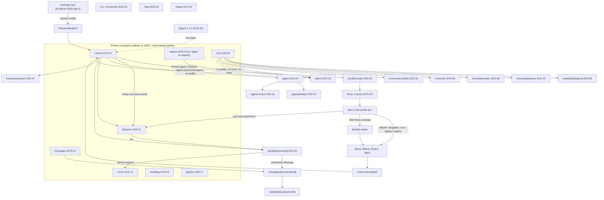

# Mangalya (MOD03) wireframes: the application as built on 2026-11-22

Source of truth: the web code in `modules/MOD03-mangalya/mangaly-web` (routes under `app/`, components, `locales/en/*.json`, `app/*.css`). Read statically. English labels are copied from the English locale files. Layouts at 390 px (phone) and 1280 px (desktop). Behaviour not confirmed in a running browser is marked **unverified**. The app has 32 web routes; the screen index below groups them into SCR ids as used by the `03-ux.md` as-built addendum (SCR-01 to SCR-25), plus two overlay ids added here (SCR-26 splash, SCR-27 story).

How to read an ASCII wireframe: `[ Label ]` is a button, `( chip )` is a chip or pill, `{ photo }` is an image, circled numbers `(1)` point to the table under the wireframe.

---

## 1. Map

### 1.1 Navigation map



### 1.2 Role differences (navigation and landing)

| Role | How they are recognised | Lands on | Menu differences | Profile view differences |
|---|---|---|---|---|
| Candidate (looking for a bride or groom) | Has own profile | Home (own search) | Home, Discover, Circle, Messages, Wedding arrangements, Marriage agents, Guides, Me | Can send a request (button "Send a request") |
| Parent or guardian in a Home Circle | Circle membership, relation `parent` or `guardian` | Home in the candidate's context (context chip "Now viewing {name}'s search") | Same as candidate | "Send a request for {name}" and Accept or Not now |
| Sibling or relative in a Home Circle | relation `sibling`, `relative` | Home in the candidate's context, family view | Same | No send or answer; the action is "Suggest to {name}" (from Home hero) |
| Marriage agent (broker) | `getMyAgentRecord().kind === "agent"` | `/agent` when they have no profile and no circle | "Workspace" is the first menu item and replaces "Marriage agents" | Works for clients; see SCR-20 to SCR-22 (Part B) |
| New member, nothing yet | no profile, no circle, no invite | `/profile/create` (or Discover after "Just look around first") | Wizard is chromeless (no menu) | n/a |
| Invitee | Pending Home Circle invitation | Home, invitation block first | Same | n/a |
| Relationship manager (RM) | RM assignment | `/rm/console` | Not in primary menu (**unverified** how reached) | n/a |

### 1.3 Screen index

Part A and Part B rows are described in sections 6 and 7 (merged from the part files).

| SCR | Route(s) | Purpose | Who sees it | Key API calls |
|---|---|---|---|---|
| SCR-01 | `/` | Home: greeting, your turn, daily introduction, matches, search progress, plan | member | `/auth/me`, `/profile/me`, `/profile/completeness`, `/discovery/search`, `/discovery/shelves`, `/discovery/because`, `/discovery/fit/{id}`, `/horoscope/match/{id}`, `/connections/sent`, `/connections/incoming`, `/billing/me`, `/billing/plans`, `/profile/matchmaker/brief` |
| SCR-02 | `/login`, `/otp`, `/signup`, `/reset` | Legacy sign-in screens; sign-in belongs to ForKhatri | signed-out | EntranceRedirect to hub |
| SCR-03 | `/profile/create` | Wizard: story, who-for, About, Where, Photos or biodata, Work, Check and publish | member | `/profile/...`, device draft in browser |
| SCR-04 | `/profile/[accountId]` | View a profile | member | `/profile/view/{id}`, `/connections`, `/shortlist` |
| SCR-05 | `/me` | My profile, next up, plan, verification | member | `/profile/me`, `/profile/completeness` |
| SCR-06 | `/me/edit/[category]` | Edit one category | owner, parent | `/profile/...` |
| SCR-07 | `/me/completeness` | Three-tier completeness | owner | `/profile/completeness` |
| SCR-08 | `/me/matchmaker` | Matchmaker: own words, importance | candidate, parent | `/profile/matchmaker/brief` |
| SCR-09 | `/me/verify` | One-minute "that it's you" check | member | verification service |
| SCR-10 | `/me/contact-safety` | Contact and safety preferences | member | `/safety/...` |
| SCR-11 | `/discover` | Photo wall, For you lenses, filters, search, saved | candidate, family | `/discovery/search`, `/discovery/shelves`, `/shortlist` |
| SCR-12 | `/circle` | Home Circle | candidate, family | circle endpoints |
| SCR-13 | `/messages`, `/messages/[connectionId]` | Inbox and chat (incognito, direct, group) | member | messages endpoints |
| SCR-14 | `/horoscope/check` | Horoscope sheet | member | `/horoscope/...` |
| SCR-15 | `/plans` | Plans and checkout | member | `/billing/plans`, `/billing/me`, `/billing/orders` |
| SCR-16 | `/wedding`, `/wedding/[connectionId]` | Wedding arrangements | connected families | wedding endpoints |
| SCR-17 | `/guides`, `/guides/[slug]` | Guides | member | static |
| SCR-18 | `/help` | How Mangalya works | member | static |
| SCR-19 | `/agents` | Find and engage a marriage agent | family | `/agents/...` |
| SCR-20 | `/agent` | Agent workspace | agent | `/agents/...` |
| SCR-21 | `/agent/biodata` | Add offline biodata | agent | |
| SCR-22 | `/agent/review` | Agent review | agent | |
| SCR-23 | `/rm`, `/rm/console`, `/rm/console/[assignmentId]` | Relationship manager | member, RM | |
| SCR-24 | `/status` | Service status | any | health |
| SCR-26 | overlay (layout) | Splash blessing | everyone, first paint | none |
| SCR-27 | overlay in `/profile/create` | Story, 3 cards | new member | none (`localStorage` `mangalya.story.seen`) |

---

## 2. Shell and global chrome

### 2.1 Phone shell (390 px) with menu drawer

```
+--------------------------------------+
| (1) [=]                              |   <- menu button (hidden on detail screens)
|                                      |
|   page content (full width)          |
|                                      |
+--------------------------------------+
(2) Request popup (RequestPrompt) floats above content when a request waits
(3) Bottom bar (class bottombar, 5+ items) is present in the markup; see gaps
```

Drawer, opened by the menu button (1):

```
+------------------------+-------------+
| (m) Mangalya      (4)  |  scrim      |
| ---------------------- |             |
| [house] Home           |             |
| [search] Discover      |             |
| [family] Circle     2  |  (5) badge  |
| [chat] Messages     3  |             |
| [wedding] Wedding arr. |             |
| [handshake] Marriage   |             |
|   agents               |             |
| [guides] Guides        |             |
| [me] Me                |             |
| ---------------------- |             |
| How Mangalya works     |  (6)        |
| Back to ForKhatri      |  (7)        |
+------------------------+-------------+
```

| # | Element | What it does | Data | States | Next |
|---|---|---|---|---|---|
| 1 | Menu / Close menu button | Opens or closes the drawer; Escape closes it | none | hidden on `/profile/*`, `/messages/[id]`, `/wedding/[id]`, `/guides/[slug]` (they carry their own back button) | drawer |
| 2 | RequestPrompt | Popup "A request for you" / "A request for {name}": View profile, Not now, Decline, Accept | pending incoming connection | only when a request waits for this person or the candidate they act for; "{count} more requests waiting" | profile, or accepted toast |
| 3 | Bottom bar | Same destinations as the drawer | `session.counts` | **unverified** whether visible on a phone (see gaps) | route |
| 4 | Brand "Mangalya" | Back to Home | none | | `/` |
| 5 | Count badges | Circle shows `pending_requests`, Messages shows `unread_messages`; hidden at 0 | `/auth/me` counts | session read fails: no badges, menu still works | |
| 6 | "How Mangalya works" | Help and story | | | `/help` |
| 7 | ForKhatriHubLink "Back to ForKhatri" | Back to hub | | | hub |

Order of menu items: for a normal member Home, Discover, Circle, Messages, Wedding arrangements, Marriage agents, Guides, Me. For a verified or applying agent: Workspace, Home, Discover, Circle, Messages, Wedding arrangements, Guides, Me.

Chromeless routes (no menu, narrow column): `/login`, `/signup`, `/reset`, `/otp`, `/profile/create`.

### 2.2 Desktop shell (1280 px)

```
+-----------------------+---------------------------------------------------------------+
| (m) Mangalya          |  main column, left margin 260 px, content max 1120 px         |
|                       |                                                               |
| [house] Home          |  page content                                                 |
| [search] Discover     |                                                               |
| [family] Circle    2  |                                                               |
| [chat] Messages    3  |                                                               |
| [wedding] Wedding arr.|                                                               |
| [handshake] Marriage  |                                                               |
|   agents              |                                                               |
| [guides] Guides       |                                                               |
| [me] Me               |                                                               |
|                       |                                                               |
| How Mangalya works    |                                                               |
| Back to ForKhatri     |                                                               |
+-----------------------+---------------------------------------------------------------+
   260 px fixed sidebar (1)        content area (2)
```

At 1024 px and above the sidebar is fixed (260 px per `globals.css`; the sindoor theme sets 248 px, **unverified** which wins), the top bar and bottom bar are hidden, and the active item is marked (`aria-current="page"`, filled icon). Layout rules differ per screen and are drawn in section 5.

---

## 3. SCR-26 Splash and SCR-27 Story (first run)

### SCR-26 Splash (overlay, `MangalySplash`, in the root layout)

```
+--------------------------------------+
|                                      |
|        { Seeta and Rama at their     |
|          wedding artwork }       (1) |
|                                      |
|  Two families. One auspicious        |
|  beginning.                      (2) |
|                                      |
|                            [ Skip ](3)|
+--------------------------------------+
```

| # | Element | What it does | Data | States | Next |
|---|---|---|---|---|---|
| 1 | Artwork, alt "Seeta and Rama at their wedding" | Brand moment | static | | |
| 2 | Blessing "Two families. One auspicious beginning." | | `common:splash.blessing` | | |
| 3 | Skip | Lifts the splash early; any key press also lifts it | | auto-lifts after a short hold then fades (hold length is a constant in code, **unverified** value) | Home or the entrance redirect |

### SCR-27 Story (3 cards, first visit to `/profile/create`)

```
+--------------------------------------+
| The story of Mangalya   [Skip the   |
|                          story] (1)  |
|            o  .  .               (2) |
|        { vignette art: family }  (3) |
|                                      |
|  Mangalya is for the whole family(4) |
|  One search, done together. You can  |
|  make the profile yourself, or a     |
|  parent, brother, sister or guardian |
|  can make it for you.                |
|                                      |
|  [ Back ]            [ Next ]    (5) |
+--------------------------------------+
```

| # | Element | What it does | Data | States | Next |
|---|---|---|---|---|---|
| 1 | "Skip the story" | Ends the story, marks seen in `localStorage` key `mangalya.story.seen` | | | "Who is this profile for?" |
| 2 | Progress dots | Show card 1 of 3 | | | |
| 3 | Vignette art | Per-card illustration (`family`, `partner`, `community`) | static | | |
| 4 | Title and body | Cards: "Mangalya is for the whole family"; "Both sides agree"; "Help when you want it" (card 3 adds the line `storyMore`, a pointer to Help for the full seven) | `help:storyShort` | | |
| 5 | Back / Next / Begin | Steps; last card shows "Begin" | | Back hidden on card 1 | who-for |

The full seven-card story (`help:story`) is shown on `/help` ("Read the story again"). The story is shown only if `storySeen()` is false; in private mode it simply shows again next time.

---

## 4. SCR-01 Home (`/`)

Role and first-run branching happens before anything draws: signed out goes to the ForKhatri entrance; an invitee sees invitations first; no profile, no circle and no invitation goes to `/profile/create` (or `/discover` after "Just look around first"); an agent with no profile goes to `/agent`. While loading, the screen shows the SacredLoader.

### 4.1 Home, candidate or parent, phone (390 px)

```
+--------------------------------------+
| [=]                    [Hub] (Acct)  |
| Thursday, 24 September            (1)|
| Namaste, Asha                     (2)|
| ( Your search v )  (looking for a  (3)|
|   groom )                            |
|--------------------------------------|
| [claim-profile note, only when a  (4)|
|  parent made this profile]           |
|                                      |
| Your turn                         (5)|
| (o) Rahul K.   Wants to connect      |
| (o) Priya      1 unread              |
|                                      |
| Invitation to a Home Circle  [Accept](6)|
|                                      |
| +----------------------------------+ |
| | { portrait fills most of screen }| |
| |  Today's introduction        (7) | |
| |  Rahul 29                        | |
| |  ( Strong ) common chips         | |
| +----------------------------------+ |
|  Why them: ...                    (8)|
|  Age 29 yrs · Height · Education ... |
|  How you fit: Ashtakoota 28/36    (9)|
|  [ See profile ]  [ Send a request ](10)|
|                                      |
| Strong matches / New matches    (11) |
| [portrait][portrait] -> peek next    |
|   See all 14 matches                 |
|                                      |
| Your search                      (12)|
|  2 requests waiting for a reply  (faces)|
|  1 connection                        |
|  0 suggested by family               |
|                                      |
| Because you liked ... (rows)     (13)|
|                                      |
| [ Your matchmaker ]  [ Profile 80% ](14)|
| [ Horoscope check ]  [ Home Circle ](15)|
|                                      |
| Your plan: You are on Free       (16)|
| 3 of 5 requests used today           |
| ( Free ) ( Plus ) ( ... ) Compare plans|
+--------------------------------------+
```

| # | Element | What it does | Data shown | States | Next |
|---|---|---|---|---|---|
| 1 | Date line | Shows today in Indian date order in the member's language | `Intl.DateTimeFormat(<lang>-IN)` | | |
| 2 | Greeting "Namaste, {first name}" (MotionTitle) | Welcome | `session` first name | | |
| 3 | ContextChip | Says whose search this is; opens a switcher "Whose search are you viewing?" with "You" and each circle candidate; text "Now viewing {name}'s search" | `contexts.circles`, `active` | shown only when `contexts` loaded; candidate view reads "Your search" | same screen re-loaded for chosen person |
| 4 | ClaimProfileNote | A profile a parent made for this person: take over or remove | `session` | only when such a profile exists | `/me` |
| 5 | "Your turn" | Faces of requests waiting (up to 4) and unread chats (up to 3). Row subtitle: "Wants to connect" or "Wants to connect with {name}" | `incoming` (connections), `unreadChats` | rendered only when `waiting > 0` or unread > 0; a zero renders nothing | `/profile/{id}` or `/messages/{connectionId}` |
| 6 | Circle invitation | "Invitation to a Home Circle" with accept or decline | `listPendingInvitations` | only when invited | stays on Home, then circle |
| 7 | Daily introduction hero | One portrait, eyebrow "Today's introduction" (or "Your best match right now" when no good pairing); phone overlay repeats eyebrow and name on the photo | `hero.person.photo_url`, `open_name`, `age`, `profession`, `match_label` | no photo: anonymised avatar; hidden name: age or profession is shown instead | `/profile/{id}` |
| 8 | "Why them" and facts | Common points (up to 3) and, for family view, facts: Age, Height, Education, Work, City, Mother tongue | `fit.common`, `person.*` | | |
| 9 | "How you fit" gunas | Horoscope total, marked provisional when birth time unknown | `horo.match.ashtakoota.totalScore`, `maxScore` | hidden when not calculated | |
| 10 | See profile / See biodata / Send a request / "Send request for {name}" / "Suggest to {name}" | Primary action by role: candidate and parent send; sibling or relative suggests; after action reads "Request sent" or "Suggested" | `/connections`, suggestions | busy; error "That did not go through. Try again from the profile." | profile, stays |
| 11 | Matches rail | "Strong matches" (or "Top matches for you"); portraits with a peeking next card; "See all {n} matches" | `shelves.picked`, `search.results`, `matchTotal` | empty: "No new matches today. Completing more of your profile brings better ones." (family: "No matches for {name} yet. A fuller profile brings more.") | `/discover` |
| 12 | "Your search" lanes | Three lanes, each a number plus words and up to four faces: requests waiting for a reply, connections, suggested by family | `listSent`, `listIncoming`, `listSuggestions`, `/discovery/snippet/{id}` | empty copy: "Nothing sent yet. Send a request from any profile." / "No connections yet." / "Your family has not suggested anyone yet."; all empty: "No requests sent or connections yet. Open any profile to send a request." | lane list or profile |
| 13 | "Because ..." rows | Themed rows from `/discovery/because` | `BecauseRow.title`, results | omitted when none | profile |
| 14 | Duo tiles: matchmaker, profile strength | Matchmaker: "Matching on what matters to you: {list}" or "Tell us who you are looking for, in your own words"; Profile ring shows % | `brief`, `completeness` | the matchmaker tile is hidden in a family context; profile tile hidden for a parent acting for a candidate (`!forId`) | `/me/matchmaker`, `/me` |
| 15 | Horoscope tile, Home Circle tile | "Home Circle: {count} helping your search" or "Invite family, so they can search and answer requests with you" | `members` | | `/horoscope/check`, `/circle` |
| 16 | Plan cards | "You are on {plan}", "{used} of {limit} requests used today", "From {price} a month", badge "Current", "Compare plans" | `getMyPlan`, `getCatalogue` | catalogue fails: section omitted | `/plans` |

Role notes: a parent in a candidate's circle sees "Picked for {name}", "{name}'s Home Circle" and "{name}'s plan"; messages and requests use `forCandidate`. Brokers do not see this screen by default (they land in `/agent`).

States: loading is the SacredLoader (held briefly to avoid a flash); each data block fails independently to empty; whole-service outage shows the shared OutageGate (retry); unknown signed-out state redirects to the ForKhatri entrance.

### 4.2 Home, desktop (1280 px)

```
+-----------+-------------------------------------------------------------------+
| sidebar   | Thursday, 24 September                    [Hub] (Account)         |
| 260       | Namaste Asha   ( Your search v )                                  |
|           |-------------------------------------------------------------------|
|           | +-----------------------------------------+  +------------------+ |
|           | | HERO (feed column, wide)                |  | Your turn        | |
|           | | { portrait 420 }  Today's introduction  |  | (o) Rahul        | |
|           | |                   Rahul 29              |  | (o) Priya        | |
|           | |                   Why them / facts      |  +------------------+ |
|           | |                   [See profile][Send..] |  | Matchmaker tile  | |
|           | +-----------------------------------------+  | Requests tile    | |
|           | Strong matches        (4 portraits across)    | Messages tile    | |
|           | [p][p][p][p]                                  | Profile 80% ring | |
|           | Your search: 3 lanes side by side             | Horoscope, Circle| |
|           | Because ... rows                              |  (right column   | |
|           | Plans: cards in a row                         |   320 px)        | |
|           +-----------------------------------------+  +------------------+ |
+-----------+-------------------------------------------------------------------+
```

Differences from phone: two columns (feed plus 320 px right column holding "Your turn" and the duo tiles; grid areas `feed`, `alerts`, `duo`); portrait rail shows four cards across (3 at tablet, 4 at 1024+); the photo and the text sit side by side so the name is not repeated as a photo overlay; the tiles "Requests" ("None waiting right now" or "{n} waiting for your answer") and "Messages" ("You are all caught up" or "{n} unread") appear only on desktop (class `duo--desk`) so the right column is a full status panel even when nothing waits; hover reveals on rail controls (hover-capable pointers).

---

## 5. SCR-11 Discover (`/discover`)

### 5.1 Discover, phone (390 px)

```
+--------------------------------------+
| [=]                                  |
| Discover                          (1)|
| ( Search ...............)  [Filters 2](2)|
| (For you 18)(Top match 1)(Near..)(All matches)(Saved) -> scroll  (3)|
| (Age 25-30 x)(Same city x) Clear all (4)|
|                                      |
| Most compatible today             (5)|
| One person, chosen because you fit   |
| each other's preferences...  See all |
| +----------------------------------+ |
| | { photo, 4:5 full width }        | |
| | 3 photos             [bookmark](6)| |
| | Strong match · why               | |
| | Rahul 29  (verified)             | |
| | Hyderabad · Architect            | |
| | "quote"                          | |
| | Request sent (state)             | |
| +----------------------------------+ |
|   ...more tiles, one per screen...   |
| That is everyone who matches right now.(7)|
+--------------------------------------+
```

| # | Element | What it does | Data shown | States | Next |
|---|---|---|---|---|---|
| 1 | Title "Discover" | Heading; family context shows "looking for {value}" line | | | |
| 2 | Search box and Filters button | Free text ("Search") and opens the filters sheet; "Filters · {count}" when active | `filters`, `q` | | filters sheet (5.2) |
| 3 | Lens rail (one active marker) | "For you" (with count), shelf lenses ("Everyone", "Top match", "Picked for you", and others from `lens.*`), "All matches", "Saved" | `/discovery/shelves`, `tab`, `lens` | scrolling rail; each lens shows its count | re-lists |
| 4 | Filter chips | "Age {min}-{max}", "{min}-{max} cm", "Open to relocating", each removable ("Remove filter"); "Clear all" | `filters` | shown only with filters | |
| 5 | Shelf heading | For example "Most compatible today", "Picked for you", "Suggested by your family"; "See all" | `shelf.*.title`, `sub` | family context uses "...for {name}" titles | lens or list |
| 6 | Tile (`dtile`) | Photo with text on it: match word (Strong or Good, never a number), first name and age, verified seal, city and work, a line from the profile; bookmark to save (44 px target on phone); state tag "Request sent", "Connected" or "They said not now" | `SearchResult.candidate_account_id`, `photo_url`, `open_photo_urls`, `open_name`, `age`, `locality`, `profession`, `match_label`, `verification`; status map | no photo: vignette art (class `dtile__nophoto`); broken image falls back to the vignette; save is optimistic and reverted on failure | `/profile/{id}` |
| 7 | End and load-more | "Loading more profiles…" then "That is everyone who matches right now." | `search.more`, `search.end` | infinite scroll | |

Empty and special states: no "looking for" set: title "Tell us who you're looking for", body, button "Choose now" (family view: "{name} hasn't said who they're looking for yet"); no results "No one matches these settings yet / Try fewer filters, or check back — new people join every week."; nothing saved "Nothing saved yet / Tap the bookmark on any photo to keep someone here to come back to."; no new matches "No new matches yet"; none in this city "No matches in this city yet / Widen to the whole state, or include people open to relocating." Look-around visitors with no profile see a "Make a profile" button and a choice of Brides or Grooms (key stored with `readBrowseLookingFor`).

### 5.2 Filters sheet (`DiscoverFiltersSheet`)

```
+--------------------------------------+
|  Filters                         [x] |
|  Basics                              |
|   Age:     From [ 25 ]  To [ 30 ]    |
|   Marital status  (chips)            |
|   Location (Same city)(Same state)   |
|   [x] Open to relocating             |
|  Community / Education & work        |
|   Education (chips)  Lifestyle (chips)|
|   City [A city, e.g. Chennai ......] |
|   Height Min [ ] Max [ ]             |
|  [ Reset ]        [ Show 12 matches ]|
+--------------------------------------+
```

Groups from the locale: Basics, Community, "Education & work". Footer buttons "Reset" and "Show {count} matches" (live count). Closing without applying keeps the old filters. Next: back to Discover with chips.

### 5.3 Discover, desktop (1280 px)

```
+-----------+-------------------------------------------------------------------+
| sidebar   | Discover                                                          |
|           | ( Search ........................ ) [ Filters 2 ]                 |
|           | (For you)(Top match)(Near you)(All matches)(Saved)                |
|           | (chips)                                                           |
|           | Most compatible today                                             |
|           | +--------+ +--------+ +--------+ +--------+     4 columns at 1100+ |
|           | | photo  | | photo  | | photo  | | photo  |     3 at 640+        |
|           | | name   | | name   | | name   | | name   |     5 at 1500+       |
|           | +--------+ +--------+ +--------+ +--------+                       |
|           | Picked for you  ... See all                                       |
+-----------+-------------------------------------------------------------------+
```

The wall (`dwall`) is a grid: 1 column on a phone (each tile fills the screen), 3 columns from 640 px, 4 from 1100 px, 5 from 1500 px. The filters sheet is still a sheet (**unverified** whether it docks at the side on desktop).

---

## 6. Profile view, desktop (1280 px)

Phone layout and states of SCR-04 are in Part A. Desktop differs materially:

```
+-----------+-------------------------------------------------------------------+
| sidebar   | [<- Back]                              [bookmark] [share] [report]|
|           | +-------------------+  +----------------------------------------+ |
|           | | { hero photo }    |  | Rahul  29   (verified)                 | |
|           | | 420 px wide,      |  | Hyderabad · Architect · ...            | |
|           | | sticky while the  |  | ( Strong ) Why you might work         | |
|           | | right side scrolls|  |   reason, reason                       | |
|           | |                   |  | Verified: Photos confirmed as their own| |
|           | | (photo strip)     |  |                                        | |
|           | +-------------------+  | [ Send a request ]  (pview__actions)   | |
|           |                        | lead prompt, large serif (2 rem)       | |
|           |                        | fact groups, outlook, prompts          | |
|           |                        | Similar profiles                       | |
|           |                        +----------------------------------------+ |
+-----------+-------------------------------------------------------------------+
```

Differences: two columns (photo 420 px sticky, words fill the rest), name 2.25 rem, lead prompt answer 2 rem, actions static rather than pinned to the bottom (on a phone they sit at the bottom with extra bottom padding). Not yet connected: the rest is a "sealed" card, "The rest opens when you both say yes". Locked fields until connection: name, prompts, outlook, further photos.

## 7. Messages, desktop (1280 px) summary

Two panes at 1024 px and above (`mpane`): a 360 px inbox list on the left and the thread on the right in a bordered rounded container the full viewport height; with no thread open the right pane shows an empty state (illustration and title). On a phone the inbox and the thread are separate full-screen pages. The full wireframe with incognito, direct and group chats is in Part B (SCR-13).

---

## 8. Role layouts

### 8.1 Candidate

Home, Discover, Circle, Messages, Me with own context. Sees "Your search", "Your Home Circle", own plan, matchmaker and profile-strength tiles, and "Send a request" on profiles.

### 8.2 Parent or family

```
+--------------------------------------+
| Namaste Vikram                       |
| ( Kavya's search v )  (looking for a |
|   groom )                            |
| Your turn: requests for Kavya        |
| Today's introduction for Kavya       |
|  [ Send request for Kavya ]          |
| Kavya's Home Circle: 3 helping       |
| Kavya's plan                         |
+--------------------------------------+
```

The context chip is the role switch (you, or each candidate whose circle you are in). Parent and guardian can send and answer; sibling and relative only suggest. A purple "acting on behalf of" accent is reserved for family actions in the base theme (`--family`; teal in the sindoor theme). Account menu lines: "Candidate · looking for {x}", "{relationship} of {name}", "Fill in {name}'s profile", "Home Circle", "Sign out".

### 8.3 Broker (marriage agent)

Lands on `/agent` (SCR-20 in Part B); menu starts with "Workspace"; clients are added through `/agent/biodata` (name and gender required); suggestions and answers reviewed in `/agent/review`. Families use `/agents` to choose an agent.

---

## 9. Key flows (storyboards)

### Flow 1: first run to Home
1. Open from the ForKhatri hub; session arrives via EntranceRedirect (SCR-02). Splash (SCR-26) lifts on its own or on Skip.
2. `/` finds no profile, no circle, no invitation: redirect to `/profile/create`.
3. Story (SCR-27), three cards; decision: Skip or Begin.
4. "Who is this profile for?": Myself, My daughter, My son, My sister or brother, Someone else in my family, Start from a biodata, Just look around first.
   - "Just look around first": choose Brides or Grooms, go to Discover (5.1) with "Make a profile" offered.
   - Biodata: file, consent, line by line confirmation, then About.
5. About, Where, Photos (choose or take; "Add photos later"), Work (can skip), Check and publish (Part A). Answers are kept on the device as a draft ("Your answers were kept on this phone." / "Start again").
6. Publish, return to Home (4.1), first Home empty states ("No new matches today...").

### Flow 2: make a profile for a daughter or son (parent)
1. Who-for: "My daughter" (or son).
2. About: her name, date of birth (under 18 shows "A bride must be at least 18 to have a profile on Mangalya."; groom 21), "She will see {value} profiles."
3. Where, Photos, Work, Check and publish.
4. Home in the candidate's context; "Fill in {name}'s profile" and Home Circle invite are in the account menu.

### Flow 3: find, request, connect, chat
1. Home hero or Discover tile (5.1, SCR-11).
2. Profile (SCR-04): decision, Send a request (candidate or parent) or Suggest (sibling or relative).
3. The other side sees RequestPrompt "{name} would like to connect": Accept, Decline, Not now, View profile.
4. Accepted: profile unseals ("You are connected"), "Message" opens the thread (SCR-13), whoever answers first answers for the family.
5. After a match: Wedding arrangements (`/wedding/[connectionId]`).

### Flow 4: invite family to the Home Circle
1. Home tile "Invite family, so they can search and answer requests with you" opens `/circle`.
2. Invite by name or mobile number, choose relationship (Part B).
3. Invitee opens Mangalya: Home shows "Invitation to a Home Circle", Accept; the invitee gets the candidate's context in the chip.

### Flow 5: sign in to module handoff
1. Hub `localhost:3100` sign-in, module tile.
2. `/` checks `getSession()`: failure shows OutageGate (retry), signed out redirects to the entrance, signed in loads Home.
3. "Back to ForKhatri" returns to the hub.

### Flow 6: broker adds a client biodata
1. Land on `/agent`, "Add clients"; `/agent/biodata`: PDF or image, photos, name and gender required (Part B).
2. Review shared suggestions at `/agent/review`; share and export from the workspace.

---

## 10. Component inventory

| Pattern | Look | Used in |
|---|---|---|
| Portrait tile (`dtile`, `hcard`, `hintro`) | Photo with scrim and name on it, match word, verified seal, bookmark | Home, Discover, Similar profiles |
| Chips (`dlens`, `factchip`, filter chips, relation chips) | Pills; one active marker | Discover lens rail and filters, profile facts, Circle |
| ContextChip and switcher | Pill "Your search" or "{name}'s search"; sheet "Whose search are you viewing?" | Home, Discover, Circle, Messages |
| ScrollRail | Horizontal scroll rail with snap | Home matches, Discover lenses |
| Duo tiles | Small status tiles with icon, label, body | Home |
| Bottom sheets | Filters, photo choose, share place, request prompt | Discover, wizard, wedding |
| RequestPrompt | Floating card with Accept, Decline, Not now | Whole shell |
| Avatar | Photo or anonymised silhouette | Lists, Your turn |
| Vignette and OutlookScene | South Indian line art used as empty-state and step art | Wizard, Story, Discover empty tile, profile outlook |
| SacredLoader | Loading animation | Home, others |
| OutageGate | Retry state when service or sign-in is down | Home and others |
| ScreenGuard | Blanks content on Print Screen; message "Screenshots are not allowed in Mangalya, to keep every family's photos and details private." | Whole app |
| UpgradeNudge | Plan upsell | Plans, limits |
| Empty states | Serif title plus caption plus action | Discover, Home, Messages, Circle |
| MotionTitle | Display heading set in motion | Home, Discover |
| Icon set | Light outline icons, filled when active (home, search, family, chat, me, briefcase, wedding, guides, handshake, heart, verified, menu, close) | Navigation |

### Design tokens (from `globals.css`, `sindoor.css` which loads after it)

| Group | Values in use |
|---|---|
| Theme | Kumkum and turmeric (owner rule); `sindoor.css` overrides the base: paper `#fff4d2`, surface `#fffbee`, surface-2 `#fff0bd`, surface-3 `#fde58a`, ink `#2a0707`, ink-2 `#62301f`, ink-3 `#8f5a3c`, hairlines `#f7e3a0` and `#eccb5c` |
| Accent | `#cc0106` (hover `#a90005`, tint `#fde1d3`); gold `#fbd946` (deep `#e8b50b`); family colour `#0e6a82` (base theme `#5b47c9`); ok `#17784a`; danger `#b00020`; warn `#8a5a00` |
| Dark | Both files define a dark scheme under `prefers-color-scheme: dark` and a `data-theme` switch (Settings: Light, Dark, System); sindoor dark paper `#1a0708` |
| Chat | Night mood for incognito (`--chat-bg` `#16040a` dark; light `#f6e6dc`) |
| Type | Display serif Instrument Serif (400, italic), UI sans Instrument Sans (400 to 700), Noto Serif and Noto Sans for Devanagari, Telugu and Kannada. Comments in `globals.css` still say Fraunces and Plus Jakarta Sans (stale) |
| Text size setting | Standard, Larger, Largest |
| Spacing | 4, 8, 12, 16, 24, 32, 48 px |
| Radii | Base 8, 12, 16, 24; sindoor 10, 16, 22, 28 |
| Motion | 160, 220, 320 ms; ease `cubic-bezier(.2,.8,.2,1)`; spring `cubic-bezier(.34,1.36,.64,1)`; reduced motion respected |
| Shell | Sidebar 260 px (sindoor 248), content max 1120 px, gutter 16 px, top bar 56 px, bottom bar 60 px (sindoor 68) |
| Breakpoints | 640, 768 (md), 1024 (lg, sidebar), 1100, 1440, 1500 |
| Languages | English, Hindi, Telugu, Marathi, Kannada (cookie read in the server layout) |

---

## 11. Wireframe gaps (this file)

- Whether the bottom bar renders on a phone or only the menu drawer (`AppShell` emits both; the code comment cites DEC-V1-030 "left drawer, not a bottom bar"). **Unverified.**
- Splash hold duration and exact trigger conditions. **Unverified.**
- Which sidebar width wins (260 base vs 248 sindoor) and the final radii, because several CSS files load in order (`globals`, `sindoor`, `home`, `royal`, `editorial`). **Unverified.**
- Discover lens keys beyond `everyone`, `mostCompatible`, `picked`, and the "Near you" lens wording (`lens.*` keys partly read). **Unverified.**
- `components/SwipeDeck.tsx` exists but no route imports it (the "swipe deck" in the addendum is not on any screen). Dead component.
- How an RM reaches `/rm/console` from the menu. **Unverified.**
- The Discover filters sheet on desktop (sheet or side panel). **Unverified.**
- Hindi, Telugu, Marathi and Kannada layouts not drawn; labels are English only.
- No browser snapshots were taken for this document (static reading only); pixel facts are from CSS.
