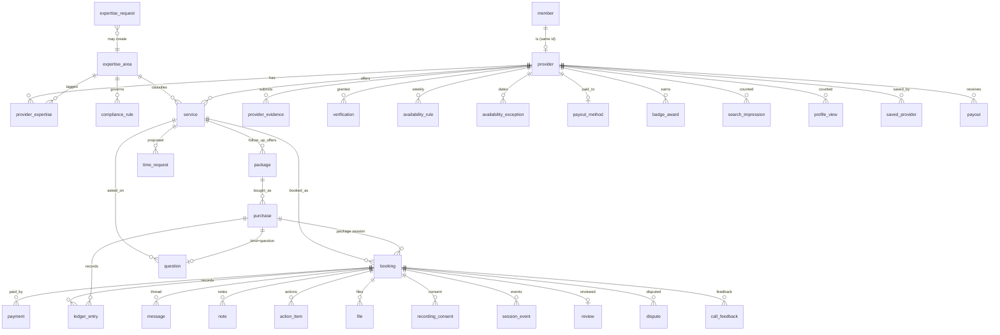

# MOD04 Counsel — 07a Data model

**Document status:** 2026-11-22, "as built". Source of truth: migrations `counsel-service/db/migrations/001-011` (authoritative) checked against the live dev database (`counsel` on port 5433, schema `counsel`, read-only with the app role): **40 tables, 0 RLS policies, 0 functions, 0 triggers, RLS off on every table.** Extension `btree_gist`. The runtime role `counsel_app` has SELECT/INSERT/UPDATE/DELETE on all tables and sequences and cannot alter schema; migrations run as `counsel_owner`. There is no `schema.sql`; there is no drift between migrations and the live table count (40 = 40 tables defined).

## Contents
1 ER diagram · 2 Table catalogue (TBL-01..40) · 3 Enumerations and CHECK constraints · 4 Indexes and constraints · 5 Settings rows · 6 Seed data · 7 Lifecycle and retention · 8 Migration history · 9 Known drift

## 1. ER diagram

Members are referenced by uuid without foreign keys for seekers (`booking.seeker_id`, `review.reviewer_id`, `purchase.buyer_id`, etc.); only `provider.member_id` is the identity of a consultant. `member` is a cache of platform identity (name, language, last_seen).

## 2. Table catalogue
| ID | Table | Purpose | Key columns / notes | Mig |
|---|---|---|---|---|
| TBL-01 | member | Cache of platform members | member_id PK, display_name, language, timezone, first_seen, last_seen | 001 |
| TBL-02 | expertise_area | Taxonomy | id slug PK, parent_id, name_en/hi/te (+ name_mr, name_kn nullable), status active/disabled, regulated, sort_order | 001,002,011 |
| TBL-03 | expertise_request | Proposed areas | proposed_by, name, parent_id, note, status pending/approved/rejected, decided_by/at, created_area | 001 |
| TBL-04 | compliance_rule | Required verification per area and jurisdiction | PK (area_id, jurisdiction '*' = all), required_dimensions text[], disclaimer_key, recording_allowed | 001,002 |
| TBL-05 | provider | Consultant profile | member_id PK, headline, intro, photo_url, city, country, timezone, languages text[], links jsonb, currency, status, review_note, submitted/reviewed fields, standing, available_until | 001,005,006 |
| TBL-06 | provider_expertise | Provider to area | PK (provider_id, area_id), years >= 0, is_primary | 001 |
| TBL-07 | provider_evidence | Evidence and proof | kind (6), title, issuer, year_from/to, reference_no (sensitive), document_url (private key), status submitted/verified/rejected, review_note, document_name, document_mime, document_encrypted | 001,004,008 |
| TBL-08 | verification | Granular verified dimensions | PK (provider_id, dimension), verified_by, note | 001 |
| TBL-09 | service | Offering | provider_id, area_id, title, description, outcomes[], duration_min 15-240, price_minor > 0, currency, formats[], min_notice_hours, max_advance_days, buffer_min, recording_allowed, status, allow_custom_time, question_price_minor, question_answer_days, instant_allowed | 001,003,006 |
| TBL-10 | availability_rule | Weekly rule | weekday 0=Monday..6, start/end time (end > start), kind window/slot | 001,003 |
| TBL-11 | availability_exception | Date exception | on_date, start/end, available, note | 001 |
| TBL-12 | booking | Commercial unit and state machine | service_id, provider_id, seeker_id, starts_at/ends_at, status (9), brief, price snapshot (service_title, duration_min, currency, gross_minor, platform_fee_minor, processing_fee_minor, tax_minor, provider_payable_minor, refund_minor), cancellation_policy jsonb, recording_allowed, formats, cancel fields, completed_at, payout_status none/eligible/paid, payout_id, pay_by, reminded_24h_at, reminded_15m_at, purchase_id, recap, recap_at | 001,003,004,006 |
| TBL-13 | payment | Payment attempt | booking_id, provider_name (mock/sandbox/...), external_ref, amount, status created/succeeded/failed/refunded/partially_refunded, refunded_minor | 001 |
| TBL-14 | ledger_entry | Money ledger (bigserial) | booking_id nullable, purchase_id nullable, kind (gross, platform_fee, processing_fee, tax, refund, provider_payable, payout, adjustment), amount_minor signed | 001,006 |
| TBL-15 | payout | Payout to consultant | provider_id, amount, currency, status requested/paid/failed, external_ref, paid_at | 001 |
| TBL-16 | message | Booking chat (bigserial) | booking_id, sender_id (null = system), kind chat/system/file, body (system rows hold keys), file_id | 001 |
| TBL-17 | note | Notes | booking_id, owner_id (null = shared), body, version; unique shared per booking, unique private per owner | 001 |
| TBL-18 | action_item | Actions | text, owner_id, done, created_by | 001 |
| TBL-19 | file | Consultation file | booking_id, owner_id, name, mime, size_bytes, storage_key, deleted_at, is_recording, encrypted, scan_status | 001,004,008 |
| TBL-20 | recording_consent | Consent | PK (booking_id, member_id) | 001 |
| TBL-21 | session_event | Call events (bigserial) | kind joined/left/recording_started/recording_stopped/screen_share_* (free text) | 001 |
| TBL-22 | review | Review | booking_id UNIQUE, provider_id, reviewer_id, 5 scores 1-5, body, hidden | 001 |
| TBL-23 | saved_provider | Saved | PK (member_id, provider_id) | 001 |
| TBL-24 | notification | In-app (bigserial) | member_id, kind, params jsonb, booking_id, read_at | 001 |
| TBL-25 | delivery | Outbound queue (bigserial) | channel, kind, payload, status queued/sending/retry/sent/failed/skipped, attempts, last_error, sent_at, next_attempt_at, provider, provider_ref | 001,010 |
| TBL-26 | report | Reports | reporter_id, target_kind (5), target_id text, reason, detail, status open/actioned/dismissed | 001 |
| TBL-27 | dispute | Disputes | booking_id, opened_by, reason, status open/refunded/partially_refunded/closed, resolution, refund_minor | 001 |
| TBL-28 | block | Blocks | PK (member_id, blocked_id) | 001 |
| TBL-29 | audit_log | Append-only audit (bigserial) | actor_id, action, target_kind, target_id, detail jsonb, at | 001 |
| TBL-30 | platform_setting | Settings | key PK, value jsonb | 001,007 |
| TBL-31 | time_request | Custom-time proposal | service_id, provider_id, seeker_id, starts_at, brief, note, status pending/accepted/declined/withdrawn/expired, reply, booking_id | 003 |
| TBL-32 | badge_award | Earned badges | PK (provider_id, badge_id, level), awarded_at, evidence jsonb | 005 |
| TBL-33 | package | Follow-up offer | service_id, sessions 1-3, price_minor, valid_days 30-90 (default 60), active | 006,008 |
| TBL-34 | purchase | Follow-up or question purchase | kind package/question, buyer_id, provider_id, package_id, service_id, sessions_total/used, expires_at, money snapshot, status (pending_payment, active, used_up, expired, refunded, answered, cancelled), payout_status, external_ref | 006 |
| TBL-35 | question | Written question | PK purchase_id, service_id, body, answer, answered_at, due_at | 006 |
| TBL-36 | payout_method | Payout destination | PK provider_id, kind upi/bank, holder_name, secret (Fernet), ifsc, last4 | 007 |
| TBL-37 | erased_member | Erasure marker | member_id PK, erased_at, reason | 007 |
| TBL-38 | call_feedback | Call quality | PK (booking_id, member_id), good, issues[] | 008 |
| TBL-39 | search_impression | Daily search counter | PK (provider_id, day), count | 009 |
| TBL-40 | profile_view | Unique daily view | PK (provider_id, day, viewer_key hash) | 009 |

## 3. Enumerations (CHECK constraints)
- booking.status: pending_payment, confirmed, in_progress, completed, cancelled_by_seeker, cancelled_by_provider, no_show_seeker, no_show_provider, expired.
- provider.status: draft, pending_review, approved, changes_requested, suspended. standing (no check): new, rising, established, senior, distinguished.
- verification.dimension: identity, contact, experience, qualification, certification, registration, business, portfolio. evidence.kind: the same without identity/contact.
- service.status active/paused/archived; availability_rule.kind window/slot.
- Booking state machine: pending_payment -> confirmed -> in_progress -> completed; pending_payment -> expired; confirmed/in_progress -> cancelled_by_* (cancel only from pending/confirmed) or no_show_*.
- payout_status none/eligible/paid.

## 4. Indexes and constraints beyond PKs
booking EXCLUDE USING gist (provider_id =, tstzrange(starts_at, ends_at) &&) WHERE status IN (pending_payment, confirmed, in_progress); CHECK ends_at > starts_at. Indexes: provider_evidence_provider_idx, service_provider_idx, availability_rule_provider_idx, availability_exception_provider_idx(provider_id,on_date), booking_seeker_idx, booking_provider_idx, payment_booking_idx, ledger_booking_idx, message_booking_idx(booking_id,id), note_shared_uidx, note_private_uidx, review_provider_idx, notification_member_idx, time_request_provider_idx, time_request_seeker_idx, badge_award_provider_idx, package_service_idx, purchase_buyer_idx, purchase_provider_idx, question_service_idx, delivery_due_idx (partial status queued/retry). review.booking_id is UNIQUE. No FK on seeker/buyer/reviewer ids.

## 5. Settings (platform_setting)
platform_fee_percent=2; cancellation_policy={seeker:[{24h,100},{6h,50},{0,0}], seeker_no_show_refund_percent 0, provider_cancel_refund_percent 100, provider_no_show_refund_percent 100}; payout_hold_hours=24; review_window_days=14 (unused); retention_recording_days=90; retention_file_days=365. Only these 6 keys are editable.

## 6. Seed data (SEED_DB=true, `db/seeds.sql`)
10 members, 8 providers (Meera Iyer business, Ravi Kumar CA, Priya Sharma design, Arjun Nair legal, Neha Verma career, Kiran Das agriculture, Vikram Rao left pending_review, plus one more), services, reviews, bookings, packages (Neha 2 for 2,800; Ravi 2 for 2,000), question prices (Ravi, Arjun), instant (Ravi, Kiran). Live dev counts on 2026-11-22: member 13, provider 8 (6 approved, 2 pending), service 11, booking 11 (all completed), review 8, ledger 33, payment 2, notification 16, audit 6, purchase 0.

## 7. Lifecycle and retention
Bookings, ledger, payments, audit are never deleted (financial/tax). Files: recordings 90 d, others 365 d (disk deleted, row soft-deleted). Evidence proofs deleted on member erasure. Notifications and deliveries have no TTL. Search/profile counters have no TTL (grows daily). `member` rows persist; on erasure name becomes "Deleted member".

## 8. Migration history
| # | File | Purpose |
|---|---|---|
| 001 | 001-initial.sql | Schema, 33 core tables, defaults, grants |
| 002 | 002-taxonomy.sql | 26 areas, 6 compliance rules |
| 003 | 003-custom-times.sql | availability kind, allow_custom_time, time_request, pay_by |
| 004 | 004-media-reminders-recording.sql | evidence document fields, reminder stamps, file.is_recording |
| 005 | 005-badges.sql | badge_award, provider.standing |
| 006 | 006-business.sql | package, purchase, question, instant, recap, ledger purchase link |
| 007 | 007-privacy-payouts.sql | payout_method, erased_member, retention settings |
| 008 | 008-follow-ups.sql | packages become 1-3 follow-ups, call_feedback, file encryption/scan flags |
| 009 | 009-discovery-insights.sql | search_impression, profile_view, question index |
| 010 | 010-delivery-dispatch.sql | delivery retry columns and partial index |
| 011 | 011-marathi-kannada.sql | name_mr, name_kn |
Applied by `db/init.sh` in filename order (idempotent, `IF NOT EXISTS` style). There is no migration-version table: re-running is the mechanism.

## 9. Known drift and gaps
No RLS (authorisation only in code); no FK on member references; `session_event.kind` unconstrained; `delivery.status` unconstrained; `payout.status` 'requested'/'failed' never used; ledger kinds processing_fee/tax/adjustment unused; setting review_window_days unused; `report.target_id` is text without integrity; seed text claims 7 consultants but the live table has 8 providers.

## 10. Account deletion (added 2026-11-22)
No migration, new table, function or grant: migration count stays 11. The existing `erased_member` table (007) is the deletion receipt (stand-in id, date, reason). Erase is application code (`privacy.erase_member`); the per-table action reference for all 40 tables is in `ACCOUNT-DELETION.md` (37 acted on; `expertise_area`, `compliance_rule`, `platform_setting` hold no member data). Stand-in rows: `member` ("Deleted member") and, where bookings, purchases or payouts point at it, a stripped `provider` row (suspended, no text). There are still no foreign keys on member references, which is why re-pointing to the stand-in id needs no constraint change.
