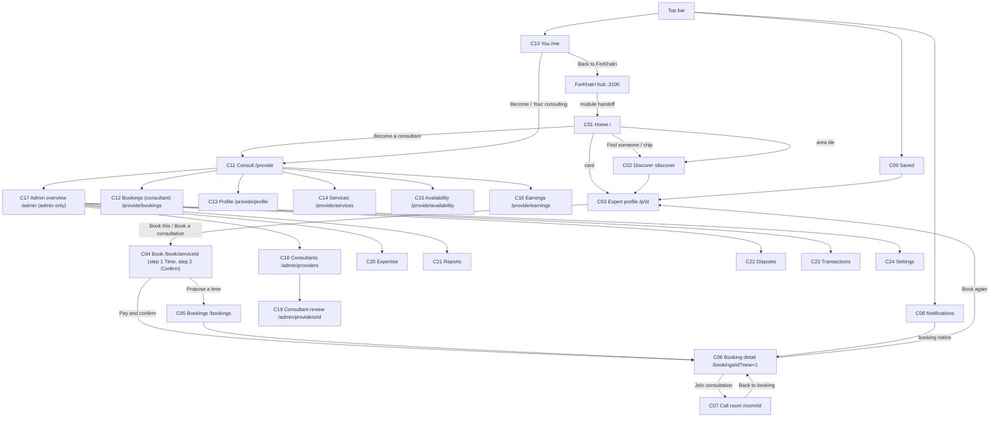

# MOD04 Counsel - Wireframes (as built, 2026-11-22)

Source: `modules/MOD04-counsel/counsel-web` (Next.js, port 3014), read statically (app/, components/, locales/en/common.json, globals.css). API base is the counsel-service (see `API-REFERENCE.md`). Labels are the exact English strings from `locales/en/common.json`. Wireframes are 390px phone width unless marked 1280px. Nothing here changes the application.

Counsel in one line: a person describes a need, finds a verified expert, books and pays for a timed consultation, meets in a call room, then reviews. Experts manage profile, services, hours and earnings under "Consult". Admins review experts, areas, reports, disputes and money.

---

## 1. Map



Navigation chrome (Shell): top bar with brand "Counsel ForKhatri", desktop text nav, Saved bookmark, Notifications bell (dot when unread), avatar to /me. Mobile bottom bar (4 tabs): Home, Discover, Bookings, Consult. Admin link appears in the top nav only for admins (bottom bar shows first 4 only). Bar hidden inside the call room. Public routes (no sign-in): `/`, `/discover`, `/p/*`, `/book/*`. Everything else shows the sign-in gate for signed-out visitors.

Role differences: seeker (any member), consultant (has provider profile), admin (`me.is_admin`). Bookings board shows "I booked" / "My clients" for both-role people.

### Screen index

| SCR | Route | Purpose | Who sees it | Key API calls |
|---|---|---|---|---|
| C01 | `/` | Home: describe a need, areas, trusted people | Public; signed-in adds "Coming up" | GET /home |
| C02 | `/discover` | Search with understood-need chips, filters, sort | Public | POST /understand, GET /search, GET /expertise |
| C03 | `/p/[id]` | Expert profile and offers | Public (save/report need sign-in) | GET /providers/{id}, PUT/DELETE /me/saved/{id}, POST /reports |
| C04 | `/book/[serviceId]` | Two-step booking, propose a time | Public to browse, sign-in to book | GET /services/{id}, /slots, POST /bookings, /bookings/{id}/pay, /time-requests, /purchases/{id}/book |
| C05 | `/bookings` | Your consultations board | Signed in | GET /bookings?scope&role |
| C06 | `/bookings/[id]` | Booking detail, messages, money, actions | Seeker or consultant of it | GET /bookings/{id}, /timeline, /messages; POST pay, cancel, complete, no-show, review, dispute |
| C07 | `/room/[id]` | Call room: video/voice, chat, notes, actions, files | Both parties, 15 min before start | GET /bookings/{id}/room, POST /me/ws-ticket, recordings, files, actions, call-feedback |
| C08 | `/notifications` | Notification list | Signed in | GET /me/notifications, POST /me/notifications/read |
| C09 | `/saved` | Saved people | Signed in | GET /me/saved |
| C10 | `/me` | Language, theme, links, data export/delete, sign out | Signed in | GET /me/deletion-check, POST /me/delete, GET /me/export |
| C11 | `/provide` | Consultant overview and getting-live checklist | Signed in | GET /provide/dashboard, POST /provide/submit, /provide/available-now |
| C12 | `/provide/bookings` | Consultant's bookings | Consultant | GET /bookings?role=provider |
| C13 | `/provide/profile` | Profile, expertise, evidence, links, photo | Consultant | GET/PUT /provide/profile, /provide/evidence, /provide/photo, /provide/expertise-requests |
| C14 | `/provide/services` | Consultations, follow-ups, paid questions | Consultant | GET/POST /provide/services, /packages, /offers |
| C15 | `/provide/availability` | Weekly windows, days off, exact times | Consultant | GET /provide/availability, rules, exceptions |
| C16 | `/provide/earnings` | Earnings, payout method, request payout | Consultant | GET /provide/earnings, /payout-method, POST /provide/payouts |
| C17 | `/admin` | Queues and marketplace/money stats | Admin only | GET /admin/overview |
| C18 | `/admin/providers` | Consultants by status | Admin | GET /admin/providers?status= |
| C19 | `/admin/providers/[id]` | Review evidence, verification dimensions, decide | Admin | GET /admin/providers/{id}, POST decide, verify, evidence decide |
| C20 | `/admin/expertise` | Area requests and taxonomy | Admin | GET /admin/expertise-requests, POST decide |
| C21 | `/admin/reports` | Open reports | Admin | GET /admin/reports, POST decide |
| C22 | `/admin/disputes` | Open disputes | Admin | GET /admin/disputes, POST decide |
| C23 | `/admin/transactions` | Money ledger | Admin | GET /admin/transactions |
| C24 | `/admin/settings` | Platform settings | Admin | GET /admin/settings, PUT /admin/settings/{key} |

Sheets/dialogs (all use the shared `Dialog`): D1 Report profile (C03), D2 Cancel booking, D3 Review, D4 Dispute (C06), D5 Delete Counsel data (C10), D6 Service editor and "More ways to book" (C14), D7 Area request and Evidence (C13), D8 Ask a question (C03/C04 offers), D9 Device picker and call feedback (C07).

---

## 2. Screens

### C01 Home `/`

```
+--------------------------------------+
| Counsel ForKhatri   [bm][bell*][(A)] |  (1)
+--------------------------------------+
| COUNSEL                              |  (2)
| What do you need help with?          |
| Pay for an hour with someone who...  |
| +----------------------------------+ |
| |(o) Describe it in your own words…| |  (3)
| |                  [* Find someone]| |  (4)
| +----------------------------------+ |
| Try: [Review my startup idea]        |  (5)
|      [GST for freelance income ...]  |
|      [Plan my first Himalayan trek]  |
| +----------------------------------+ |
| | COMING UP                      ->| |  (6)
| | You have 2 consultation(s)...    | |
| +----------------------------------+ |
| Browse by area          All areas    |  (7)
| [Startups  12 people][Tax  8 people] |
| People you have consulted            |  (8)
| [ProviderCard] [ProviderCard]        |
| Trusted people             See all   |  (9)
| [ProviderCard] [ProviderCard]        |
| +----------------------------------+ |
| | Know something people would pay..| |  (10)
| | ...ForKhatri keeps 2%.           | |
| |        [Become a consultant]     | |
| +----------------------------------+ |
+--------------------------------------+
| [Home] [Discover] [Bookings][Consult]|  (11)
+--------------------------------------+
```

| # | Element | Does | Data | States | Next |
|---|---|---|---|---|---|
| 1 | Top bar | Brand, saved, bell, avatar | me.display_name, me.unread | signed out: "Sign in" button instead of icons | C09, C08, C10 |
| 2 | Hero | Eyebrow "Counsel", title, lede | static | - | - |
| 3 | Need input | Free text of the need | q | placeholder "Describe it in your own words…" | C02 with ?need= |
| 4 | Find someone | Submits; empty text goes to plain /discover | - | icon only on narrow screens | C02 |
| 5 | Example chips | One tap search | home.ex1-3 | - | C02 ?need= |
| 6 | Coming up card | Shows upcoming count | me.upcoming | only when upcoming > 0 | C05 |
| 7 | Area tiles | Filter discover by area | areas[].name, providers ("{n} people") | loading: skeleton | C02 ?area= |
| 8 | People you have consulted | Cards of recent experts | recent[] | hidden if none | C03 |
| 9 | Trusted people | Featured cards | featured[] | loading skeleton | C03 |
| 10 | Provide banner | Invite to consult | static | - | C11 |
| 11 | Bottom bar | Main tabs | - | active tab marked aria-current | - |

Desktop 1280: hero search is max 720px wide; areas and cards in 2-column grids; top nav shows text links (Home, Discover, Bookings, Consult, Admin for admins); bottom bar hidden.

### C02 Discover `/discover`

```
+--------------------------------------+
| top bar                              |
| +----------------------------------+ |
| |(o) Search people, expertise or a.| |  (1)
| |                 [filter][Search] | |  (2)
| +----------------------------------+ |
| We understood: [Startups][up to 60min]|  (3)
|                [under 3000]  Clear   |
| Near [Anywhere in India v] Sort [Best fit v] (4)
| [* Available now][Free in next 6 h]  |  (5)
| [4* and above][Within 150 km of X]   |
| [All][Startups][Tax][Career]...      |  (6)
| +--filters (toggle)----------------+ |
| | Price range (Rs) [Min][Max]      | |  (7)
| | Language [Any v] Rating [Any v]  | |
| | [ ] Verified people only         | |
| | [Apply]  Clear filters           | |
| +----------------------------------+ |
| People for what you need   3 found   |  (8)
| [ProviderCard]                       |
| [ProviderCard]                       |
|  -- empty: No one matches yet --     |  (9)
+--------------------------------------+
```

| # | Element | Does | Data | States | Next |
|---|---|---|---|---|---|
| 1-2 | Search + filter toggle | q text; icon toggles filter card | q | - | stays |
| 3 | We understood | Shows what the free-text need was parsed into, with Clear | understood.area, duration_max, max_price | only for ?need=; loading while /understand runs | stays |
| 4 | Near / Sort | Near: Anywhere, Use my location, cities; Sort: Best match, Top rated, Most consultations, Soonest available, Price low/high/high/low, Newest, Most experience, Nearest | near, sort | "Nearest" only when a place chosen; honest note "Consultations happen online..." | stays |
| 5 | Quick chips | toggle now, soon, rating, nearby | now, soon, rating, nearby | aria-pressed | stays |
| 6 | Area chips | "All" plus each area | /expertise | one active | stays |
| 7 | Filters card | price, language, rating, verified | min, max, lang, rating, verified | collapsed by default | stays |
| 8 | Result list | ProviderCard list, count "{n} found" | Card: name, headline, primary expertise, rating, completed, from price, next slot, available_now, verified | loading skeleton | C03 |
| 9 | Empty | "No one matches yet / Try fewer words, another area, or clear the filters." | - | button resets | stays |

State lives in the URL (need, q, area, min, max, lang, verified, sort, now, near, nearby, soon, rating). Desktop: filter card is a 4-column grid; results in 2 columns.

### C03 Expert profile `/p/[id]`

```
+--------------------------------------+
| top bar                              |
| (Photo)  Name          [Saved/Save]  |  (1)
|  headline  *4.8 (23)   [Report]      |  (2)
| About                                |  (3)
|  intro text...  [Startups . 9 yrs]   |
| Why you can trust them               |  (4)
|  CHECKED BY FORKHATRI                |
|  [Identity verified][Experience rev.]|
|  Experience / Qualification entries  |
|  ELSEWHERE [LinkedIn][Website]       |
| Consultations they offer             |  (5)
|  +--------------------------------+  |
|  | Startup idea review   60 min   |  |
|  | You leave with: ...   Rs 2,000 |  |
|  | [Book this] [Ask a question]   |  |
|  | Follow-ups (packages)          |  |
|  +--------------------------------+  |
| What people say                      |  (6)
|  *5 reviewer . date                  |
|  AT A GLANCE  23 | 5 | 98% | 4      |  (7)
|  MILESTONES badges                   |
|  USUALLY AVAILABLE Mon 10-14 ...     |  (8)
|  [Book a consultation]               |  (9)
+--------------------------------------+
```

| # | Element | Does | Data | States | Next |
|---|---|---|---|---|---|
| 1 | Save toggle | Bookmark person | saved | signed out: toast "Sign in to save people" | stays |
| 2 | Report | Opens D1 | - | only when signed in | D1 |
| 3 | About | Intro and expertise tags with years | intro, expertise[] | - | - |
| 4 | Trust | Verified dimensions and evidence | verified[], evidence[] (title, issuer, years, status), links | "No verification completed yet." | external links |
| 5 | Services | One card per service | title, duration_min, outcomes, price, status | "No consultations listed right now." | C04 |
| 6 | Reviews | Stars, reviewer, date, text | reviews[] | "No reviews yet." | - |
| 7 | At a glance | Completed, Repeat clients, Reliability, Checks passed | reputation.* | reliability "-" if null | - |
| 8 | Availability | Usually available with time zone | weekly windows | "Hours not set yet." | - |
| 9 | Book CTA | Books first service | services[0] | hidden if no service | C04 |

D1 dialog "Report this profile": select "Choose a reason" (Misleading claims, Not qualified for a regulated area, Abuse or harassment, Spam or solicitation, Something else), buttons Cancel / Send report; success toast "Report sent to ForKhatri". Desktop (two-col at 960px): main column plus sticky right aside holding At a glance, Milestones, Usually available and the Book CTA.

### C04 Book `/book/[serviceId]`

```
Step 1 (Time)                          Step 2 (Confirm)
+------------------------------+       +------------------------------+
| 1. Time -> 2. Confirm & pay  |       | 1. Time -> 2. Confirm & pay  |
| Pick a time                  |       | Review and confirm           |
| Times shown in IST           |       | Who      Dr. Rao             |
| [Mon 10:00][Mon 10:30]...    |  (1)  | What     Startup idea review |
| None of these times work?    |  (2)  | When     Mon 5 Jan, 10:00    |
|   [Propose a time]           |       | How long 60 min              |
| What do you want help with?  |  (3)  | How      Video . Audio       |
| [textarea ...............]   |       | Recording Only if you both.. |
| Shared with the consultant.. |       | Consultation        Rs 2,000 |
| [Continue]  / [Sign in to    |  (4)  | Incl. ForKhatri fee (2%)     |
|   book]                      |       | You pay             Rs 2,000 |
+------------------------------+       | CANCELLATION RULES  tiers..  |
| Service summary card:        |       | [x] I have read the...       |
| provider, area, outcomes     |       | [Back] [Pay Rs 2,000 and     |
+------------------------------+       |         confirm]             |
                                       | Development: test payment... |
                                       +------------------------------+
```

| # | Element | Does | Data | States | Next |
|---|---|---|---|---|---|
| 1 | Slot grid | Pick a start; "now" slots tagged | slots[] (30 days) | empty: "No open times in the next 30 days. Save this person and check back." | - |
| 2 | Propose a time | Inline form: date, time, "Why this time? (optional)", [Send request] | starts_at, note | only if service allows custom times; after send: "Request sent / {name} will accept or decline..." with "See your requests" | C05 |
| 3 | Brief | Textarea up to 1500 chars | brief | - | - |
| 4 | Continue / Sign in to book | Moves to step 2 or entrance sign-in | - | disabled until a slot; signed out shows Sign in | step 2 / hub |
| 5 | Confirm summary | Read-only recap, price, fee, cancellation tiers, disclaimers (legal, finance, investment, health by area) | quote.gross_minor, platform_fee_percent, policy.tiers | agree checkbox required | - |
| 6 | Pay and confirm | Creates booking, pays (test payment succeeds instantly), toast "Booked. See you there." | - | busy "Confirming…" | C06 ?new=1 |

Follow-up variant: when ?package= is used, step 2 reads "2. Confirm", shows "Follow-up {n} of {total}", button "Confirm session", and "Pay for this session separately instead" / "Use my follow-ups instead". Desktop: two-column with the service summary card on the right.

### C05 Bookings `/bookings`

```
+--------------------------------------+
| Your consultations                   |
| Everything you've booked, and...     |
| [ Today 1 ][ Next 7 days 3 ][Need your action 1] (1)
| Show bookings [All][I booked][My clients]  (2)
| [Upcoming 4] [Past 7]                (3)
| NEEDS YOUR ACTION (1)                |
| +----------------------------------+ |
| | [Awaiting payment]               | |
| | with Dr. Rao . 60 min . Video call |
| | Pay within 23h to keep this time | |
| | [Pay Rs 2,000]                   | |  (4)
| +----------------------------------+ |
| TODAY / COMING UP groups             |
| [Join] [Open room] [Add to calendar] |
| Past: [All][Completed][Cancelled or missed] |  (5)
|   [Leave a review] [View recap]      |
+--------------------------------------+
```

| # | Element | Does | Data | States | Next |
|---|---|---|---|---|---|
| 1 | Summary tiles | Counts for Today, Next 7 days, Need your action | derived from bookings | action tile highlighted when > 0 | - |
| 2 | Whose | Switch view | role | shown only if the person is also a consultant | - |
| 3 | Tabs | Upcoming / Past with counts | bookings | - | - |
| 4 | Booking card (BookingCard) | Status tag, counterpart, duration, format, hints ("Starts in", "Happening now", "Full refund if cancelled before..."), actions Pay, Join, Open room, Add to calendar, Leave a review, View recap | status, role, starts_at, pay_by, gross_minor, payout_status | empty upcoming: "Nothing booked yet / Find someone who knows what you need." [Find someone]; consultants: "No upcoming consultations / Once people book you, they appear here." | C06 / C07 / C04 |
| 5 | Past filter | All, Completed, Cancelled or missed | - | empty: "No past consultations" | C06 |

Also lists pending time requests (TimeRequests component; accept/decline for consultants) and, for the signed-out, the sign-in gate.

### C06 Booking detail `/bookings/[id]`

```
+--------------------------------------+
| (new=1) You're booked ... reminder.. |  (1)
| [Confirmed] in 2 days  [Follow-up]   |  (2)
| with Dr. Rao      View profile       |  (3)
| Startup idea review . 60 min . Video |
| +--------------------------------+   |
| | Your room is open   [Join      ]|  (4)
| | Starts in 14 min . Join from..  |
| +--------------------------------+   |
| | Your time is held / Pay by...   |   |  (5)
| |            [Pay Rs 2,000]       |   |
| | How did it go?  [Write a review]|   |  (6)
| What you asked for help with         |  (7)
| Messages (kept with this booking)    |  (8)
|  [bubble][bubble]                    |
|  [Write a message…            ][>]   |
| Continue with Dr. Rao (follow-ups)   |  (9)
| Recap: Summary / Notes / Action items|
| What has happened (timeline)         |  (10)
| Money: Consultation / fee / refund   |  (11)
| Cancellation rules                   |
| [Add to calendar][Mark as completed] |  (12)
| [Report a no-show]                   |
| [Cancel booking]                     |
| Something went wrong? Open a dispute |
| [Book again]                         |
+--------------------------------------+
```

| # | Element | Does | Data | States | Next |
|---|---|---|---|---|---|
| 1 | Confirmed banner | "You're booked" after payment | ?new=1 | only on new | - |
| 2 | Status line | StatusTag, relative time | status, role, purchase_id | Awaiting payment, Confirmed, In progress, Completed, Cancelled by you / by consultant, Seeker/Consultant did not attend, Expired | - |
| 3 | Counterpart | "with {name}" (seeker) / "booked by {name}" (consultant) | other party | profile link only for seeker | C03 |
| 4 | Room card | Opens room when within 15 min | starts_at | hidden otherwise; "Happening now" | C07 |
| 5 | Held time | Pay by deadline after accepted time request | pay_by | seeker only; consultant sees "Waiting for {name} to pay" | pay |
| 6 | Review prompt | Opens D3 | - | completed and no review | D3 |
| 7 | Brief | Text the seeker wrote | brief | label differs for consultant ("What they need help with") | - |
| 8 | Messages | Polled thread with send | messages[] | file messages link to the room | - |
| 9 | Follow-ups upsell | Buy follow-ups after completion | offers | seeker, completed | C04 ?package= |
| 10 | Timeline | Event log | events[] | - | - |
| 11 | Money | Gross, fee, you receive, payout, refunded | gross_minor, platform_fee_minor, payout_status, refund_minor | fee rows only for consultant | - |
| 12 | Actions | Calendar (.ics), Mark as completed, Report a no-show, Cancel booking, Open a dispute, Book again | status, role | each appears only when allowed | D2, D4, C03 |

Dialogs. D2 "Cancel this booking?": refund text "Under the rules you agreed to, you get {pct}% back ({amount})." or unpaid variant; textarea "Reason (shared with the other person)"; [Keep it] [Yes, cancel]. D3 "How was it?": star input per dimension (Overall, Expertise, Communication, Professionalism, Punctuality), textarea, [Cancel] [Publish review]. D4 "Open a dispute": body "A ForKhatri reviewer will read both sides...", textarea "What went wrong?", [Cancel] [Open dispute]. Desktop: two columns, money and actions in the right aside.

### C07 Call room `/room/[id]`  (view only, not exercised live)

```
+--------------------------------------+
| < Back to booking       Consultation room |  (no bottom bar)
| Pre-join:                            |
|  Ready when you are                  |  (1)
|  Choose video or voice. Nothing is.. |
|  Camera [v]  Microphone [v]  level ||| |
|  [Join with video] [Join by voice]   |
| Live:                                |
| +----------------------------------+ |
| |        remote video   [REC]      | |  (2)
| |  Dr. Rao is here     [self pip]  | |
| +----------------------------------+ |
| [Mute][Cam off][Share screen][Record][Leave] (3)
| (!) Weak connection - video may pause|
| [Chat][Shared notes][My notes][Actions][Files] (4)
| panel content                        |
| After leaving: You left the call [Rejoin] |
| How was the call quality? [Good][Had problems] |  (5)
+--------------------------------------+
```

| # | Element | Does | Data | States | Next |
|---|---|---|---|---|---|
| 1 | Ready card | Device check, join | room state | before open: "The room opens {when}, 15 minutes before the start." / "The room opens 15 minutes before the start time."; voice booking: "Join by voice", "This consultation is by voice. Only your microphone is used."; permission errors "Camera or microphone permission was refused." | live |
| 2 | Stage | Remote/self video, presence, banners | websocket (ticket) | "{name} hasn't joined", "Waiting for {name}…", "Reconnecting…", "{name} is sharing their screen", recording banner "This consultation is being recorded. Both of you agreed." | - |
| 3 | Controls | Mute/Unmute, Turn camera off/on, Share screen, Record (needs "Allow recording" from both: "Waiting for the other person's consent"), Full screen, Picture in picture, Switch to voice, Leave | - | shortcuts Ctrl/Cmd+D mute, Ctrl/Cmd+E camera | - |
| 4 | Side tabs | Chat, Shared notes (autosave), My notes (private), Actions (follow-ups), Files (upload/download) | messages, note, actions, files | empties "No action items yet.", "No files yet." | - |
| 5 | Call feedback | Rate quality; reasons Sound, Video, Screen share, Kept dropping, Echo, Something else | - | "Thanks - this helps us improve calls." | C06 |

After the call: "The call has ended. Notes, actions and files stay here." Recording saved to Files. Desktop: stage left, tabbed side panel right. Real media was not exercised (unverified).

### C08 Notifications `/notifications`

```
| Notifications                        |
| +----------------------------------+ |
| | Confirmed: Startup review on 5 Jan |  2h ago |
| | Your consultant profile is approved. |  1d ago |
| +----------------------------------+ |
|   empty: "Nothing yet"               |
```

Rows list text rendered from `notif.<kind>` templates (booking new/confirmed/cancelled/no_show/reminder_day/reminder_now/recap, review available/received, payout eligible, message new, dispute decided, provider approved/changes_requested/suspended, expertise approved/rejected, time_request new/accepted/declined, badge earned, package bought/refunded, question new/answered/refunded). Unread rows are bold; the page marks all read on open (POST /me/notifications/read), clearing the bell dot. Rows with booking_id link to C06; others are not tappable. Loading: skeleton.

### C09 Saved `/saved`
Title "Saved people", grid of ProviderCards from GET /me/saved. Empty: "Nobody saved yet / Tap the bookmark on a person to keep them here." with [Find someone] to C02.

### C10 You `/me`

```
| (Avatar) Name                        |
| Your account lives in ForKhatri...   |
| LANGUAGE [English][Hindi][Telugu][Marathi][Kannada] |  (1)
| APPEARANCE [System][Light][Dark]     |  (2)
| Become a consultant / Your consulting ->  |  (3)
| Saved ->                             |
| ForKhatri account ->  (hub /account) |  (4)
| Back to ForKhatri ->                 |
| YOUR DATA ... [Download my data] [Delete my Counsel data] |  (5)
| [Sign out]                           |
```

| # | Element | Does | Next |
|---|---|---|---|
| 1 | Language picker (5 languages, English-first) | switches the whole app | stays |
| 2 | Theme | System / Light / Dark | stays |
| 3 | Consult link | label depends on provider_status | C11 |
| 4 | Hub links | open the ForKhatri entrance | hub |
| 5 | Privacy | D5 "Delete your Counsel data?": blockers list ("First finish or cancel what is still open:") or removes/keeps/account-stays text, field "Type DELETE to confirm", [Cancel] [Delete permanently]; download is GET /me/export | C01 |

### C11 Consult overview `/provide`
Page header (shared with C12-C16): eyebrow "Your consulting", title "Consult on Counsel", tabs Overview, Bookings, Profile, Services, Availability, Earnings.

```
| YOUR CONSULTING                      |
| Consult on Counsel                   |
| [Overview][Bookings][Profile][Services][Availability][Earnings] |
| No profile: Offer your expertise     |  (1)
|  4 steps...  [Set up my profile]     |
| Profile: Getting live checklist      |  (2)
|  [x] Profile created                 |
|  [ ] Submit for review  [Submit for review] |
|  [ ] Hours set  [ ] At least one consultation listed |
| Status body (Under review / Changes requested + note / Suspended) |
| Online for instant consults ... [Go offline] |  (3)
| Your verification  [Add evidence]    |  (4)
| Coming up / No upcoming consultations|
| How you are doing  (performance)     |  (5)
| Earnings (last 30 days) Details      |
| Your milestones (badges)             |
```
States by profile status: draft, pending_review ("Under review"), changes_requested, approved, suspended. Next: C13, C12, C16, C15, C14.

### C12 Consultant bookings `/provide/bookings`
BookingsBoard with role=provider (same layout as C05). Empty: "No upcoming consultations / Once people book you, they appear here." with [Add hours] (to C15).

### C13 Profile `/provide/profile`
Sections in order: Who you are (name note "Your name comes from your ForKhatri account: {name}.", Headline, Introduction, City choose + "Another city or town", Country, Time zone, Languages you consult in, photo: Add a photo / Change photo), What you know (expertise checklist with years, "Main" primary, "My area isn't listed - request it" opens D7 with Area name, Belongs under, Why it deserves its own area), Where else people can learn about you (LinkedIn, Website, Portfolio, YouTube, Instagram, Facebook), Why people should trust you (evidence list: Type, Title, Organisation, From/To year, Registration number "Seen only by ForKhatri reviewers", [Attach proof]; statuses Submitted / Verified / Not accepted), What works (tips), Verified so far. Buttons [Save]; "Save your profile first, then add evidence/photo." Desktop: form left, tips aside right.

### C14 Services `/provide/services`
List of consultations with status Live / Paused / Archived and actions Edit, Pause / Make live, "Follow-ups & more". Empty: "No consultations yet / Create the first thing people can book." [New consultation]; if no expertise: "Add at least one area of expertise to your profile first." Dialog "New consultation / Edit consultation": Title, Area, What happens in it, What they leave with (one per line), Duration, Price (Rs), How it happens (Video, Audio, Screen share, Files), Booking rules (Min notice hours, Book up to days ahead, Buffer after min, Allow recording when both agree, Let people propose their own time, Allow instant consults). Note "ForKhatri keeps 2% of each paid consultation." D6 "More ways to book": follow-up offers (Check-ins, Price for all, Valid for days) and paid question (Question price, Answer within days, Off).

### C15 Availability `/provide/availability`
Weekly hours per day (Mon-Sun) with windows ("Add another window", "Window", "Exact time"), "Days off and extra hours" (Date, Type: Day off / Extra hours, From, To, Note), explanatory "How booking works" four bullets. Empty hours: "Add hours".

### C16 Earnings `/provide/earnings`
Cards "Ready to pay out" with [Request payout] (toast "Payout of {amount} requested"), "Awaiting payout", "Paid out", "Last 30 days"; payout method form (kind, holder name, IFSC, last 4); lists "Consultations" (breakdown "{gross} - fee {fee}") and "Payouts" (Payable, Paid, Requested, Failed). Empty: "No transactions yet." / "No payouts yet."; no payout method shows [Profile]-style link to set up.

### C17-C24 Admin (admin only; others see "Administrators only.")
Header eyebrow "ForKhatri", title "Counsel administration"; tabs Overview, Consultants, Expertise, Reports, Disputes, Transactions, Settings.

```
| COUNSEL ADMINISTRATION               |
| [Overview][Consultants][Expertise][Reports][Disputes][Transactions][Settings] |
| Needs a decision                     |
| [ 3 Profiles to review ][ 1 Area requests ][ 0 Open reports ][ 2 Open disputes ] |
| Marketplace  Live consultants | Completed | Cancelled | No-shows |
| Money        Gross booked | Platform fee earned | Refunded |
```

| SCR | Layout | Actions |
|---|---|---|
| C17 | queue tiles (links) plus stats (above) | tap a queue to its tab |
| C18 | status filter tabs, rows of consultants; empty "Nobody in this state." | open C19 |
| C19 | profile summary, "Evidence submitted" with [Mark verified] / [Reject], "Verification dimensions" toggles, Services, History; Decision: note "Note to the consultant (sent with your decision)", [Approve] [Request changes] [Suspend] [Reinstate]; "Public profile" link | decision posts |
| C20 | "Requested areas" with "Proposed by {name}", "under {area}", Identifier; approve/reject; "Current areas" taxonomy; empty "No pending requests." | decide |
| C21 | open reports with reason and target; empty "No open reports."; decision "Actioned" | decide |
| C22 | open disputes with both sides and refund decision | decide |
| C23 | ledger table of transactions | read only |
| C24 | editable settings (fees, hold period, policy values) | PUT per key |

Admin lists were read from code only; exact field labels for C22-C24 are unverified.

---

## 3. Flows

**F1 First run to home.** (1) Hub entrance -> Counsel handoff -> C01 (public, no sign-in needed). (2) Decision: signed in? yes: top bar shows icons; no: "Sign in" opens the hub entrance. (3) Browse areas or search.

**F2 Describe a need to a booking.** (1) C01 type need or tap chip -> (2) C02 "We understood" chips; adjust filters -> (3) C03 read trust and reviews -> (4) C04 step 1 pick slot or Propose a time (decision: propose -> consultant accepts -> C06 "Your time is held" -> pay) -> (5) step 2 agree and pay -> (6) C06 "You're booked".

**F3 Book to ticket.** C04 Pay and confirm -> C06 new banner -> reminders (C08) -> 15 min before start room card -> C07 join -> leave and rate -> C06 review prompt -> Publish review; if it went wrong open a dispute (D4).

**F4 Become a consultant.** C01 banner / C10 -> C11 "Set up my profile" -> C13 profile + expertise + evidence + save -> C15 hours -> C14 first consultation -> C11 "Submit for review" -> admin C19 decides (Approve, Request changes, Suspend) -> notification "Your consultant profile is approved. You're live." -> bookings arrive in C12.

**F5 Cancel.** C06 Cancel booking -> D2 shows refund by tier -> Yes, cancel -> status "Cancelled by you", refund shown in Money.

**F6 Admin review.** C17 queue tile -> C18 -> C19 verify evidence dimensions -> decision with note -> consultant notified.

**F7 Sign in to handoff.** Gate screen "Sign in to continue / Counsel uses your ForKhatri sign-in. One tap, no new password." [Sign in] -> hub entrance -> back to the requested page; "Back to ForKhatri" in C10 returns to the hub.

---

## 4. Components and tokens

| Component | Where used |
|---|---|
| Shell (top bar, topnav, bottombar) | every screen |
| ProviderCard (`.pcard`, save bookmark, live-tag, verified tags, next slot, "View & book") | C01, C02, C09 |
| Chips (`.chip`, aria-pressed toggles) and tags (`.tag`, `.tag-verified`) | C02, C03, C01 |
| Dialog (modal sheet) | D1-D9 |
| Empty (title, body, action) and Skeleton | C01, C02, C05, C08, C09, C12, C14, C16, C18-C22 |
| BookingCard, BookingsBoard, TimeRequests | C05, C12, C06 |
| Offers (follow-up packages, questions) | C03, C04, C06, C14 |
| Badges (milestones, verified tags) | C03, C11, C19 |
| Stars / StarInput, Avatar, StatusTag | C03, C06, C05 |
| Tabs (`.tabs` link strip) | C11-C16 (provide), C17-C24 (admin); BookingsBoard uses role=tab |
| Stat tiles (`.stat`) | C05 summary, C17 |
| Toast | saves, bookings, errors |

Design tokens (globals.css, "Quiet Luxury + Human Network"): canvas #f5f0e8, surface #fffcf7, surface-2 #efe8dd, ink #1b1a17, ink-2 #4a463f, muted #7a7469, line #e3dbcd, accent deep teal #0f6b5c (accent-soft #dcefe8), gold #a88a4a, ok #2a7a4b, warn #9a6a12, danger #9c2f2f. Dark theme: canvas #131210, surface #1b1916, accent #4fc3a9 (follows system or the C10 toggle). Type: Fraunces for headings, Anek Latin/Devanagari/Telugu/Kannada for body, 16px base. Radius 14 / 9 / pill; shadow `0 1px 2px` plus soft 30px; nav height 64, bottom bar 62, max width 1180. Breakpoints 640 (2-col grids), 900 (desktop nav, 4-col grids, larger padding), 960 (two-column page + sticky aside). Motion: fade-in on revealed cards, all animation off under prefers-reduced-motion. Languages: English, Hindi, Telugu, Marathi, Kannada.

---

## 5. Wireframe gaps (unverified)

- No browser snapshots were taken; all layouts are reconstructed from code and locale strings, so spacing and exact ordering inside C13, C14, C15, C16 and the admin lists (C20-C24) are approximate.
- C07 call room: live video, screen share, recording and picture-in-picture states were not exercised; the file is ~43KB and only its structure, tabs and strings were read.
- C24 settings keys and C23 ledger columns not enumerated.
- Provide "Overview" performance and milestone widgets (C11) described from locale keys only.
- Hindi, Telugu, Marathi, Kannada layouts not checked (longer strings may wrap).
- Desktop (1280) layouts inferred from CSS breakpoints, not rendered.
- Paid-question flow (Ask a question, answer, refund) and instant "Available now" consult are described only at label level.
