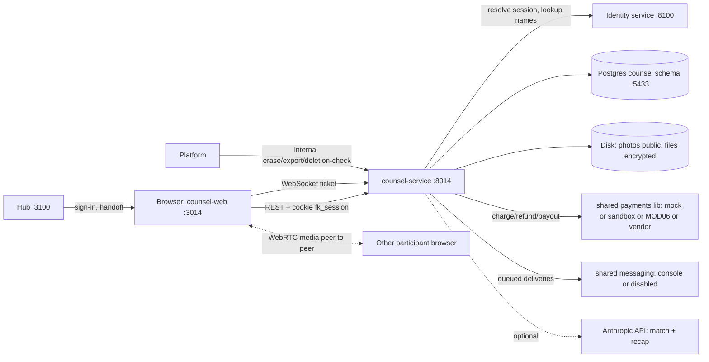
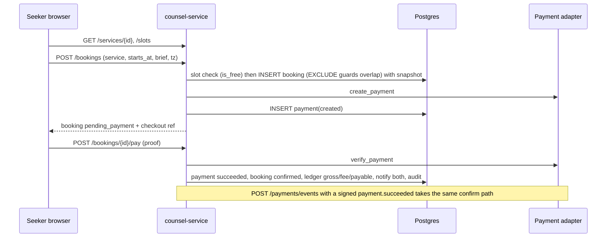
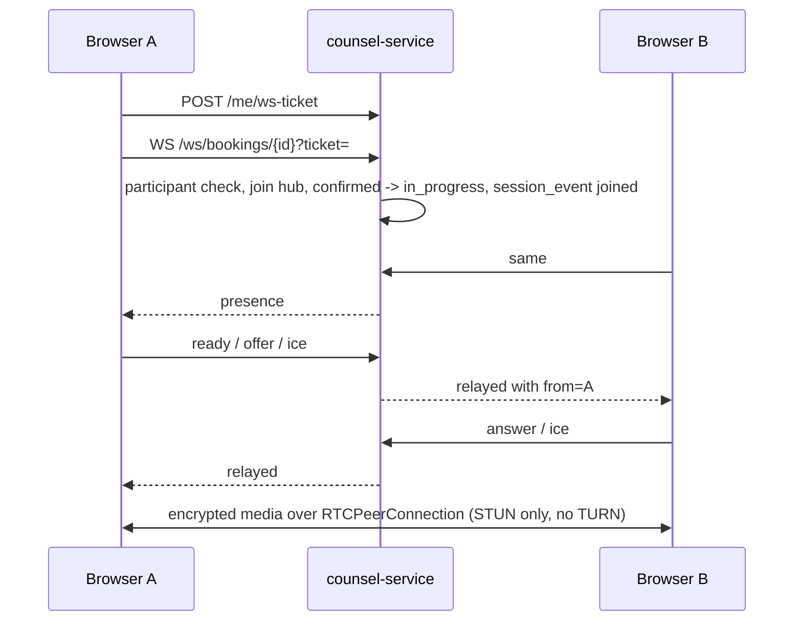

# MOD04 Counsel — Architecture

**Document status:** 2026-11-22, "as built".

## Contents
1 Components and ports · 2 Container diagram · 3 Key sequences · 4 Background jobs · 5 Realtime · 6 Storage · 7 Integrations and adapters · 8 Decisions

## 1. Components
| Component | Tech | Port | Notes |
|---|---|---|---|
| counsel-web | Next.js 16.3.5, React 19.2.8, i18next 26 / react-i18next 17, lucide-react; client-rendered pages | 3014 | `npm run dev` = `next dev -p 3014`; `proxy.ts` handles optional tunnel handoff |
| counsel-service | FastAPI 0.141.1 on uvicorn 0.52.4, pydantic 2.13.5, asyncpg 0.31, httpx 0.28, cryptography 46, websockets 15 (Python 3.12 per `__pycache__`) | 8014 (loopback) | One process; routers `me, discovery, provide, bookings, requests, offers, payments, room, admin, internal` |
| Postgres | schema `counsel` in database `counsel`, port 5433 | 5433 | pool max 20 (`DB_POOL_MAX`), app role `counsel_app` |
| Identity service (platform) | FastAPI | 8100 | resolves sessions `POST /internal/v1/sessions/resolve`, name lookup `POST /internal/v1/members/lookup` |
| ForKhatri hub (platform web) | Next.js | 3100 | sign-in, "act as (development)", account |
| shared/forkhatri-integrations | Python package (editable install) | - | payments gateways, messaging senders, delivery dispatcher |
| Local file store | disk at `STORAGE_ROOT` (default `counsel-service/.local-files`) | - | public photos, private encrypted files |

## 2. Container diagram

Media never touches the server; the server only relays WebRTC signalling.

## 3. Key sequences
**Book and pay**

**Room join**

**Completion and payout:** complete (or auto after 24 h) -> `payout_status=eligible` -> after `payout_hold_hours`, consultant `POST /provide/payouts` -> adapter `create_payout` -> payout row paid, ledger payout.

## 4. Background jobs (single in-process loop, every 60 s, `_housekeeping` in `main.py`)
expire_stale checkouts (15 min, or `pay_by`, or start passed) · auto_progress · send_reminders · purchases.expire (unanswered questions refund; expired packages refund unused; abandoned purchases cancelled after 30 min) · every 10th tick badges.refresh_all · every 60th tick privacy.apply_retention · outbound.dispatch_once. A failed iteration is logged and the loop continues. With several API instances every instance would run the loop (not designed for horizontal scale; room hub and ticket store are in-memory too).

## 5. Realtime
In-memory `workspace` hub: rooms keyed by booking id with sockets per member; `broadcast` and `send_to`; tickets in an in-memory dict (60 s, single-use); session cache in memory (30 s/5 s). All lost on restart; clients reconnect. WebRTC config comes from `ICE_SERVERS` (JSON list), default one Google STUN.

## 6. Storage
Public: `public/photos/{member}/{random}.ext`. Private: `private/evidence/{member}/...` and `{booking}/...`, content `CF1 | 12-byte nonce | AES-256-GCM`. Files saved before encryption keep `encrypted=false`. Path traversal guarded in `path_for`. ClamAV via TCP `INSTREAM` when `MALWARE_SCANNER=clamav` (refuses upload if scanner unreachable).

## 7. Integrations
| Adapter | Selected by | Today |
|---|---|---|
| Payments | `PAYMENT_PROVIDER` mock / sandbox / payment_services / vendor | mock on localhost; sandbox via shared lib; vendor none |
| Messaging senders | `SMS_PROVIDER` etc. | `console` (local), contact lookup missing -> skipped |
| AI | `AI_PROVIDER` rules / anthropic, `COUNSEL_AI_MODEL` (default `claude-sonnet-5`) | rules; key placeholder |
| Identity | `PLATFORM_IDENTITY_URL` | live |
| Malware scan | `MALWARE_SCANNER` none / clamav | none |
| Storage | local disk | object-store adapter not built |
Start-up guards: mock payments refused when API host is not loopback; `PAYOUT_ENCRYPTION_KEY` and `FILE_ENCRYPTION_KEY` must not contain CHANGE_ME when not loopback.

## 8. Decisions
D-A one process, one package per component, routers registered only in `main.py`. D-B money is explicit columns and a ledger, not price minus 2%. D-C price and cancellation snapshotted onto each booking. D-D no media server (owner 2026-09-30). D-E identity is platform-owned; Counsel keeps only a name cache. D-F application-layer authorisation, non-owning runtime role, no RLS (see 08).
